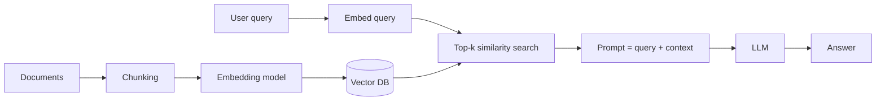

# 01. Naive (Basic) RAG

> **Category:** Foundational  
> **Core idea:** Index, retrieve top-k chunks by vector similarity, stuff them into the prompt, generate.  
> **Status:** Research collected. Implementation planned.

## Table of Contents

- [Overview](#overview)
- [Architecture](#architecture)
- [How It Works](#how-it-works)
- [When to Use](#when-to-use)
- [Limitations](#limitations)
- [Key Components](#key-components)
- [Research Papers](#research-papers)
- [Folder Structure](#folder-structure)
- [Navigation](#navigation)

## Overview

The baseline retrieve-then-read pipeline. Documents are split into chunks, embedded and stored in a vector database. At query time the question is embedded, the top-k most similar chunks are retrieved and passed as context to the LLM, which generates the answer. Every other architecture in this repo is an improvement on one or more stages of this pipeline.

## Architecture



## How It Works

1. Load documents (PDF, HTML, Markdown) and clean the text.
2. Split into fixed-size chunks with overlap.
3. Embed each chunk and store vectors plus metadata in a vector DB.
4. Embed the user query and retrieve the top-k nearest chunks.
5. Build a prompt with the retrieved context and generate the answer with source citations.

## When to Use

- Small, clean, single-domain corpus.
- First prototype and baseline for evaluation.

## Limitations

- Low precision: irrelevant chunks reach the prompt.
- No handling of ambiguous or multi-hop questions.
- Fixed chunking can split facts.

## Key Components

- Document loaders
- Text splitter
- Embedding model
- Vector DB
- Prompt template
- LLM
- RAGAS evaluation

## Research Papers

<table width="100%">
<thead><tr><th>#</th><th>Paper</th><th>Year</th><th>Venue / Org</th><th>arXiv</th><th>Local copy</th></tr></thead>
<tbody>
<tr><td>1</td><td>Retrieval-Augmented Generation for Knowledge-Intensive NLP Tasks</td><td>2020</td><td>NeurIPS 2020 (Meta AI)</td><td><a href="https://arxiv.org/abs/2005.11401">2005.11401</a></td><td><a href="papers/2005.11401_RAG-Lewis.pdf">PDF</a></td></tr>
</tbody>
</table>

## Folder Structure

```text
01-Naive-RAG/
├── README.md        # This file
└── papers/         # Research papers (PDF)
```

Implementation code (`src/`, `notebooks/`, `requirements.txt`) will be added when this architecture is built end to end.

## Navigation

[← RAG Surveys & Foundations](../00-RAG-Surveys-and-Foundations/) | [Home](../README.md) | [Advanced RAG →](../02-Advanced-RAG/)
