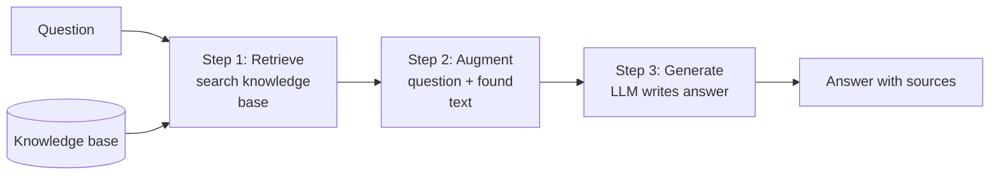
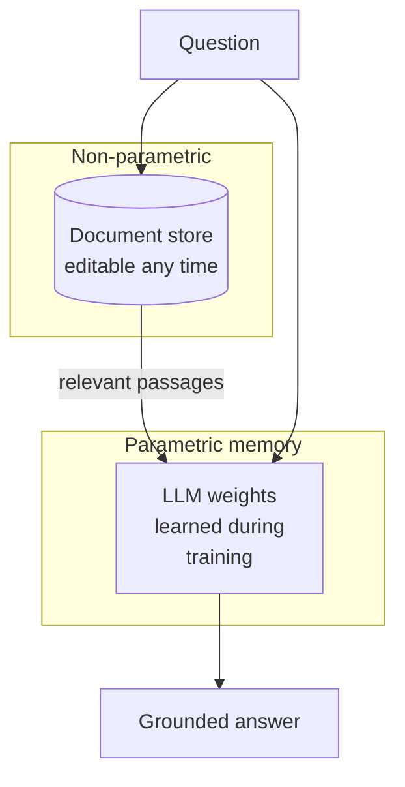

# 01. What is RAG

In this note:

- The definition of Retrieval-Augmented Generation (RAG) in plain words
- The open-book exam analogy
- Parametric memory and non-parametric memory
- The three stages: Retrieve, Augment, Generate
- RAG compared with fine-tuning and with long-context prompting

## Definition

**Retrieval-Augmented Generation (RAG)** is a way to make a Large Language Model (LLM) answer questions using information that you give it at question time, instead of only what it learned during training.

The name has three parts. Each part is one step of the method:

<table width="100%">
<thead><tr><th>Word</th><th>Meaning</th><th>What happens in the system</th></tr></thead>
<tbody>
<tr><td>Retrieval</td><td>Find and fetch</td><td>Search a knowledge base and pick the text pieces most related to the question.</td></tr>
<tr><td>Augmented</td><td>Added to, made bigger</td><td>Put the retrieved text into the prompt, next to the question.</td></tr>
<tr><td>Generation</td><td>Produce new text</td><td>The LLM writes the answer, using the added text as its source of facts.</td></tr>
</tbody>
</table>

## The open-book exam analogy

Think of two students taking an exam.

- **Closed-book student (plain LLM):** answers only from memory. If the memory is old or wrong, the answer is old or wrong, and the student may still sound confident. This is what we call a **hallucination**.
- **Open-book student (RAG):** first looks up the right pages in the textbook, then writes the answer using those pages. The answer is more accurate and the student can point to the page used.

RAG turns the LLM into the open-book student. The "textbook" is your document collection. The "looking up" is the retriever.

## Two kinds of memory

The original RAG paper (Lewis et al., 2020) describes RAG as a mix of two memories. This idea is the base of everything in this repository.

<table width="100%">
<thead><tr><th>Memory type</th><th>Where the knowledge lives</th><th>How to update it</th><th>Example</th><th>Strength</th><th>Weakness</th></tr></thead>
<tbody>
<tr><td>Parametric memory</td><td>Inside the model weights (parameters)</td><td>Retrain or fine-tune the model (slow, costly)</td><td>GPT, Claude, Llama weights</td><td>Fluent language, reasoning, general knowledge</td><td>Fixed at training time, can hallucinate, no sources</td></tr>
<tr><td>Non-parametric memory</td><td>Outside the model, in a searchable store of documents</td><td>Add, edit or delete documents (fast, cheap)</td><td>Vector database of company PDFs</td><td>Up to date, private data, traceable sources</td><td>Needs good search, adds latency</td></tr>
</tbody>
</table>

RAG combines both: the LLM gives the language skill, the document store gives the facts.

## A small example

Question: "What is the leave policy for new joiners at our company?"

1. A plain LLM has never seen your company HR policy. It either refuses or makes up an answer.
2. A RAG system searches the HR policy PDF, finds the paragraph "New joiners get 12 days of paid leave in the first year", adds it to the prompt and the LLM answers: "New joiners get 12 days of paid leave in the first year (source: HR Policy, section 4.2)."

## Why RAG is so widely used

<table width="100%">
<thead><tr><th>Problem with a plain LLM</th><th>How RAG solves it</th></tr></thead>
<tbody>
<tr><td>Knowledge cutoff: the model does not know events after its training date</td><td>Retrieve fresh documents at question time</td></tr>
<tr><td>No access to private data (emails, contracts, internal wikis)</td><td>Index private documents in your own store</td></tr>
<tr><td>Hallucination: confident but false answers</td><td>The model is told to answer only from retrieved text</td></tr>
<tr><td>No citations, hard to trust</td><td>Each answer can show which chunk it came from</td></tr>
<tr><td>Updating knowledge needs retraining</td><td>Update the document store, the model stays the same</td></tr>
<tr><td>Access control is hard inside model weights</td><td>Filter retrieved documents by user permissions</td></tr>
</tbody>
</table>

## RAG compared with other options

<table width="100%">
<thead><tr><th>Approach</th><th>How it adds knowledge</th><th>Cost to update</th><th>Gives sources</th><th>Best for</th></tr></thead>
<tbody>
<tr><td>Prompting only</td><td>Nothing added, uses model memory</td><td>None</td><td>No</td><td>General questions, creative tasks</td></tr>
<tr><td>RAG</td><td>Retrieves relevant text into the prompt per question</td><td>Low (re-index documents)</td><td>Yes</td><td>Large or changing knowledge, private data, factual Q and A</td></tr>
<tr><td>Fine-tuning</td><td>Changes model weights with training examples</td><td>High (new training run)</td><td>No</td><td>Teaching style, format, tone or a narrow skill</td></tr>
<tr><td>Long-context prompting</td><td>Pastes whole documents into the prompt</td><td>Low, but high cost per call</td><td>Partly</td><td>Small document sets that fit in the context window</td></tr>
</tbody>
</table>

A common rule: **use fine-tuning to change how the model behaves, use RAG to change what the model knows.** The two can be combined.

## Where Naive RAG fits

"Naive RAG" (also called basic or vanilla RAG) is the simplest version: one search, top-k chunks, one LLM call. It has no query rewriting, no re-ranking and no self-checking. All later folders in this repository improve one part of this simple pipeline. The rest of these notes explain each building block of Naive RAG.

## Key points

- RAG = Retrieve relevant text, Augment the prompt with it, Generate the answer.
- The LLM provides language skill (parametric memory). The document store provides facts (non-parametric memory).
- RAG reduces hallucination, adds private and fresh knowledge, and gives citations.
- Fine-tuning changes behaviour. RAG changes knowledge.

## Navigation

[Index](README.md) | Next: [02. Why LLMs Need RAG](02.%20Why%20LLMs%20Need%20RAG.md)
