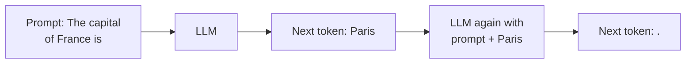
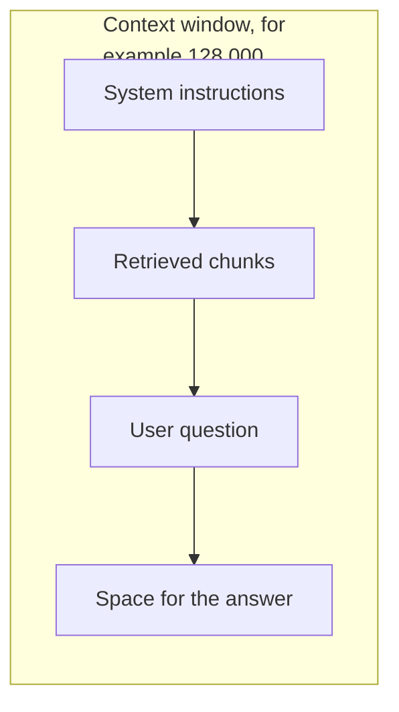

# 02. Why LLMs Need RAG

In this note:

- How an LLM produces text (next-token prediction)
- Tokens and the context window
- Knowledge cutoff
- Why hallucinations happen
- How each limitation maps to a RAG feature

## How an LLM writes text

A Large Language Model is a neural network trained on a huge amount of text. Its only job is to **predict the next token** given all previous tokens. It repeats this step again and again to write a full answer.

At each step the model gives a probability to every token in its vocabulary and picks one (the most likely one, or a random sample if temperature is above 0).

$$P(\text{next token} \mid \text{all previous tokens})$$

Read this as: "the probability of the next token, given all the tokens before it".

Important consequence: the model does not "look up" facts. It produces text that is **statistically likely**. If the right fact was rare or missing in training data, the likely-sounding text can still be wrong.

## Tokens

A **token** is a small piece of text: a word, part of a word, or a symbol. Models read and write tokens, not characters.

<table width="100%">
<thead><tr><th>Text</th><th>Possible tokens</th><th>Token count</th></tr></thead>
<tbody>
<tr><td>RAG is useful</td><td>RAG / is / useful</td><td>3</td></tr>
<tr><td>unbelievable</td><td>un / believ / able</td><td>3</td></tr>
<tr><td>2026-11-20</td><td>202 / 6 / - / 11 / - / 20</td><td>6</td></tr>
</tbody>
</table>

Rule of thumb for English: **1 token is about 4 characters, or about 0.75 words.** 1,000 tokens is about 750 words.

Tokens matter in RAG because:

- Chunk sizes are measured in tokens.
- The context window is measured in tokens.
- LLM API cost is charged per token (input and output).

## The context window

The **context window** is the maximum number of tokens the model can read in one call: system prompt + retrieved chunks + question + the answer it writes.

Why not paste every document into the window?

<table width="100%">
<thead><tr><th>Reason</th><th>Explanation</th></tr></thead>
<tbody>
<tr><td>Size limit</td><td>A company knowledge base can be millions of tokens. It does not fit.</td></tr>
<tr><td>Cost</td><td>You pay for every input token on every question.</td></tr>
<tr><td>Latency</td><td>More input tokens means slower answers.</td></tr>
<tr><td>Lost in the middle</td><td>Models pay less attention to facts buried in the middle of a very long prompt.</td></tr>
<tr><td>Noise</td><td>Irrelevant text can distract the model and lower answer quality.</td></tr>
</tbody>
</table>

RAG solves this by sending only the few most relevant chunks.

## Knowledge cutoff

The model only knows what was in its training data. The last date of that data is the **knowledge cutoff**. Anything newer (new product prices, a policy changed last week, today's news) is unknown to the model.

RAG fixes this because retrieval runs at question time on your current documents.

## Why hallucinations happen

A **hallucination** is an answer that sounds correct but is false or made up. Common causes:

<table width="100%">
<thead><tr><th>Cause</th><th>Simple explanation</th><th>RAG help</th></tr></thead>
<tbody>
<tr><td>Missing knowledge</td><td>The fact was never in training data, the model fills the gap with likely text</td><td>Supplies the fact in the prompt</td></tr>
<tr><td>Rare facts</td><td>Seen only a few times in training, weakly remembered</td><td>Supplies the exact source text</td></tr>
<tr><td>Outdated facts</td><td>Training data had an older value</td><td>Retrieves the current value</td></tr>
<tr><td>Pressure to answer</td><td>Models are trained to be helpful, so they rarely say "I do not know"</td><td>Prompt tells the model to say "I do not know" if the context has no answer</td></tr>
</tbody>
</table>

RAG reduces hallucinations but does not remove them. If retrieval returns the wrong chunk, the model can still give a wrong answer. That is why evaluation (note 11) matters.

## Limitation to RAG feature map

<table width="100%">
<thead><tr><th>LLM limitation</th><th>RAG component that addresses it</th><th>Note</th></tr></thead>
<tbody>
<tr><td>Knowledge cutoff</td><td>Indexing pipeline with fresh documents</td><td>03, 04</td></tr>
<tr><td>Small context window</td><td>Chunking and top-k retrieval</td><td>04, 08</td></tr>
<tr><td>Hallucination</td><td>Grounded prompt with instructions</td><td>09</td></tr>
<tr><td>No sources</td><td>Metadata stored with each chunk</td><td>03, 07</td></tr>
<tr><td>Private data</td><td>Your own vector database</td><td>07</td></tr>
</tbody>
</table>

## Key points

- An LLM predicts the next token. It writes likely text, not looked-up facts.
- Tokens are the unit for chunk size, context window and cost.
- The context window is limited, expensive and noisy when overfilled.
- RAG sends only relevant text, which keeps answers current, grounded and cheaper.

## Navigation

Previous: [01. What is RAG](01.%20What%20is%20RAG.md) | [Index](README.md) | Next: [03. Document Loading and Parsing](03.%20Document%20Loading%20and%20Parsing.md)
