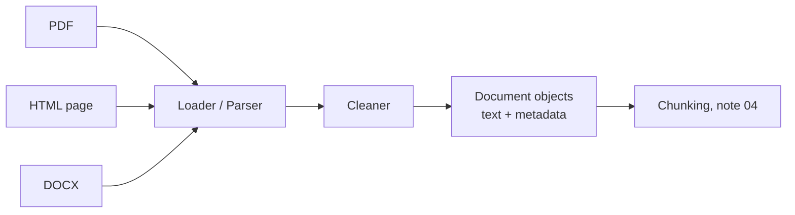
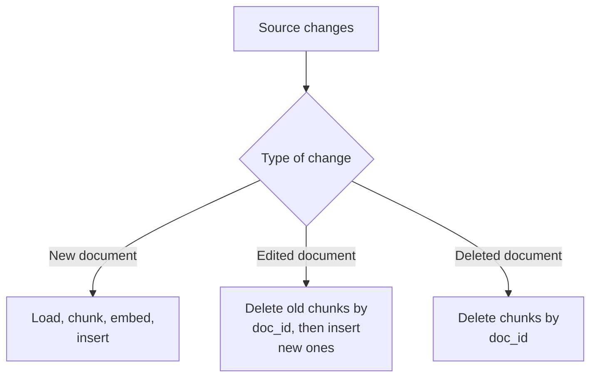

# 03. Document Loading and Parsing

In this note:

- What the knowledge base is
- Loading different file types
- Parsing and cleaning text
- Metadata and why every chunk needs it
- Common problems and how to handle them

## The knowledge base

The **knowledge base** (also called the corpus) is the set of documents the RAG system can answer from. It is the "textbook" in the open-book exam analogy.

Typical sources:

<table width="100%">
<thead><tr><th>Source type</th><th>Examples</th><th>Typical loader approach</th></tr></thead>
<tbody>
<tr><td>Files</td><td>PDF, DOCX, PPTX, TXT, Markdown, CSV</td><td>File parsers (pypdf, PyMuPDF, python-docx, Unstructured)</td></tr>
<tr><td>Web</td><td>Websites, documentation portals, blogs</td><td>HTTP fetch + HTML to text (BeautifulSoup, trafilatura)</td></tr>
<tr><td>Collaboration tools</td><td>Confluence, Notion, Google Drive, SharePoint</td><td>Official APIs or connectors</td></tr>
<tr><td>Databases</td><td>SQL tables, product catalogs, tickets</td><td>Query rows and turn each row into text</td></tr>
<tr><td>Code</td><td>Git repositories</td><td>Read files, split by function or class</td></tr>
</tbody>
</table>

## The loading step

**Loading** means reading the raw source and turning it into plain text plus metadata. In frameworks like LangChain or LlamaIndex, the result of loading is a list of `Document` objects:

```python
Document(
    page_content="New joiners get 12 days of paid leave in the first year...",
    metadata={"source": "hr_policy.pdf", "page": 4, "section": "4.2 Leave"}
)
```



## Parsing: getting clean text out

Different formats hide text in different ways. Parsing quality directly limits RAG quality: **if the text is broken here, no later step can fix it.**

<table width="100%">
<thead><tr><th>Format</th><th>Common parsing problem</th><th>What to do</th></tr></thead>
<tbody>
<tr><td>PDF (digital)</td><td>Columns read in the wrong order, headers and footers repeated on every page</td><td>Use a layout-aware parser, remove repeated header and footer lines</td></tr>
<tr><td>PDF (scanned)</td><td>No text layer, only images</td><td>Run OCR (Tesseract, cloud OCR) first</td></tr>
<tr><td>Tables</td><td>Rows and columns flatten into a jumble of words</td><td>Extract tables separately, convert to Markdown or "column: value" lines</td></tr>
<tr><td>HTML</td><td>Menus, ads, cookie banners mixed with content</td><td>Keep only the main article content</td></tr>
<tr><td>Slides</td><td>Very short text, meaning carried by layout</td><td>Join slide title with its bullets, include speaker notes</td></tr>
<tr><td>Images and charts</td><td>Information not in text at all</td><td>Caption with a vision model, or use Multimodal RAG (folder 18)</td></tr>
</tbody>
</table>

## Cleaning

After parsing, clean the text:

1. Fix broken words from line breaks (for example "infor- mation" to "information").
2. Normalise whitespace (many spaces or blank lines to one).
3. Remove boilerplate: page numbers, repeated headers, legal footers.
4. Fix encoding errors (strange characters from bad conversions).
5. Remove exact duplicate documents, so the same text is not retrieved several times.

Do not over-clean. Headings, list markers and table structure help both chunking and the LLM.

## Metadata

**Metadata** is data about the text: where it came from and what it is. It is stored next to each chunk in the vector database.

<table width="100%">
<thead><tr><th>Metadata field</th><th>Example</th><th>Used for</th></tr></thead>
<tbody>
<tr><td>source</td><td>hr_policy.pdf</td><td>Citations in the answer</td></tr>
<tr><td>page / section</td><td>page 4, section 4.2</td><td>Precise citations, jump to source</td></tr>
<tr><td>title</td><td>Leave Policy 2026</td><td>Adding context to the chunk, display</td></tr>
<tr><td>created_at / updated_at</td><td>2026-03-01</td><td>Filter old documents, prefer recent ones</td></tr>
<tr><td>department / product</td><td>HR</td><td>Metadata filtering at search time</td></tr>
<tr><td>access_level</td><td>employees_only</td><td>Security: only show chunks a user may see</td></tr>
<tr><td>doc_id / chunk_id</td><td>hr_policy_p4_c2</td><td>Updates and deletes during re-indexing</td></tr>
</tbody>
</table>

## Keeping the index up to date

Documents change. The indexing pipeline must handle:



A hash of each document's content helps detect whether it really changed, so unchanged documents are not embedded again (embedding costs money and time).

## Key points

- Loading turns raw files into text plus metadata.
- Parsing quality limits the whole system. Bad text in means bad answers out.
- Tables, scans and images need special handling.
- Always store metadata: it powers citations, filtering, security and updates.

## Navigation

Previous: [02. Why LLMs Need RAG](02.%20Why%20LLMs%20Need%20RAG.md) | [Index](README.md) | Next: [04. Chunking](04.%20Chunking.md)
