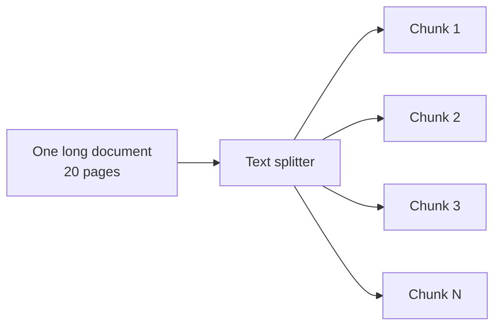
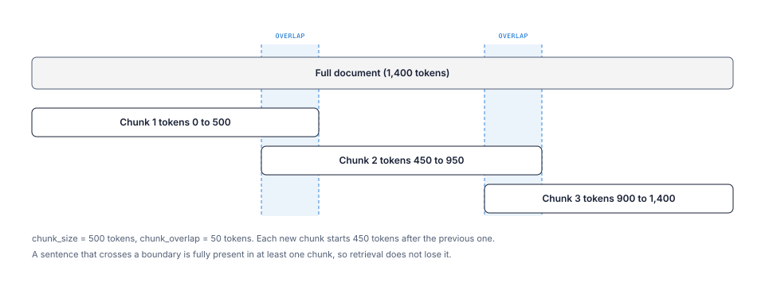
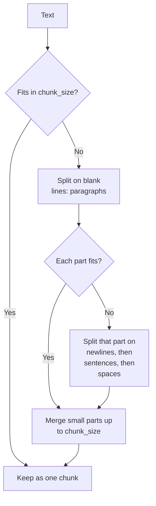

# 04. Chunking

In this note:

- What a chunk is and why we split documents
- Chunk size and chunk overlap
- Chunking strategies compared
- How to choose a chunk size
- A worked example

## What is chunking

**Chunking** means splitting a long document into smaller pieces called **chunks**. Each chunk is embedded and stored separately, and retrieval returns chunks, not whole documents.

## Why we split documents

<table width="100%">
<thead><tr><th>Reason</th><th>Explanation</th></tr></thead>
<tbody>
<tr><td>Embedding models have input limits</td><td>Many embedding models accept only 512 to 8,192 tokens. A 50-page PDF does not fit.</td></tr>
<tr><td>One vector cannot hold many topics</td><td>An embedding is one point in space. A whole document about ten topics becomes a blurry average that matches nothing well.</td></tr>
<tr><td>Precise retrieval</td><td>Small, focused chunks match a specific question better.</td></tr>
<tr><td>Context window and cost</td><td>Sending 5 small chunks is cheaper and cleaner than sending 5 full documents.</td></tr>
<tr><td>Better citations</td><td>The answer can point to an exact paragraph.</td></tr>
</tbody>
</table>

## Chunk size and chunk overlap

Two settings control most splitters:

- **chunk_size**: the maximum length of one chunk (in tokens or characters).
- **chunk_overlap**: how much text at the end of one chunk is repeated at the start of the next.

Why overlap? A sentence or idea that falls on a chunk boundary would be cut in half. With overlap, it appears whole in at least one chunk. A common starting point is overlap = 10 to 20 percent of chunk size.

The step between chunk starts is:

$$\text{step} = \text{chunk size} - \text{chunk overlap}$$

The number of chunks for a document of length $L$ is about:

$$\text{number of chunks} \approx \left\lceil \frac{L - \text{overlap}}{\text{chunk size} - \text{overlap}} \right\rceil$$

Example: $L = 1400$ tokens, chunk size 500, overlap 50. Step = 450. Chunks = ceil((1400 - 50) / 450) = ceil(3) = 3 chunks, starting at tokens 0, 450 and 900.

## The chunk size trade-off

<table width="100%">
<thead><tr><th>Chunk size</th><th>Good</th><th>Bad</th><th>Good for</th></tr></thead>
<tbody>
<tr><td>Small (100 to 256 tokens)</td><td>Very precise match, little noise</td><td>Loses surrounding context, answer may need several chunks</td><td>FAQs, definitions, short facts</td></tr>
<tr><td>Medium (256 to 768 tokens)</td><td>Balance of precision and context</td><td>Needs tuning per corpus</td><td>Most documents, the usual default</td></tr>
<tr><td>Large (1,000+ tokens)</td><td>Rich context, fewer chunks</td><td>Blurry embedding, more noise, higher cost per question</td><td>Narrative text, legal clauses that must stay whole</td></tr>
</tbody>
</table>

The original RAG paper used **100-word chunks** of Wikipedia (21 million chunks). Today 300 to 800 tokens is a common starting range. Always measure with your own evaluation set (note 11).

## Chunking strategies

<table width="100%">
<thead><tr><th>Strategy</th><th>How it splits</th><th>Pros</th><th>Cons</th></tr></thead>
<tbody>
<tr><td>Fixed-size</td><td>Every N characters or tokens</td><td>Simple, fast, predictable</td><td>Cuts sentences and ideas in the middle</td></tr>
<tr><td>Recursive character</td><td>Try to split on paragraphs, then lines, then sentences, then words, until under the size limit</td><td>Keeps natural boundaries, strong default</td><td>Still size-driven, not meaning-driven</td></tr>
<tr><td>Sentence-based</td><td>Group whole sentences until the size limit</td><td>Never cuts a sentence</td><td>Sentence detection can fail on lists and code</td></tr>
<tr><td>Document-structure</td><td>Split by Markdown headings, HTML tags, PDF sections, code functions</td><td>Chunks match real sections, great metadata</td><td>Needs clean structure in the source</td></tr>
<tr><td>Semantic</td><td>Embed sentences, split where meaning changes (similarity drops)</td><td>Topic-coherent chunks</td><td>Slower, costs embedding calls at indexing</td></tr>
<tr><td>Small-to-big / parent-child</td><td>Index small chunks, return their larger parent at query time</td><td>Precise match plus full context</td><td>More storage and logic (see folder 06)</td></tr>
</tbody>
</table>

### How recursive splitting works

This is the default splitter in many frameworks (for example `RecursiveCharacterTextSplitter` in LangChain) because it respects natural text boundaries.

## Worked example

Document text:

> Section 4.2 Leave. New joiners get 12 days of paid leave in the first year. Leave must be approved by the line manager. Section 4.3 Sick leave. Employees get 8 sick days per year. A doctor's note is needed after 2 days.

With a small chunk size and splitting on sections:

<table width="100%">
<thead><tr><th>Chunk id</th><th>Text</th><th>Metadata</th></tr></thead>
<tbody>
<tr><td>hr_c1</td><td>Section 4.2 Leave. New joiners get 12 days of paid leave in the first year. Leave must be approved by the line manager.</td><td>source=hr_policy.pdf, section=4.2</td></tr>
<tr><td>hr_c2</td><td>Section 4.3 Sick leave. Employees get 8 sick days per year. A doctor's note is needed after 2 days.</td><td>source=hr_policy.pdf, section=4.3</td></tr>
</tbody>
</table>

The question "How many sick days do I get?" now matches hr_c2 strongly. With one big chunk, the leave and sick-leave facts would be mixed in one vector.

## Practical tips

- Start with recursive splitting, 500 tokens, 50 overlap. Then tune.
- Keep the section heading inside each chunk (or in metadata). It gives the chunk context.
- Never split tables row by row without repeating the header.
- Measure chunk size in tokens of the embedding model, not characters, when precision matters.
- Re-run evaluation after any chunking change. Chunking often has a bigger effect than the choice of embedding model.

## Key points

- Chunking splits documents into focused pieces so retrieval is precise and fits limits.
- chunk_size and chunk_overlap are the two main settings.
- Small chunks are precise but lose context. Large chunks keep context but add noise.
- Recursive and structure-based splitting are strong defaults.

## Navigation

Previous: [03. Document Loading and Parsing](03.%20Document%20Loading%20and%20Parsing.md) | [Index](README.md) | Next: [05. Embeddings](05.%20Embeddings.md)
