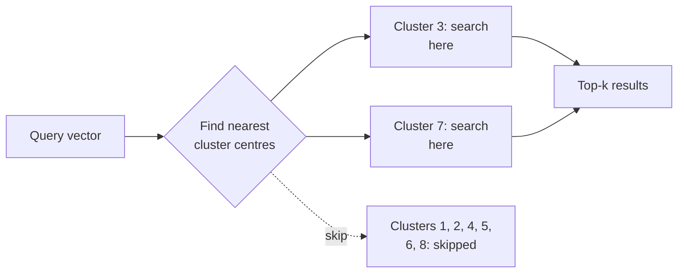
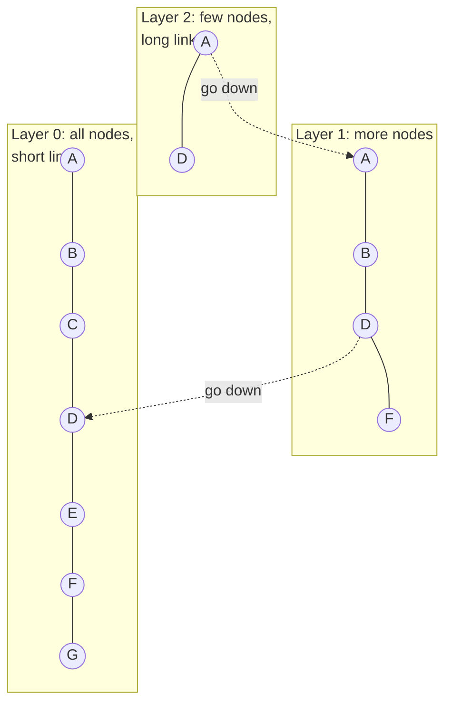
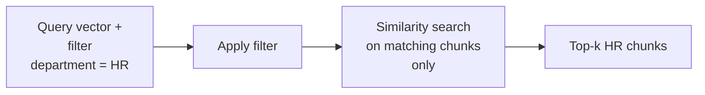

# 07. Vector Databases and Indexing

In this note:

- What a vector database stores
- Exact search (flat) and why it gets slow
- Approximate Nearest Neighbour (ANN) search
- Index types: Flat, IVF, HNSW, PQ, explained simply
- Metadata filtering
- Popular vector databases compared

## What a vector database is

A **vector database** stores vectors and finds the ones closest to a query vector, fast. For RAG, each record holds:

<table width="100%">
<thead><tr><th>Field</th><th>Example</th><th>Purpose</th></tr></thead>
<tbody>
<tr><td>id</td><td>hr_policy_p4_c2</td><td>Unique key for updates and deletes</td></tr>
<tr><td>vector</td><td>[0.12, -0.48, ..., 0.07] (768 numbers)</td><td>Used for similarity search</td></tr>
<tr><td>text</td><td>Employees get 8 sick days per year...</td><td>Sent to the LLM as context</td></tr>
<tr><td>metadata</td><td>{source: hr_policy.pdf, page: 4}</td><td>Citations and filters</td></tr>
</tbody>
</table>

## Exact search (flat index)

The simplest way: compare the query vector with **every** stored vector and keep the top-k. This is called **brute-force** or **flat** search.

- Always finds the true best results (100 percent recall).
- Cost grows linearly with the number of vectors: with $N$ vectors of dimension $d$, one query costs about $N \times d$ multiplications.

Example: 21 million chunks x 768 dimensions = about 16 billion multiplications per question. Too slow for interactive use on a CPU. (21 million is the size of the Wikipedia index in the RAG paper.)

Rule of thumb: flat search is fine up to around 100,000 vectors. Beyond that, use an ANN index.

## Approximate Nearest Neighbour (ANN)

**ANN** indexes trade a tiny bit of accuracy for a huge gain in speed. They organise vectors so a query only checks a small part of the collection.

- **Recall@k** of an index = share of the true top-k results that the ANN search actually returns. Good indexes reach 95 to 99 percent recall while being 100 to 1000 times faster.
- The RAG paper calls this "sub-linear time" search: cost grows much slower than $N$.

## Index types

### IVF (Inverted File index)

Idea: group vectors into clusters, then search only the closest clusters.

1. At build time, run k-means to make, for example, 1,000 cluster centres. Each vector is stored in the list of its nearest centre.
2. At query time, find the `nprobe` closest centres (for example 10) and search only their lists.

Setting `nprobe` higher means better recall but slower search.

### HNSW (Hierarchical Navigable Small World)

Idea: build a multi-layer graph where each vector links to its near neighbours. Search starts at the top layer (few nodes, long jumps) and moves down to the bottom layer (all nodes, short steps), always walking toward the query. It works like finding a house: country, then city, then street, then door.

- Very fast and very accurate. The default in most vector databases.
- Uses more memory (stores the graph links).
- Key settings: `M` (links per node), `ef_construction` (build quality), `ef_search` (search breadth: higher means better recall, slower).
- The RAG paper used FAISS with an HNSW index over 21 million Wikipedia chunks.

### PQ (Product Quantization)

Idea: **compress** vectors to save memory. Split each vector into small parts and replace each part with the id of the closest entry in a small codebook. A 768-dimension float32 vector (3,072 bytes) can shrink to 64 or 96 bytes.

- Big memory savings, small accuracy loss.
- Often combined: IVF-PQ, or HNSW with PQ.
- The RAG paper compressed its index from about 100 GB to 36 GB with FAISS compression.

### Comparison

<table width="100%">
<thead><tr><th>Index</th><th>Idea</th><th>Speed</th><th>Recall</th><th>Memory</th><th>Good for</th></tr></thead>
<tbody>
<tr><td>Flat</td><td>Compare with every vector</td><td>Slow at scale</td><td>100 percent</td><td>Raw vectors</td><td>Under 100K vectors, ground truth for testing</td></tr>
<tr><td>IVF</td><td>Search only nearest clusters</td><td>Fast</td><td>High (tune nprobe)</td><td>Raw vectors + centres</td><td>Large collections, batch updates</td></tr>
<tr><td>HNSW</td><td>Walk a layered neighbour graph</td><td>Very fast</td><td>Very high</td><td>Raw vectors + graph (higher)</td><td>Default for most RAG systems</td></tr>
<tr><td>PQ</td><td>Compress vectors into short codes</td><td>Fast</td><td>Lower</td><td>Very low</td><td>Billions of vectors, memory limits</td></tr>
</tbody>
</table>

## Metadata filtering

Often you want to search only some documents: "only HR documents", "only documents from 2026", "only what this user may see". Vector databases support **filters** on metadata.

Filtering is essential for **multi-tenant** and **access-controlled** systems: never rely on the LLM to hide information it should not see. Filter it out before retrieval results reach the prompt.

## Popular vector stores

<table width="100%">
<thead><tr><th>Name</th><th>Type</th><th>Hosting</th><th>Index types</th><th>Notes</th></tr></thead>
<tbody>
<tr><td>FAISS</td><td>Library (not a database)</td><td>In your process</td><td>Flat, IVF, HNSW, PQ</td><td>By Meta. Used in the RAG paper. No metadata storage by itself.</td></tr>
<tr><td>Chroma</td><td>Embedded database</td><td>Local or server</td><td>HNSW</td><td>Very easy for prototypes and learning</td></tr>
<tr><td>Qdrant</td><td>Vector database</td><td>Self-host or cloud</td><td>HNSW</td><td>Strong filtering, written in Rust</td></tr>
<tr><td>Weaviate</td><td>Vector database</td><td>Self-host or cloud</td><td>HNSW</td><td>Built-in hybrid search and modules</td></tr>
<tr><td>Milvus</td><td>Vector database</td><td>Self-host or cloud (Zilliz)</td><td>IVF, HNSW, PQ, DiskANN</td><td>Built for very large scale</td></tr>
<tr><td>Pinecone</td><td>Managed service</td><td>Cloud only</td><td>Proprietary</td><td>No servers to manage</td></tr>
<tr><td>pgvector</td><td>PostgreSQL extension</td><td>Anywhere Postgres runs</td><td>IVFFlat, HNSW</td><td>Keep vectors next to your relational data</td></tr>
<tr><td>Elasticsearch / OpenSearch</td><td>Search engine</td><td>Self-host or cloud</td><td>HNSW + BM25</td><td>Good when you already run it, strong hybrid search</td></tr>
</tbody>
</table>

## Key points

- A vector database stores id, vector, text and metadata for each chunk.
- Flat search is exact but slow at scale. ANN indexes are approximate but very fast.
- HNSW is the common default. IVF clusters, PQ compresses.
- Use metadata filters for scoping and security.

## Navigation

Previous: [06. Similarity Measures](06.%20Similarity%20Measures.md) | [Index](README.md) | Next: [08. Retrieval](08.%20Retrieval.md)
