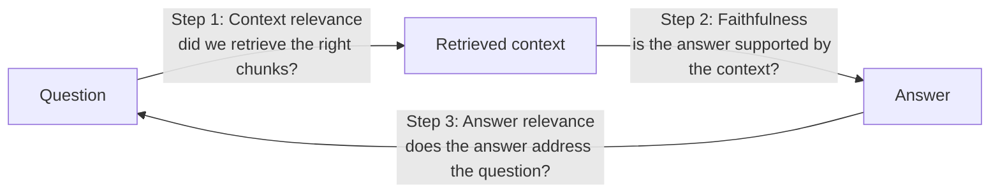
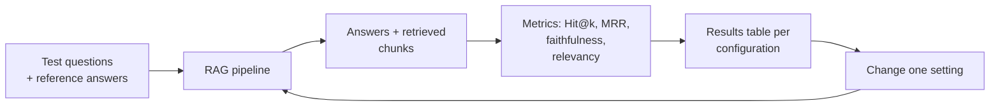

# 11. Evaluation Basics

In this note:

- Why RAG needs its own evaluation
- The RAG triad: context relevance, faithfulness, answer relevance
- Retrieval metrics with formulas and a worked example
- Generation metrics (RAGAS)
- How to build a small test set
- Classic text metrics used in the RAG paper

## Why evaluate

A RAG answer can fail in two places: retrieval brought the wrong chunks, or the LLM misused good chunks. Without measuring both, you cannot tell which part to fix. Every later architecture in this repository is compared with the Naive RAG baseline using the same metrics.

## The RAG triad

<table width="100%">
<thead><tr><th>Check</th><th>Question it asks</th><th>Low score means</th><th>Fix area</th></tr></thead>
<tbody>
<tr><td>Context relevance</td><td>Are the retrieved chunks about the question?</td><td>Retrieval problem</td><td>Chunking, embeddings, k, hybrid search</td></tr>
<tr><td>Faithfulness (groundedness)</td><td>Is every claim in the answer backed by the context?</td><td>Hallucination</td><td>Prompt rules, temperature, model choice</td></tr>
<tr><td>Answer relevance</td><td>Does the answer actually respond to the question?</td><td>Off-topic or vague answers</td><td>Prompt format, model choice</td></tr>
</tbody>
</table>

## Retrieval metrics

These need a test set where you know which chunks are relevant for each question.

### Hit rate (Hit@k)

Did **at least one** relevant chunk appear in the top-k?

$$\text{Hit@k} = \frac{\text{number of questions with at least one relevant chunk in top-}k}{\text{total questions}}$$

### Recall@k

What share of **all** relevant chunks did we find in the top-k?

$$\text{Recall@k} = \frac{|\text{relevant} \cap \text{retrieved top-}k|}{|\text{relevant}|}$$

### Precision@k

What share of the top-k results are relevant?

$$\text{Precision@k} = \frac{|\text{relevant} \cap \text{retrieved top-}k|}{k}$$

### MRR (Mean Reciprocal Rank)

How high is the **first** relevant chunk? If it is at rank $r$, the reciprocal rank is $1/r$. Average over questions:

$$\text{MRR} = \frac{1}{|Q|} \sum_{i=1}^{|Q|} \frac{1}{\text{rank}_i}$$

### Worked example

Three questions, k = 4. "R" marks a relevant chunk.

<table width="100%">
<thead><tr><th>Question</th><th>Relevant chunks total</th><th>Top-4 results</th><th>Hit@4</th><th>Recall@4</th><th>Precision@4</th><th>Reciprocal rank</th></tr></thead>
<tbody>
<tr><td>Q1</td><td>1</td><td>R, x, x, x</td><td>1</td><td>1/1 = 1.00</td><td>1/4 = 0.25</td><td>1/1 = 1.00</td></tr>
<tr><td>Q2</td><td>2</td><td>x, R, x, x</td><td>1</td><td>1/2 = 0.50</td><td>1/4 = 0.25</td><td>1/2 = 0.50</td></tr>
<tr><td>Q3</td><td>1</td><td>x, x, x, x</td><td>0</td><td>0/1 = 0.00</td><td>0/4 = 0.00</td><td>0</td></tr>
<tr><td>Average</td><td>-</td><td>-</td><td>0.67</td><td>0.50</td><td>0.17</td><td>MRR = 0.50</td></tr>
</tbody>
</table>

Reading: we find something useful for 2 of 3 questions, but only half of all relevant chunks, and the first relevant chunk is on average at rank 2.

## Generation metrics (RAGAS)

RAGAS (paper in folder 00) uses an LLM as a judge to score answers without needing a hand-written reference for every metric.

<table width="100%">
<thead><tr><th>Metric</th><th>How it is computed (simplified)</th><th>Needs reference answer</th></tr></thead>
<tbody>
<tr><td>Faithfulness</td><td>Split the answer into claims. Check each claim against the context. Score = supported claims / total claims.</td><td>No</td></tr>
<tr><td>Answer relevancy</td><td>Generate questions from the answer, embed them, compare with the real question. Similar = relevant.</td><td>No</td></tr>
<tr><td>Context precision</td><td>Are relevant chunks ranked above irrelevant ones?</td><td>Yes (or a judge)</td></tr>
<tr><td>Context recall</td><td>Can each sentence of the reference answer be found in the retrieved context?</td><td>Yes</td></tr>
<tr><td>Answer correctness</td><td>Compare the answer with the reference answer (facts + similarity)</td><td>Yes</td></tr>
</tbody>
</table>

Faithfulness example: answer "You get 8 sick days [1] and 20 days of paid leave." Context says 8 sick days and 12 days of paid leave. Claim 1 supported, claim 2 not. Faithfulness = 1/2 = 0.5.

## Building a small test set

1. Collect 30 to 100 real or realistic questions.
2. For each, write the reference answer and note the source chunk ids.
3. Include hard cases: questions with no answer in the documents, multi-part questions, questions using synonyms or codes.
4. Optional: generate extra questions with an LLM from your chunks, then review them by hand.
5. Run the pipeline, compute metrics, save results with the settings used (chunk size, k, models).

Change **one** setting at a time so you know what caused the change.

## Classic text metrics (used in the RAG paper)

<table width="100%">
<thead><tr><th>Metric</th><th>Plain meaning</th><th>Used in RAG paper for</th></tr></thead>
<tbody>
<tr><td>Exact Match (EM)</td><td>1 if the answer equals the reference after normalising case and punctuation, else 0</td><td>Open-domain QA (NQ, TriviaQA, WebQuestions, CuratedTrec)</td></tr>
<tr><td>BLEU-1</td><td>Share of answer words that also appear in the reference (word overlap, precision)</td><td>MS-MARCO, Jeopardy</td></tr>
<tr><td>ROUGE-L</td><td>Length of the longest common word sequence between answer and reference</td><td>MS-MARCO</td></tr>
<tr><td>Q-BLEU-1</td><td>BLEU variant that gives more weight to matching entities, for question generation</td><td>Jeopardy question generation</td></tr>
<tr><td>Label accuracy</td><td>Share of correct class labels</td><td>FEVER fact verification</td></tr>
</tbody>
</table>

These overlap metrics are cheap but miss meaning (a correct answer in different words scores low). Modern RAG evaluation adds LLM-as-judge metrics like RAGAS and human review.

## Key points

- Measure retrieval and generation separately so you know what to fix.
- Retrieval: Hit@k, Recall@k, Precision@k, MRR.
- Generation: faithfulness, answer relevancy, context precision and recall (RAGAS).
- Build a small labelled test set and change one setting at a time.

## Navigation

Previous: [10. Naive RAG Architecture End to End](10.%20Naive%20RAG%20Architecture%20End%20to%20End.md) | [Index](README.md) | Next: [12. Limitations of Naive RAG](12.%20Limitations%20of%20Naive%20RAG.md)
