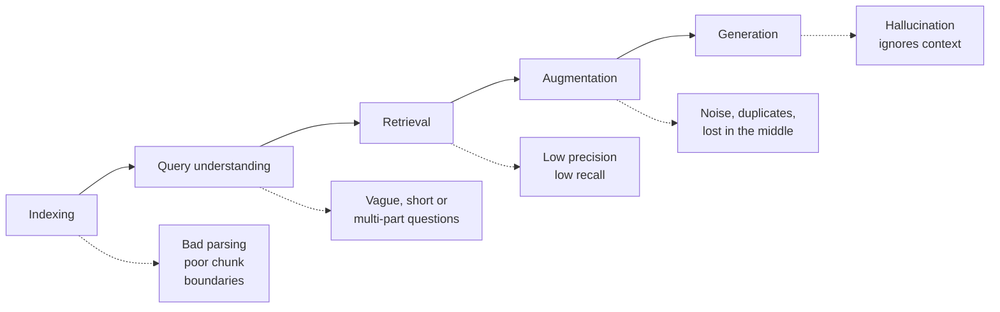

# 12. Limitations of Naive RAG

In this note:

- Where Naive RAG fails, grouped by pipeline stage
- Examples for each failure
- Which folder in this repository fixes each failure

## Failure points by stage

## Detailed failure table

<table width="100%">
<thead><tr><th>Stage</th><th>Failure</th><th>Example</th><th>Fixed by folder</th></tr></thead>
<tbody>
<tr><td>Indexing</td><td>Facts split across chunk boundaries</td><td>A rule and its exception land in different chunks</td><td>06 Contextual Chunking, 07 RAPTOR</td></tr>
<tr><td>Indexing</td><td>Chunk loses its context</td><td>Chunk says "it costs 20 dollars" with no product name</td><td>06 Contextual Chunking</td></tr>
<tr><td>Indexing</td><td>Tables, images and scans unreadable</td><td>Pricing table flattened into noise</td><td>18 Multimodal RAG</td></tr>
<tr><td>Query</td><td>Vague or conversational question</td><td>"What about the other one?"</td><td>02 Advanced RAG (query rewriting)</td></tr>
<tr><td>Query</td><td>Words differ from document words</td><td>"PTO" vs "paid leave"</td><td>04 HyDE, 05 RAG Fusion</td></tr>
<tr><td>Query</td><td>Every question uses the same pipeline</td><td>"Hi" triggers a full retrieval</td><td>10 Adaptive RAG</td></tr>
<tr><td>Retrieval</td><td>Exact codes and names missed</td><td>"Error E-4021" not matched by dense vectors</td><td>03 Hybrid Search</td></tr>
<tr><td>Retrieval</td><td>Correct chunk ranked too low</td><td>Answer at rank 7 with k = 4</td><td>02 Advanced RAG (re-ranking)</td></tr>
<tr><td>Retrieval</td><td>Multi-hop questions</td><td>"Who leads the team that built product X?"</td><td>11 Iterative RAG, 13 Graph RAG, 15 HippoRAG</td></tr>
<tr><td>Retrieval</td><td>Whole-corpus questions</td><td>"What are the main themes across all reports?"</td><td>13 Graph RAG, 07 RAPTOR</td></tr>
<tr><td>Retrieval</td><td>Nothing relevant in the knowledge base</td><td>Question about yesterday's news</td><td>09 Corrective RAG (web fallback)</td></tr>
<tr><td>Augmentation</td><td>Too much noise in the prompt</td><td>3 of 5 chunks unrelated</td><td>02 Advanced RAG (compression), 08 Self RAG</td></tr>
<tr><td>Generation</td><td>Answer not supported by context</td><td>Model adds facts from memory</td><td>08 Self RAG, 09 Corrective RAG</td></tr>
<tr><td>Generation</td><td>No self-check</td><td>Wrong answer returned with confidence</td><td>08 Self RAG</td></tr>
<tr><td>System</td><td>Cannot use tools or several sources</td><td>Needs SQL data plus documents</td><td>16 Agentic RAG</td></tr>
<tr><td>System</td><td>Hard to change parts</td><td>Swapping the retriever needs a rewrite</td><td>22 Modular RAG</td></tr>
</tbody>
</table>

## The three big gaps

1. **No query understanding.** The raw question goes straight to search. Advanced RAG adds rewriting, expansion and routing.
2. **One-shot retrieval.** One search, no second chance. Iterative, Corrective and Agentic RAG search again when needed.
3. **No verification.** Nothing checks whether the chunks were relevant or the answer is supported. Self RAG and Corrective RAG add graders.

## Why still start with Naive RAG

- It is the **baseline**: every improvement is measured against it.
- It is simple, fast and cheap, and works well on clean, focused document sets.
- Most production systems are Naive RAG plus two or three targeted upgrades, chosen by measuring where it fails.

## Key points

- Naive RAG can fail at indexing, query, retrieval, augmentation and generation.
- Each failure maps to a specific later architecture in this repository.
- Build Naive RAG first, measure it, then add only the upgrades your failures need.

## Measured in this project

These limitations were measured on the implementation in this folder: context precision 0.41, missed retrieval on similar papers, exact names lost by dense search, no memory for follow-ups. The evidence, root causes and fixes are in [API doc 28. Naive RAG Limitations, Lessons and Next Steps](../../03.%20API/docs/28.%20Naive%20RAG%20Limitations%2C%20Lessons%20and%20Next%20Steps.md).

## Navigation

Previous: [11. Evaluation Basics](11.%20Evaluation%20Basics.md) | [Index](README.md) | Next: [13. Glossary](13.%20Glossary.md)
