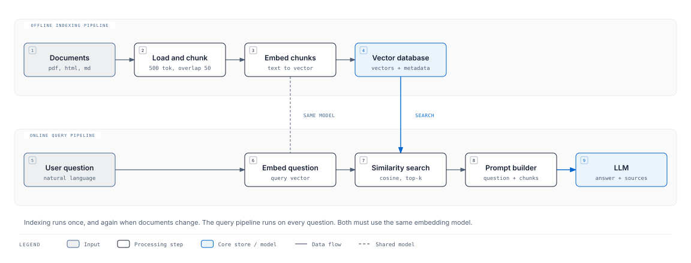

# Naive RAG: Basic Concepts

These notes explain every building block of a basic (Naive) RAG system in simple terms, with diagrams, formulas and worked examples. Read them in order. Each note ends with links to the previous and next note.

## How the notes connect

```mermaid
flowchart LR
    N1[01 What is RAG] --> N2[02 Why LLMs need RAG]
    N2 --> N3[03 Loading and<br/>parsing]
    N3 --> N4[04 Chunking]
    N4 --> N5[05 Embeddings]
    N5 --> N6[06 Similarity]
    N6 --> N7[07 Vector databases]
    N7 --> N8[08 Retrieval]
    N8 --> N9[09 Prompt and<br/>generation]
    N9 --> N10[10 End to end<br/>architecture]
    N10 --> N11[11 Evaluation]
    N11 --> N12[12 Limitations]
```

## Reading order

<table width="100%">
<thead><tr><th>#</th><th>Note</th><th>What you will learn</th><th>Pipeline stage</th><th>Diagrams</th></tr></thead>
<tbody>
<tr><td>01</td><td><a href="01.%20What%20is%20RAG.md">What is RAG</a></td><td>Definition, open-book analogy, parametric vs non-parametric memory, RAG vs fine-tuning</td><td>Overview</td><td>Mermaid</td></tr>
<tr><td>02</td><td><a href="02.%20Why%20LLMs%20Need%20RAG.md">Why LLMs Need RAG</a></td><td>Next-token prediction, tokens, context window, knowledge cutoff, hallucination</td><td>Overview</td><td>Mermaid</td></tr>
<tr><td>03</td><td><a href="03.%20Document%20Loading%20and%20Parsing.md">Document Loading and Parsing</a></td><td>Sources, parsing problems, cleaning, metadata, keeping the index fresh</td><td>Indexing</td><td>Mermaid</td></tr>
<tr><td>04</td><td><a href="04.%20Chunking.md">Chunking</a></td><td>Chunk size, overlap, strategies, trade-offs, worked example</td><td>Indexing</td><td>Design + Mermaid</td></tr>
<tr><td>05</td><td><a href="05.%20Embeddings.md">Embeddings</a></td><td>Vectors, embedding space, contrastive training, dimensions, dense vs sparse, bi vs cross encoder</td><td>Indexing and query</td><td>Design + Mermaid</td></tr>
<tr><td>06</td><td><a href="06.%20Similarity%20Measures.md">Similarity Measures</a></td><td>Dot product, cosine, Euclidean with formulas and a hand-worked example</td><td>Query</td><td>Formulas</td></tr>
<tr><td>07</td><td><a href="07.%20Vector%20Databases%20and%20Indexing.md">Vector Databases and Indexing</a></td><td>Flat vs ANN, IVF, HNSW, PQ, metadata filters, vector store comparison</td><td>Indexing and query</td><td>Mermaid</td></tr>
<tr><td>08</td><td><a href="08.%20Retrieval.md">Retrieval</a></td><td>Top-k, thresholds, dense vs sparse vs hybrid, MMR, retrieval failures</td><td>Query</td><td>Mermaid</td></tr>
<tr><td>09</td><td><a href="09.%20Prompt%20Augmentation%20and%20Generation.md">Prompt Augmentation and Generation</a></td><td>Prompt template, grounding and citation rules, temperature, token budget</td><td>Query</td><td>Mermaid</td></tr>
<tr><td>10</td><td><a href="10.%20Naive%20RAG%20Architecture%20End%20to%20End.md">Naive RAG Architecture End to End</a></td><td>Both pipelines, full trace of one question, components, tuning knobs</td><td>Full system</td><td>Design + Mermaid</td></tr>
<tr><td>11</td><td><a href="11.%20Evaluation%20Basics.md">Evaluation Basics</a></td><td>RAG triad, Hit@k, Recall@k, MRR, RAGAS, test sets, EM / BLEU / ROUGE</td><td>Quality</td><td>Mermaid</td></tr>
<tr><td>12</td><td><a href="12.%20Limitations%20of%20Naive%20RAG.md">Limitations of Naive RAG</a></td><td>Failure points by stage, mapped to later architectures</td><td>Quality</td><td>Mermaid</td></tr>
<tr><td>13</td><td><a href="13.%20Glossary.md">Glossary</a></td><td>All terms in one table</td><td>Reference</td><td>-</td></tr>
</tbody>
</table>

## The architecture at a glance

## Next

After these notes, read the [Research Paper Explained](../02.%20Research%20Paper%20Explained/README.md) notes, which walk through the original RAG paper (Lewis et al., 2020) section by section.

## Navigation

[Back to 01. Naive RAG](../../README.md) | Next: [01. What is RAG](01.%20What%20is%20RAG.md)
