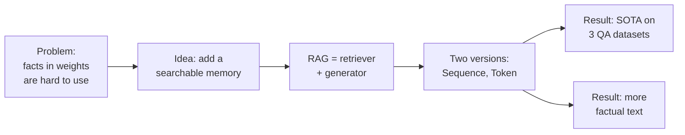

# 01. Abstract (Paper Section: Abstract)

In this note:

- The abstract split into its sentences
- Each sentence explained in simple words
- Words you need to know before reading further
- The abstract as one picture

## The Abstract, Sentence by Sentence

The abstract has nine sentences. Each one is quoted (shortened where very long) and then explained.

### Sentence 1

> "Large pre-trained language models have been shown to store factual knowledge in their parameters, and achieve state-of-the-art results when fine-tuned on downstream NLP tasks."

**Simple meaning:** Big language models (like BERT, BART, T5, GPT) learn many facts while they are trained on huge amounts of text. Those facts are stored inside the numbers (parameters, also called weights) of the model. When you train such a model a little more on a specific task (fine-tuning), it often gets the best scores.

### Sentence 2

> "However, their ability to access and precisely manipulate knowledge is still limited, and hence on knowledge-intensive tasks, their performance lags behind task-specific architectures."

**Simple meaning:** The model knows facts, but it cannot reliably pull out the exact fact it needs. So on tasks that really depend on facts (for example answering trivia questions), these general models are beaten by special systems built only for that task.

### Sentence 3

> "Additionally, providing provenance for their decisions and updating their world knowledge remain open research problems."

**Simple meaning:** Two more problems:

- **Provenance**: the model cannot tell you where an answer came from (no source, no citation).
- **Updating**: when the world changes (a new president, a new price), you cannot easily change one fact inside the model.

### Sentence 4

> "Pre-trained models with a differentiable access mechanism to explicit non-parametric memory have so far been only investigated for extractive downstream tasks."

**Simple meaning:** Some earlier models (REALM, ORQA) were connected to an external memory (a searchable store of text), and the connection could be trained (it is "differentiable", meaning gradients can flow through it). But those models were only used for **extractive** tasks: copying a span of text out of a found passage. Nobody had done it for models that **write** new text.

### Sentence 5

> "We explore a general-purpose fine-tuning recipe for retrieval-augmented generation (RAG), models which combine pre-trained parametric and non-parametric memory for language generation."

**Simple meaning:** This paper gives one general way to fine-tune a model that **retrieves** text and then **generates** an answer. This is where the name RAG comes from. It mixes two memories that are both already pre-trained:

<table width="100%">
<thead><tr><th>Memory</th><th>What it is</th><th>In this paper</th></tr></thead>
<tbody>
<tr><td>Parametric memory</td><td>Knowledge inside model weights</td><td>The BART generator</td></tr>
<tr><td>Non-parametric memory</td><td>Knowledge in an external text store</td><td>Vector index of Wikipedia</td></tr>
</tbody>
</table>

### Sentence 6

> "We introduce RAG models where the parametric memory is a pre-trained seq2seq model and the non-parametric memory is a dense vector index of Wikipedia, accessed with a pre-trained neural retriever."

**Simple meaning:** The concrete parts:

- **Pre-trained seq2seq model**: a model that reads a text and writes a text (sequence to sequence). Here it is BART.
- **Dense vector index of Wikipedia**: every Wikipedia passage is turned into a list of numbers (a vector) and stored so it can be searched quickly.
- **Pre-trained neural retriever**: a neural network (DPR) that turns the question into a vector and finds the closest passage vectors.

### Sentence 7

> "We compare two RAG formulations, one which conditions on the same retrieved passages across the whole generated sequence, and another which can use different passages per token."

**Simple meaning:** There are two versions:

- **RAG-Sequence**: one passage is used for the whole answer.
- **RAG-Token**: each word piece (token) of the answer may lean on a different passage.

### Sentence 8

> "We fine-tune and evaluate our models on a wide range of knowledge-intensive NLP tasks and set the state of the art on three open domain QA tasks, outperforming parametric seq2seq models and task-specific retrieve-and-extract architectures."

**Simple meaning:** They tested on many fact-heavy tasks. On three open-domain question answering datasets (Natural Questions, WebQuestions, CuratedTrec), RAG got the best scores ever reported at the time. It beat models that only use their weights (like T5) and also beat special systems that retrieve and then copy an answer span (like DPR, REALM).

### Sentence 9

> "For language generation tasks, we find that RAG models generate more specific, diverse and factual language than a state-of-the-art parametric-only seq2seq baseline."

**Simple meaning:** When the task is to write text (long answers, Jeopardy questions), RAG writes text that is:

- **More specific**: tied closely to the input, not generic.
- **More diverse**: less repetitive.
- **More factual**: fewer made-up facts.

The baseline it is compared with is plain BART without retrieval.

## Words to Know

<table width="100%">
<thead><tr><th>Term</th><th>Simple meaning</th></tr></thead>
<tbody>
<tr><td>Pre-trained</td><td>Already trained on a large general dataset before being used for a task</td></tr>
<tr><td>Fine-tuning</td><td>Extra training on a smaller task-specific dataset</td></tr>
<tr><td>Parameters</td><td>The learned numbers inside a neural network</td></tr>
<tr><td>Knowledge-intensive task</td><td>A task a human could not do well without looking things up</td></tr>
<tr><td>Provenance</td><td>The source of an answer</td></tr>
<tr><td>Differentiable</td><td>Can be trained with gradients (the normal way neural networks learn)</td></tr>
<tr><td>Extractive</td><td>The answer is copied from a passage</td></tr>
<tr><td>Generative (abstractive)</td><td>The answer is written in new words</td></tr>
<tr><td>seq2seq</td><td>A model that reads one text and writes another</td></tr>
<tr><td>Dense vector index</td><td>A searchable store of passage vectors</td></tr>
<tr><td>Open-domain QA</td><td>Answer any question with no passage given, the system must find the knowledge itself</td></tr>
</tbody>
</table>

## The Abstract as One Picture

## Key Points

- Problem: models store facts in weights but cannot access them precisely, cannot cite, cannot update.
- Idea: connect a pre-trained generator (BART) to a pre-trained retriever (DPR) over Wikipedia.
- Two variants: RAG-Sequence and RAG-Token.
- Results: best open-domain QA scores and more factual, specific, diverse generation.

## Navigation

[Index](README.md) | Next: [02. Introduction](02.%20Introduction.md)
