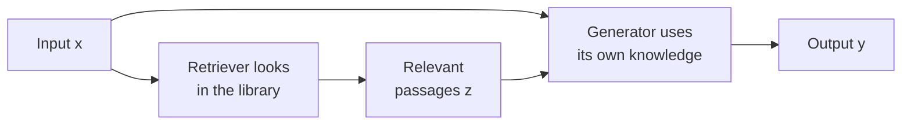
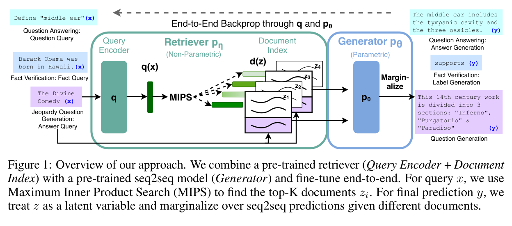
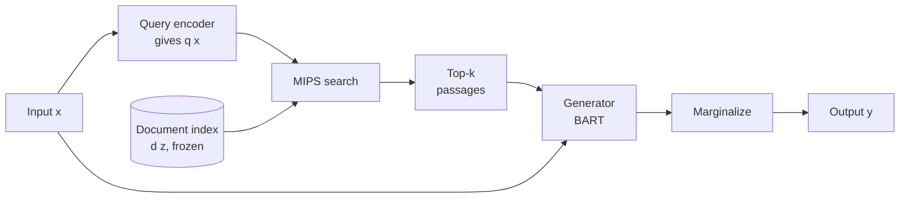

# 02. Introduction (Paper Section 1)

In this note:

- The problem with knowledge stored only in model weights
- Parametric memory vs non-parametric memory
- What existed before (REALM, ORQA, memory networks) and the gap
- Figure 1 of the paper, explained box by box and arrow by arrow
- The three example tasks shown in Figure 1
- The two RAG variants (preview)
- The contributions and claims of the paper

## 1. The Problem in Simple Words

Pre-trained language models such as BART, T5 and GPT learn a lot of facts during training. The facts are stored inside the model weights. The paper calls this a "parameterized implicit knowledge base". It works surprisingly well, but it has clear problems:

<table width="100%">
<thead><tr><th>Problem</th><th>What it means</th><th>Example</th></tr></thead>
<tbody>
<tr><td>Cannot expand or revise memory</td><td>To change a fact you must retrain or fine-tune the model</td><td>A new president is elected, the model still names the old one</td></tr>
<tr><td>No insight into predictions</td><td>The model cannot show which source supports its answer</td><td>You cannot check where "Paris is the capital" came from</td></tr>
<tr><td>Hallucinations</td><td>The model writes fluent text that is factually wrong</td><td>"The middle ear is between the middle ear and the nose"</td></tr>
</tbody>
</table>

The paper focuses on **knowledge-intensive tasks**: tasks a human could not reasonably do without an external knowledge source, for example answering trivia questions or checking a claim against Wikipedia.

## 2. Two Kinds of Memory

The core idea: combine **parametric** memory and **non-parametric** (retrieval-based) memory. In such hybrid models knowledge can be revised and expanded directly, and what the model looked at can be inspected.

<table width="100%">
<thead><tr><th>Memory type</th><th>Where knowledge lives</th><th>In this paper</th><th>Strength</th><th>Weakness</th></tr></thead>
<tbody>
<tr><td>Parametric</td><td>Inside model weights</td><td>BART generator, parameters theta</td><td>Fluent language, general knowledge</td><td>Hard to update, no sources, can hallucinate</td></tr>
<tr><td>Non-parametric</td><td>Outside the model, in a searchable store</td><td>Dense vector index of 21M Wikipedia passages</td><td>Easy to update, inspectable, exact facts</td><td>Needs a good retriever to find the right text</td></tr>
</tbody>
</table>

Analogy: parametric memory is what a student remembers in their head. Non-parametric memory is the textbook they may open during an open-book exam. RAG lets the model take an open-book exam.

## 3. What Existed Before, and the Gap

<table width="100%">
<thead><tr><th>Earlier work</th><th>What it did</th><th>Limit</th></tr></thead>
<tbody>
<tr><td>REALM and ORQA</td><td>Masked language model plus a trainable (differentiable) retriever</td><td>Only open-domain extractive QA: copy a span from a passage</td></tr>
<tr><td>Memory networks, stack-augmented networks, memory layers</td><td>Added an external memory to a neural network</td><td>Trained from scratch for one specific task</td></tr>
</tbody>
</table>

The gap: nobody had given a general **sequence-to-sequence (seq2seq) generator** a pre-trained retrieval memory. The paper calls seq2seq models the "workhorse of NLP", because translation, summarization, question answering and even classification can all be written as "text in, text out".

What is new in this paper: **both** memories are pre-trained and already full of knowledge. Because the access mechanism (the retriever) is also pre-trained, the model can use knowledge without extra training of that mechanism.

## 4. Figure 1 of the Paper

Caption in simple words: a pre-trained retriever (query encoder plus document index) is joined with a pre-trained seq2seq generator, and the whole thing is fine-tuned end to end. For an input x, Maximum Inner Product Search (MIPS) finds the top-K documents. To make the final prediction y, the document is treated as a hidden (latent) variable and the generator's predictions for the different documents are combined (marginalized).

### 4.1 Every part of Figure 1

<table width="100%">
<thead><tr><th>Part in the figure</th><th>Symbol</th><th>What it does</th><th>Trained?</th></tr></thead>
<tbody>
<tr><td>Coloured input boxes on the left</td><td>x</td><td>The input: a question, a claim, or an answer entity</td><td>Not a model</td></tr>
<tr><td>Query Encoder (green block)</td><td>q</td><td>A BERT model that turns x into one vector q(x)</td><td>Yes, fine-tuned</td></tr>
<tr><td>Small green bar labelled q(x)</td><td>q(x)</td><td>The query vector, a list of 768 numbers</td><td>Output, not a model</td></tr>
<tr><td>Document Index (stack of pages)</td><td>d(z)</td><td>Pre-computed vectors for all 21M Wikipedia passages z</td><td>No, frozen</td></tr>
<tr><td>Green bars of different lengths next to the pages</td><td>scores</td><td>How well each passage vector matches q(x); longer bar means higher score</td><td>Computed, not trained</td></tr>
<tr><td>Dashed arrows into MIPS</td><td>top-k</td><td>Maximum Inner Product Search picks the k passages with the highest score</td><td>No parameters</td></tr>
<tr><td>Pages z1, z2, z3, z4</td><td>z</td><td>The top-4 retrieved passages in this drawing</td><td>Data</td></tr>
<tr><td>Teal frame "Retriever p_eta (Non-Parametric)"</td><td>p_eta(z|x)</td><td>Query encoder plus index together; gives each passage a probability</td><td>Query side only</td></tr>
<tr><td>Blue frame "Generator p_theta (Parametric)"</td><td>p_theta</td><td>BART-large reads x plus one passage and writes the output</td><td>Yes, fine-tuned</td></tr>
<tr><td>Margin-alize</td><td>sum over z</td><td>Adds up the generator's outputs for each passage, weighted by passage probability</td><td>No parameters</td></tr>
<tr><td>Coloured output boxes on the right</td><td>y</td><td>The output: an answer, a label, or a question</td><td>Not a model</td></tr>
<tr><td>Dashed arrow on top</td><td>backprop</td><td>"End-to-End Backprop through q and p_theta": training changes the query encoder and the generator</td><td>Shows what learns</td></tr>
</tbody>
</table>

### 4.2 Following the arrows

1. The input x (for example "Define middle ear") enters the **query encoder**, which outputs the vector q(x).
2. **MIPS** compares q(x) with every passage vector d(z) in the **document index**. The green bars show the scores. The k highest-scoring passages are returned (z1 to z4 in the picture).
3. For each retrieved passage, the **generator** reads the pair (x, z) and predicts the output.
4. **Marginalize**: the model is never told which passage is the right one. It treats the passage as a hidden variable and adds up the predictions from all k passages, each weighted by how likely the retriever thinks that passage is. The formulas are in [03. Methods](03.%20Methods.md).
5. The output y comes out of this weighted combination.
6. During training, the error on y flows back (dashed arrow) into the generator and the query encoder. The document index does not change. The retriever learns which passages help the generator, without anyone labelling the correct passage.

### 4.3 The three example tasks in Figure 1

The figure shows that one architecture handles very different tasks, because each one is just "text x in, text y out".

<table width="100%">
<thead><tr><th>Task (left label)</th><th>Input x</th><th>Output y</th><th>Task type (right label)</th></tr></thead>
<tbody>
<tr><td>Question Answering: Question Query</td><td>Define "middle ear"</td><td>The middle ear includes the tympanic cavity and the three ossicles.</td><td>Question Answering: Answer Generation</td></tr>
<tr><td>Fact Verification: Fact Query</td><td>Barack Obama was born in Hawaii.</td><td>supports</td><td>Fact Verification: Label Generation</td></tr>
<tr><td>Jeopardy Question Generation: Answer Query</td><td>The Divine Comedy</td><td>This 14th century work is divided into 3 sections: "Inferno", "Purgatorio" and "Paradiso"</td><td>Question Generation</td></tr>
</tbody>
</table>

Notice the Jeopardy task works backwards: the input is the answer, and the model writes the question (clue).

## 5. The Two Model Variants (preview)

The paper marginalizes the hidden passage in two ways:

- **RAG-Sequence** (per-output basis): the same passage is responsible for all tokens of the output.
- **RAG-Token** (per-token basis): different passages can be responsible for different tokens.

Like T5 or BART, RAG can be fine-tuned on any seq2seq task, and the generator and retriever are learned together. Details and equations: [03. Methods](03.%20Methods.md).

## 6. Contributions and Claims

<table width="100%">
<thead><tr><th>#</th><th>Claim</th><th>Evidence in the paper</th></tr></thead>
<tbody>
<tr><td>1</td><td>A general fine-tuning recipe joining a pre-trained retriever (DPR) and a pre-trained seq2seq generator (BART)</td><td>Same architecture used for QA, generation and classification</td></tr>
<tr><td>2</td><td>Both memories pre-trained, so knowledge access works without extra pre-training</td><td>No salient span masking pre-training (needed by REALM, T5+SSM)</td></tr>
<tr><td>3</td><td>State of the art on open Natural Questions, WebQuestions and CuratedTrec</td><td>Table 1</td></tr>
<tr><td>4</td><td>Much better than specialised pre-training methods on TriviaQA</td><td>Table 1</td></tr>
<tr><td>5</td><td>Generation beats earlier extractive approaches even on extractive tasks</td><td>RAG beats DPR reader on NQ</td></tr>
<tr><td>6</td><td>More factual, specific and diverse text than BART (MS-MARCO, Jeopardy)</td><td>Tables 2, 4, 5</td></tr>
<tr><td>7</td><td>Within 4.3% of state-of-the-art pipelines on FEVER, without retrieval supervision</td><td>Table 2</td></tr>
<tr><td>8</td><td>Knowledge can be updated by replacing the non-parametric memory</td><td>Index hot-swap experiment</td></tr>
</tbody>
</table>

The authors also released code in HuggingFace Transformers and an online demo.

## Key Points

- Knowledge only in weights cannot be updated, cannot be cited, and can be hallucinated.
- RAG = pre-trained retriever (non-parametric memory) + pre-trained generator (parametric memory), fine-tuned together.
- The retrieved passage is a hidden variable. The model learns which passages help from the final answer only.
- One architecture serves QA, fact verification and question generation.

## Navigation

Previous: [01. Abstract](01.%20Abstract.md) | [Index](README.md) | Next: [03. Methods](03.%20Methods.md)
