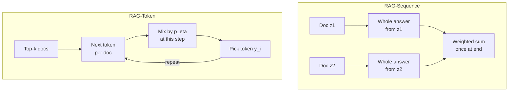
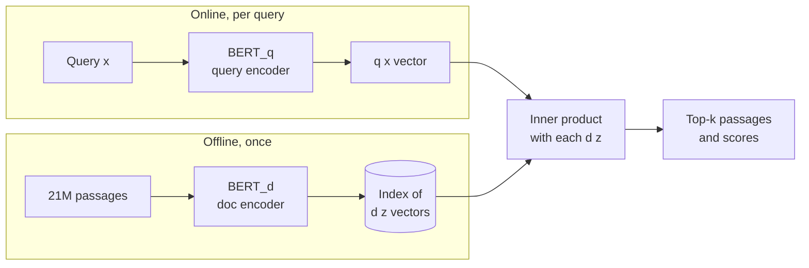
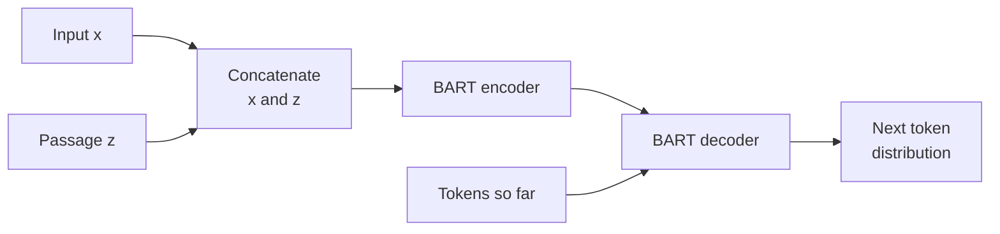
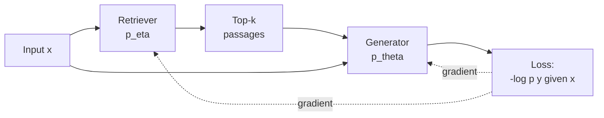
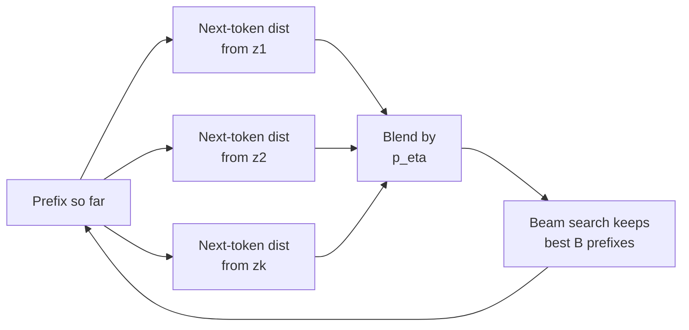
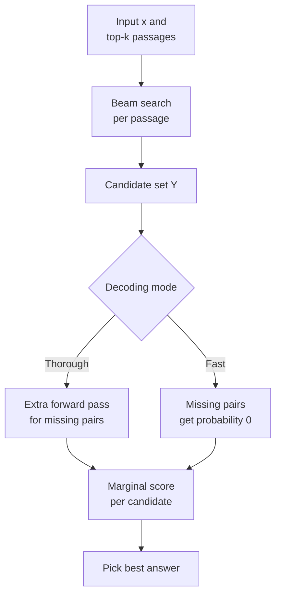

# 03. Methods (Paper Section 2)

In this note:

- Section 2 overview: retriever, generator and the hidden passage
- 2.1 Models: RAG-Sequence and RAG-Token equations, symbol by symbol, with a worked example
- 2.2 Retriever: DPR, inner product, MIPS
- 2.3 Generator: BART
- 2.4 Training: the loss, what is trained, what is frozen
- 2.5 Decoding: beam search, Thorough and Fast decoding

## Section 2 Overview

RAG uses the input sequence $x$ to retrieve text documents $z$ and uses them as extra context when generating the target sequence $y$. It has two components (see Figure 1 in [02. Introduction](02.%20Introduction.md)):

<table width="100%">
<thead><tr><th>Component</th><th>Written as</th><th>Parameters</th><th>Job</th></tr></thead>
<tbody>
<tr><td>Retriever</td><td>p_eta(z | x)</td><td>eta</td><td>Gives a probability to each passage z for input x, cut to the top-K passages</td></tr>
<tr><td>Generator</td><td>p_theta(y_i | x, z, y_1:i-1)</td><td>theta</td><td>Predicts the next token y_i from the input x, one passage z, and the tokens already written</td></tr>
</tbody>
</table>

### The retrieved document is a latent variable

A **latent variable** affects the result but is never observed in the training data. Training data only has pairs (question, answer). It never says "passage number 4,512,006 contains the answer". So the model treats "which passage was used" as hidden and **marginalizes** over it.

**Marginalizing** means: compute the answer probability for every possible passage, multiply each by the probability of that passage, and add them up. This is the law of total probability:

$$
p(y \mid x) = \sum_{z} p(z \mid x) \, p(y \mid x, z)
$$

Summing over all 21 million passages is too expensive, so the paper only sums over the top-K passages returned by the retriever (the "top-k approximation"). The two RAG models differ only in **when** this sum happens.

## 2.1 Models

### RAG-Sequence model

The same retrieved passage is used to generate the complete output sequence.

$$
p_{\text{RAG-Sequence}}(y \mid x) \approx \sum_{z \in \text{top-}k(p(\cdot \mid x))} p_\eta(z \mid x) \, p_\theta(y \mid x, z) = \sum_{z \in \text{top-}k(p(\cdot \mid x))} p_\eta(z \mid x) \prod_{i}^{N} p_\theta(y_i \mid x, z, y_{1:i-1})
$$

<table width="100%">
<thead><tr><th>Symbol (plain text)</th><th>Name</th><th>Meaning</th></tr></thead>
<tbody>
<tr><td>x</td><td>Input</td><td>The question or claim</td></tr>
<tr><td>y</td><td>Output sequence</td><td>The full answer, made of N tokens y_1 ... y_N</td></tr>
<tr><td>y_i</td><td>Token i</td><td>The i-th output token</td></tr>
<tr><td>y_1:i-1</td><td>Prefix</td><td>All tokens generated before token i</td></tr>
<tr><td>z</td><td>Document</td><td>One retrieved Wikipedia passage</td></tr>
<tr><td>top-k(p(.|x))</td><td>Top-k set</td><td>The k passages with the highest retriever score for x</td></tr>
<tr><td>p_eta(z|x)</td><td>Retriever probability</td><td>How relevant the retriever thinks passage z is for x</td></tr>
<tr><td>p_theta(y|x,z)</td><td>Generator probability</td><td>How likely BART writes the full answer y after reading x and z</td></tr>
<tr><td>Product over i</td><td>Chain rule</td><td>Probability of a sequence = product of its next-token probabilities</td></tr>
<tr><td>Sum over z</td><td>Marginalization</td><td>Weighted average over the top-k passages</td></tr>
<tr><td>approx sign</td><td>Approximation</td><td>Only the top-k passages are summed, not all of them</td></tr>
</tbody>
</table>

**Plain words:** for each retrieved passage, imagine BART writes the **whole answer** using only that passage. Compute how likely that whole answer is. Then take a weighted average across passages, where the weight is the retriever's confidence in each passage. One passage is responsible for the entire answer.

### RAG-Token model

A different passage can be drawn for each output token, so the generator can take content from several passages in one answer.

$$
p_{\text{RAG-Token}}(y \mid x) \approx \prod_{i}^{N} \sum_{z \in \text{top-}k(p(\cdot \mid x))} p_\eta(z \mid x) \, p_\theta(y_i \mid x, z, y_{1:i-1})
$$

The product and the sum swapped places:

<table width="100%">
<thead><tr><th>Aspect</th><th>RAG-Sequence</th><th>RAG-Token</th></tr></thead>
<tbody>
<tr><td>Order of operations</td><td>Sum over docs of (product over tokens)</td><td>Product over tokens of (sum over docs)</td></tr>
<tr><td>When documents are mixed</td><td>Once, after the whole answer</td><td>At every token</td></tr>
<tr><td>Docs per answer</td><td>One doc explains the whole answer</td><td>Each token can lean on a different doc</td></tr>
<tr><td>Good for</td><td>Short answers from one source</td><td>Answers that combine facts from several sources</td></tr>
<tr><td>Decoding</td><td>Needs special beam search (2.5)</td><td>Standard beam search</td></tr>
</tbody>
</table>

**Plain words:** at every step, each passage proposes a distribution over the next token. The model blends those proposals using the retriever weights, picks the next token, and repeats. Token 3 can come mostly from passage 1 while token 7 comes mostly from passage 2. The paper shows this in Figure 2 (the Hemingway example, see [05. Results](05.%20Results.md)).

### Worked numeric example

The answer has 2 tokens, $y = (y_1, y_2)$, and the retriever returns 2 passages.

<table width="100%">
<thead><tr><th>Passage</th><th>p_eta(z|x)</th><th>p_theta(y_1 | x, z)</th><th>p_theta(y_2 | x, z, y_1)</th><th>p_theta(y | x, z) = product</th></tr></thead>
<tbody>
<tr><td>z1</td><td>0.7</td><td>0.9</td><td>0.8</td><td>0.72</td></tr>
<tr><td>z2</td><td>0.3</td><td>0.2</td><td>0.5</td><td>0.10</td></tr>
</tbody>
</table>

**RAG-Sequence:** multiply tokens first (per passage), then mix.

$$
p = 0.7 \times (0.9 \times 0.8) + 0.3 \times (0.2 \times 0.5) = 0.504 + 0.030 = 0.534
$$

**RAG-Token:** mix first (per token), then multiply.

$$
\text{token 1: } 0.7 \times 0.9 + 0.3 \times 0.2 = 0.69 \qquad \text{token 2: } 0.7 \times 0.8 + 0.3 \times 0.5 = 0.71
$$

$$
p = 0.69 \times 0.71 = 0.4899
$$

What the numbers show:

- The same answer gets different probabilities (0.534 vs 0.490), so the two are really different models.
- In RAG-Sequence, passage z1 "wins" as a whole package. In RAG-Token, z2 contributes a little to every token.
- If z2 were great for token 2 but bad for token 1, only RAG-Token could use that.

### When the two models are the same

For classification (for example FEVER labels), the target is a sequence of length one (N = 1). The product has one term, so both formulas become:

$$
p(y_1 \mid x) = \sum_{z} p_\eta(z \mid x) \, p_\theta(y_1 \mid x, z)
$$

This is why FEVER has one "RAG" number in the results.

## 2.2 Retriever: DPR

The retriever $p_\eta(z \mid x)$ is the Dense Passage Retriever (DPR) of Karpukhin et al. 2020. DPR is a **bi-encoder**.

$$
p_\eta(z \mid x) \propto \exp\left( \mathbf{d}(z)^\top \mathbf{q}(x) \right)
\qquad
\mathbf{d}(z) = \text{BERT}_d(z), \quad \mathbf{q}(x) = \text{BERT}_q(x)
$$

<table width="100%">
<thead><tr><th>Symbol (plain text)</th><th>Name</th><th>Meaning</th></tr></thead>
<tbody>
<tr><td>d(z)</td><td>Document vector</td><td>Dense vector for passage z, made by the document encoder</td></tr>
<tr><td>q(x)</td><td>Query vector</td><td>Dense vector for input x, made by the query encoder</td></tr>
<tr><td>BERT_d</td><td>Document encoder</td><td>A BERT-base model used only for passages</td></tr>
<tr><td>BERT_q</td><td>Query encoder</td><td>A separate BERT-base model used only for queries</td></tr>
<tr><td>d(z)^T q(x)</td><td>Inner product</td><td>Similarity score between query and passage</td></tr>
<tr><td>exp(...)</td><td>Exponential</td><td>Turns any score into a positive number</td></tr>
<tr><td>proportional sign</td><td>Proportional to</td><td>The values are divided by their total so they sum to 1</td></tr>
<tr><td>eta</td><td>Retriever parameters</td><td>The weights of the two BERT encoders</td></tr>
</tbody>
</table>

**Plain words:** turn the question into a vector. Every passage already has a vector. The score of a passage is the dot product of the two vectors: bigger means more relevant. Exponentiate and normalize the scores of the retrieved passages so they become probabilities (a **softmax**):

$$
p_\eta(z \mid x) = \frac{\exp\left(\mathbf{d}(z)^\top \mathbf{q}(x)\right)}{\sum_{z' \in \text{top-}k} \exp\left(\mathbf{d}(z')^\top \mathbf{q}(x)\right)}
$$

### Inner product with numbers

Real vectors have 768 numbers. A 3-number toy example:

<table width="100%">
<thead><tr><th>Vector</th><th>Dim 1</th><th>Dim 2</th><th>Dim 3</th><th>Inner product with q(x)</th></tr></thead>
<tbody>
<tr><td>q(x) query</td><td>0.9</td><td>0.1</td><td>0.4</td><td>-</td></tr>
<tr><td>d(z1) relevant passage</td><td>0.8</td><td>0.0</td><td>0.5</td><td>0.72 + 0.00 + 0.20 = 0.92</td></tr>
<tr><td>d(z2) unrelated passage</td><td>0.1</td><td>0.9</td><td>0.0</td><td>0.09 + 0.09 + 0.00 = 0.18</td></tr>
</tbody>
</table>

z1 points in a similar direction to the query, so its score is higher. Softmax of (0.92, 0.18) gives about (0.68, 0.32).

### Bi-encoder: why it is fast

The two texts never meet inside a model. They meet only when their vectors are compared. So all 21 million passage vectors can be computed **once, offline**, and stored. At question time only one BERT pass (for the query) is needed.

<table width="100%">
<thead><tr><th>Design</th><th>How it works</th><th>Speed</th><th>Accuracy</th><th>Used in RAG?</th></tr></thead>
<tbody>
<tr><td>Bi-encoder</td><td>Encode query and passage separately, compare vectors</td><td>Very fast, passage vectors pre-computed</td><td>Good</td><td>Yes, as the retriever</td></tr>
<tr><td>Cross-encoder</td><td>Feed query and passage together into one model</td><td>Slow, must run per pair</td><td>Better</td><td>No, the paper shows it is not needed</td></tr>
</tbody>
</table>

### MIPS: Maximum Inner Product Search

Finding the top-k passages = finding the k vectors with the **largest inner product** with q(x). This is the MIPS problem. It "can be approximately solved in sub-linear time".

<table width="100%">
<thead><tr><th>Approach</th><th>How</th><th>Cost per query</th><th>Exact?</th></tr></thead>
<tbody>
<tr><td>Brute force</td><td>Score all 21M passages</td><td>Linear: grows with the number of passages</td><td>Yes</td></tr>
<tr><td>Approximate (HNSW in FAISS)</td><td>Walk a graph of neighbouring vectors toward the best region</td><td>Sub-linear: grows much slower</td><td>Almost, may miss a few</td></tr>
</tbody>
</table>

**Sub-linear time** means doubling the number of passages does not double the search time. HNSW (Hierarchical Navigable Small World) builds layers of graphs: the top layer has few nodes and long jumps, lower layers have more nodes and short jumps. A search starts at the top and zooms in, like going from a country map to a street map.

### Where the retriever came from

The retriever starts from a pre-trained DPR bi-encoder, which was trained to find passages containing answers to TriviaQA and Natural Questions questions. The same DPR model is used to build the document index. The paper calls this document index the **non-parametric memory**.

## 2.3 Generator: BART

The generator $p_\theta(y_i \mid x, z, y_{1:i-1})$ could be any encoder-decoder. The paper uses **BART-large**.

<table width="100%">
<thead><tr><th>Property</th><th>Value</th></tr></thead>
<tbody>
<tr><td>Type</td><td>Pre-trained seq2seq (encoder-decoder) transformer</td></tr>
<tr><td>Size</td><td>About 400M parameters (406M in Appendix G)</td></tr>
<tr><td>Pre-training</td><td>Denoising: corrupt text with several noising functions, learn to restore it</td></tr>
<tr><td>Strength</td><td>State of the art on many generation tasks, beats similar-sized T5</td></tr>
<tr><td>How it reads the passage</td><td>Simple concatenation of input x and passage z</td></tr>
<tr><td>Paper's name for it</td><td>Parametric memory (parameters theta)</td></tr>
</tbody>
</table>

There is no special fusion layer. Input and passage are joined into one text and fed to the BART encoder. The decoder writes the output one token at a time. This is done separately for each of the k passages, giving k next-token distributions, which RAG-Sequence or RAG-Token then combines.

## 2.4 Training

Retriever and generator are trained **together**, with **no direct supervision** on which document should be retrieved. Training data is pairs $(x_j, y_j)$, for example ("who wrote the divine comedy", "Dante Alighieri").

$$
\mathcal{L} = \sum_{j} -\log p(y_j \mid x_j)
$$

<table width="100%">
<thead><tr><th>Symbol (plain text)</th><th>Meaning</th></tr></thead>
<tbody>
<tr><td>j</td><td>Index of a training example</td></tr>
<tr><td>x_j, y_j</td><td>Input and correct output of example j</td></tr>
<tr><td>p(y_j | x_j)</td><td>Marginal probability from RAG-Sequence or RAG-Token, summed over top-k passages</td></tr>
<tr><td>-log</td><td>Negative log: small when the probability is high, large when it is low</td></tr>
<tr><td>Sum over j</td><td>Total loss over the training examples</td></tr>
</tbody>
</table>

**Plain words:** make the correct answer as likely as possible, after averaging over the retrieved passages. This is the **negative marginal log-likelihood**. It is minimized with stochastic gradient descent using the **Adam** optimizer.

### Why no passage labels are needed

The marginal probability contains $p_\eta(z \mid x)$. When the gradient flows back:

- If passage z helped the generator produce the correct answer (high $p_\theta(y \mid x, z)$), the gradient **raises** $p_\eta(z \mid x)$, so the query encoder learns to rank that passage higher next time.
- If passage z did not help, its weight goes down.

The retriever learns from the generator's success. This is the "end-to-end" in Figure 1.

### What is trained and what is frozen

<table width="100%">
<thead><tr><th>Component</th><th>Parameters</th><th>Status</th><th>Reason</th></tr></thead>
<tbody>
<tr><td>Query encoder BERT_q</td><td>110M</td><td>Trained</td><td>Cheap, only changes the query vector</td></tr>
<tr><td>Generator BART-large</td><td>406M</td><td>Trained</td><td>Learns to use passages for the task</td></tr>
<tr><td>Document encoder BERT_d</td><td>110M</td><td>Frozen</td><td>Changing it means re-encoding 21M passages</td></tr>
<tr><td>Document index</td><td>21M vectors</td><td>Frozen</td><td>Rebuilding the index during training is very costly</td></tr>
</tbody>
</table>

If BERT_d changed, every stored passage vector would become stale and the index would need periodic rebuilding, as REALM does during pre-training. The authors found this **not necessary** for strong results. Modern RAG makes the same choice: build the index once, keep it fixed.

## 2.5 Decoding

**Decoding** picks the final output at test time. We want the most likely output, $\arg\max_y p(y \mid x)$. Checking every possible sentence is impossible, so **beam search** is used: keep the B best partial outputs at each step, extend each by one token, keep the best B again.

### RAG-Token decoding

RAG-Token behaves like a normal autoregressive generator with this transition probability:

$$
p'_\theta(y_i \mid x, y_{1:i-1}) = \sum_{z \in \text{top-}k(p(\cdot \mid x))} p_\eta(z_i \mid x) \, p_\theta(y_i \mid x, z_i, y_{1:i-1})
$$

**Plain words:** at each step, blend the k next-token distributions using the retriever weights, and treat the blend as the model's next-token distribution. Plug it into a **standard beam decoder**.

### RAG-Sequence decoding

For RAG-Sequence, $p(y \mid x)$ does not break into one probability per token, so a single beam search cannot score it. Two procedures:

**Thorough Decoding**

1. Run a separate beam search for **each** passage z, scoring with $p_\theta(y_i \mid x, z, y_{1:i-1})$.
2. Put all candidate answers from all beams into one set Y.
3. A candidate may appear in the beam of z1 but not of z2. For each missing (candidate, passage) pair, run an **extra forward pass** to compute $p_\theta(y \mid x, z)$.
4. Multiply each generator probability by $p_\eta(z \mid x)$ and sum across passages to get the marginal.
5. Output the candidate with the highest marginal.

Accurate, but long outputs make Y large and need many extra forward passes.

**Fast Decoding**

Same as Thorough, but skip step 3: if candidate y was not generated in the beam for passage $z_i$, assume $p_\theta(y \mid x, z_i) \approx 0$. No extra forward passes.

<table width="100%">
<thead><tr><th>Mode</th><th>Extra forward passes</th><th>Accuracy</th><th>Used in the paper for</th></tr></thead>
<tbody>
<tr><td>Thorough Decoding</td><td>Yes</td><td>Exact marginal for candidates</td><td>Open-domain QA (short answers)</td></tr>
<tr><td>Fast Decoding</td><td>No</td><td>Approximate</td><td>MS-MARCO and Jeopardy (long outputs)</td></tr>
</tbody>
</table>

## Key Points

- The passage is a hidden variable. Both models average over the top-k passages.
- RAG-Sequence mixes once at the end. RAG-Token mixes at every token. They are equal for single-token outputs.
- Retriever score = inner product of query and passage vectors (DPR bi-encoder), searched with MIPS over a FAISS HNSW index.
- BART reads "input + passage" as one text.
- Loss = negative log of the marginal answer probability. Only BERT_q and BART are trained.
- RAG-Token uses normal beam search. RAG-Sequence needs per-passage beams with Thorough or Fast scoring.

## Navigation

Previous: [02. Introduction](02.%20Introduction.md) | [Index](README.md) | Next: [04. Experiments](04.%20Experiments.md)
