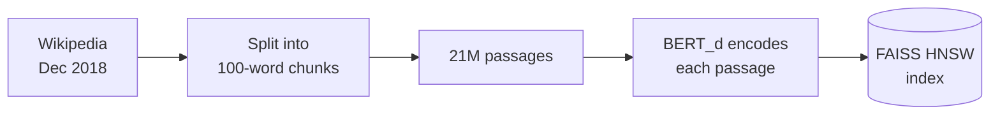

# 04. Experiments (Paper Section 3)

In this note:

- Section 3 shared setup: how Wikipedia was chunked and indexed
- 3.1 Open-domain Question Answering
- 3.2 Abstractive Question Answering
- 3.3 Jeopardy Question Generation
- 3.4 Fact Verification
- Every metric explained in simple words

## Section 3 Shared Setup: the Knowledge Source

All experiments use one Wikipedia snapshot as the non-parametric memory.

<table width="100%">
<thead><tr><th>Setting</th><th>Value</th><th>Why it matters</th></tr></thead>
<tbody>
<tr><td>Source</td><td>Wikipedia dump, December 2018</td><td>Same dump as earlier work (Lee et al., DPR), so results are comparable</td></tr>
<tr><td>Chunking</td><td>Each article split into disjoint 100-word chunks</td><td>Fixed-size chunks with no overlap, the ancestor of modern chunking</td></tr>
<tr><td>Number of passages</td><td>About 21 million documents</td><td>Size of the search space</td></tr>
<tr><td>Encoding</td><td>Document encoder computes one vector per chunk</td><td>Done once, offline</td></tr>
<tr><td>Index</td><td>One MIPS index built with FAISS, using HNSW approximation</td><td>Fast approximate top-k search</td></tr>
<tr><td>k during training</td><td>5 or 10</td><td>Number of passages marginalized per example</td></tr>
<tr><td>k at test time</td><td>Chosen using dev data</td><td>Can differ from the training k</td></tr>
</tbody>
</table>

"Disjoint" means chunks do not overlap: words 1 to 100 form chunk 1, words 101 to 200 form chunk 2, and so on.

## 3.1 Open-domain Question Answering

Open-domain QA means: answer a question with no passage given. The system must find the knowledge itself. It is a common test bed for knowledge-intensive tasks.

- Questions and answers are treated as input-output text pairs (x, y). RAG is trained by directly minimizing the negative log-likelihood of the answers.
- Four datasets: **Natural Questions (NQ)**, **TriviaQA (TQA)**, **WebQuestions (WQ)**, **CuratedTrec (CT)**.
- CT and WQ are small, so (like DPR) their models start from the NQ RAG model.
- Same train/dev/test splits as earlier work. For TQA, results are also given on the TQA Wiki test set to compare with T5.
- Metric: **Exact Match (EM)**.

RAG is compared with two families:

<table width="100%">
<thead><tr><th>Family</th><th>How it answers</th><th>Uses retrieval?</th><th>Main knowledge</th><th>Examples</th></tr></thead>
<tbody>
<tr><td>Extractive (open-book)</td><td>Copies a span from a retrieved passage</td><td>Yes</td><td>Non-parametric</td><td>DPR, REALM</td></tr>
<tr><td>Closed-book</td><td>Generates from its weights only</td><td>No</td><td>Parametric</td><td>T5-11B, T5-11B+SSM</td></tr>
<tr><td>RAG</td><td>Generates while reading retrieved passages</td><td>Yes</td><td>Both</td><td>RAG-Sequence, RAG-Token</td></tr>
</tbody>
</table>

## 3.2 Abstractive Question Answering

RAG can go beyond copying spans and answer in free-form written sentences (**abstractive** answers).

- Dataset: **MS-MARCO NLG task v2.1**. Each question has ten gold passages from a search engine and a full-sentence human answer.
- The paper **does not use the gold passages**. It uses only questions and answers, so MS-MARCO becomes an open-domain abstractive QA task.
- Some questions cannot match the reference without the gold passages, for example "What is the weather in Volcano, CA?". So scores will be lower than systems that read gold passages.
- Some questions cannot be answered from Wikipedia at all. Then RAG can fall back on BART's own (parametric) knowledge.
- Metrics: **BLEU-1** and **ROUGE-L**.

## 3.3 Jeopardy Question Generation

To test generation outside QA, the paper uses **open-domain question generation**. Normal QA datasets have short, simple questions, so the paper uses the harder **Jeopardy** format.

- Jeopardy works backwards: given an answer entity, write a factual clue that points to it.
- Example: answer "The World Cup", clue "In 1986 Mexico scored as the first country to host this international sports competition twice."
- Clues are precise factual statements, so writing them is a hard knowledge-intensive generation task.
- Splits from SearchQA: 100K train, 14K dev, 27K test.
- Baseline: a BART model trained on the same data (this is a new task).
- Automatic metric: **Q-BLEU-1** (a BLEU variant that gives more weight to matching entities and correlates better with human judgement for question generation).
- Two **human evaluations**:

<table width="100%">
<thead><tr><th>Human evaluation</th><th>Definition in the paper</th><th>Simple meaning</th></tr></thead>
<tbody>
<tr><td>Factuality</td><td>Whether a statement can be corroborated by trusted external sources</td><td>Is it true, can you check it?</td></tr>
<tr><td>Specificity</td><td>High mutual dependence between input and output</td><td>Does the clue fit this answer only, not any answer?</td></tr>
</tbody>
</table>

Method: **pairwise comparison**. Evaluators see an answer and two generated clues (one from BART, one from RAG) and pick one of four options: question A is better, question B is better, both are good, neither is good.

## 3.4 Fact Verification

- Dataset: **FEVER**. Classify whether a natural-language claim is **supported** or **refuted** by Wikipedia, or whether there is **not enough info**.
- It is a retrieval problem (find evidence) plus a reasoning problem (does the evidence support the claim?).
- It tests RAG on **classification** instead of generation. Each class label is mapped to a single output token, and the model is trained directly on (claim, class) pairs.
- Unlike most FEVER systems, RAG gets **no supervision on retrieved evidence**. Many real applications have no such labels, so a model that does not need them is more widely usable.
- Two variants: **3-way** (supports / refutes / not enough info) and **2-way** (supports / refutes, as studied by Thorne and Vlachos).
- Metric: **label accuracy**.

## The Four Tasks Side by Side

<table width="100%">
<thead><tr><th>Section</th><th>Task</th><th>Datasets</th><th>Output type</th><th>Metric</th><th>Baseline compared</th></tr></thead>
<tbody>
<tr><td>3.1</td><td>Open-domain QA</td><td>NQ, TQA, WQ, CT</td><td>Short answer</td><td>Exact Match</td><td>T5, REALM, DPR</td></tr>
<tr><td>3.2</td><td>Abstractive QA</td><td>MS-MARCO NLG v2.1</td><td>Full sentence</td><td>BLEU-1, ROUGE-L</td><td>BART, gold-passage SotA</td></tr>
<tr><td>3.3</td><td>Jeopardy question generation</td><td>SearchQA splits</td><td>Factual clue</td><td>Q-BLEU-1, human eval</td><td>BART</td></tr>
<tr><td>3.4</td><td>Fact verification</td><td>FEVER 3-way, 2-way</td><td>One label token</td><td>Label accuracy</td><td>Pipeline SotA, RoBERTa</td></tr>
</tbody>
</table>

## Metrics Explained

<table width="100%">
<thead><tr><th>Metric</th><th>Used for</th><th>What it measures</th><th>Simple example</th></tr></thead>
<tbody>
<tr><td>Exact Match (EM)</td><td>Open-domain QA</td><td>Percent of answers identical to a gold answer after normalization (lowercase, no punctuation or articles)</td><td>"Dante" vs gold "dante" counts, "Dante A." does not</td></tr>
<tr><td>BLEU-1</td><td>MS-MARCO, Jeopardy</td><td>Share of generated words that also appear in the reference (unigram precision)</td><td>10 output words, 7 in reference: about 0.7</td></tr>
<tr><td>ROUGE-L</td><td>MS-MARCO</td><td>Length of the longest common subsequence between output and reference</td><td>Rewards keeping the reference word order</td></tr>
<tr><td>Q-BLEU-1</td><td>Jeopardy</td><td>BLEU-1 with extra weight on matching entities</td><td>Getting "Mount Rainier" right counts more than "the"</td></tr>
<tr><td>Label accuracy</td><td>FEVER</td><td>Percent of claims with the correct label</td><td>90 of 100 correct: 90%</td></tr>
<tr><td>Factuality (human)</td><td>Jeopardy</td><td>Can the statement be confirmed by trusted sources?</td><td>Annotators may search the web</td></tr>
<tr><td>Specificity (human)</td><td>Jeopardy</td><td>Is the output tied to this input, not generic?</td><td>A clue that fits only "Washington"</td></tr>
</tbody>
</table>

## Key Points

- Index: 21M disjoint 100-word Wikipedia chunks in a FAISS HNSW index, k = 5 or 10 in training.
- Four task families: open-domain QA, abstractive QA, Jeopardy question generation, fact verification.
- RAG is never told which passage is correct, in any task.

## Navigation

Previous: [03. Methods](03.%20Methods.md) | [Index](README.md) | Next: [05. Results](05.%20Results.md)
