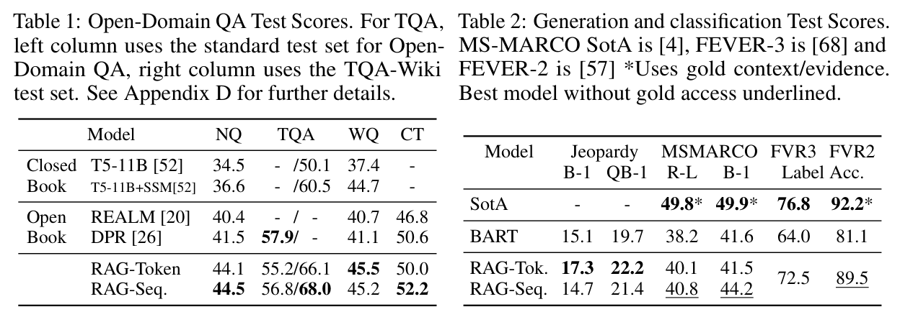
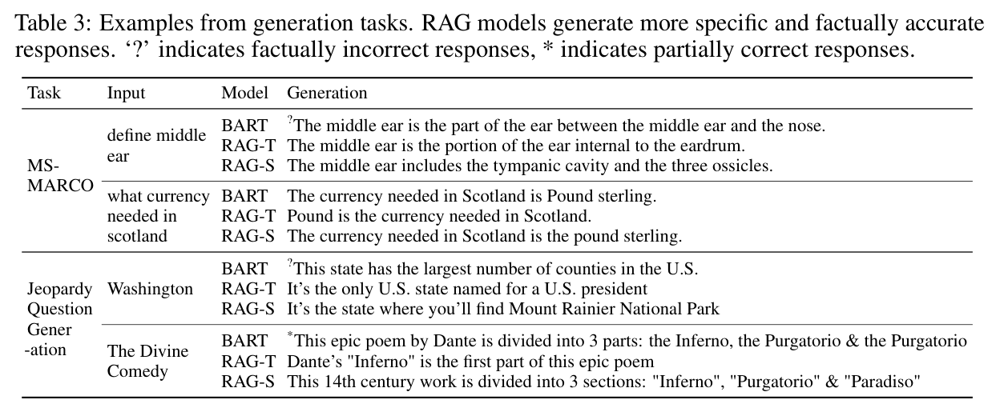
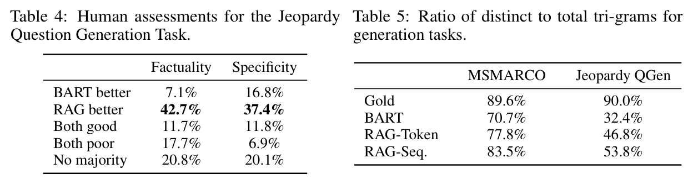
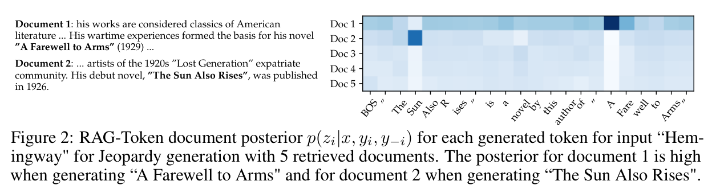
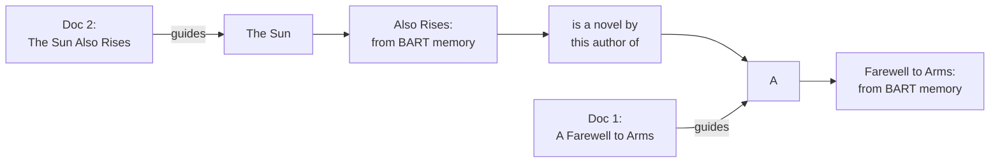
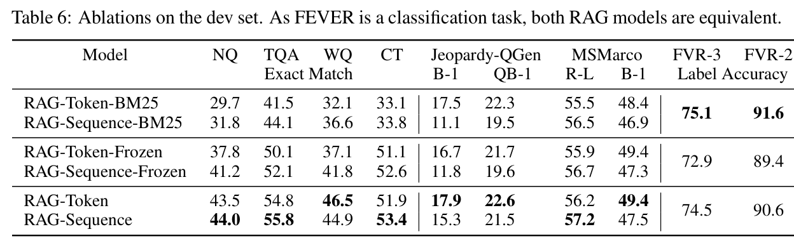
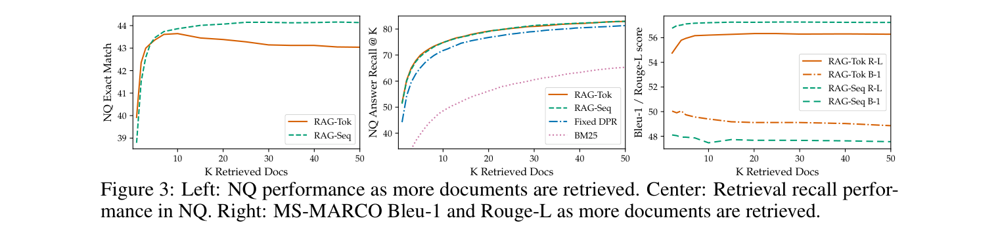

# 05. Results (Paper Section 4)

In this note:

- 4.1 Open-domain QA (Table 1)
- 4.2 Abstractive QA (Table 2, Table 3)
- 4.3 Jeopardy Question Generation (Table 2, Table 4, Figure 2)
- 4.4 Fact Verification (Table 2)
- 4.5 Additional Results: Generation Diversity (Table 5), Retrieval Ablations (Table 6), Index Hot-swapping, Effect of Retrieving More Documents (Figure 3)

Every table and figure is shown exactly as in the paper, then explained.

## Tables 1 and 2 of the Paper

These two tables appear side by side in the paper. Table 1 is used in 4.1. Table 2 is used in 4.2, 4.3 and 4.4.

### How to read Table 1 (left)

<table width="100%">
<thead><tr><th>Part of the table</th><th>Meaning</th></tr></thead>
<tbody>
<tr><td>Rows "Closed Book"</td><td>Models that answer from their weights only (T5-11B, T5-11B+SSM)</td></tr>
<tr><td>Rows "Open Book"</td><td>Retrieve-then-extract models (REALM, DPR)</td></tr>
<tr><td>Rows RAG-Token, RAG-Seq.</td><td>The two models of this paper</td></tr>
<tr><td>Columns NQ, TQA, WQ, CT</td><td>The four QA datasets</td></tr>
<tr><td>Numbers</td><td>Exact Match score, higher is better</td></tr>
<tr><td>TQA "a/b"</td><td>a = standard open-domain test set, b = TQA-Wiki test set (used by T5)</td></tr>
<tr><td>"-"</td><td>Not reported by that paper</td></tr>
<tr><td>Bold</td><td>Best score in the column</td></tr>
</tbody>
</table>

### How to read Table 2 (right)

<table width="100%">
<thead><tr><th>Part of the table</th><th>Meaning</th></tr></thead>
<tbody>
<tr><td>Jeopardy B-1, QB-1</td><td>BLEU-1 and Q-BLEU-1 for Jeopardy question generation</td></tr>
<tr><td>MSMARCO R-L, B-1</td><td>ROUGE-L and BLEU-1 for abstractive QA</td></tr>
<tr><td>FVR3, FVR2 Label Acc.</td><td>FEVER 3-way and 2-way label accuracy</td></tr>
<tr><td>Row SotA</td><td>Best published system at the time</td></tr>
<tr><td>Star (*)</td><td>That system used gold context or gold evidence, which RAG does not get</td></tr>
<tr><td>Underlined</td><td>Best model without gold access</td></tr>
<tr><td>One FEVER number for both RAG rows</td><td>For one-token outputs, RAG-Sequence and RAG-Token are the same model</td></tr>
</tbody>
</table>

## 4.1 Open-domain Question Answering

<table width="100%">
<thead><tr><th>Family</th><th>Model</th><th>NQ</th><th>TQA (std / Wiki)</th><th>WQ</th><th>CT</th></tr></thead>
<tbody>
<tr><td>Closed book</td><td>T5-11B</td><td>34.5</td><td>- / 50.1</td><td>37.4</td><td>-</td></tr>
<tr><td>Closed book</td><td>T5-11B+SSM</td><td>36.6</td><td>- / 60.5</td><td>44.7</td><td>-</td></tr>
<tr><td>Open book</td><td>REALM</td><td>40.4</td><td>- / -</td><td>40.7</td><td>46.8</td></tr>
<tr><td>Open book</td><td>DPR</td><td>41.5</td><td>57.9 / -</td><td>41.1</td><td>50.6</td></tr>
<tr><td>RAG</td><td>RAG-Token</td><td>44.1</td><td>55.2 / 66.1</td><td>45.5</td><td>50.0</td></tr>
<tr><td>RAG</td><td>RAG-Sequence</td><td>44.5</td><td>56.8 / 68.0</td><td>45.2</td><td>52.2</td></tr>
</tbody>
</table>

What the paper says, in simple words:

- RAG sets a new state of the art on all four QA tasks (for TQA, on the T5-comparable split).
- RAG mixes the strengths of both families: the flexible generation of closed-book models and the accuracy of open-book retrieval models.
- RAG beats REALM and T5+SSM **without** their expensive "salient span masking" pre-training.
- RAG's retriever starts from DPR, which was trained with retrieval supervision on NQ and TQA. RAG still beats the DPR QA system, which uses a BERT **cross-encoder re-ranker** plus an **extractive reader**. So neither a re-ranker nor an extractive reader is needed for state-of-the-art results.

Why generating can beat extracting:

- A passage can contain **clues** without containing the exact answer words. A generator can still use those clues. An extractor cannot.
- RAG answered correctly in **11.8%** of NQ cases where the correct answer was **not in any retrieved passage**. An extractive model scores 0% there, because there is nothing to copy.

## 4.2 Abstractive Question Answering

Numbers from Table 2 (MS-MARCO):

<table width="100%">
<thead><tr><th>Model</th><th>ROUGE-L</th><th>BLEU-1</th><th>Plain reading</th></tr></thead>
<tbody>
<tr><td>SotA (uses gold passages)</td><td>49.8</td><td>49.9</td><td>Upper reference, not a fair comparison</td></tr>
<tr><td>BART</td><td>38.2</td><td>41.6</td><td>No retrieval</td></tr>
<tr><td>RAG-Token</td><td>40.1</td><td>41.5</td><td>Better ROUGE-L than BART</td></tr>
<tr><td>RAG-Sequence</td><td>40.8</td><td>44.2</td><td>Best without gold access: +2.6 on both metrics over BART</td></tr>
</tbody>
</table>

RAG comes close to the state of the art even though (i) the SotA models read gold passages, (ii) many questions cannot be answered without those passages, and (iii) not all questions can be answered from Wikipedia. Qualitatively, RAG hallucinates less and is factually correct more often than BART. Table 3 shows examples.

### Table 3 of the Paper

How to read it: each block is one input. BART, RAG-T (RAG-Token) and RAG-S (RAG-Sequence) each generate an output. A "?" marks a factually wrong output, a "*" a partly correct one.

<table width="100%">
<thead><tr><th>Input</th><th>BART problem</th><th>What RAG did better</th></tr></thead>
<tbody>
<tr><td>define middle ear</td><td>? Circular and wrong: "between the middle ear and the nose"</td><td>Correct anatomy: internal to the eardrum, tympanic cavity and three ossicles</td></tr>
<tr><td>what currency needed in scotland</td><td>Correct</td><td>Also correct, all three agree</td></tr>
<tr><td>Washington (Jeopardy)</td><td>? Wrong fact: "largest number of counties"</td><td>True, specific clues: only state named for a president, Mount Rainier</td></tr>
<tr><td>The Divine Comedy (Jeopardy)</td><td>* Repeats "Purgatorio" instead of "Paradiso"</td><td>RAG-S lists all three parts correctly</td></tr>
</tbody>
</table>

The pattern: BART alone hallucinates. RAG outputs are grounded in retrieved text, so they are specific and correct.

## 4.3 Jeopardy Question Generation

Numbers from Table 2 (Jeopardy):

<table width="100%">
<thead><tr><th>Model</th><th>BLEU-1</th><th>Q-BLEU-1</th><th>Plain reading</th></tr></thead>
<tbody>
<tr><td>BART</td><td>15.1</td><td>19.7</td><td>Baseline</td></tr>
<tr><td>RAG-Token</td><td>17.3</td><td>22.2</td><td>Best on both</td></tr>
<tr><td>RAG-Sequence</td><td>14.7</td><td>21.4</td><td>Beats BART on Q-BLEU-1</td></tr>
</tbody>
</table>

### Table 4 of the Paper (with Table 5)

Table 4 (left) is the human evaluation over **452 pairs** of clues from BART and RAG-Token. Each row is the share of pairs where judges chose that option. Table 5 (right) is explained in 4.5.

<table width="100%">
<thead><tr><th>Judgement</th><th>Factuality</th><th>Specificity</th><th>Plain reading</th></tr></thead>
<tbody>
<tr><td>BART better</td><td>7.1%</td><td>16.8%</td><td>BART rarely wins</td></tr>
<tr><td>RAG better</td><td>42.7%</td><td>37.4%</td><td>RAG wins about 6x more often on facts</td></tr>
<tr><td>Both good</td><td>11.7%</td><td>11.8%</td><td>Both acceptable</td></tr>
<tr><td>Both poor</td><td>17.7%</td><td>6.9%</td><td>Both failed</td></tr>
<tr><td>No majority</td><td>20.8%</td><td>20.1%</td><td>Judges disagreed</td></tr>
</tbody>
</table>

Why RAG-Token is best here: Jeopardy clues often contain **two separate pieces of information**, and RAG-Token can take each piece from a different passage. Figure 2 shows this.

### Figure 2 of the Paper

What the figure shows:

<table width="100%">
<thead><tr><th>Part of the figure</th><th>Meaning</th></tr></thead>
<tbody>
<tr><td>Input</td><td>"Hemingway", with 5 retrieved documents</td></tr>
<tr><td>Text on the left</td><td>Parts of Document 1 (mentions "A Farewell to Arms") and Document 2 (mentions "The Sun Also Rises")</td></tr>
<tr><td>Rows Doc 1 to Doc 5</td><td>The 5 retrieved passages</td></tr>
<tr><td>Columns</td><td>Each generated token: BOS, ", The, Sun, Also, R, ises, ", is, a, novel, by, this, author, of, ", A, Fare, well, to, Arms, "</td></tr>
<tr><td>Cell colour</td><td>Posterior p(z_i | x, y_i, y_-i): after seeing the token, how likely it is that this passage produced it. Darker = more responsible</td></tr>
<tr><td>Dark cell Doc 2 at "Sun"</td><td>The first title comes from Document 2</td></tr>
<tr><td>Dark cell Doc 1 at "A"</td><td>The second title comes from Document 1</td></tr>
</tbody>
</table>

Generated clue: "The Sun Also Rises" is a novel by this author of "A Farewell to Arms".

The finding:

- RAG-Token really mixes passages **inside one output**: two facts, two passages.
- After the **first token of each title**, the posterior becomes flat (no passage is needed). The authors tested BART alone: given the partial text "The Sun, BART completes "The Sun Also Rises". So the title is already stored in BART's weights.
- Conclusion: **the non-parametric memory guides the generation and draws out specific knowledge stored in the parametric memory.** The two memories work together.

## 4.4 Fact Verification

Numbers from Table 2 (FEVER):

<table width="100%">
<thead><tr><th>Variant</th><th>SotA</th><th>BART</th><th>RAG</th><th>Plain reading</th></tr></thead>
<tbody>
<tr><td>FEVER 3-way</td><td>76.8</td><td>64.0</td><td>72.5</td><td>Within 4.3% of complex pipelines trained with retrieval supervision</td></tr>
<tr><td>FEVER 2-way</td><td>92.2 (gold evidence)</td><td>81.1</td><td>89.5</td><td>Within 2.7% of RoBERTa that is given the gold evidence sentence</td></tr>
</tbody>
</table>

- The SotA systems are pipelines with domain-specific architecture and lots of engineering, trained with intermediate retrieval supervision. RAG has none of that.
- Does RAG retrieve the right evidence? Comparing article titles with FEVER gold evidence: the top retrieved document is from a gold article in **71%** of cases, and a gold article is in the top 10 in **90%** of cases.

## 4.5 Additional Results

### Generation Diversity (Table 5)

Table 5 is the right half of the Table 4-5 image above. It shows the ratio of **distinct tri-grams to total tri-grams** (a tri-gram is a sequence of 3 words). Higher means less repetitive.

<table width="100%">
<thead><tr><th>Model</th><th>MS-MARCO</th><th>Jeopardy QGen</th><th>Plain reading</th></tr></thead>
<tbody>
<tr><td>Gold (human text)</td><td>89.6%</td><td>90.0%</td><td>Reference level</td></tr>
<tr><td>BART</td><td>70.7%</td><td>32.4%</td><td>Very repetitive on Jeopardy</td></tr>
<tr><td>RAG-Token</td><td>77.8%</td><td>46.8%</td><td>More diverse than BART</td></tr>
<tr><td>RAG-Sequence</td><td>83.5%</td><td>53.8%</td><td>Most diverse model</td></tr>
</tbody>
</table>

Both RAG models are much more diverse than BART **without** any diversity-promoting decoding trick. Different retrieved passages push the generator toward different, specific content.

### Retrieval Ablations (Table 6)

An **ablation** removes or replaces one part to see how much it matters. Table 6 uses the dev set.

<table width="100%">
<thead><tr><th>Row group</th><th>What changed</th></tr></thead>
<tbody>
<tr><td>RAG-...-BM25</td><td>Dense retriever replaced by a fixed BM25 keyword retriever, BM25 scores used as logits for p(z|x)</td></tr>
<tr><td>RAG-...-Frozen</td><td>Dense retriever kept, but the query encoder is not fine-tuned</td></tr>
<tr><td>RAG-Token, RAG-Sequence</td><td>Full model with learned retrieval</td></tr>
</tbody>
</table>

<table width="100%">
<thead><tr><th>Compare</th><th>NQ (RAG-Seq)</th><th>FEVER-3</th><th>Plain reading</th></tr></thead>
<tbody>
<tr><td>BM25</td><td>31.8</td><td>75.1</td><td>Weak on QA, best on FEVER</td></tr>
<tr><td>Frozen dense</td><td>41.2</td><td>72.9</td><td>Dense helps QA a lot</td></tr>
<tr><td>Learned dense</td><td>44.0</td><td>74.5</td><td>Fine-tuning the query encoder helps further</td></tr>
</tbody>
</table>

- **Learned retrieval improves results for all tasks** compared with frozen retrieval.
- **Dense beats BM25** on every task except FEVER, and the gap is largest on open-domain QA, where differentiable retrieval is crucial.
- **FEVER is the exception:** BM25 is best. FEVER claims are full of entity names, and word-overlap search is very good at matching names. This is an early hint that combining keyword and dense search (**hybrid search**, folder 03 of this repo) is valuable.

### Index Hot-swapping

Because knowledge lives in the index, it can be updated at test time without retraining. Models like T5 or BART would need more training.

Experiment: an index from the December 2016 Wikipedia dump (from DrQA) and the main December 2018 index. 82 world leaders who changed between those dates. Template: "Who is {position}?" (for example "Who is the President of Peru?").

<table width="100%">
<thead><tr><th>Index used</th><th>Leaders asked about</th><th>Accuracy</th><th>Meaning</th></tr></thead>
<tbody>
<tr><td>2016 index</td><td>2016 leaders</td><td>70%</td><td>Matched, mostly correct</td></tr>
<tr><td>2018 index</td><td>2018 leaders</td><td>68%</td><td>Matched, mostly correct</td></tr>
<tr><td>2018 index</td><td>2016 leaders</td><td>12%</td><td>Mismatched, answers follow the index</td></tr>
<tr><td>2016 index</td><td>2018 leaders</td><td>4%</td><td>Mismatched, answers follow the index</td></tr>
</tbody>
</table>

The answers follow whatever the index says. To update world knowledge, swap the non-parametric memory.

### Effect of Retrieving More Documents (Figure 3)

Models were trained with 5 or 10 retrieved documents, with no significant difference between the two. At test time the number of documents K can be changed freely. This affects both quality and running time.

<table width="100%">
<thead><tr><th>Panel</th><th>X-axis</th><th>Y-axis</th><th>Curves</th><th>What happens as K grows</th></tr></thead>
<tbody>
<tr><td>Left</td><td>K retrieved docs (10 to 50)</td><td>NQ Exact Match</td><td>RAG-Tok, RAG-Seq</td><td>RAG-Seq keeps improving. RAG-Tok peaks near K = 10 then slowly drops</td></tr>
<tr><td>Center</td><td>K retrieved docs</td><td>NQ Answer Recall @ K (answer appears in top K)</td><td>RAG-Tok, RAG-Seq, Fixed DPR, BM25</td><td>All rise. RAG retrievers above fixed DPR, both far above BM25</td></tr>
<tr><td>Right</td><td>K retrieved docs</td><td>MS-MARCO BLEU-1 and ROUGE-L</td><td>R-L and B-1 for each model</td><td>RAG-Tok: ROUGE-L up, BLEU-1 down. RAG-Seq: small effect</td></tr>
</tbody>
</table>

Takeaway: K is a **test-time knob** that trades quality against speed. More documents help recall, but not always the final answer, and the best K depends on the model and task. Modern RAG systems tune top-k in the same way.

## Key Points

- RAG wins open-domain QA with far fewer parameters than T5-11B and without a re-ranker or extractive reader.
- RAG can answer correctly even when the answer is not in any retrieved passage (11.8% on NQ).
- RAG is more factual, more specific and more diverse than BART.
- RAG-Token combines facts from different passages inside one output (Figure 2).
- Learned dense retrieval beats frozen dense and BM25, except on entity-heavy FEVER.
- Swapping the index updates knowledge with no retraining.

## Navigation

Previous: [04. Experiments](04.%20Experiments.md) | [Index](README.md) | Next: [06. Related Work](06.%20Related%20Work.md)
