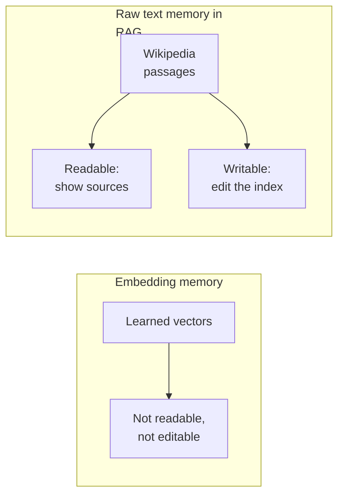

# 06. Related Work (Paper Section 5)

In this note:

- Single-Task Retrieval
- General-Purpose Architectures for NLP
- Learned Retrieval
- Memory-based Architectures (and why raw-text memory matters)
- Retrieve-and-Edit approaches
- Summary: where RAG sits

## Single-Task Retrieval

**What earlier work did:** retrieval was shown to help many NLP tasks, but each one **on its own**: open-domain question answering, fact checking, fact completion, long-form question answering, Wikipedia article generation, dialogue, translation and language modeling.

**How RAG differs:** RAG unifies these separate successes. It shows that **one** retrieval-based architecture can reach strong results on **several** tasks.

## General-Purpose Architectures for NLP

**What earlier work did:** single pre-trained models worked across many tasks **without retrieval**.

<table width="100%">
<thead><tr><th>Model</th><th>Type</th><th>What it showed</th></tr></thead>
<tbody>
<tr><td>BERT and similar</td><td>Encoder, fine-tuned</td><td>Strong results on GLUE classification tasks after fine-tuning</td></tr>
<tr><td>GPT-2</td><td>Left-to-right decoder</td><td>One model can do both discriminative and generative tasks</td></tr>
<tr><td>BART, T5</td><td>Encoder-decoder</td><td>Bidirectional attention gives even stronger results on both kinds of tasks</td></tr>
</tbody>
</table>

**How RAG differs:** it keeps the "one model for many tasks" idea and widens the set of tasks it can do well by **adding a learned retrieval module** to a pre-trained generator.

## Learned Retrieval

**What earlier work did:** much work in information retrieval learns to retrieve documents, more recently with pre-trained neural language models (like DPR). Some work optimizes the retriever for **one** downstream task such as question answering, using:

- search,
- reinforcement learning,
- or a latent-variable approach (ORQA, REALM), which is the same idea RAG uses.

**How RAG differs:** those methods reach strong results on a single task. RAG shows that **one** retrieval-based architecture can be fine-tuned for strong results on **many** tasks.

## Memory-based Architectures

**What earlier work did:** the document index can be seen as a large external memory that a neural network attends to, like **memory networks**. Related work:

- Concurrent work retrieves a **trained embedding** for each entity in the input, instead of raw text.
- Other work helps dialogue models write factual text by attending over **fact embeddings**.

**How RAG differs:** RAG's memory is made of **raw text**, not learned vectors. This gives two properties:

<table width="100%">
<thead><tr><th>Property</th><th>Meaning</th><th>Benefit</th></tr></thead>
<tbody>
<tr><td>Human-readable</td><td>You can read the passages the model retrieved</td><td>A form of interpretability, and citations become possible</td></tr>
<tr><td>Human-writable</td><td>You can edit, add or remove passages</td><td>Change what the model knows without training (see index hot-swapping)</td></tr>
</tbody>
</table>

Raw-text memory had also been used in knowledge-intensive dialogue, where generators read retrieved text directly, but the text was found with TF-IDF, not with end-to-end learned retrieval.

## Retrieve-and-Edit Approaches

**What earlier work did:** for an input, retrieve a **similar training input-output pair** and then edit it a little to get the final output. This worked in machine translation and semantic parsing.

**How RAG differs:**

<table width="100%">
<thead><tr><th>Aspect</th><th>Retrieve-and-edit</th><th>RAG</th></tr></thead>
<tbody>
<tr><td>What is retrieved</td><td>A similar training pair</td><td>Evidence documents</td></tr>
<tr><td>How it is used</td><td>Lightly edit one retrieved item</td><td>Combine content from several retrieved passages</td></tr>
<tr><td>Retrieval learning</td><td>Usually fixed</td><td>Learned as a latent variable</td></tr>
</tbody>
</table>

The authors note that RAG techniques may still work well in those settings, which is a possible future direction.

## Summary: Where RAG Sits

<table width="100%">
<thead><tr><th>Line of work</th><th>What it had</th><th>What it lacked</th><th>What RAG adds</th></tr></thead>
<tbody>
<tr><td>Single-task retrieval</td><td>Retrieval helps</td><td>One system per task</td><td>One architecture for many tasks</td></tr>
<tr><td>General-purpose models</td><td>One model, many tasks</td><td>No retrieval</td><td>A learned retrieval module</td></tr>
<tr><td>Learned retrieval</td><td>Trainable retrievers</td><td>Tuned for one task</td><td>Multi-task fine-tuning</td></tr>
<tr><td>Memory-based models</td><td>External memory</td><td>Memory is learned vectors</td><td>Raw text memory: readable and writable</td></tr>
<tr><td>Retrieve-and-edit</td><td>Retrieval of examples</td><td>Edits one item</td><td>Combines several evidence passages</td></tr>
</tbody>
</table>

## Key Points

- RAG unifies many single-task retrieval successes into one general architecture.
- It adds retrieval to general seq2seq models like BART and T5.
- Its memory is raw text, which is readable (citations) and writable (updates without training).

## Navigation

Previous: [05. Results](05.%20Results.md) | [Index](README.md) | Next: [07. Discussion](07.%20Discussion.md)
