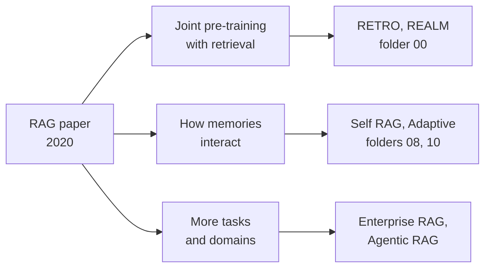

# 07. Discussion (Paper Section 6)

In this note:

- What the authors say they showed
- Each claim linked to its evidence
- The future work they propose
- How later research followed these directions

## What the Authors Say They Showed

Section 6 is short. It sums up the paper as **hybrid generation models with access to parametric and non-parametric memory**. In simple words, the authors claim four things:

<table width="100%">
<thead><tr><th>#</th><th>Claim (simple words)</th><th>Evidence</th><th>Where to read it</th></tr></thead>
<tbody>
<tr><td>1</td><td>RAG reaches state-of-the-art results on open-domain QA</td><td>Table 1</td><td><a href="05.%20Results.md">05. Results</a>, 4.1</td></tr>
<tr><td>2</td><td>People prefer RAG text over purely parametric BART, finding it more factual and specific</td><td>Table 4 human evaluation</td><td><a href="05.%20Results.md">05. Results</a>, 4.3</td></tr>
<tr><td>3</td><td>The learned retrieval component is effective (thorough investigation)</td><td>Table 6 ablations, Figure 3</td><td><a href="05.%20Results.md">05. Results</a>, 4.5</td></tr>
<tr><td>4</td><td>The retrieval index can be hot-swapped to update the model without retraining</td><td>World leaders experiment</td><td><a href="05.%20Results.md">05. Results</a>, 4.5</td></tr>
</tbody>
</table>

## Future Work Proposed

<table width="100%">
<thead><tr><th>Proposal</th><th>Simple meaning</th><th>Why it is interesting</th></tr></thead>
<tbody>
<tr><td>Joint pre-training from scratch</td><td>Train retriever and generator together from the start, with a denoising objective like BART or another objective</td><td>In this paper both parts are pre-trained separately and only fine-tuned together</td></tr>
<tr><td>Study how the two memories interact</td><td>Understand how parametric and non-parametric memory work together and how best to combine them</td><td>Figure 2 already hints at cooperation: retrieval guides, weights fill in</td></tr>
<tr><td>Apply RAG to many more NLP tasks</td><td>Use the same recipe elsewhere</td><td>The architecture is task-agnostic</td></tr>
</tbody>
</table>

## How Later Research Followed

<table width="100%">
<thead><tr><th>Direction from the paper</th><th>Later work</th><th>Folder in this repo</th></tr></thead>
<tbody>
<tr><td>Joint pre-training with retrieval</td><td>RETRO (retrieval during pre-training)</td><td>00. RAG Surveys and Foundations</td></tr>
<tr><td>How and when to use each memory</td><td>Self-RAG (decide when to retrieve), Adaptive-RAG (route by question difficulty)</td><td>08. Self RAG, 10. Adaptive RAG</td></tr>
<tr><td>Wider range of tasks</td><td>Document QA, multimodal RAG, agentic systems</td><td>16. Agentic RAG, 18. Multimodal RAG</td></tr>
</tbody>
</table>

## Key Points

- The paper's four claims: SOTA open-domain QA, more factual and specific text, effective learned retrieval, hot-swappable knowledge.
- Open questions named by the authors: joint pre-training and how the two memories interact.
- Many later architectures in this repo answer exactly these questions.

## Navigation

Previous: [06. Related Work](06.%20Related%20Work.md) | [Index](README.md) | Next: [08. Broader Impact](08.%20Broader%20Impact.md)
