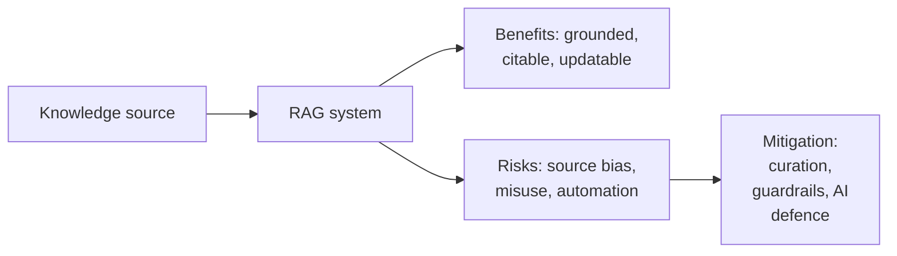

# 08. Broader Impact (Paper Section: Broader Impact)

In this note:

- Benefits for society named by the authors
- Risks and downsides named by the authors
- The mitigation the authors suggest
- How these points look in today's RAG systems

## Benefits

The authors argue that RAG has positive effects compared with earlier models.

<table width="100%">
<thead><tr><th>Benefit</th><th>Why, in simple words</th><th>Today's practice</th></tr></thead>
<tbody>
<tr><td>Hallucinates less</td><td>Generation is grounded in real factual text (here Wikipedia)</td><td>Grounding prompts: answer only from context</td></tr>
<tr><td>More factual output</td><td>Facts are read from documents, not guessed from weights</td><td>Faithfulness metrics in evaluation</td></tr>
<tr><td>More control and interpretability</td><td>You can see which passages the answer is based on</td><td>Citations next to answers</td></tr>
<tr><td>Useful in specialised domains</td><td>Give it a medical index and ask open-domain medical questions</td><td>Domain knowledge bases (legal, medical, company docs)</td></tr>
<tr><td>Helps people at work</td><td>Makes people more effective at their jobs</td><td>Internal assistants and support bots</td></tr>
</tbody>
</table>

## Risks and Downsides

<table width="100%">
<thead><tr><th>Risk</th><th>Explanation in simple words</th><th>Modern mitigation</th></tr></thead>
<tbody>
<tr><td>Imperfect knowledge source</td><td>Wikipedia, or any knowledge source, will never be fully factual and free of bias. RAG repeats what the source says</td><td>Curate sources, track provenance, show citations</td></tr>
<tr><td>Misuse as a language model</td><td>Like GPT-2, it could be used to write abuse, fake or misleading news, impersonate people, or automate spam and phishing. The authors say the risk is arguably smaller than for GPT-2</td><td>Guardrails, content filters, usage policies</td></tr>
<tr><td>Job automation</td><td>Advanced language models may automate some jobs in the coming decades</td><td>Human-in-the-loop design</td></tr>
</tbody>
</table>

## Suggested Mitigation

The authors suggest that AI systems themselves could be used to **fight** misleading content and automated spam or phishing.

## Key Point for Builders

A RAG system is only as trustworthy as its documents. Good source selection, access control and citations are part of the design, not extras.

## Navigation

Previous: [07. Discussion](07.%20Discussion.md) | [Index](README.md) | Next: [09. Appendices](09.%20Appendices.md)
