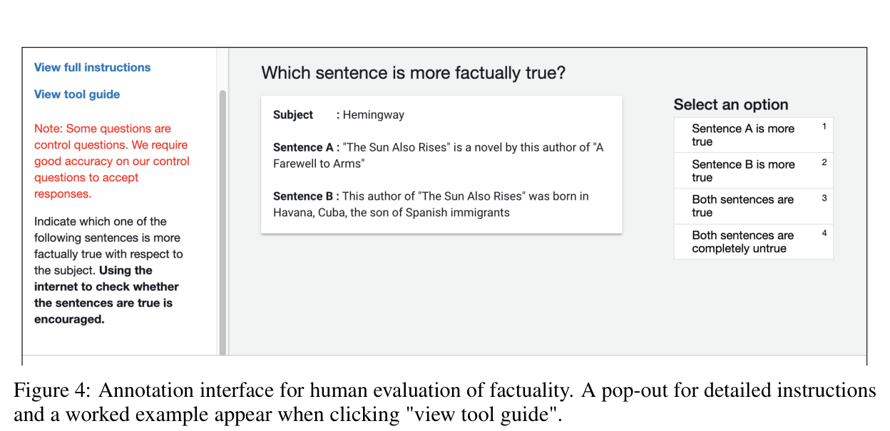
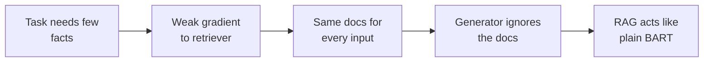
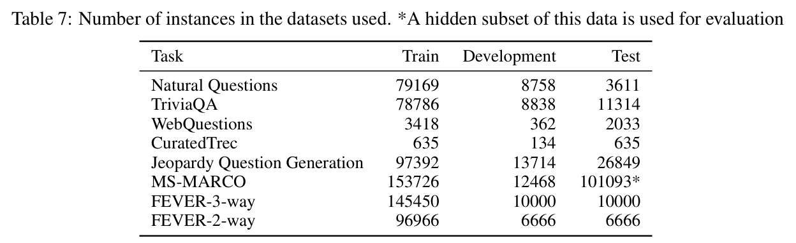

# 09. Appendices (Paper Appendices A to I)

In this note:

- A. Implementation Details
- B. Human Evaluation (Figure 4)
- C. Training Setup Details
- D. Further Details on Open-Domain QA
- E. Further Details on FEVER
- F. Null Document Probabilities
- G. Parameters
- H. Retrieval Collapse
- I. Number of Instances per Dataset (Table 7)

## A. Implementation Details

<table width="100%">
<thead><tr><th>Task</th><th>Model</th><th>Docs retrieved at test</th><th>Decoding</th></tr></thead>
<tbody>
<tr><td>Open-domain QA</td><td>RAG-Token</td><td>15</td><td>Greedy (beam search did not help)</td></tr>
<tr><td>Open-domain QA</td><td>RAG-Sequence</td><td>50</td><td>Thorough Decoding, greedy (answers are short)</td></tr>
<tr><td>MS-MARCO, Jeopardy</td><td>RAG-Token</td><td>10</td><td>Beam size 4</td></tr>
<tr><td>MS-MARCO, Jeopardy</td><td>RAG-Sequence</td><td>10</td><td>Beam size 4, Fast Decoding (Thorough did not help)</td></tr>
<tr><td>MS-MARCO, Jeopardy</td><td>BART baseline</td><td>0</td><td>BART-large trained on the same data</td></tr>
</tbody>
</table>

**Greedy decoding** picks the single most likely token at each step (a beam of size 1). **Beam size 4** keeps the 4 best partial outputs at each step.

## B. Human Evaluation

Figure 4 is the screen the human judges used.

<table width="100%">
<thead><tr><th>Part of the screen</th><th>Meaning</th></tr></thead>
<tbody>
<tr><td>Title "Which sentence is more factually true?"</td><td>The question asked for the factuality evaluation</td></tr>
<tr><td>Subject: Hemingway</td><td>The input (the Jeopardy answer entity)</td></tr>
<tr><td>Sentence A, Sentence B</td><td>Two generated clues, one from BART and one from RAG</td></tr>
<tr><td>Four options on the right</td><td>A is more true, B is more true, both true, both completely untrue</td></tr>
<tr><td>Red note on the left</td><td>Some questions are control questions to check annotator accuracy</td></tr>
<tr><td>Left instructions</td><td>Annotators are told to use the internet to check the sentences</td></tr>
<tr><td>"View full instructions", "View tool guide"</td><td>Links to detailed instructions and a worked example</td></tr>
</tbody>
</table>

How bias was avoided:

- Which model was A and which was B was chosen at **random** for each example, so screen position could not bias judges.
- Gold sentences (with known answers) were mixed in to check annotator quality. **Two annotators** did poorly on these, and their annotations were removed.

## C. Training Setup Details

<table width="100%">
<thead><tr><th>Item</th><th>Value</th><th>Note</th></tr></thead>
<tbody>
<tr><td>Framework</td><td>Fairseq</td><td>Later ported to HuggingFace Transformers with the same performance</td></tr>
<tr><td>Precision</td><td>Mixed precision floating point</td><td>Faster training, less memory</td></tr>
<tr><td>GPUs</td><td>8 x NVIDIA V100, 32GB each</td><td>Training and inference can also run on 1 GPU</td></tr>
<tr><td>MIPS location</td><td>CPU, with FAISS</td><td>Fast enough on CPU</td></tr>
<tr><td>Index memory</td><td>About 100 GB CPU RAM for all of Wikipedia</td><td>Uncompressed vectors</td></tr>
<tr><td>Compressed index</td><td>About 36 GB</td><td>Using FAISS compression tools</td></tr>
</tbody>
</table>

Lesson for production: vector indexes are large, and **compression (quantization)** is often needed. See the vector database note in Basic Concepts.

## D. Further Details on Open-Domain QA

<table width="100%">
<thead><tr><th>Dataset</th><th>Issue</th><th>What the authors did</th></tr></thead>
<tbody>
<tr><td>NQ, WebQuestions</td><td>Several valid answer annotations per question</td><td>Train with each (question, answer) pair separately: small accuracy gain</td></tr>
<tr><td>TriviaQA</td><td>Many valid answers, some bad as targets (emoji, spelling variants)</td><td>Drop answer candidates that do not appear in the top 1000 retrieved documents</td></tr>
<tr><td>CuratedTrec</td><td>Answers are regular expressions, not text, which is hard for generators</td><td>Retrieve top 1000 docs and use the most frequent regex match as the target. If none, generate all permutations of the regex, replacing non-deterministic symbols with a space</td></tr>
<tr><td>TriviaQA test sets</td><td>Two test sets used in the literature</td><td>Report both: open-domain dev split (as DPR) and official Wiki test set (as T5)</td></tr>
</tbody>
</table>

The official TQA Wiki test set gives much higher scores than the open-domain split. The authors think its questions are simpler to answer from Wikipedia.

## E. Further Details on FEVER

- Following BART, the model first **re-generates the claim**, then classifies using the representation of the **final hidden state**, and finally **marginalizes across documents** to get class probabilities.
- FEVER has a second sub-task: extract the evidence sentences from Wikipedia. FEVER uses a different Wikipedia dump than the paper, so this was not attempted and is left for future work.

## F. Null Document Probabilities

**Problem:** sometimes no retrieved passage is useful. Can the model "choose no document"?

**Idea (from REALM):** retrieve k documents, add one extra empty **null document** with its own score (logit), and marginalize over k + 1 options. Three ways to score it were tried:

1. Learn a document embedding for the null document.
2. Learn a static bias term.
3. Use a neural network to predict the logit.

**Result:** none improved performance, so the mechanism was dropped for simplicity. On MS-MARCO, where useful passages often cannot be found, the model learned by itself to **always retrieve a particular fixed set of documents** for questions that do not benefit from retrieval. So a null-document mechanism may not be needed.

This "should we retrieve at all" question returns in Self-RAG and Adaptive RAG (folders 08 and 10).

## G. Parameters

<table width="100%">
<thead><tr><th>Component</th><th>Parameters</th><th>Trained in RAG?</th></tr></thead>
<tbody>
<tr><td>BERT-base query encoder</td><td>110M</td><td>Yes</td></tr>
<tr><td>BERT-base document encoder</td><td>110M</td><td>No, kept frozen</td></tr>
<tr><td>BART-large generator</td><td>406M</td><td>Yes</td></tr>
<tr><td>Total "trainable" as reported</td><td>626M</td><td>-</td></tr>
<tr><td>Document index</td><td>21M vectors, 15.3B values</td><td>Not parameters</td></tr>
</tbody>
</table>

Two notes on the numbers:

- The paper's 626M (110M + 110M + 406M) **includes the document encoder**, which is never trained. The parameters actually updated are 110M + 406M = **516M**.
- The paper says the index has 21M "728 dimensional" vectors, 15.3B values in total. 21M x 728 does give 15.3B, so the arithmetic matches, but BERT-base outputs **768** dimensions (21M x 768 is about 16.1B). 728 is very likely a typo for 768. The vectors can be stored in 8-bit floating point to save memory and disk.

Comparison with closed-book models:

<table width="100%">
<thead><tr><th>Model</th><th>Trainable parameters</th><th>NQ Exact Match</th></tr></thead>
<tbody>
<tr><td>T5-11B (best closed-book)</td><td>11B</td><td>34.5</td></tr>
<tr><td>T5-large (closest size to RAG)</td><td>770M</td><td>28.9</td></tr>
<tr><td>RAG-Sequence</td><td>626M (as reported)</td><td>44.5</td></tr>
</tbody>
</table>

Hybrid parametric plus non-parametric models need far fewer trainable parameters for strong open-domain QA.

## H. Retrieval Collapse

In early experiments on tasks like **story generation**, the retriever "collapsed": it learned to return the **same documents for every input**. Then the generator learned to ignore the documents, and RAG behaved like plain BART.

Possible reasons given by the authors:

- The task needs less explicit factual knowledge.
- Long target sequences may give the retriever less informative gradients.

Lesson: retrieval helps knowledge-intensive tasks. For creative or open-ended tasks it may add little.

## I. Number of Instances per Dataset

Table 7 lists how many examples each dataset has in the train, development and test splits. The star on MS-MARCO test means a hidden subset of the test data is used for evaluation.

<table width="100%">
<thead><tr><th>Task</th><th>Train</th><th>Development</th><th>Test</th><th>Plain reading</th></tr></thead>
<tbody>
<tr><td>Natural Questions</td><td>79,169</td><td>8,758</td><td>3,611</td><td>Large QA set</td></tr>
<tr><td>TriviaQA</td><td>78,786</td><td>8,838</td><td>11,314</td><td>Large QA set</td></tr>
<tr><td>WebQuestions</td><td>3,418</td><td>362</td><td>2,033</td><td>Small, starts from NQ model</td></tr>
<tr><td>CuratedTrec</td><td>635</td><td>134</td><td>635</td><td>Very small, starts from NQ model</td></tr>
<tr><td>Jeopardy Question Generation</td><td>97,392</td><td>13,714</td><td>26,849</td><td>New task in this paper</td></tr>
<tr><td>MS-MARCO</td><td>153,726</td><td>12,468</td><td>101,093 (hidden subset)</td><td>Largest set</td></tr>
<tr><td>FEVER 3-way</td><td>145,450</td><td>10,000</td><td>10,000</td><td>Classification</td></tr>
<tr><td>FEVER 2-way</td><td>96,966</td><td>6,666</td><td>6,666</td><td>Classification, no "not enough info"</td></tr>
</tbody>
</table>

## Key Points

- QA used greedy decoding with 15 (Token) or 50 (Sequence) documents. Generation used beam size 4 with 10 documents.
- Human evaluation was randomized and quality-checked with gold sentences.
- The full Wikipedia index needs about 100 GB RAM, or 36 GB compressed.
- About 516M parameters actually trained (626M as reported) beat an 11B closed-book model.
- A null document did not help, and retrieval can collapse on tasks that need few facts.

## Navigation

Previous: [08. Broader Impact](08.%20Broader%20Impact.md) | [Index](README.md) | Next: [Back to 01. Naive RAG](../../README.md#notes)
