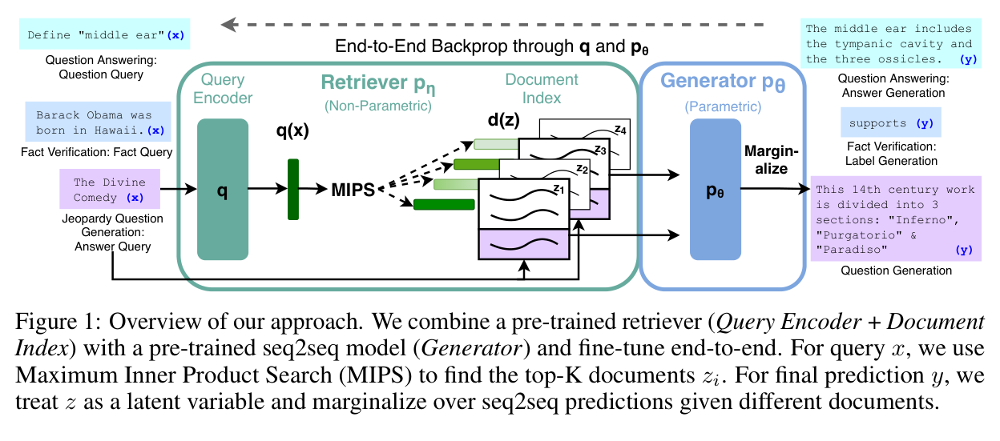

# Research Paper Explained: Retrieval-Augmented Generation for Knowledge-Intensive NLP Tasks

These notes go through the original RAG paper one section at a time. There is one note for each section of the paper. Every figure and table is shown exactly as it appears in the paper and then explained in simple words. Every equation is explained symbol by symbol.

In this note:

- Paper card with links
- The paper in one paragraph
- Figure 1 of the paper (the whole idea in one picture)
- Index of the notes (one per paper section)
- Key takeaways
- Paper RAG vs today's Naive RAG

## Paper Card

<table width="100%">
<thead><tr><th>Field</th><th>Value</th></tr></thead>
<tbody>
<tr><td>Title</td><td>Retrieval-Augmented Generation for Knowledge-Intensive NLP Tasks</td></tr>
<tr><td>Authors</td><td>Patrick Lewis, Ethan Perez, Aleksandra Piktus, Fabio Petroni, Vladimir Karpukhin, Naman Goyal, Heinrich Kuttler, Mike Lewis, Wen-tau Yih, Tim Rocktaschel, Sebastian Riedel, Douwe Kiela</td></tr>
<tr><td>Organizations</td><td>Facebook AI Research, University College London, New York University</td></tr>
<tr><td>Year and venue</td><td>2020, NeurIPS 2020</td></tr>
<tr><td>arXiv</td><td><a href="https://arxiv.org/abs/2005.11401">2005.11401</a></td></tr>
<tr><td>Local PDF</td><td><a href="../../02.%20Papers/2005.11401_RAG-Lewis.pdf">2005.11401_RAG-Lewis.pdf</a></td></tr>
<tr><td>Code</td><td><a href="https://huggingface.co/docs/transformers/model_doc/rag">HuggingFace Transformers RAG docs</a></td></tr>
</tbody>
</table>

## The Paper in One Paragraph

Large language models store facts inside their weights. They cannot easily update those facts, they cannot show where an answer came from, and they sometimes invent facts (hallucinate). This paper connects a text generator (BART) to a searchable library of 21 million Wikipedia passages. For each input, a neural retriever (DPR) finds the most relevant passages, and the generator writes the output while reading them. The paper gives two ways to combine several passages (RAG-Sequence and RAG-Token). It trains the retriever and the generator together without telling the model which passage is correct. It shows state-of-the-art results on open-domain question answering, more factual text than BART alone, and the ability to update knowledge by swapping the passage library. The name "RAG" and the retrieve-then-generate pattern used in almost every modern LLM application come from this paper.

## Figure 1 of the Paper

Left to right: an input (a question, a claim or an answer entity) goes into the **query encoder**, **MIPS** search finds the top passages in the **document index**, the **generator** reads the input with each passage, and **marginalize** combines the results into the output. The dashed arrow on top shows that training updates the query encoder and the generator together. The full part-by-part explanation is in [02. Introduction](02.%20Introduction.md).

## Index of Notes (one per paper section)

<table width="100%">
<thead><tr><th>#</th><th>Note</th><th>Paper section</th><th>What it covers</th><th>Figures / Tables used</th></tr></thead>
<tbody>
<tr><td>01</td><td><a href="01.%20Abstract.md">Abstract</a></td><td>Abstract</td><td>Every sentence of the abstract explained in simple words</td><td>-</td></tr>
<tr><td>02</td><td><a href="02.%20Introduction.md">Introduction</a></td><td>Section 1</td><td>Problem, two kinds of memory, prior work, Figure 1 part by part, contributions</td><td>Figure 1</td></tr>
<tr><td>03</td><td><a href="03.%20Methods.md">Methods</a></td><td>Section 2 (2.1 to 2.5)</td><td>RAG-Sequence and RAG-Token equations, DPR retriever, BART generator, training, decoding</td><td>Figure 1 (recap)</td></tr>
<tr><td>04</td><td><a href="04.%20Experiments.md">Experiments</a></td><td>Section 3 (3.1 to 3.4)</td><td>Wikipedia index, open-domain QA, abstractive QA, Jeopardy generation, FEVER, metrics</td><td>-</td></tr>
<tr><td>05</td><td><a href="05.%20Results.md">Results</a></td><td>Section 4 (4.1 to 4.5)</td><td>All results, examples, human evaluation, document posterior, ablations, hot-swapping, effect of K</td><td>Tables 1 to 6, Figures 2 and 3</td></tr>
<tr><td>06</td><td><a href="06.%20Related%20Work.md">Related Work</a></td><td>Section 5</td><td>Five lines of earlier work and how RAG differs from each</td><td>-</td></tr>
<tr><td>07</td><td><a href="07.%20Discussion.md">Discussion</a></td><td>Section 6</td><td>What the authors claim they showed, and future work</td><td>-</td></tr>
<tr><td>08</td><td><a href="08.%20Broader%20Impact.md">Broader Impact</a></td><td>Broader Impact</td><td>Benefits and risks for society</td><td>-</td></tr>
<tr><td>09</td><td><a href="09.%20Appendices.md">Appendices</a></td><td>Appendices A to I</td><td>Implementation, human evaluation, hardware, dataset tricks, null document, parameters, retrieval collapse, dataset sizes</td><td>Figure 4, Table 7</td></tr>
</tbody>
</table>

## Key Takeaways

1. **Two memories are better than one.** Model weights give fluency and general knowledge. A text index gives exact, updatable facts.
2. **Retrieve, then generate.** Find relevant passages first, then let the generator read them.
3. **Dense retrieval works.** Query and passage vectors compared by inner product beat keyword search on most tasks.
4. **The passage is a hidden (latent) variable.** No passage labels are needed. The retriever learns from the final answer.
5. **Two ways to combine passages.** RAG-Sequence (one passage per answer) and RAG-Token (the passage can change per token).
6. **Freeze the document side.** Rebuilding the index during training is expensive and not needed.
7. **Generation beats extraction.** Even on extractive QA, and even when the answer string is not in any passage.
8. **Less hallucination, more specific answers.** Human judges strongly prefer RAG over BART for factuality.
9. **Update knowledge by swapping the index.** No retraining required.
10. **Small plus retrieval beats huge without retrieval.** About 626M parameters with retrieval beat T5 with 11B parameters.

## Paper RAG vs Today's Naive RAG

### What modern Naive RAG kept

<table width="100%">
<thead><tr><th>Idea from the paper</th><th>How it appears in Naive RAG today</th></tr></thead>
<tbody>
<tr><td>Retrieve-then-generate pipeline</td><td>Same two-stage design: retriever finds chunks, LLM writes the answer</td></tr>
<tr><td>Dense bi-encoder retrieval</td><td>Embedding models encode chunks and queries separately</td></tr>
<tr><td>Fixed-size chunking (100 words)</td><td>Fixed-size chunks (often 200 to 1000 tokens), now usually with overlap</td></tr>
<tr><td>Pre-computed vector index</td><td>Vector databases (FAISS, Chroma, Qdrant, pgvector, Pinecone)</td></tr>
<tr><td>Approximate search with HNSW</td><td>HNSW is still the default index in most vector databases</td></tr>
<tr><td>Frozen document encoder and index</td><td>Index built once offline, re-indexed only when documents change</td></tr>
<tr><td>Top-k as a tunable knob</td><td>top_k is a standard retriever setting</td></tr>
<tr><td>Hot-swappable knowledge</td><td>Update the vector store to update answers, no model training</td></tr>
<tr><td>Provenance from raw text</td><td>Return source chunks and citations with the answer</td></tr>
</tbody>
</table>

### What changed

<table width="100%">
<thead><tr><th>Paper (2020)</th><th>Today's Naive RAG</th><th>Why it changed</th></tr></thead>
<tbody>
<tr><td>Retriever and generator fine-tuned together</td><td>No training at all, both models used as they are</td><td>Large LLMs are expensive to fine-tune and already good at reading context</td></tr>
<tr><td>BART-large encoder-decoder, 406M</td><td>Large decoder-only LLMs (Claude, GPT, Llama)</td><td>Much stronger instruction following and reasoning</td></tr>
<tr><td>Generator reads one passage at a time</td><td>All top-k chunks put into one prompt</td><td>Long context windows hold many chunks at once</td></tr>
<tr><td>Marginalization over passages</td><td>No marginalization, the LLM reads all chunks together</td><td>Prompt stuffing is simpler and works well with strong LLMs</td></tr>
<tr><td>Wikipedia only</td><td>Any private or public documents</td><td>Enterprise use cases</td></tr>
<tr><td>100-word chunks with no overlap</td><td>Token-based chunks with overlap and smarter splitting</td><td>Overlap avoids cutting facts at chunk borders</td></tr>
<tr><td>BERT-base 768-dim encoders trained for QA</td><td>General-purpose embedding models, 384 to 3072 dims</td><td>Better embeddings trained on huge, varied data</td></tr>
<tr><td>Behaviour set by task fine-tuning</td><td>Behaviour set by a prompt template</td><td>Prompting replaces task-specific fine-tuning</td></tr>
</tbody>
</table>

```mermaid
flowchart TB
    subgraph Paper[RAG paper 2020]
        PX[Input x] --> PQ[BERT_q<br/>query encoder]
        PQ --> PM[MIPS over 21M<br/>Wikipedia vectors]
        PM --> PG[BART reads x with<br/>each passage]
        PG --> PMG[Marginalize<br/>over passages]
        PMG --> PY[Output y]
    end
    subgraph Today[Naive RAG today]
        TX[User question] --> TE[Embedding model]
        TE --> TV[Vector DB<br/>top-k search]
        TV --> TP[Prompt: question<br/>plus top-k chunks]
        TP --> TL[Frozen LLM]
        TL --> TY[Answer with<br/>citations]
    end
```

### From the paper's findings to later architectures

<table width="100%">
<thead><tr><th>Finding in the paper</th><th>Problem it shows</th><th>Later architecture in this repo</th></tr></thead>
<tbody>
<tr><td>BM25 beats dense retrieval on entity-heavy FEVER</td><td>Dense vectors miss exact names</td><td>03. Hybrid Search RAG</td></tr>
<tr><td>DPR baseline used a cross-encoder re-ranker</td><td>Bi-encoder ranking is imperfect</td><td>02. Advanced RAG (re-ranking)</td></tr>
<tr><td>Null document did not help, model ignores retrieval for some questions</td><td>Not every query needs retrieval</td><td>08. Self RAG, 10. Adaptive RAG</td></tr>
<tr><td>Some MS-MARCO questions not answerable from Wikipedia</td><td>The knowledge base can be incomplete</td><td>09. Corrective RAG (web fallback)</td></tr>
<tr><td>RAG-Token combines facts from two passages</td><td>Multi-fact and multi-hop questions</td><td>11. Active Iterative RAG, 13. Graph RAG</td></tr>
<tr><td>Best K differs by task</td><td>Context selection matters</td><td>02. Advanced RAG, 19. Long RAG</td></tr>
<tr><td>Future work: joint pre-training</td><td>Retrieval inside pre-training</td><td>REALM and RETRO in 00. RAG Surveys and Foundations</td></tr>
</tbody>
</table>

One sentence summary: giving a generator a searchable, swappable library of text makes it more accurate, more factual and easier to update than storing everything in its weights, and this idea is the base of every architecture in this repository.

## Navigation

[Back to 01. Naive RAG](../../README.md#notes) | Next: [01. Abstract](01.%20Abstract.md)
