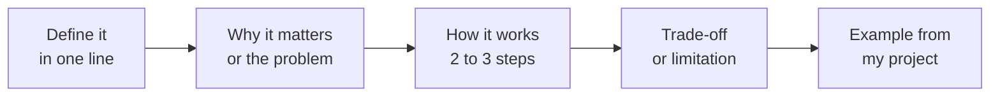
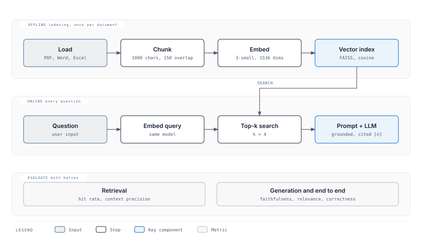
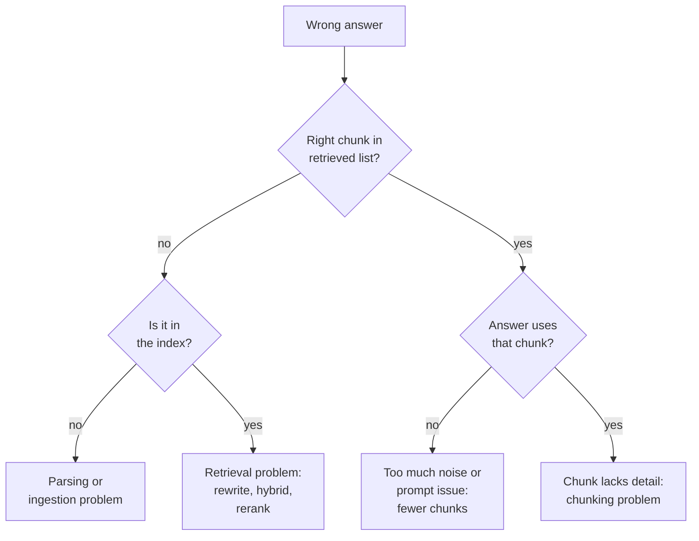

# 01. Naive RAG Interview Preparation

Everything needed to explain Naive RAG in an interview: the concepts, the paper, this project's implementation and numbers, evaluation, limitations and what comes next. Each answer is short enough to say out loud; the links point to the detailed notes and docs.

In this doc:

- How to use this doc, and how to structure an answer
- The diagram to draw
- Questions and answers by topic (14 topics)
- Worked numbers you can calculate on a whiteboard
- System design: from this project to production
- Your project story and walkthrough
- Debugging a bad answer, live
- Rapid-fire round
- Mistakes that cost points

## How to use this doc

1. Read the 30-second and 2-minute explanations until you can say them without notes.
2. Practise drawing the diagram in under a minute.
3. Learn the project numbers (they make answers credible): overall 0.80, faithfulness 0.95, context precision 0.41, correctness 0.85, hit rate 90 percent, Rs 0.02 and 1.7 s per question, 410 chunks.
4. Go through the topic tables; for each question, say the answer, then check the linked note.

### How to structure any answer

Example, "What is chunk overlap?": *Define* "repeating the last part of one chunk at the start of the next". *Why* "so a sentence that crosses a boundary is still retrievable in one piece". *How* "we use 150 characters of overlap on 1000-character chunks". *Trade-off* "more chunks and some duplicate context". *Example* "in our index 410 chunks; without overlap facts at boundaries were split".

## The 30-second and 2-minute explanations

**30 seconds:** "An LLM only knows its training data. RAG gives it an open book: documents are split into chunks, each chunk becomes an embedding vector in a vector index. For a question, we embed it, retrieve the most similar chunks by cosine similarity, put them in the prompt and tell the LLM to answer only from them, with citations. Naive RAG is the simplest version: one retrieval, a fixed top-k, no reranking. It is cheap and grounded; its weakness is retrieval quality."

**2 minutes:** add the two phases (offline indexing, online querying), name the components (loader, chunker, embedding model, vector database, retriever, prompt, LLM), say why it beats a plain LLM (fresh knowledge, citations, fewer hallucinations, no retraining), give one limitation with a number ("in my evaluation only 41 percent of retrieved chunks were useful") and the next step ("reranking and query rewriting, which is Advanced RAG").

## The diagram to draw

Draw the two rows first (offline, online), then the arrow from the index to the search, then the evaluation box. Write the numbers on the boxes: they show you have built it.

## Questions and answers by topic

### 1. Fundamentals

<table width="100%">
<thead><tr><th>Question</th><th>Answer</th></tr></thead>
<tbody>
<tr><td>What is RAG?</td><td>Retrieval-Augmented Generation: before generating, retrieve relevant text from an external source and give it to the LLM as context, so the answer is grounded in that text</td></tr>
<tr><td>Why do LLMs need RAG?</td><td>Knowledge cutoff, no access to private data, hallucinations, no sources. RAG adds current and private knowledge with citations, without retraining</td></tr>
<tr><td>Parametric versus non-parametric memory?</td><td>Parametric: knowledge stored in the model's weights. Non-parametric: an external index the model reads at question time. RAG combines both</td></tr>
<tr><td>What makes it "Naive"?</td><td>Single retrieval, fixed top-k, dense similarity only, no query rewriting, no reranking, no verification. The term comes from the RAG survey by Gao et al. 2023 (Naive, Advanced, Modular)</td></tr>
<tr><td>RAG versus fine-tuning?</td><td>Fine-tuning changes behaviour and style; RAG adds knowledge. RAG updates instantly and cites sources; fine-tuning is costly to update and still hallucinates facts. They combine well</td></tr>
<tr><td>RAG versus long context?</td><td>Long context puts everything in the prompt: simple but costly per question and weaker on very long inputs ("lost in the middle"). RAG sends only relevant chunks. For a small fixed corpus, long context or caching can be enough</td></tr>
<tr><td>When not to use RAG?</td><td>Pure reasoning tasks, tiny knowledge that fits in the prompt, questions needing aggregation over the whole corpus (use SQL or Graph RAG)</td></tr>
</tbody>
</table>

Notes: [01. What is RAG](../01.%20Basic%20Concepts/01.%20What%20is%20RAG.md), [02. Why LLMs Need RAG](../01.%20Basic%20Concepts/02.%20Why%20LLMs%20Need%20RAG.md).

### 2. Loading and parsing

<table width="100%">
<thead><tr><th>Question</th><th>Answer</th></tr></thead>
<tbody>
<tr><td>Why does parsing matter?</td><td>Garbage in, garbage out: broken text, flattened tables or missing pages become bad chunks that can never be retrieved correctly</td></tr>
<tr><td>How did you load PDFs?</td><td>pypdf, one document per page with the page number in metadata, so citations can point to a page and the UI can open it</td></tr>
<tr><td>What problems did you see?</td><td>Small caps split into letters ("L EARNING"), tables flattened into rows of numbers, formulas as raw text, scanned pages with no text (detected by a 0-character page in the logs)</td></tr>
<tr><td>Excel and Word?</td><td>Excel: one document per sheet, rows as text with headers. Word: paragraphs and tables as text. Each keeps source metadata</td></tr>
</tbody>
</table>

Notes: [03. Document Loading and Parsing](../01.%20Basic%20Concepts/03.%20Document%20Loading%20and%20Parsing.md). API docs 04 to 08.

### 3. Chunking

<table width="100%">
<thead><tr><th>Question</th><th>Answer</th></tr></thead>
<tbody>
<tr><td>Why chunk at all?</td><td>Embedding models and prompts have limits, and a small chunk has a focused meaning, so its vector matches specific questions better</td></tr>
<tr><td>How do you choose chunk size?</td><td>Big enough for a complete idea, small enough to be specific. We use 1000 characters with 150 overlap; test a few sizes on an evaluation set</td></tr>
<tr><td>What is recursive chunking?</td><td>Split by the largest natural boundary first (paragraph), then line, sentence, word, only as far as needed to fit the size, then merge small pieces with overlap</td></tr>
<tr><td>Downside of fixed-size chunks?</td><td>They ignore structure: our one-chunk HR file capped precision at 0.25 with top 4, and paper chunks mix two sections</td></tr>
<tr><td>Better chunking strategies?</td><td>Semantic chunking, section-aware splitting, parent-child (search small, send the larger parent), contextual headers (prepend title and section)</td></tr>
</tbody>
</table>

Notes: [04. Chunking](../01.%20Basic%20Concepts/04.%20Chunking.md). API doc 09.

### 4. Embeddings and similarity

<table width="100%">
<thead><tr><th>Question</th><th>Answer</th></tr></thead>
<tbody>
<tr><td>What is an embedding?</td><td>A vector of numbers representing meaning; similar texts get vectors that point in similar directions. text-embedding-3-small gives 1536 numbers</td></tr>
<tr><td>Cosine similarity?</td><td>The cosine of the angle between two vectors: dot product divided by the product of lengths. 1 = same direction, 0 = unrelated</td></tr>
<tr><td>Why normalise vectors?</td><td>After L2 normalisation, the dot product equals cosine similarity, so an inner-product index (FAISS IndexFlatIP) gives cosine search</td></tr>
<tr><td>Same model for query and documents?</td><td>Yes, both must live in the same vector space. (DPR uses two encoders trained together; we use one frozen model for both)</td></tr>
<tr><td>Why are scores like 0.6, not 0.95?</td><td>Questions and passages are different kinds of text; absolute scores depend on the model. Compare scores within one query, not across queries</td></tr>
<tr><td>Weakness of dense embeddings?</td><td>Rare names and codes (DPR, BART) carry little weight; similar topics blur together. Hybrid search with BM25 fixes the first</td></tr>
</tbody>
</table>

Notes: [05. Embeddings](../01.%20Basic%20Concepts/05.%20Embeddings.md), [06. Similarity Measures](../01.%20Basic%20Concepts/06.%20Similarity%20Measures.md). API doc 10.

### 5. Vector databases and indexing

<table width="100%">
<thead><tr><th>Question</th><th>Answer</th></tr></thead>
<tbody>
<tr><td>What does a vector database do?</td><td>Stores vectors with their text and metadata and finds the nearest vectors to a query fast</td></tr>
<tr><td>Why FAISS IndexFlatIP?</td><td>Exact search, no training, fast enough for thousands of chunks; simple to save and load</td></tr>
<tr><td>Exact versus approximate search?</td><td>Flat compares with every vector (exact, linear time). HNSW (graph) or IVF (clusters), often with PQ compression, are approximate but sub-linear, needed for millions of vectors</td></tr>
<tr><td>How do you delete a document from FAISS?</td><td>IndexFlatIP has no delete by id here, so we rebuild the index from the remaining vectors (reconstruct, filter, re-add). Fine at this scale; IndexIDMap or a managed vector DB support deletes directly</td></tr>
<tr><td>FAISS versus a vector database (Pinecone, Qdrant, Azure AI Search)?</td><td>FAISS is a library in your process; a vector DB adds persistence, filtering, scaling, replication and hybrid search as a service</td></tr>
</tbody>
</table>

Notes: [07. Vector Databases and Indexing](../01.%20Basic%20Concepts/07.%20Vector%20Databases%20and%20Indexing.md). API docs 11, 23.

### 6. Retrieval

<table width="100%">
<thead><tr><th>Question</th><th>Answer</th></tr></thead>
<tbody>
<tr><td>What is top-k?</td><td>The number of most similar chunks returned. We use 4</td></tr>
<tr><td>How did you pick k?</td><td>Experiment on the test set: k=2 precision 0.50 but hit rate 80 percent; k=6 hit rate 100 percent but precision 0.32; k=4 had the best overall score</td></tr>
<tr><td>What is a bi-encoder?</td><td>Query and documents are encoded separately, so documents are encoded once offline and search is one vector comparison per chunk</td></tr>
<tr><td>What is a cross-encoder?</td><td>A model that reads the query and a chunk together and outputs a relevance score: more accurate, too slow for the whole index, so used to rerank the top 20 to 50</td></tr>
<tr><td>Why not use a similarity threshold?</td><td>Naive RAG does not, which is one of its weaknesses: our logs show chunks with score 0.14 sent next to a 0.52 chunk. A threshold or dynamic k is one of the first upgrades</td></tr>
</tbody>
</table>

Notes: [08. Retrieval](../01.%20Basic%20Concepts/08.%20Retrieval.md). API doc 14.

### 7. Prompting and generation

<table width="100%">
<thead><tr><th>Question</th><th>Answer</th></tr></thead>
<tbody>
<tr><td>What is in your prompt?</td><td>System: use only the context, say "I could not find this in the provided documents" if missing, cite [n] after each fact. User: numbered context blocks with source labels, then the question</td></tr>
<tr><td>Why temperature 0?</td><td>Factual answers should be stable and close to the context</td></tr>
<tr><td>How do citations work?</td><td>Each chunk is numbered in the prompt; the model cites the number; the API returns the sources with file and page; the UI turns [n] into a chip that opens the PDF page with the passage highlighted</td></tr>
<tr><td>How do you prevent hallucinations?</td><td>Grounding instruction, fixed not-found answer, citations, temperature 0, and measuring faithfulness; for weak retrieval add verification (Corrective RAG)</td></tr>
<tr><td>What is "lost in the middle"?</td><td>LLMs use information at the start and end of a long context better than in the middle; another reason to send fewer, better chunks</td></tr>
</tbody>
</table>

Notes: [09. Prompt Augmentation and Generation](../01.%20Basic%20Concepts/09.%20Prompt%20Augmentation%20and%20Generation.md). API docs 15, 16.

### 8. The original paper (Lewis et al. 2020)

<table width="100%">
<thead><tr><th>Question</th><th>Answer</th></tr></thead>
<tbody>
<tr><td>What did the paper propose?</td><td>A model combining a DPR retriever over a Wikipedia index with a BART generator, trained end to end, treating the retrieved document as a latent variable</td></tr>
<tr><td>RAG-Sequence versus RAG-Token?</td><td>RAG-Sequence uses the same document for the whole answer and marginalises per answer; RAG-Token can use a different document for each token</td></tr>
<tr><td>What was trained?</td><td>The query encoder and the generator; the document encoder and index stayed fixed, so no re-indexing during training</td></tr>
<tr><td>Key results?</td><td>State of the art on open-domain QA (Natural Questions, TriviaQA, WebQuestions), more factual and specific generation than BART alone, and index hot-swapping to update knowledge without retraining</td></tr>
<tr><td>How does your project differ?</td><td>Same architecture, but frozen API models (text-embedding-3-small, gpt-4o-mini), all chunks concatenated into one prompt instead of marginalisation, no training. That is Naive RAG</td></tr>
</tbody>
</table>

Notes: [Research Paper Explained](../02.%20Research%20Paper%20Explained/). API doc 27 (paper to code mapping).

### 9. Evaluation

<table width="100%">
<thead><tr><th>Question</th><th>Answer</th></tr></thead>
<tbody>
<tr><td>How do you evaluate RAG?</td><td>Separately for retrieval (hit rate, context precision, recall) and generation (faithfulness, answer relevance), plus end to end (correctness against references), on a fixed test set</td></tr>
<tr><td>Define each metric</td><td>Faithfulness: share of claims supported by the retrieved chunks. Answer relevance: does it answer the question. Context precision: useful chunks / retrieved chunks. Correctness: agreement with a reference answer. Hit rate: was the expected file retrieved</td></tr>
<tr><td>How is your overall score computed?</td><td>Per question, the mean of its metrics; per run, the mean of the questions. Overall 0.79 means an average grade, not 79 percent correct; passed is a separate count (overall at least 0.75)</td></tr>
<tr><td>Why an LLM judge and not BLEU or ROUGE?</td><td>String overlap punishes correct answers phrased differently and cannot check grounding; a judge compares meaning and checks claims against the context</td></tr>
<tr><td>How do you make the judge reliable?</td><td>Strict rubric, five score levels, JSON mode, temperature 0, compute what can be computed in code (precision from chunk numbers), human spot checks</td></tr>
<tr><td>Faithful but wrong: how?</td><td>Retrieval brought the wrong chunks and the model faithfully used them. Our rag-corpus case: faithfulness 0.75, correctness 0.25</td></tr>
<tr><td>How do you know a change helped?</td><td>Same test set, same judge, change one thing, run at least twice; ignore differences under about 0.03 (we saw 0.79 versus 0.81 with identical settings)</td></tr>
</tbody>
</table>

Notes: [11. Evaluation Basics](../01.%20Basic%20Concepts/11.%20Evaluation%20Basics.md). API docs 24, 25, 26.

### 10. Limitations

<table width="100%">
<thead><tr><th>Question</th><th>Answer</th></tr></thead>
<tbody>
<tr><td>Main weakness of Naive RAG?</td><td>Retrieval quality. Our context precision was 0.41: most retrieved chunks were noise, while faithfulness was 0.95</td></tr>
<tr><td>Why is precision low?</td><td>Fixed k fills every slot; similar documents blur together; exact names are missed; the bi-encoder score does not equal usefulness; with one relevant chunk precision is capped at 1/k</td></tr>
<tr><td>Other limitations?</td><td>No memory for follow-up questions, single-step retrieval (no multi-hop), no verification of retrieved chunks, extraction noise from PDFs, fixed chunks</td></tr>
<tr><td>What does Naive RAG do well?</td><td>Grounded answers, honest refusals, simple single-fact questions, low cost (Rs 0.02 per question), instant knowledge updates</td></tr>
</tbody>
</table>

Notes: [12. Limitations of Naive RAG](../01.%20Basic%20Concepts/12.%20Limitations%20of%20Naive%20RAG.md). API doc 28 (measured limitations L1 to L10).

### 11. Improvements and next architectures

<table width="100%">
<thead><tr><th>Question</th><th>Answer</th></tr></thead>
<tbody>
<tr><td>What would you improve first?</td><td>Retrieval: retrieve 20, rerank with a cross-encoder, keep 3, plus a score threshold. Generation is already near its ceiling</td></tr>
<tr><td>What is Advanced RAG?</td><td>Naive RAG plus pre-retrieval (query rewriting, expansion), better retrieval and post-retrieval (reranking, compression, filtering)</td></tr>
<tr><td>Hybrid search?</td><td>Run BM25 keyword search and dense search, fuse the rankings (reciprocal rank fusion); fixes exact names and codes</td></tr>
<tr><td>HyDE?</td><td>Generate a hypothetical answer and embed that instead of the question; the answer-like text lands closer to answer chunks</td></tr>
<tr><td>Corrective RAG and Self-RAG?</td><td>Grade the retrieved chunks (CRAG) or let the model decide when to retrieve and critique its output (Self-RAG), so bad retrieval is caught before answering</td></tr>
<tr><td>Multi-hop questions?</td><td>Decompose the question, retrieve iteratively, or use a graph of entities (Adaptive, iterative, Graph RAG)</td></tr>
<tr><td>Follow-up questions?</td><td>Rewrite the follow-up into a standalone question using the chat history before retrieval</td></tr>
</tbody>
</table>

### 12. Cost and latency

<table width="100%">
<thead><tr><th>Question</th><th>Answer</th></tr></thead>
<tbody>
<tr><td>What does one question cost?</td><td>About 10 embedding, 1,000 prompt and 100 answer tokens: about $0.0002, Rs 0.02 with gpt-4o-mini</td></tr>
<tr><td>Where does the time go?</td><td>About 1 s for the question embedding call and 1 to 2 s for generation; search and prompt building take milliseconds</td></tr>
<tr><td>How do you reduce cost?</td><td>Fewer, better chunks (reranking), smaller model where quality allows, caching repeated questions and embeddings, batching embeddings at ingestion</td></tr>
<tr><td>How do you track it?</td><td>Each run records tokens from the API's usage field, priced per million tokens, saved as an event; the analytics page shows totals in rupees</td></tr>
</tbody>
</table>

API doc 22.

### 13. Engineering and code

<table width="100%">
<thead><tr><th>Question</th><th>Answer</th></tr></thead>
<tbody>
<tr><td>How is the backend structured?</td><td>FastAPI routes call services; services call components (loaders, chunker, embedder, FAISS store, retriever, prompt builder, generator); routes know HTTP, services know the pipeline</td></tr>
<tr><td>How do you test without Azure?</td><td>Fake clients replace Azure calls; 63 tests run offline in about a second</td></tr>
<tr><td>Concurrent uploads?</td><td>A lock around the steps that change the shared index; duplicates are rejected before and after embedding</td></tr>
<tr><td>Observability?</td><td>Structured logs with a request id, one line per step with timing, tokens and cost, and detail lines with every retrieved chunk and the answer</td></tr>
<tr><td>Why a background thread for eval runs?</td><td>A run takes 20 to 40 s; the API returns at once and the UI polls; a production system would use a job queue</td></tr>
</tbody>
</table>

API docs 01, 12, 17, 19, 21, 25.

### 14. Security and safety

<table width="100%">
<thead><tr><th>Question</th><th>Answer</th></tr></thead>
<tbody>
<tr><td>Where are secrets?</td><td>In a .env file that is never committed; only variable names are in .env.example</td></tr>
<tr><td>Prompt injection through documents?</td><td>A document could contain instructions; the system prompt rules and grounding help but are not enough for untrusted content. Mitigate with content filtering, separating instructions from data, and output checks</td></tr>
<tr><td>Access control?</td><td>Not in this project; production RAG filters retrieved chunks by the user's permissions (metadata filters) so no one sees documents they cannot open</td></tr>
<tr><td>Personal data?</td><td>Indexed files and questions may contain personal data; keep them local, log carefully, and delete on request (our delete endpoint removes a file from the index)</td></tr>
</tbody>
</table>

## Worked numbers for the whiteboard

**Cosine similarity.** a = (1, 2, 2), b = (2, 1, 2).

$$\cos(a,b) = \frac{a \cdot b}{\lVert a \rVert \lVert b \rVert} = \frac{2 + 2 + 4}{3 \cdot 3} = \frac{8}{9} \approx 0.89$$

**Context precision.** 4 chunks retrieved, the judge marks chunk 3 as relevant: 1/4 = 0.25. With only one relevant chunk in the whole index, top 6 can never score above 1/6 = 0.17.

**Overall score.** Faithfulness 1.00, relevance 1.00, precision 0.17, correctness 0.75: (1 + 1 + 0.17 + 0.75) / 4 = 0.73 for the question. Eleven questions summing to 8.69 give 8.69 / 11 = 0.79 for the run.

**Cost of one question.** 1,099 prompt tokens at $0.15 per million plus 81 answer tokens at $0.60 per million plus 10 embedding tokens at $0.02 per million:

$$\frac{1099 \cdot 0.15 + 81 \cdot 0.60 + 10 \cdot 0.02}{10^6} = \$0.000214 \approx \text{Rs } 0.018$$

**Ingestion.** A 30-page paper became 139 chunks and 30,600 embedding tokens: 30,600 x $0.02 / 10^6 = $0.0006, about Rs 0.05.

**Noise in the prompt.** Precision 0.41 means 59 percent of chunks are not useful, so most of the 1,000 prompt tokens per question pay for noise.

## System design: from this project to production

<table width="100%">
<thead><tr><th>Concern</th><th>This project</th><th>Production</th></tr></thead>
<tbody>
<tr><td>Scale</td><td>410 chunks, exact flat index</td><td>Approximate index (HNSW, IVF-PQ) or managed vector DB, sharding</td></tr>
<tr><td>Ingestion</td><td>Synchronous request</td><td>Queue and workers, retries, incremental re-indexing</td></tr>
<tr><td>Retrieval quality</td><td>Dense top-k</td><td>Hybrid search, reranking, metadata filters, query rewriting</td></tr>
<tr><td>Latency</td><td>1.7 s, no streaming</td><td>Streaming tokens, caching, parallel retrieval</td></tr>
<tr><td>Access</td><td>Local, no auth</td><td>Authentication, per-user document permissions, rate limits</td></tr>
<tr><td>Quality control</td><td>11-case test set, LLM judge</td><td>Larger test sets, regression evals in CI, online feedback (thumbs up/down)</td></tr>
<tr><td>Observability</td><td>Rich logs, JSONL usage file</td><td>Tracing (OpenTelemetry, LangSmith, Langfuse), dashboards, alerts on cost and errors</td></tr>
</tbody>
</table>

## Your project story

**STAR version (about 90 seconds):**

- **Situation:** I wanted to learn RAG from first principles and build every major architecture, starting with the baseline.
- **Task:** build Naive RAG end to end, make it observable and measurable, so later architectures can be compared against it.
- **Action:** FastAPI backend with loaders for PDF, Excel, Word, Markdown and text; recursive chunking; Azure text-embedding-3-small and FAISS; gpt-4o-mini with a grounded, cited prompt. React UI where clicking a citation opens the PDF at the passage. Structured logs, cost tracking in rupees, and an LLM-judge evaluation with an 11-question test set. 63 backend and 22 frontend tests, 28 API and 11 UI design docs.
- **Result:** faithfulness 0.95 with correct refusals, overall 0.80, about Rs 0.02 and 1.7 s per question. The evaluation showed context precision of 0.41 and pinpointed retrieval as the bottleneck, which set the next step: reranking and query rewriting.

**If they ask "what was hardest?":** making evaluation trustworthy: separating faithfulness from correctness, computing context precision from the judge's chunk list instead of trusting a number, and learning that identical runs vary by about 0.02.

**If they ask "what would you do differently?":** start the test set on day one, include multi-hop and follow-up questions, and add a score threshold earlier.

## Debugging a bad answer, live

A common interview exercise: "the answer is wrong, what do you check?"

In this project each step is visible: the logs list every retrieved chunk with its score (API doc 21), the Documents page shows how a file was chunked, and the Evaluate button shows which chunks were relevant.

## Rapid-fire round

<table width="100%">
<thead><tr><th>Question</th><th>Answer</th></tr></thead>
<tbody>
<tr><td>Embedding dimensions of text-embedding-3-small?</td><td>1536</td></tr>
<tr><td>Your chunk size and overlap?</td><td>1000 and 150 characters</td></tr>
<tr><td>Your top-k?</td><td>4</td></tr>
<tr><td>Similarity measure?</td><td>Cosine (inner product on normalised vectors)</td></tr>
<tr><td>FAISS index type?</td><td>IndexFlatIP</td></tr>
<tr><td>Generator?</td><td>gpt-4o-mini on Azure, temperature 0</td></tr>
<tr><td>Weakest metric?</td><td>Context precision, 0.41</td></tr>
<tr><td>Strongest metric?</td><td>Answer relevance 0.98, faithfulness 0.95</td></tr>
<tr><td>Cost per question?</td><td>About Rs 0.02</td></tr>
<tr><td>Next architecture?</td><td>Advanced RAG: rewriting and reranking</td></tr>
<tr><td>Paper?</td><td>Lewis et al., NeurIPS 2020</td></tr>
<tr><td>What does RRF stand for?</td><td>Reciprocal rank fusion, used to merge rankings in hybrid search</td></tr>
</tbody>
</table>

## Mistakes that cost points

- Saying "the score is 79 percent accurate" (it is an average grade; passed was 8 or 9 of 11).
- Claiming your system is the paper's RAG model (it is Naive RAG with frozen models).
- Talking only about the LLM; interviewers want retrieval and evaluation.
- Proposing a bigger LLM to fix retrieval problems (generation is already at 0.95).
- Giving metrics without saying how they were measured (test set size, judge, runs).
- Forgetting cost and latency in a system design answer.

## Navigation

Previous: [02. Research Paper Explained](../02.%20Research%20Paper%20Explained/) | [Naive RAG](../../README.md) | Next: [03. API](../../03.%20API/)
