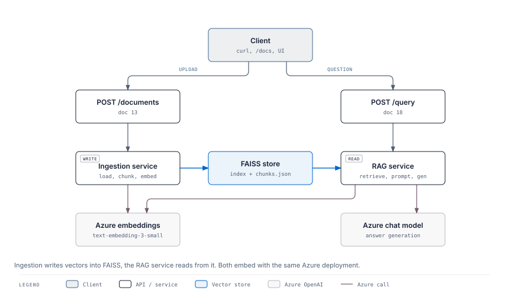

# Naive RAG Implementation

An end-to-end Naive RAG API built with FastAPI, Azure OpenAI (gpt-4o-mini chat and `text-embedding-3-small` embeddings) and FAISS. Upload documents, ask questions answered only from them with citations, track tokens and cost in USD and INR, and evaluate answer quality with an LLM judge.

**Status: complete.** Naive RAG baseline on the 11-question test set: overall 0.80, faithfulness 0.95, answer relevance 0.98, context precision 0.41, correctness 0.85, retrieval hit rate 90 percent, about Rs 0.02 and 1.7 s per question. Limitations and the move to Advanced RAG: [docs/28](docs/28.%20Naive%20RAG%20Limitations%2C%20Lessons%20and%20Next%20Steps.md).

Start with [docs/19. Naive RAG Architecture Overview](docs/19.%20Naive%20RAG%20Architecture%20Overview.md) for the big picture.



## Endpoints

<table width="100%">
<thead><tr><th>Method</th><th>Path</th><th>What it does</th><th>Doc</th></tr></thead>
<tbody>
<tr><td>GET</td><td>/health</td><td>API status, Azure configuration check, models and chunking settings</td><td>03</td></tr>
<tr><td>GET</td><td>/documents</td><td>List indexed files with type, pages or sheets, chunks, size and upload time</td><td>20, 23</td></tr>
<tr><td>POST</td><td>/documents</td><td>Upload a .pdf, .xlsx, .docx, .txt or .md file and index it; returns step timings, tokens and cost</td><td>13, 22</td></tr>
<tr><td>GET</td><td>/documents/{source}/file</td><td>The original file (used by the PDF viewer)</td><td>23</td></tr>
<tr><td>GET</td><td>/documents/{source}/chunks</td><td>Every chunk of one file with page and text</td><td>23</td></tr>
<tr><td>DELETE</td><td>/documents/{source}</td><td>Remove a file from the index</td><td>23</td></tr>
<tr><td>POST</td><td>/query</td><td>Ask a question; answer with numbered sources (file, page, score, text) and usage (tokens, cost in USD and INR, latency)</td><td>18, 22</td></tr>
<tr><td>GET</td><td>/analytics</td><td>Totals, daily series and recent runs for questions, ingestions and evaluations</td><td>22</td></tr>
<tr><td>POST</td><td>/evals/answer</td><td>Grade one answer with the LLM judge</td><td>24</td></tr>
<tr><td>GET</td><td>/evals/testset</td><td>The built-in test cases</td><td>25</td></tr>
<tr><td>POST</td><td>/evals/runs</td><td>Start an evaluation of the pipeline on the test set (background)</td><td>25</td></tr>
<tr><td>GET</td><td>/evals/runs</td><td>Saved runs with summaries, newest first</td><td>25</td></tr>
<tr><td>GET</td><td>/evals/runs/{id}</td><td>One run with per-case results</td><td>25, 26</td></tr>
</tbody>
</table>

## Features

<table width="100%">
<thead><tr><th>Feature</th><th>How</th><th>Docs</th></tr></thead>
<tbody>
<tr><td>Five file types</td><td>PDF per page, Excel per sheet, Word, Markdown, text</td><td>04 to 08</td></tr>
<tr><td>Chunking</td><td>Recursive splitter, 1000 characters, 150 overlap</td><td>09</td></tr>
<tr><td>Vector search</td><td>text-embedding-3-small, FAISS IndexFlatIP (cosine), top 4</td><td>10, 11, 14</td></tr>
<tr><td>Grounded answers</td><td>gpt-4o-mini, citations [n], fixed not-found answer</td><td>15 to 17</td></tr>
<tr><td>Logs</td><td>Request id, one line per step, retrieved chunks with scores, answer, cost</td><td>21</td></tr>
<tr><td>Cost tracking</td><td>Tokens per run, priced per million tokens, USD and INR</td><td>22</td></tr>
<tr><td>Document management</td><td>View file, list chunks, delete</td><td>23</td></tr>
<tr><td>Evaluation</td><td>LLM judge, 11-case test set, background runs, saved reports</td><td>24 to 26</td></tr>
</tbody>
</table>

## Setup

1. Add these variables to the repository root `.env` (see `.env.example`):

<table width="100%">
<thead><tr><th>Variable</th><th>Example</th></tr></thead>
<tbody>
<tr><td>AZURE_OPENAI_ENDPOINT</td><td>https://your-resource.openai.azure.com/</td></tr>
<tr><td>AZURE_OPENAI_API_KEY</td><td>your key</td></tr>
<tr><td>AZURE_OPENAI_DEPLOYMENT_NAME</td><td>your chat deployment</td></tr>
<tr><td>AZURE_OPENAI_EMBEDDING_DEPLOYMENT</td><td>text-embedding-3-small</td></tr>
<tr><td>USD_TO_INR (optional)</td><td>84.0</td></tr>
<tr><td>LOG_LEVEL (optional)</td><td>INFO or DEBUG</td></tr>
</tbody>
</table>

2. Install and run from this folder:

```bash
uv venv .venv --python 3.12
uv pip install -p .venv -r requirements.txt
.venv/bin/uvicorn app.main:app --reload
```

3. Open http://127.0.0.1:8000/docs to try the endpoints.

## Quick example

```bash
# Index the RAG paper
curl -F "file=@../02. Papers/2005.11401_RAG-Lewis.pdf" http://127.0.0.1:8000/documents

# Ask a question
curl -X POST http://127.0.0.1:8000/query \
  -H "content-type: application/json" \
  -d '{"question": "Which retriever and generator does RAG combine?"}'
```

## Tests

```bash
.venv/bin/python -m pytest -q tests
```

63 tests, all offline: Azure calls are replaced with fakes and evaluation runs use stubs.

## Docs

Each feature was built, documented and pushed as its own step. The docs explain why each choice was made and how the code works, with diagrams.

Reading order: start with 19 (architecture overview), then 24 to 26 (evaluation), 27 (paper to code) and 28 (limitations and next steps). Docs 01 to 18 explain each component in build order.

<table width="100%">
<thead><tr><th>Step</th><th>Doc</th></tr></thead>
<tbody>
<tr><td>01</td><td><a href="docs/01.%20Project%20Folder%20Structure.md">Project Folder Structure</a></td></tr>
<tr><td>02</td><td><a href="docs/02.%20Configuration%20and%20Settings.md">Configuration and Settings</a></td></tr>
<tr><td>03</td><td><a href="docs/03.%20FastAPI%20Application%20Setup.md">FastAPI Application Setup</a></td></tr>
<tr><td>04</td><td><a href="docs/04.%20PDF%20Loader.md">PDF Loader</a></td></tr>
<tr><td>05</td><td><a href="docs/05.%20Excel%20Loader.md">Excel Loader</a></td></tr>
<tr><td>06</td><td><a href="docs/06.%20Word%20Loader.md">Word Loader</a></td></tr>
<tr><td>07</td><td><a href="docs/07.%20Text%20and%20Markdown%20Loader.md">Text and Markdown Loader</a></td></tr>
<tr><td>08</td><td><a href="docs/08.%20File%20Loader%20Selection.md">File Loader Selection</a></td></tr>
<tr><td>09</td><td><a href="docs/09.%20Chunker.md">Chunker</a></td></tr>
<tr><td>10</td><td><a href="docs/10.%20Embeddings.md">Embeddings</a></td></tr>
<tr><td>11</td><td><a href="docs/11.%20FAISS%20Vector%20Store.md">FAISS Vector Store</a></td></tr>
<tr><td>12</td><td><a href="docs/12.%20Ingestion%20Service.md">Ingestion Service</a></td></tr>
<tr><td>13</td><td><a href="docs/13.%20Document%20Upload%20API.md">Document Upload API</a></td></tr>
<tr><td>14</td><td><a href="docs/14.%20Retriever.md">Retriever</a></td></tr>
<tr><td>15</td><td><a href="docs/15.%20Prompt%20Builder.md">Prompt Builder</a></td></tr>
<tr><td>16</td><td><a href="docs/16.%20Answer%20Generator.md">Answer Generator</a></td></tr>
<tr><td>17</td><td><a href="docs/17.%20RAG%20Service.md">RAG Service</a></td></tr>
<tr><td>18</td><td><a href="docs/18.%20Query%20API.md">Query API</a></td></tr>
<tr><td>19</td><td><a href="docs/19.%20Naive%20RAG%20Architecture%20Overview.md">Naive RAG Architecture Overview</a></td></tr>
<tr><td>20</td><td><a href="docs/20.%20Document%20List%20API.md">Document List API</a></td></tr>
<tr><td>21</td><td><a href="docs/21.%20Structured%20Logging.md">Structured Logging</a></td></tr>
<tr><td>22</td><td><a href="docs/22.%20Usage%20and%20Cost%20Tracking.md">Usage and Cost Tracking</a></td></tr>
<tr><td>23</td><td><a href="docs/23.%20Document%20Viewer%20and%20Management%20API.md">Document Viewer and Management API</a></td></tr>
<tr><td>24</td><td><a href="docs/24.%20Answer%20Evaluation%20with%20an%20LLM%20Judge.md">Answer Evaluation with an LLM Judge</a></td></tr>
<tr><td>25</td><td><a href="docs/25.%20Evaluation%20Runs%20and%20Reports.md">Evaluation Runs and Reports</a></td></tr>
<tr><td>26</td><td><a href="docs/26.%20Reading%20the%20Evaluation%20Report.md">Reading the Evaluation Report</a></td></tr>
<tr><td>27</td><td><a href="docs/27.%20Research%20Paper%20to%20Code%20Mapping.md">Research Paper to Code Mapping</a></td></tr>
<tr><td>28</td><td><a href="docs/28.%20Naive%20RAG%20Limitations%2C%20Lessons%20and%20Next%20Steps.md">Naive RAG Limitations, Lessons and Next Steps</a></td></tr>
</tbody>
</table>
