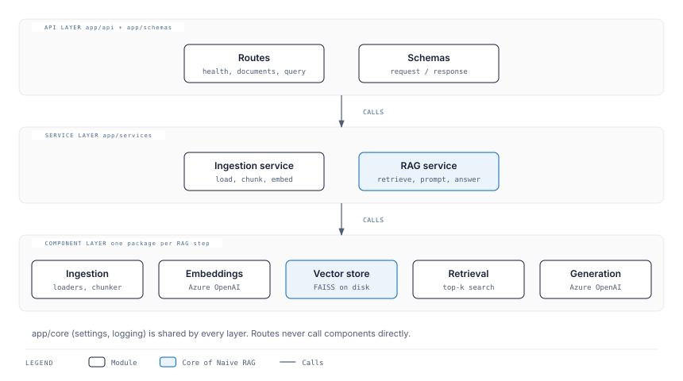
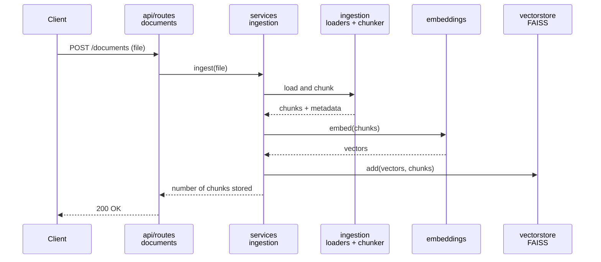
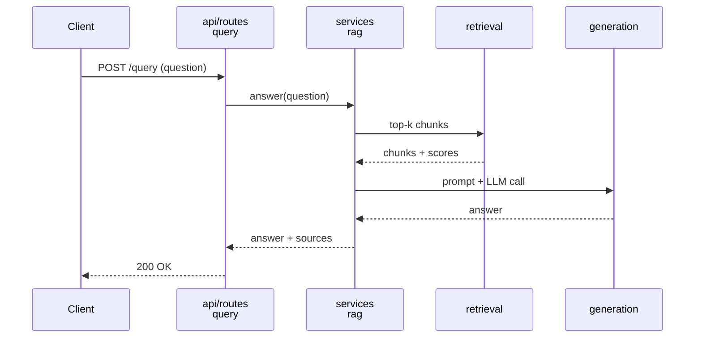

# 01. Project Folder Structure

In this doc:

- Why the code is split into layers
- The full folder tree and what each folder holds
- How a request travels through the folders
- Where configuration, data and docs live
- The rules every new file follows

## Why this structure

Naive RAG has two pipelines (see [notes 10](../../01.%20Notes/01.%20Basic%20Concepts/10.%20Naive%20RAG%20Architecture%20End%20to%20End.md)):

- **Ingestion (offline):** load files, split into chunks, embed, store in FAISS.
- **Query (online):** embed the question, search FAISS, build the prompt, ask the LLM.

Each step of these pipelines gets its own package. This gives three benefits:

<table width="100%">
<thead><tr><th>Benefit</th><th>What it means in practice</th></tr></thead>
<tbody>
<tr><td>Easy to understand</td><td>The folder name tells you which RAG step the code belongs to. Chunking code is in ingestion, search code is in vectorstore.</td></tr>
<tr><td>Easy to replace</td><td>Later architectures (Hybrid Search, Re-ranking, HyDE) swap one package without touching the rest.</td></tr>
<tr><td>Easy to test</td><td>Each package can be tested alone, without starting the API.</td></tr>
</tbody>
</table>

## Three layers

The code is organised in three layers. A layer only calls the layer directly below it.



<table width="100%">
<thead><tr><th>Layer</th><th>Folders</th><th>Responsibility</th><th>Must not</th></tr></thead>
<tbody>
<tr><td>API layer</td><td>app/api, app/schemas</td><td>Receive HTTP requests, validate input, return responses</td><td>Contain RAG logic</td></tr>
<tr><td>Service layer</td><td>app/services</td><td>Run a full pipeline by calling components in the right order</td><td>Know about HTTP</td></tr>
<tr><td>Component layer</td><td>app/ingestion, app/embeddings, app/vectorstore, app/retrieval, app/generation</td><td>Do one RAG step well</td><td>Call other layers above them</td></tr>
</tbody>
</table>

`app/core` sits beside all layers. It holds settings and logging that everyone needs.

## Folder tree

```text
01. Naive RAG/03. API/
    app/
        main.py                 FastAPI app: creates the app and registers routers
        api/
            routes/             one file per endpoint group: health, documents, query
        core/                   settings from .env, logging setup
        schemas/                Pydantic request and response models
        ingestion/
            loaders/            one loader per file type: pdf, excel, word, text
                                chunker.py splits text into chunks
        embeddings/             Azure OpenAI embeddings client
        vectorstore/            FAISS index: add vectors, search, save, load
        retrieval/              question to top-k chunks
        generation/             prompt template and Azure OpenAI chat call
        services/               ingestion service and RAG service
    data/
        uploads/                uploaded source files (not committed)
        index/                  saved FAISS index and chunk metadata (not committed)
    docs/                       numbered design docs like this one
        images/                 design diagrams used by the docs
    tests/                      tests per package
    requirements.txt            Python dependencies
    .env.example                names of the required environment variables
```

Files like `main.py` and `chunker.py` are added in the step that builds them. Each package already has an `__init__.py` whose docstring explains what the package is for.

## How a request travels through the folders

### Ingestion request



### Query request



## Configuration, data and docs

<table width="100%">
<thead><tr><th>Item</th><th>Location</th><th>Committed to git</th><th>Why</th></tr></thead>
<tbody>
<tr><td>Secrets (API keys, endpoints)</td><td>Repository root .env</td><td>No</td><td>Keys must never be public</td></tr>
<tr><td>Variable names</td><td>03. API/.env.example</td><td>Yes</td><td>Shows which variables are needed, without values</td></tr>
<tr><td>Uploaded files</td><td>data/uploads</td><td>No</td><td>User data, can be large</td></tr>
<tr><td>FAISS index</td><td>data/index</td><td>No</td><td>Generated output, rebuilt from uploads</td></tr>
<tr><td>Design docs</td><td>docs</td><td>Yes</td><td>Explain every feature and decision</td></tr>
</tbody>
</table>

## Rules every file follows

1. A module docstring at the top explains what the file does.
2. Imports come next under one `# Imports` comment, ordered from the longest line to the shortest.
3. Each logical block has a short comment above it, then the code, then a blank line.
4. Simple code over clever code.

## Build order

Each step below is built, documented and pushed on its own.

<table width="100%">
<thead><tr><th>Step</th><th>Feature</th><th>Doc</th></tr></thead>
<tbody>
<tr><td>1</td><td>Folder structure</td><td>01. Project Folder Structure (this doc)</td></tr>
<tr><td>2</td><td>Settings from .env</td><td>02. Configuration and Settings</td></tr>
<tr><td>3</td><td>FastAPI app and health endpoint</td><td>03. FastAPI Application Setup</td></tr>
<tr><td>4 and later</td><td>Loaders (PDF, Excel, ...), chunking, embeddings, FAISS, retrieval, generation, API endpoints</td><td>One doc per feature</td></tr>
</tbody>
</table>
