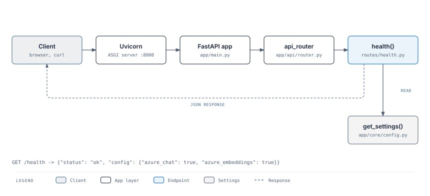
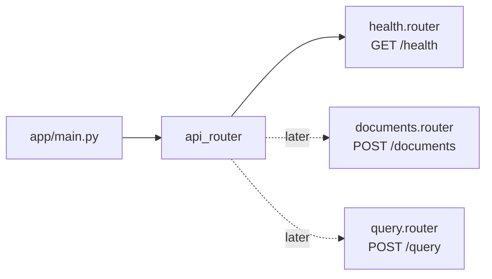
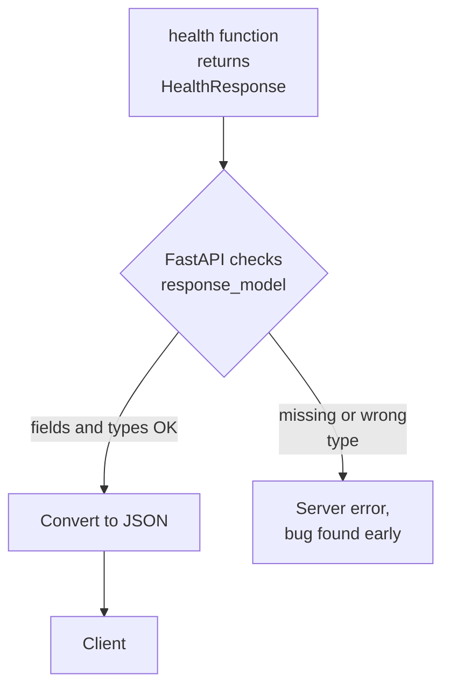

# 03. FastAPI Application Setup

In this doc:

- Why FastAPI
- The four files of this step and what each does
- How a request reaches an endpoint
- The health endpoint and why it exists
- How to install, run and test the app

## Why FastAPI

<table width="100%">
<thead><tr><th>Need</th><th>How FastAPI covers it</th></tr></thead>
<tbody>
<tr><td>Validate input and output</td><td>Uses Pydantic models. Bad requests get a clear 422 error automatically.</td></tr>
<tr><td>Interactive docs for testing</td><td>Swagger UI at /docs is generated from the code, no extra work.</td></tr>
<tr><td>File uploads for ingestion</td><td>Built-in UploadFile support.</td></tr>
<tr><td>Calls to slow external APIs (OpenAI)</td><td>Supports async endpoints, so one slow call does not block other requests.</td></tr>
<tr><td>Simple code</td><td>An endpoint is a normal Python function with a decorator.</td></tr>
</tbody>
</table>

## Files in this step

<table width="100%">
<thead><tr><th>File</th><th>Layer</th><th>What it does</th></tr></thead>
<tbody>
<tr><td><a href="../app/main.py">app/main.py</a></td><td>Entry point</td><td>Creates the FastAPI app, creates data folders, registers the main router</td></tr>
<tr><td><a href="../app/api/router.py">app/api/router.py</a></td><td>API</td><td>Collects all route modules into one api_router</td></tr>
<tr><td><a href="../app/api/routes/health.py">app/api/routes/health.py</a></td><td>API</td><td>GET /health endpoint</td></tr>
<tr><td><a href="../app/schemas/health.py">app/schemas/health.py</a></td><td>API</td><td>Pydantic models for the health response</td></tr>
</tbody>
</table>

## How a request reaches an endpoint



1. The **client** (browser, curl, a frontend) sends `GET /health`.
2. **Uvicorn** is the web server. It receives the HTTP request and passes it to the FastAPI app (ASGI is the standard interface between them).
3. The **FastAPI app** (`app/main.py`) finds which router has a matching path.
4. **api_router** (`app/api/router.py`) holds all endpoint groups and forwards to the health router.
5. **health()** reads settings, builds a `HealthResponse` and returns it.
6. FastAPI checks the result against `HealthResponse` and turns it into JSON.

### Why one main router



`main.py` registers only `api_router`. Each new endpoint group (documents, query) is one `include_router` line in `router.py`. `main.py` stays small and never changes when endpoints are added.

## The health endpoint

### Why it exists

- Confirms the server is running (used by monitoring and deployment checks).
- Shows whether required settings are filled in, before any real request fails.
- Never returns secret values, only true or false.

### Response

```json
{
  "status": "ok",
  "app_name": "Naive RAG API",
  "version": "0.1.0",
  "config": {
    "azure_chat": true,
    "azure_embeddings": true
  }
}
```

<table width="100%">
<thead><tr><th>Field</th><th>Type</th><th>Meaning</th></tr></thead>
<tbody>
<tr><td>status</td><td>string</td><td>Always "ok" when the API answers</td></tr>
<tr><td>app_name, version</td><td>string</td><td>From settings, also shown in /docs</td></tr>
<tr><td>config.azure_chat</td><td>boolean</td><td>True when endpoint, key and chat deployment name are all set</td></tr>
<tr><td>config.azure_embeddings</td><td>boolean</td><td>True when endpoint, key and embedding deployment name are all set</td></tr>
</tbody>
</table>

### How the response model works



`response_model=HealthResponse` makes the response shape a contract. It also documents the response in `/docs`.

## Install and run

From `01. Naive RAG/03. API`:

```bash
# Create a virtual environment and install dependencies
uv venv .venv --python 3.12
uv pip install -p .venv -r requirements.txt

# Start the server with auto reload
.venv/bin/uvicorn app.main:app --reload
```

Then open:

<table width="100%">
<thead><tr><th>URL</th><th>What you see</th></tr></thead>
<tbody>
<tr><td>http://127.0.0.1:8000/health</td><td>Health JSON</td></tr>
<tr><td>http://127.0.0.1:8000/docs</td><td>Swagger UI to try every endpoint</td></tr>
<tr><td>http://127.0.0.1:8000/redoc</td><td>Read-only API reference</td></tr>
</tbody>
</table>

## Dependencies added

<table width="100%">
<thead><tr><th>Package</th><th>Version</th><th>Why</th></tr></thead>
<tbody>
<tr><td>fastapi</td><td>0.115.6</td><td>Web framework</td></tr>
<tr><td>uvicorn[standard]</td><td>0.34.0</td><td>ASGI server that runs the app</td></tr>
<tr><td>pydantic-settings</td><td>2.7.1</td><td>Settings from .env (doc 02)</td></tr>
</tbody>
</table>
