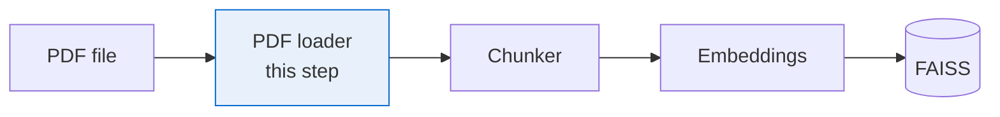
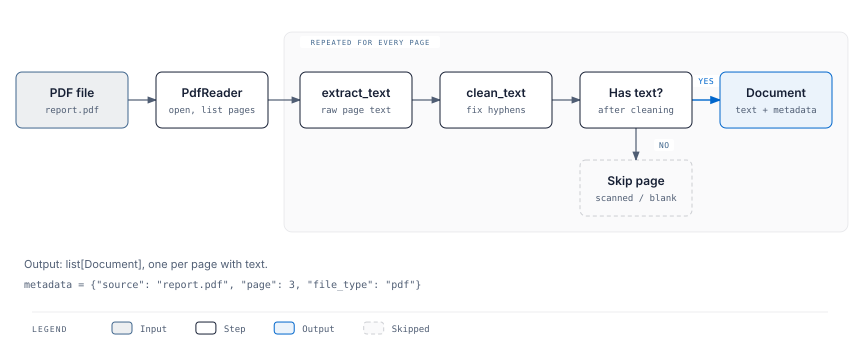
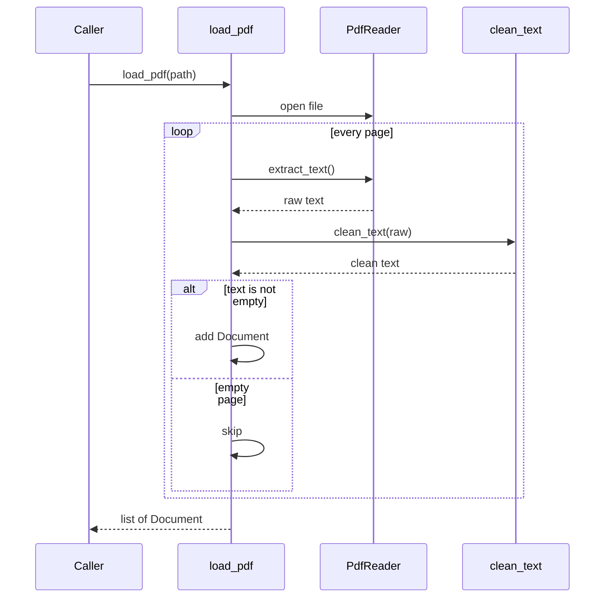

# 04. PDF Loader

In this doc:

- The Document model every loader returns
- Why pypdf was chosen for PDF parsing
- How the PDF loader works, step by step
- What text cleaning does and why
- Known limits and how later steps handle them
- Tests

Files:

- [app/ingestion/document.py](../app/ingestion/document.py)
- [app/ingestion/loaders/pdf_loader.py](../app/ingestion/loaders/pdf_loader.py)
- [tests/test_pdf_loader.py](../tests/test_pdf_loader.py)

## Where this fits

The PDF loader is the first step of the ingestion pipeline: it turns a raw file into text that the chunker can split.



## The Document model

Every loader (PDF now, Excel, Word and text later) returns the same shape, so the rest of the pipeline never needs to know the file type.

```python
@dataclass
class Document:
    text: str        # the extracted text
    metadata: dict   # where it came from
```

<table width="100%">
<thead><tr><th>Field</th><th>Example</th><th>Used later for</th></tr></thead>
<tbody>
<tr><td>text</td><td>"Retrieval-Augmented Generation for ..."</td><td>Chunking, embedding, the LLM prompt</td></tr>
<tr><td>metadata.source</td><td>"2005.11401_RAG-Lewis.pdf"</td><td>Citations in answers, deleting a file's chunks</td></tr>
<tr><td>metadata.page</td><td>3</td><td>Citing the exact page</td></tr>
<tr><td>metadata.file_type</td><td>"pdf"</td><td>Filtering and debugging</td></tr>
</tbody>
</table>

A dataclass is used instead of a Pydantic model because this object never crosses the API boundary: it only moves between internal steps, and a dataclass is the simplest way to hold two fields.

## Why pypdf

<table width="100%">
<thead><tr><th>Library</th><th>Install</th><th>Text quality</th><th>License</th><th>Decision</th></tr></thead>
<tbody>
<tr><td>pypdf</td><td>Pure Python, no system packages</td><td>Good for digital PDFs</td><td>BSD (permissive)</td><td>Chosen: simple, light, enough for Naive RAG</td></tr>
<tr><td>PyMuPDF (fitz)</td><td>Compiled wheel</td><td>Very good, faster, layout aware</td><td>AGPL (restrictive for commercial use)</td><td>Possible upgrade if quality is a problem</td></tr>
<tr><td>pdfplumber</td><td>Pure Python on top of pdfminer</td><td>Good, strong at tables</td><td>MIT</td><td>Consider for table-heavy PDFs</td></tr>
<tr><td>Unstructured / Docling</td><td>Heavy, many dependencies</td><td>Best, handles layout, tables, OCR</td><td>Apache</td><td>Too heavy for a baseline</td></tr>
</tbody>
</table>

Naive RAG is the baseline, so the simplest reliable option wins. The loader is one small file, so swapping the library later only changes this file.

## How it works



### Step by step

1. `PdfReader(path)` opens the file and reads its page list. It does not read all text at once.
2. The loop goes through `reader.pages`. `enumerate(..., start=1)` numbers pages from 1, the same as a PDF viewer, so citations match what users see.
3. `page.extract_text()` returns the page text. It can return `None` for image-only pages, so `or ""` turns that into an empty string.
4. `clean_text` tidies the text (next section).
5. If nothing is left, the page is skipped. Empty pages would create empty chunks that waste embedding calls and pollute search.
6. Otherwise a `Document` is created with the text and metadata `source`, `page`, `file_type`.



## Text cleaning

PDF text extraction keeps the visual line breaks of the page, which hurts chunking and embeddings. `clean_text` fixes the three most common problems with three regular expressions.

<table width="100%">
<thead><tr><th>Problem</th><th>Raw text</th><th>Regular expression</th><th>Result</th></tr></thead>
<tbody>
<tr><td>Words split by a hyphen at the end of a line</td><td>infor-\nmation</td><td>(\w)-\n(\w) to \1\2</td><td>information</td></tr>
<tr><td>Runs of spaces and tabs</td><td>neural&nbsp;&nbsp;&nbsp;&nbsp;retriever</td><td>[ \t]+ to one space</td><td>neural retriever</td></tr>
<tr><td>Many blank lines</td><td>end\n\n\n\nstart</td><td>\n{3,} to \n\n</td><td>end\n\nstart</td></tr>
</tbody>
</table>

Single line breaks are kept on purpose. The chunker (a later step) uses paragraph and line breaks as natural split points.

## Known limits

<table width="100%">
<thead><tr><th>Limit</th><th>Effect</th><th>Handled by</th></tr></thead>
<tbody>
<tr><td>Scanned PDFs have no text layer</td><td>Pages are skipped, nothing is indexed</td><td>OCR is out of scope for Naive RAG. Multimodal RAG (folder 18) covers it.</td></tr>
<tr><td>Tables become plain text</td><td>Column structure is lost</td><td>Excel loader for spreadsheet data; better parsers later if needed</td></tr>
<tr><td>Two-column layouts</td><td>pypdf usually reads columns in order, but not always</td><td>Acceptable for the baseline</td></tr>
<tr><td>Headers and footers repeat on every page</td><td>Small noise in chunks</td><td>Acceptable for the baseline</td></tr>
</tbody>
</table>

## Example

Loading the RAG paper stored in this repo:

```python
from pathlib import Path
from app.ingestion.loaders.pdf_loader import load_pdf

documents = load_pdf(Path("../02. Papers/2005.11401_RAG-Lewis.pdf"))
print(len(documents))           # 19
print(documents[0].metadata)    # {'source': '2005.11401_RAG-Lewis.pdf', 'page': 1, 'file_type': 'pdf'}
```

## Tests

<table width="100%">
<thead><tr><th>Test</th><th>Checks</th></tr></thead>
<tbody>
<tr><td>test_load_pdf_returns_one_document_per_page</td><td>19 pages give 19 Documents, first page metadata is correct, title text is present</td></tr>
<tr><td>test_clean_text_joins_hyphenated_words_and_spaces</td><td>Hyphen joins, space collapse and blank-line limit all work</td></tr>
</tbody>
</table>

Run from `01. Naive RAG/03. API`:

```bash
.venv/bin/python -m pytest -q tests
```

## Dependencies added

<table width="100%">
<thead><tr><th>Package</th><th>Version</th><th>Why</th></tr></thead>
<tbody>
<tr><td>pypdf</td><td>5.1.0</td><td>PDF text extraction</td></tr>
<tr><td>pytest</td><td>8.3.4</td><td>Running tests</td></tr>
</tbody>
</table>
