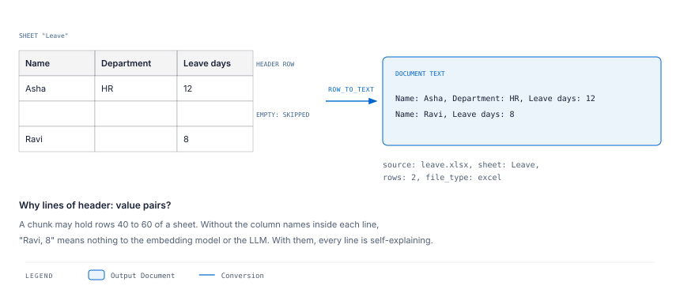
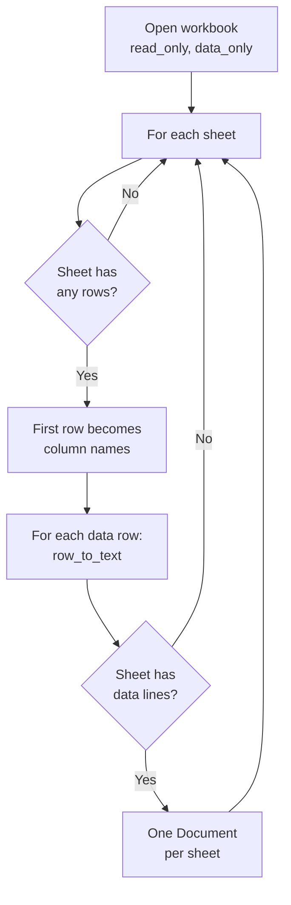

# 05. Excel Loader

In this doc:

- Why spreadsheets need special handling in RAG
- Why openpyxl was chosen
- How a sheet is turned into text, step by step
- The "header: value" row format and why it matters
- Edge cases and tests

Files:

- [app/ingestion/loaders/excel_loader.py](../app/ingestion/loaders/excel_loader.py)
- [tests/test_excel_loader.py](../tests/test_excel_loader.py)

## Why spreadsheets need special handling

A spreadsheet is a grid. Embedding models and LLMs read text. If a sheet is flattened naively, row by row with only values, the meaning is lost:

```text
Asha HR 12
Ravi 8
```

Nobody can tell what "8" is. After chunking, the header row may even be in a different chunk. The loader therefore writes the column name next to every value.

## Why openpyxl

<table width="100%">
<thead><tr><th>Library</th><th>Reads .xlsx</th><th>Extra weight</th><th>Decision</th></tr></thead>
<tbody>
<tr><td>openpyxl</td><td>Yes, cell by cell, can stream large files (read_only mode)</td><td>Small, pure Python</td><td>Chosen</td></tr>
<tr><td>pandas.read_excel</td><td>Yes (uses openpyxl underneath)</td><td>Adds pandas and numpy just for reading</td><td>Not needed for simple row text</td></tr>
<tr><td>xlrd</td><td>Only old .xls files</td><td>Small</td><td>Does not support .xlsx</td></tr>
</tbody>
</table>

## How it works





### Step by step

1. `load_workbook(path, read_only=True, data_only=True)` opens the file.
   - `read_only=True` streams rows instead of loading the whole workbook into memory, so large files work.
   - `data_only=True` returns the last calculated value of formula cells (`120`), not the formula text (`=SUM(B2:B9)`).
2. For each sheet, `iter_rows(values_only=True)` gives each row as a tuple of plain values.
3. The first row goes to `make_headers`, which turns it into column names. Blank header cells become `column_1`, `column_2`, and so on, so no value is ever left without a name.
4. Every other row goes to `row_to_text`, which builds `header: value` pairs and joins them with commas. Empty cells are skipped.
5. Empty rows produce an empty line and are dropped.
6. All lines of a sheet are joined with newlines into one `Document`. Sheets with no data rows are skipped.
7. The workbook is closed to release the file.

## The row format

<table width="100%">
<thead><tr><th>Sheet row</th><th>Line produced</th></tr></thead>
<tbody>
<tr><td>Name | Department | Leave days (header)</td><td>Used as column names, no line</td></tr>
<tr><td>Asha | HR | 12</td><td>Name: Asha, Department: HR, Leave days: 12</td></tr>
<tr><td>(empty row)</td><td>Skipped</td></tr>
<tr><td>Ravi | (empty) | 8</td><td>Name: Ravi, Leave days: 8</td></tr>
</tbody>
</table>

Why one line per row: the chunker (next steps) splits on line breaks first, so a row is never cut in half, and each chunk is a set of complete, self-explaining rows.

### Example question it enables

Question: "How many leave days does Ravi have?"

The chunk contains `Name: Ravi, Leave days: 8`. The words "Ravi" and "Leave days" sit next to the value, so the embedding of this line is close to the question, and the LLM can answer "8" directly.

## Metadata

<table width="100%">
<thead><tr><th>Key</th><th>Example</th><th>Why</th></tr></thead>
<tbody>
<tr><td>source</td><td>leave.xlsx</td><td>Citation</td></tr>
<tr><td>sheet</td><td>Leave</td><td>Citation at sheet level (the Excel equivalent of a page number)</td></tr>
<tr><td>rows</td><td>2</td><td>Size check and debugging</td></tr>
<tr><td>file_type</td><td>excel</td><td>Filtering and debugging</td></tr>
</tbody>
</table>

## Edge cases

<table width="100%">
<thead><tr><th>Case</th><th>Behaviour</th></tr></thead>
<tbody>
<tr><td>Empty sheet</td><td>Skipped</td></tr>
<tr><td>Sheet with only a header row</td><td>Skipped</td></tr>
<tr><td>Blank header cell</td><td>Named column_N</td></tr>
<tr><td>Empty cell inside a row</td><td>Left out of the line</td></tr>
<tr><td>Formula cell</td><td>Last saved value is used (cells never calculated by Excel come back empty)</td></tr>
<tr><td>Header not in the first row (title rows above the table)</td><td>Title row becomes the header. Acceptable for the baseline; clean sheets work best.</td></tr>
<tr><td>Old .xls format</td><td>Not supported, save as .xlsx</td></tr>
</tbody>
</table>

## Tests

<table width="100%">
<thead><tr><th>Test</th><th>Checks</th></tr></thead>
<tbody>
<tr><td>test_load_excel_turns_rows_into_lines</td><td>Builds a workbook with a data sheet and an empty sheet; checks one Document, exact line text, skipped empty row and cell, metadata</td></tr>
<tr><td>test_make_headers_fills_blank_names</td><td>Blank header becomes column_2, spaces are trimmed</td></tr>
</tbody>
</table>

## Dependencies added

<table width="100%">
<thead><tr><th>Package</th><th>Version</th><th>Why</th></tr></thead>
<tbody>
<tr><td>openpyxl</td><td>3.1.5</td><td>Read .xlsx workbooks</td></tr>
</tbody>
</table>
