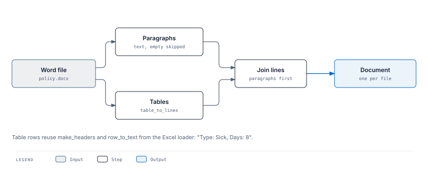
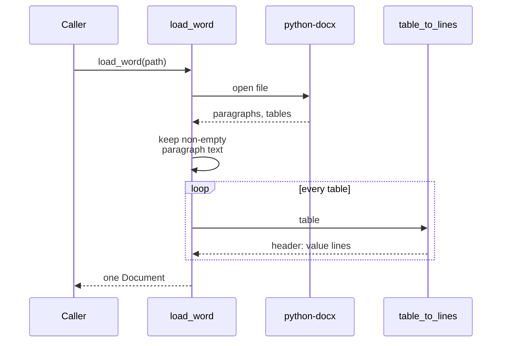

# 06. Word Loader

In this doc:

- Why python-docx was chosen
- How paragraphs and tables are read, step by step
- Why the whole file becomes one Document
- Reuse of the Excel row format for tables
- Limits and tests

Files:

- [app/ingestion/loaders/word_loader.py](../app/ingestion/loaders/word_loader.py)
- [tests/test_word_loader.py](../tests/test_word_loader.py)

## Why python-docx

<table width="100%">
<thead><tr><th>Library</th><th>Reads</th><th>Tables</th><th>Decision</th></tr></thead>
<tbody>
<tr><td>python-docx</td><td>.docx paragraphs, headings, styles</td><td>Yes, cell by cell</td><td>Chosen: small, standard, gives tables as structure</td></tr>
<tr><td>docx2txt</td><td>.docx as one flat string</td><td>Cells run together</td><td>Loses table structure</td></tr>
<tr><td>Converting to PDF first</td><td>Anything</td><td>As flat text</td><td>Extra tools, slower, worse tables</td></tr>
</tbody>
</table>

A `.docx` file is a zip of XML files. python-docx reads that XML and gives Python objects: `paragraphs` (each with `.text`) and `tables` (rows of cells).

## How it works

### Step by step

1. `open_docx(path)` opens the file. (python-docx names its function `Document`, which clashes with our own `Document` model, so it is imported as `open_docx`.)
2. Paragraphs: every paragraph's text is stripped. Empty paragraphs (blank lines used for spacing) are skipped. Headings are paragraphs too, so they are kept in order.
3. Tables: `table_to_lines` reads each row as a tuple of cell texts. The first row becomes the column names with `make_headers`, every other row becomes a `header: value` line with `row_to_text`. These two helpers come from the Excel loader, so tables look the same whether they come from Excel or Word.
4. All lines are joined with newlines into one `Document`.
5. A file with no text at all returns an empty list.

## Example

<table width="100%">
<thead><tr><th>Word content</th><th>Output line</th></tr></thead>
<tbody>
<tr><td>Heading: Leave Policy</td><td>Leave Policy</td></tr>
<tr><td>Paragraph: New joiners get 12 days of paid leave.</td><td>New joiners get 12 days of paid leave.</td></tr>
<tr><td>Empty paragraph</td><td>Skipped</td></tr>
<tr><td>Table header: Type | Days</td><td>Used as column names</td></tr>
<tr><td>Table row: Sick | 8</td><td>Type: Sick, Days: 8</td></tr>
</tbody>
</table>

## Why one Document per file

<table width="100%">
<thead><tr><th>File type</th><th>Natural unit</th><th>Document per</th></tr></thead>
<tbody>
<tr><td>PDF</td><td>Fixed pages</td><td>Page</td></tr>
<tr><td>Excel</td><td>Sheets</td><td>Sheet</td></tr>
<tr><td>Word</td><td>No fixed pages: page breaks change with fonts, margins and screen</td><td>Whole file</td></tr>
</tbody>
</table>

The chunker splits the long text later, so one Document per file is not a problem. Citations point to the file name.

## Limits

<table width="100%">
<thead><tr><th>Limit</th><th>Effect</th><th>Why acceptable</th></tr></thead>
<tbody>
<tr><td>Tables are placed after all paragraphs</td><td>A table's position in the text is lost</td><td>Each row still carries its column names, so it is understandable on its own</td></tr>
<tr><td>Text in headers, footers, text boxes and comments is not read</td><td>Rarely important content is missed</td><td>Main body text is what users ask about</td></tr>
<tr><td>Images are ignored</td><td>Diagrams are not indexed</td><td>Multimodal RAG (folder 18) covers images</td></tr>
<tr><td>Old .doc format</td><td>Not supported</td><td>Save as .docx</td></tr>
</tbody>
</table>

## Tests

<table width="100%">
<thead><tr><th>Test</th><th>Checks</th></tr></thead>
<tbody>
<tr><td>test_load_word_reads_paragraphs_and_tables</td><td>Heading, paragraph and table row text in order, empty paragraph skipped, metadata</td></tr>
<tr><td>test_load_word_returns_nothing_for_empty_file</td><td>Empty file gives an empty list</td></tr>
</tbody>
</table>

## Dependencies added

<table width="100%">
<thead><tr><th>Package</th><th>Version</th><th>Why</th></tr></thead>
<tbody>
<tr><td>python-docx</td><td>1.1.2</td><td>Read .docx paragraphs and tables</td></tr>
</tbody>
</table>
