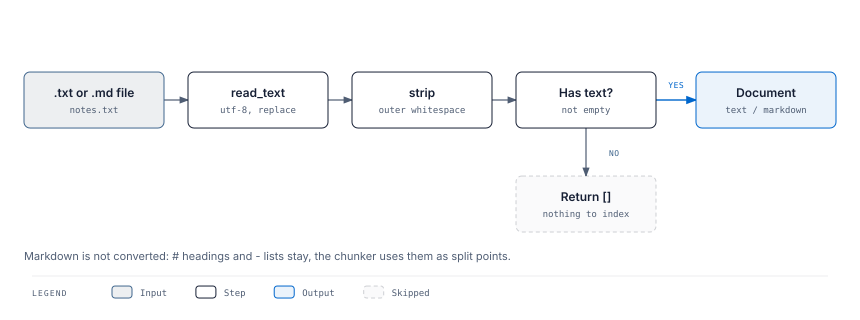
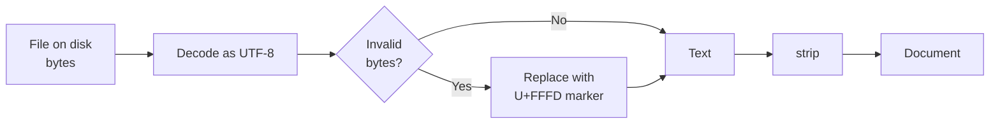

# 07. Text and Markdown Loader

In this doc:

- Why plain text and Markdown share one loader
- How the file is read, step by step
- Why Markdown is kept as it is
- Encoding errors and how they are handled
- Tests

Files:

- [app/ingestion/loaders/text_loader.py](../app/ingestion/loaders/text_loader.py)
- [tests/test_text_loader.py](../tests/test_text_loader.py)

## Why one loader for both

`.txt` and `.md` files are both plain text on disk. No library is needed to read them. The only difference is the `file_type` value in the metadata, which comes from a small lookup table:

<table width="100%">
<thead><tr><th>Extension</th><th>file_type in metadata</th><th>Typical content</th></tr></thead>
<tbody>
<tr><td>.txt</td><td>text</td><td>Notes, exported chats, logs, transcripts</td></tr>
<tr><td>.md</td><td>markdown</td><td>Documentation, READMEs, wiki exports</td></tr>
</tbody>
</table>

## How it works

### Step by step

1. `path.read_text(encoding="utf-8", errors="replace")` reads the whole file as text.
2. `.strip()` removes blank lines and spaces at the start and end.
3. If nothing is left, the loader returns an empty list.
4. Otherwise it returns one `Document` with the text and metadata `source` and `file_type`.

## Why Markdown is kept as it is

Markdown symbols carry structure:

<table width="100%">
<thead><tr><th>Markdown</th><th>Meaning</th><th>Benefit for RAG</th></tr></thead>
<tbody>
<tr><td># Leave Policy</td><td>Heading</td><td>Chunk keeps its section title, LLM sees the topic</td></tr>
<tr><td>- 12 days</td><td>List item</td><td>Line breaks are natural split points for the chunker</td></tr>
<tr><td>**must**</td><td>Emphasis</td><td>Harmless for embeddings, LLMs read Markdown well</td></tr>
</tbody>
</table>

Converting Markdown to plain text would remove these signals for no gain.

## Encoding errors

Most files today are UTF-8, but old files may be saved in Windows-1252 or Latin-1. Reading such a file strictly as UTF-8 raises `UnicodeDecodeError` and the whole upload fails.

<table width="100%">
<thead><tr><th>errors setting</th><th>Behaviour on a bad byte</th><th>Decision</th></tr></thead>
<tbody>
<tr><td>strict (default)</td><td>Raise an error, upload fails</td><td>Rejected: one bad character should not block a document</td></tr>
<tr><td>ignore</td><td>Drop the byte silently</td><td>Rejected: words change without a trace ("cafe" becomes "caf")</td></tr>
<tr><td>replace</td><td>Insert a visible replacement marker</td><td>Chosen: the file loads and the damage is visible</td></tr>
</tbody>
</table>

## Tests

<table width="100%">
<thead><tr><th>Test</th><th>Checks</th></tr></thead>
<tbody>
<tr><td>test_load_text_reads_markdown</td><td>Markdown text kept, outer blank lines removed, file_type is markdown</td></tr>
<tr><td>test_load_text_skips_empty_file</td><td>Whitespace-only file gives an empty list</td></tr>
<tr><td>test_load_text_replaces_invalid_bytes</td><td>A Latin-1 byte does not stop loading, readable text is kept</td></tr>
</tbody>
</table>

No new dependencies: only the Python standard library is used.
