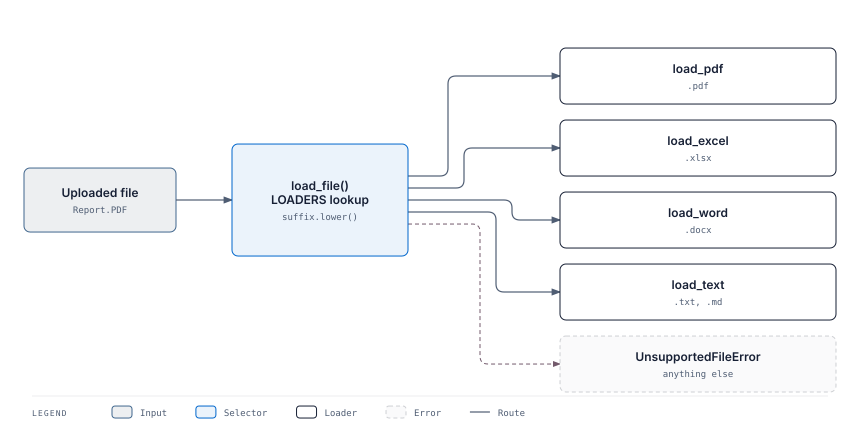
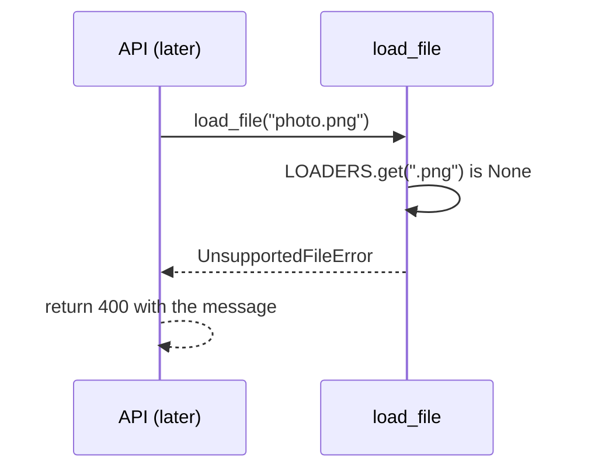

# 08. File Loader Selection

In this doc:

- Why one entry point for all loaders
- How load_file picks a loader, step by step
- The LOADERS table and how to add a new file type
- Error handling for unsupported files
- Tests

Files:

- [app/ingestion/file_loader.py](../app/ingestion/file_loader.py)
- [tests/test_file_loader.py](../tests/test_file_loader.py)

## Why one entry point

Steps 04 to 07 built four loaders. The ingestion service (a later step) receives any uploaded file. Without a selector it would need an `if pdf ... elif xlsx ...` chain, and every new file type would change the service.

With `load_file`, the service makes one call and never knows which loaders exist:

```python
documents = load_file(path)
```


All loaders return the same `list[Document]`, so the result looks the same for every file type.

## How it works



### Step by step

1. `path.suffix.lower()` takes the extension in lower case. `Report.PDF` gives `.pdf`, so letter case never matters.
2. `LOADERS.get(extension)` looks up the loader function in a dictionary.
3. If no loader is found, `UnsupportedFileError` is raised with the bad type and the list of allowed types.
4. Otherwise the loader is called with the path and its result is returned.

## The LOADERS table

<table width="100%">
<thead><tr><th>Extension</th><th>Loader</th><th>Document per</th><th>Doc</th></tr></thead>
<tbody>
<tr><td>.pdf</td><td>load_pdf</td><td>Page</td><td>04</td></tr>
<tr><td>.xlsx</td><td>load_excel</td><td>Sheet</td><td>05</td></tr>
<tr><td>.docx</td><td>load_word</td><td>File</td><td>06</td></tr>
<tr><td>.txt</td><td>load_text</td><td>File</td><td>07</td></tr>
<tr><td>.md</td><td>load_text</td><td>File</td><td>07</td></tr>
</tbody>
</table>

### Why a dictionary and not if/elif

<table width="100%">
<thead><tr><th>Approach</th><th>Adding a new type</th><th>Listing allowed types</th></tr></thead>
<tbody>
<tr><td>if / elif chain</td><td>Edit the chain in the middle of the logic</td><td>Must be kept in sync by hand</td></tr>
<tr><td>LOADERS dictionary</td><td>Add one line: ".csv": load_csv</td><td>sorted(LOADERS), always correct</td></tr>
</tbody>
</table>

Python functions are values, so a dictionary can map a string to a function and call it later: `LOADERS[".pdf"](path)` is the same as `load_pdf(path)`.

## Unsupported files



Message example:

```text
Unsupported file type '.png'. Allowed: .docx, .md, .pdf, .txt, .xlsx
```

`UnsupportedFileError` extends `ValueError`, so it is clearly an input problem, and the API step can turn it into an HTTP 400 response for this one error type without hiding real bugs.

## Tests

<table width="100%">
<thead><tr><th>Test</th><th>Checks</th></tr></thead>
<tbody>
<tr><td>test_load_file_picks_loader_by_extension</td><td>README.MD (upper case) goes to the text loader and is marked markdown</td></tr>
<tr><td>test_load_file_rejects_unsupported_type</td><td>.png raises UnsupportedFileError naming .png and the allowed types</td></tr>
<tr><td>test_supported_extensions_are_sorted</td><td>All five extensions listed in sorted order</td></tr>
</tbody>
</table>

No new dependencies.
