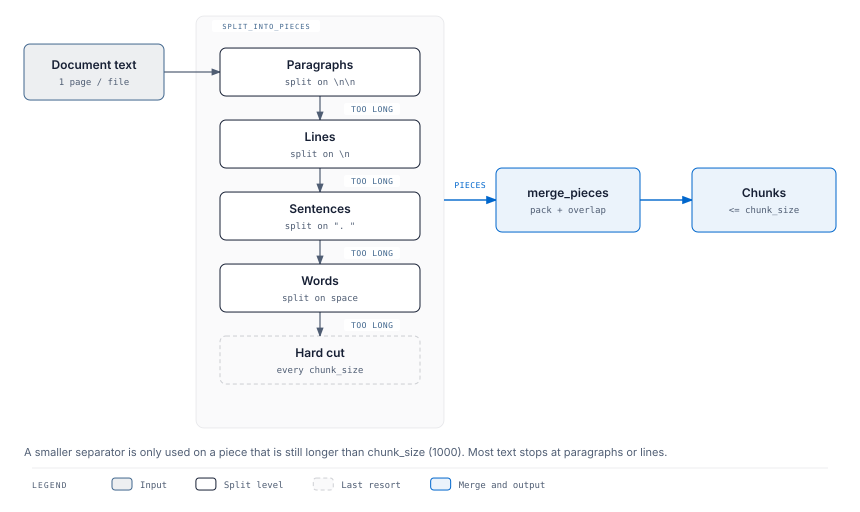
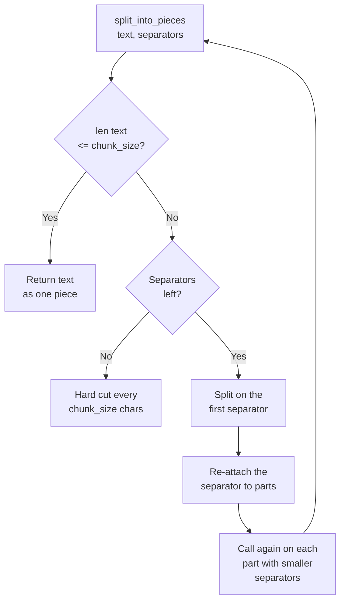
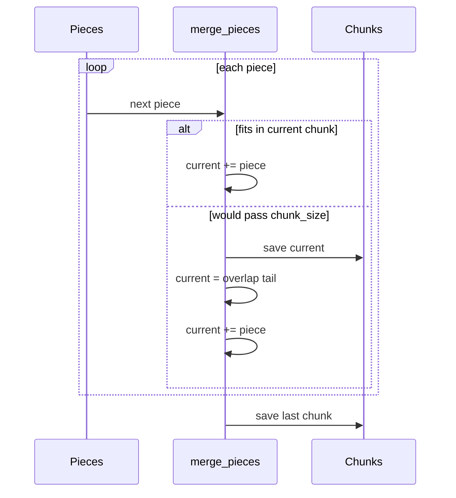

# 09. Chunker

In this doc:

- Why chunking is needed and the settings used
- Why our own small recursive splitter instead of a library
- Stage 1: split_into_pieces, step by step
- Stage 2: merge_pieces with overlap, step by step
- A full worked example
- Chunk metadata and tests

Files:

- [app/ingestion/chunker.py](../app/ingestion/chunker.py)
- [tests/test_chunker.py](../tests/test_chunker.py)

Background: [notes 04. Chunking](../../01.%20Notes/01.%20Basic%20Concepts/04.%20Chunking.md)

## Why chunking and which settings

A PDF page or a Word file is too long and covers too many topics for one embedding. The chunker cuts it into focused pieces.

<table width="100%">
<thead><tr><th>Setting</th><th>Value</th><th>Reason</th></tr></thead>
<tbody>
<tr><td>CHUNK_SIZE</td><td>1000 characters</td><td>About 250 tokens or 150 to 200 words: one or two paragraphs, a focused topic. Close to the 100-word chunks of the RAG paper, a bit larger for business documents.</td></tr>
<tr><td>CHUNK_OVERLAP</td><td>150 characters</td><td>15 percent of the chunk size, about one sentence, so a sentence cut at a boundary is whole in one of the two chunks</td></tr>
<tr><td>Unit</td><td>Characters</td><td>Simple and fast with no tokenizer dependency. 1000 characters is far below the 8,191-token input limit of text-embedding-3-small, so exact token counting is not needed.</td></tr>
</tbody>
</table>

Both values come from settings (doc 02), so they can be tuned in `.env` without code changes.

## Why our own splitter

<table width="100%">
<thead><tr><th>Option</th><th>Pros</th><th>Cons</th><th>Decision</th></tr></thead>
<tbody>
<tr><td>LangChain RecursiveCharacterTextSplitter</td><td>Popular, well tested</td><td>Adds a framework dependency for about 60 lines of logic, behaviour hidden inside the library</td><td>Not used</td></tr>
<tr><td>Own recursive splitter (same idea)</td><td>Every line is visible and documented, no dependency</td><td>We maintain it</td><td>Chosen: the goal of this repo is to understand every step</td></tr>
</tbody>
</table>

## How it works



The chunker runs in two stages.


### Stage 1: split_into_pieces

Goal: cut the text into pieces that are each at most `chunk_size`, cutting at the biggest natural boundary possible.

`SEPARATORS = ["\n\n", "\n", ". ", " "]` lists the boundaries from biggest to smallest: paragraph, line, sentence, word.

1. If the text already fits in `chunk_size`, return it as one piece.
2. If no separators are left, cut every `chunk_size` characters (only happens for a single "word" longer than 1000 characters, like a long URL or a base64 string).
3. Otherwise split on the biggest separator (`\n\n` first).
4. Put the separator back on the end of every part except the last, so joining the pieces gives back the exact original text.
5. For each part, call the function again with the smaller separators. A part that fits stops at step 1. A part that is still too long is split on the next separator.



This is **recursion**: the function calls itself on smaller inputs until every piece is small enough.

### Stage 2: merge_pieces

Stage 1 may produce many tiny pieces (single lines). Stage 2 packs them back into chunks that are as full as possible without passing `chunk_size`.

1. Start with an empty `current` chunk.
2. For each piece: if adding it would pass `chunk_size`, save `current` as a finished chunk.
3. Start the next chunk with `overlap_tail(current)`: the last 150 characters of the finished chunk, trimmed to start at a whole word.
4. If the overlap plus the new piece would still be too long, drop the overlap for this chunk (the size limit always wins).
5. Add the piece to `current`.
6. After the loop, save the last chunk.



## Worked example

Settings for the example: `chunk_size = 60`, `chunk_overlap = 20`.

Text (3 lines, 99 characters):

```text
Section 4.3 Sick leave.
Employees get 8 sick days per year.
A doctor's note is needed after 2 days.
```

Stage 1: the whole text is longer than 60. There is no `\n\n`, so the paragraph split gives one part, still too long. The line split `\n` gives three pieces, each under 60:

<table width="100%">
<thead><tr><th>Piece</th><th>Text</th><th>Length</th></tr></thead>
<tbody>
<tr><td>1</td><td>Section 4.3 Sick leave.\n</td><td>24</td></tr>
<tr><td>2</td><td>Employees get 8 sick days per year.\n</td><td>36</td></tr>
<tr><td>3</td><td>A doctor's note is needed after 2 days.</td><td>39</td></tr>
</tbody>
</table>

Stage 2:

<table width="100%">
<thead><tr><th>Step</th><th>Action</th><th>current after step</th></tr></thead>
<tbody>
<tr><td>Piece 1</td><td>Empty chunk, add it</td><td>24 chars</td></tr>
<tr><td>Piece 2</td><td>24 + 36 = 60, fits</td><td>60 chars</td></tr>
<tr><td>Piece 3</td><td>60 + 39 = 99 is too long: save chunk 0; the last 20 characters "sick days per year.\n" start right after a space, so they are kept whole; 20 + 39 = 59 fits</td><td>59 chars</td></tr>
<tr><td>End</td><td>Save chunk 2</td><td>-</td></tr>
</tbody>
</table>

Result:

```text
Chunk 0: Section 4.3 Sick leave.
         Employees get 8 sick days per year.
Chunk 1: sick days per year.
         A doctor's note is needed after 2 days.
```

Chunk 1 repeats "sick days per year." from chunk 0, so a question about sick days and doctor's notes finds both facts in one chunk.

## Chunk metadata

Each chunk is a `Document` with its parent's metadata plus `chunk_index`:

<table width="100%">
<thead><tr><th>Parent</th><th>Chunk metadata</th></tr></thead>
<tbody>
<tr><td>PDF page 3 of report.pdf</td><td>source: report.pdf, page: 3, file_type: pdf, chunk_index: 0, 1, 2, ...</td></tr>
<tr><td>Sheet Leave of leave.xlsx</td><td>source: leave.xlsx, sheet: Leave, rows: 40, file_type: excel, chunk_index: 0, ...</td></tr>
</tbody>
</table>

Chunks never cross Document boundaries: a chunk never mixes the end of page 3 with the start of page 4, so every chunk has exactly one page number for citations.

## Real result on the RAG paper

<table width="100%">
<thead><tr><th>Input</th><th>Chunks</th><th>Longest chunk</th><th>Average chunk</th></tr></thead>
<tbody>
<tr><td>19 pages (2005.11401_RAG-Lewis.pdf)</td><td>91</td><td>999 characters</td><td>872 characters</td></tr>
</tbody>
</table>

The average is close to the limit: merge_pieces packs chunks well.

## Tests

<table width="100%">
<thead><tr><th>Test</th><th>Checks</th></tr></thead>
<tbody>
<tr><td>test_short_text_stays_one_chunk</td><td>Short text is not split</td></tr>
<tr><td>test_chunks_respect_size_and_prefer_paragraphs</td><td>Two paragraphs are split exactly at the blank line</td></tr>
<tr><td>test_neighbouring_chunks_overlap</td><td>All chunks are at most chunk_size, the last word of chunk 0 appears in chunk 1</td></tr>
<tr><td>test_chunk_documents_keeps_metadata</td><td>Parent metadata copied, chunk_index counts from 0</td></tr>
<tr><td>test_overlap_must_be_smaller_than_chunk_size</td><td>Invalid settings raise ValueError</td></tr>
</tbody>
</table>

No new dependencies.
