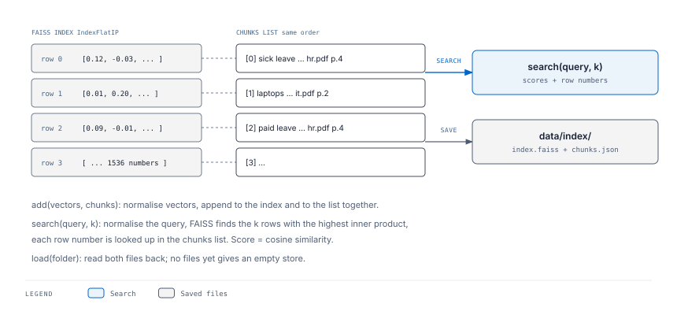
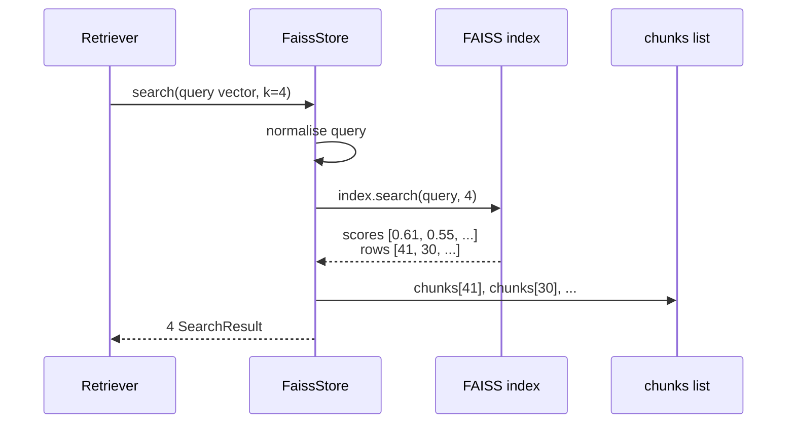
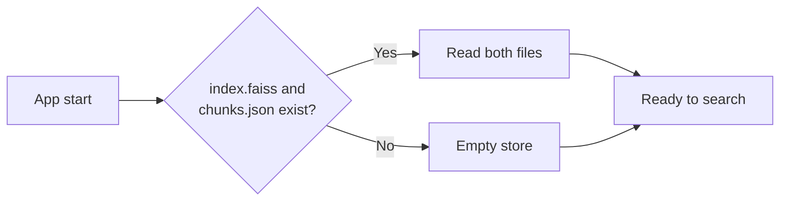

# 11. FAISS Vector Store

In this doc:

- Why FAISS and why the IndexFlatIP index type
- How vectors and chunks stay in sync
- add, search, save and load, step by step
- Why vectors are normalised
- A real search on the RAG paper
- Tests

Files:

- [app/vectorstore/faiss_store.py](../app/vectorstore/faiss_store.py)
- [tests/test_faiss_store.py](../tests/test_faiss_store.py)

Background: [notes 07. Vector Databases and Indexing](../../01.%20Notes/01.%20Basic%20Concepts/07.%20Vector%20Databases%20and%20Indexing.md)

## Why FAISS

FAISS is the vector search library by Meta, and the one used in the original RAG paper. It runs inside our Python process: no server to run, no account, no network call.

<table width="100%">
<thead><tr><th>Option</th><th>Runs</th><th>Stores text and metadata</th><th>Fit for this step</th></tr></thead>
<tbody>
<tr><td>FAISS</td><td>In process, files on disk</td><td>No, we keep a list next to it</td><td>Chosen (project decision): simple, fast, same as the paper</td></tr>
<tr><td>Chroma</td><td>In process</td><td>Yes</td><td>Hides the index details we want to learn</td></tr>
<tr><td>Qdrant, Weaviate, pgvector</td><td>Separate server</td><td>Yes</td><td>Needed later for production scale, not for the baseline</td></tr>
</tbody>
</table>

## Which index type

<table width="100%">
<thead><tr><th>Index</th><th>Search</th><th>Needs training</th><th>Good up to</th><th>Decision</th></tr></thead>
<tbody>
<tr><td>IndexFlatIP</td><td>Exact, compares the query with every vector</td><td>No</td><td>About 100,000 vectors</td><td>Chosen: exact results, no tuning, a few ms for thousands of chunks</td></tr>
<tr><td>IndexHNSWFlat</td><td>Approximate, graph walk</td><td>No</td><td>Millions</td><td>Upgrade path when the corpus grows</td></tr>
<tr><td>IndexIVFFlat / IVFPQ</td><td>Approximate, clusters</td><td>Yes</td><td>Millions to billions</td><td>Needs enough data to train</td></tr>
</tbody>
</table>

A Naive RAG baseline over a few documents has hundreds to thousands of chunks, so exact search is both fast and the most accurate reference for later comparisons.

## How vectors and chunks stay in sync

FAISS stores only numbers. It returns **row numbers**, not text. So the store keeps a Python list `chunks` where position `i` holds the text and metadata of index row `i`. Both are only ever changed together in `add`, so they can never drift apart.

## Operations

### add(vectors, chunks)

1. Check that there is one chunk per vector, otherwise raise `ValueError`.
2. Copy the vectors as `float32` and normalise each to length 1 with `faiss.normalize_L2`.
3. `index.add(vectors)` appends rows; `chunks.extend(chunks)` appends the matching chunks.

### search(query_vector, top_k)

1. Return an empty list if the store is empty.
2. Reshape the query to one row, convert to `float32` and normalise it.
3. `index.search(query, k)` returns two arrays: the best `scores` and their `rows`, best first. `k` is capped at the number of stored chunks.
4. Each row number is looked up in `chunks`, giving a `SearchResult(document, score)`.

### save(folder) and load(folder)

<table width="100%">
<thead><tr><th>File</th><th>Content</th><th>Format</th></tr></thead>
<tbody>
<tr><td>data/index/index.faiss</td><td>All vectors</td><td>FAISS binary (faiss.write_index)</td></tr>
<tr><td>data/index/chunks.json</td><td>Text and metadata of every chunk, in row order</td><td>JSON, readable for debugging</td></tr>
</tbody>
</table>

`load` reads both files back. If either file is missing (first run), it returns an empty store, so the app starts cleanly with no index.

## Why normalise

IndexFlatIP ranks by **inner product** (dot product). For vectors of length 1, the inner product equals the **cosine similarity** (notes 06):

$$\cos(\theta) = \frac{\mathbf{a} \cdot \mathbf{b}}{\lVert \mathbf{a} \rVert \, \lVert \mathbf{b} \rVert} = \mathbf{a} \cdot \mathbf{b} \quad \text{when } \lVert \mathbf{a} \rVert = \lVert \mathbf{b} \rVert = 1$$

text-embedding-3-small already returns length-1 vectors, but normalising again costs almost nothing and keeps scores correct if the embedding model is ever swapped. Scores are then easy to read: 1.0 is identical meaning, around 0 is unrelated.

## Real search on the RAG paper

91 chunks from the paper were embedded (2.8 seconds for one batch) and searched.

<table width="100%">
<thead><tr><th>Question</th><th>Top score</th><th>Top chunk (page)</th></tr></thead>
<tbody>
<tr><td>What retriever does RAG use?</td><td>0.607</td><td>Page 7, retrieval ablations: freezing the retriever during training</td></tr>
<tr><td>How many documents are in the Wikipedia index?</td><td>0.325</td><td>Page 17, training setup details</td></tr>
</tbody>
</table>

The second question shows a typical Naive RAG weakness: the answer ("21M documents", page 4) uses different words ("100-word chunks", "21M documents"), so plain vector search ranks it below other chunks. This is exactly the kind of failure later architectures (hybrid search, re-ranking, query rewriting) improve, and it is why we keep this exact baseline to compare against.

## Tests

<table width="100%">
<thead><tr><th>Test</th><th>Checks</th></tr></thead>
<tbody>
<tr><td>test_search_returns_best_matches_first</td><td>With 3-number vectors, the exact match comes first with score 1.0, then the 0.8 match</td></tr>
<tr><td>test_search_on_empty_store_returns_nothing</td><td>Empty store returns an empty list</td></tr>
<tr><td>test_add_rejects_mismatched_lengths</td><td>Two vectors with one chunk raises ValueError</td></tr>
<tr><td>test_save_and_load_round_trip</td><td>After save and load, count, best match and metadata are unchanged</td></tr>
<tr><td>test_load_without_files_gives_empty_store</td><td>First run with no files gives an empty store</td></tr>
</tbody>
</table>

The test run prints 4 DeprecationWarning lines from inside the faiss-cpu package (its SWIG bindings with NumPy 2). They come from the library, not from our code, and do not affect results.

## Dependencies added

<table width="100%">
<thead><tr><th>Package</th><th>Version</th><th>Why</th></tr></thead>
<tbody>
<tr><td>faiss-cpu</td><td>1.9.0.post1</td><td>Vector index and search</td></tr>
</tbody>
</table>
