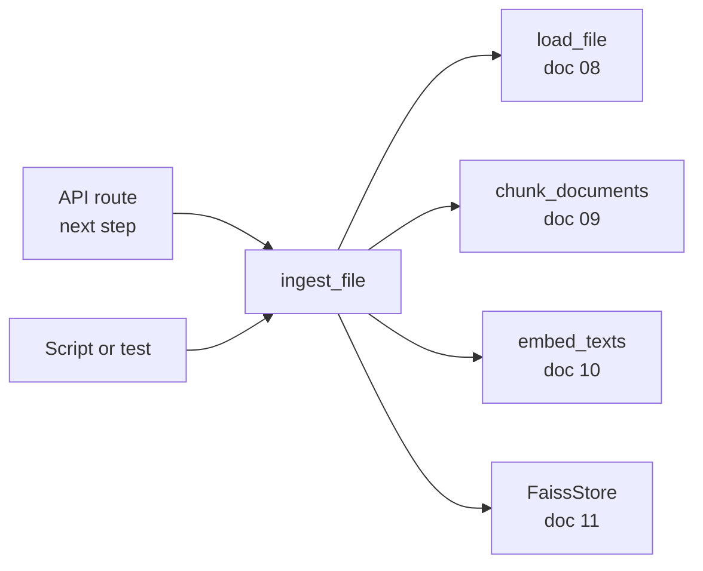
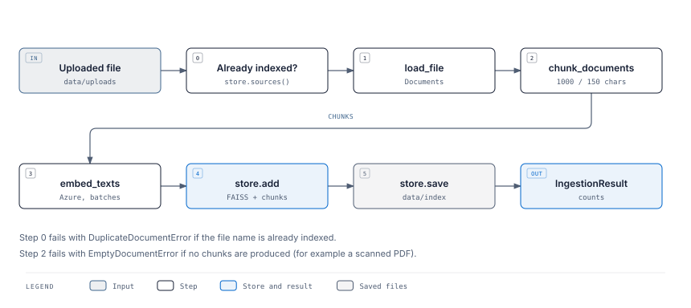
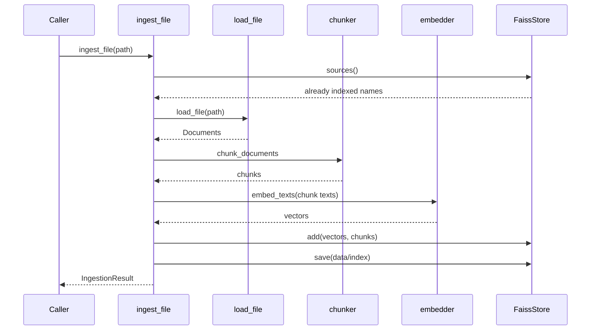

# 12. Ingestion Service

In this doc:

- What the ingestion service does and why it is a separate layer
- The shared vector store
- The pipeline, step by step
- Duplicate and empty file handling
- The result object
- Tests that run offline

Files:

- [app/services/vector_store.py](../app/services/vector_store.py)
- [app/services/ingestion_service.py](../app/services/ingestion_service.py)
- [app/vectorstore/faiss_store.py](../app/vectorstore/faiss_store.py) (new `sources()` method)
- [tests/test_ingestion_service.py](../tests/test_ingestion_service.py)

## What it does

The ingestion service is the **offline indexing pipeline** of Naive RAG ([notes 10](../../01.%20Notes/01.%20Basic%20Concepts/10.%20Naive%20RAG%20Architecture%20End%20to%20End.md)) in one function:

```python
result = ingest_file(Path("data/uploads/hr_policy.pdf"))
```

It only connects the building blocks from docs 04 to 11. It has no HTTP code, so it can be called from the API (next step), from a script or from tests.



## The shared vector store

`get_vector_store()` loads the store from `data/index` the first time it is called and caches it. Every later call returns the same object.

<table width="100%">
<thead><tr><th>Without a shared store</th><th>With get_vector_store()</th></tr></thead>
<tbody>
<tr><td>Each request loads the index from disk: slow</td><td>Loaded once per app start</td></tr>
<tr><td>A file ingested in one request is not seen by another request until reload</td><td>The same in-memory store is updated and searched</td></tr>
</tbody>
</table>

## The pipeline



### Step by step

<table width="100%">
<thead><tr><th>Step</th><th>Code</th><th>Output</th><th>Example (RAG paper)</th></tr></thead>
<tbody>
<tr><td>0. Duplicate check</td><td>path.name in store.sources()</td><td>Continue or DuplicateDocumentError</td><td>New file, continue</td></tr>
<tr><td>1. Load</td><td>load_file(path)</td><td>list of Document</td><td>19 page Documents</td></tr>
<tr><td>2. Chunk</td><td>chunk_documents(documents, 1000, 150)</td><td>list of chunk Documents</td><td>91 chunks</td></tr>
<tr><td>3. Embed</td><td>embed_texts([chunk.text ...])</td><td>float32 matrix</td><td>(91, 1536)</td></tr>
<tr><td>4. Store</td><td>store.add(vectors, chunks)</td><td>Rows added</td><td>count grows by 91</td></tr>
<tr><td>5. Save</td><td>store.save(settings.index_dir)</td><td>index.faiss, chunks.json</td><td>Index survives a restart</td></tr>
<tr><td>Result</td><td>IngestionResult(...)</td><td>Summary</td><td>source, 19, 91, total</td></tr>
</tbody>
</table>



## Error handling

<table width="100%">
<thead><tr><th>Error</th><th>When</th><th>Why stop here</th><th>API response (next step)</th></tr></thead>
<tbody>
<tr><td>DuplicateDocumentError</td><td>A file with the same name is already indexed</td><td>The same chunks twice would fill top-k with duplicates and double the embedding cost</td><td>409 Conflict</td></tr>
<tr><td>EmptyDocumentError</td><td>Loading and chunking produced no chunks</td><td>Usually a scanned PDF; the user should know nothing was indexed</td><td>422 Unprocessable</td></tr>
<tr><td>UnsupportedFileError</td><td>Unknown extension (from load_file, doc 08)</td><td>Cannot be read</td><td>400 Bad Request</td></tr>
</tbody>
</table>

The duplicate check runs **first**, before any work or API cost. Both custom errors extend `ValueError`, like `UnsupportedFileError`.

Replacing an existing file (delete its old chunks, then add the new ones) is not part of Naive RAG v1. To re-index a file today, delete `data/index` and ingest again.

## The result

<table width="100%">
<thead><tr><th>Field</th><th>Meaning</th></tr></thead>
<tbody>
<tr><td>source</td><td>File name</td></tr>
<tr><td>documents</td><td>Pages (PDF), sheets (Excel) or 1 (Word, text) read by the loader</td></tr>
<tr><td>chunks</td><td>Chunks created and stored for this file</td></tr>
<tr><td>total_chunks</td><td>Chunks in the whole store after this file</td></tr>
</tbody>
</table>

## Tests

The tests replace `embed_texts` with a fake that returns random 8-number vectors and point `index_dir` to a temporary folder, so they are free, fast and never touch the real index.

<table width="100%">
<thead><tr><th>Test</th><th>Checks</th></tr></thead>
<tbody>
<tr><td>test_ingest_file_runs_full_pipeline</td><td>A long text file gives 1 Document and several chunks, all stored, and both index files are written</td></tr>
<tr><td>test_ingest_file_rejects_duplicates</td><td>Ingesting the same file name twice raises DuplicateDocumentError</td></tr>
<tr><td>test_ingest_file_rejects_empty_files</td><td>A whitespace-only file raises EmptyDocumentError and stores nothing</td></tr>
</tbody>
</table>

No new dependencies.
