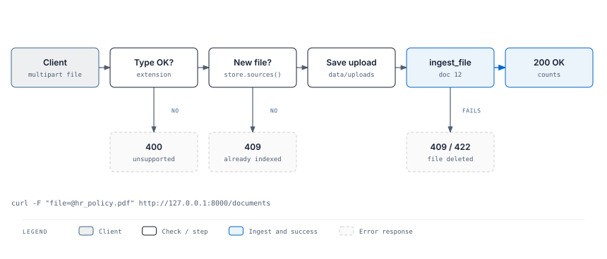
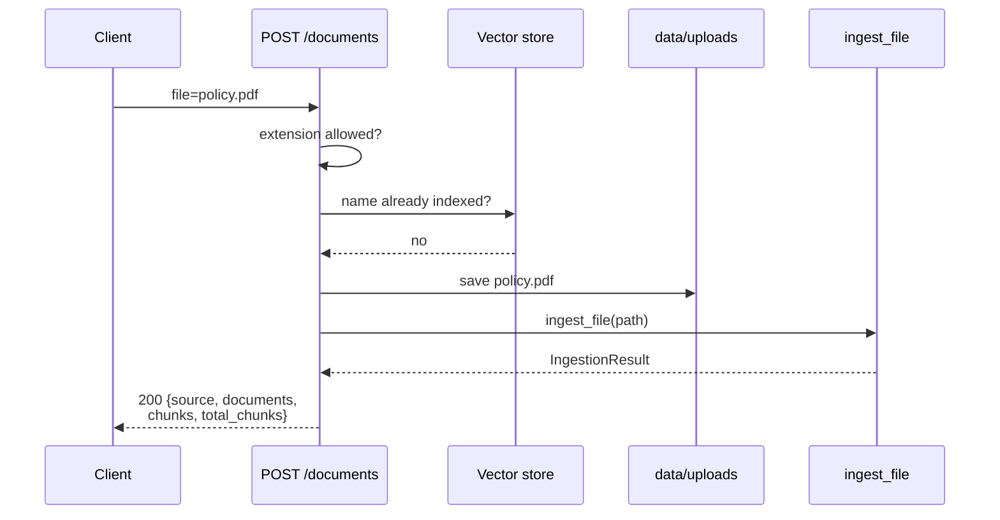
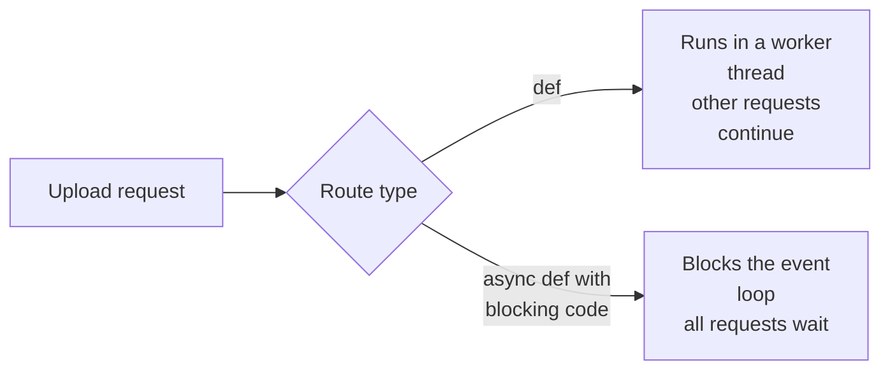

# 13. Document Upload API

In this doc:

- The POST /documents endpoint: request and response
- How a request is processed, step by step
- Error responses and why each status code
- Why the route is a normal (sync) function
- Thread safety of the shared store
- How to try it and tests

Files:

- [app/api/routes/documents.py](../app/api/routes/documents.py)
- [app/schemas/documents.py](../app/schemas/documents.py)
- [app/api/router.py](../app/api/router.py) (registers the new router)
- [app/services/ingestion_service.py](../app/services/ingestion_service.py) (new store lock)
- [tests/test_documents_api.py](../tests/test_documents_api.py)

## The endpoint

<table width="100%">
<thead><tr><th>Item</th><th>Value</th></tr></thead>
<tbody>
<tr><td>Method and path</td><td>POST /documents</td></tr>
<tr><td>Request body</td><td>multipart/form-data with one field named file</td></tr>
<tr><td>Allowed types</td><td>.docx, .md, .pdf, .txt, .xlsx</td></tr>
<tr><td>Success</td><td>200 with source, documents, chunks, total_chunks</td></tr>
<tr><td>Errors</td><td>400 unsupported type, 409 already indexed, 422 no text</td></tr>
</tbody>
</table>

Example response:

```json
{
  "source": "2005.11401_RAG-Lewis.pdf",
  "documents": 19,
  "chunks": 91,
  "total_chunks": 91
}
```

## How a request is processed



### Step by step

1. **Clean the file name.** `Path(file.filename).name` keeps only the name. A client could send `../../app/main.py` as the file name; taking `.name` makes it `main.py`, so nothing can be written outside `data/uploads`.
2. **Check the type.** If the extension is not in `supported_extensions()` (doc 08), return 400 before saving anything.
3. **Check it is new.** If the name is already in the store, return 409. This happens before saving, so the existing copy in `data/uploads` is never overwritten.
4. **Save the upload.** `shutil.copyfileobj` copies the uploaded stream to `data/uploads/<name>` in pieces, so large files do not have to fit in memory.
5. **Ingest.** `ingest_file` (doc 12) loads, chunks, embeds, stores and saves.
6. **Clean up on failure.** If ingestion fails for any reason, the saved file is deleted, so `data/uploads` only holds files that are really indexed.
7. **Respond.** The `IngestionResult` is returned as `DocumentUploadResponse`.



## Error responses

<table width="100%">
<thead><tr><th>Status</th><th>When</th><th>Why this code</th><th>File kept?</th></tr></thead>
<tbody>
<tr><td>400 Bad Request</td><td>Extension not supported</td><td>The request itself is invalid</td><td>Never saved</td></tr>
<tr><td>409 Conflict</td><td>File name already indexed</td><td>Conflicts with the current state of the index</td><td>Existing copy untouched</td></tr>
<tr><td>422 Unprocessable Content</td><td>File type is fine but no text can be extracted (for example a scanned PDF)</td><td>Valid request, content cannot be processed</td><td>Deleted</td></tr>
<tr><td>500 Internal Server Error</td><td>Unexpected failure, for example Azure is unreachable</td><td>A server-side problem, not the client's fault</td><td>Deleted</td></tr>
</tbody>
</table>

All error bodies use FastAPI's standard shape: `{"detail": "message"}`.

## Why a normal def and not async def

FastAPI runs a normal `def` route in a **thread pool**. The ingestion work (file parsing, the embedding HTTP call, FAISS) is blocking code. If the route were `async def`, that blocking work would freeze the event loop and stop all other requests, including `/health`, until the upload finished.



## Thread safety

Because routes run in threads, two uploads can run at the same time. Both would change the shared `FaissStore` (the index rows and the chunk list must stay in the same order). `ingest_file` now holds `STORE_LOCK` while it adds and saves:

<table width="100%">
<thead><tr><th>Part of ingest_file</th><th>Runs in parallel?</th><th>Why</th></tr></thead>
<tbody>
<tr><td>Load, chunk, embed</td><td>Yes</td><td>Only touches this request's data; the slow embedding call should not block other uploads</td></tr>
<tr><td>Duplicate re-check, store.add, store.save</td><td>No, one at a time (lock)</td><td>Changes the shared store and the files on disk</td></tr>
</tbody>
</table>

The duplicate check is repeated inside the lock, because another request could have added the same file while this one was embedding.

## Try it

Start the server from `01. Naive RAG/03. API`:

```bash
.venv/bin/uvicorn app.main:app --reload
```

Upload the RAG paper:

```bash
curl -F "file=@../02. Papers/2005.11401_RAG-Lewis.pdf" http://127.0.0.1:8000/documents
```

Or open http://127.0.0.1:8000/docs, expand POST /documents, click "Try it out" and choose a file.

Real results from a live run:

<table width="100%">
<thead><tr><th>Request</th><th>Status</th><th>Response</th></tr></thead>
<tbody>
<tr><td>Upload 2005.11401_RAG-Lewis.pdf</td><td>200</td><td>documents 19, chunks 91, total_chunks 91</td></tr>
<tr><td>Upload the same file again</td><td>409</td><td>'2005.11401_RAG-Lewis.pdf' is already indexed</td></tr>
<tr><td>Upload a file named photo.png</td><td>400</td><td>Unsupported file type. Allowed: .docx, .md, .pdf, .txt, .xlsx</td></tr>
</tbody>
</table>

## Tests

The tests use FastAPI's `TestClient` against the real app. Embeddings are faked, upload and index folders point to a temporary folder, and the shared store cache is cleared before and after each test.

<table width="100%">
<thead><tr><th>Test</th><th>Checks</th></tr></thead>
<tbody>
<tr><td>test_upload_indexes_file</td><td>200 with the expected counts, file saved in uploads</td></tr>
<tr><td>test_upload_rejects_unsupported_type</td><td>400 and nothing saved</td></tr>
<tr><td>test_upload_rejects_duplicate</td><td>Second upload of the same name gives 409</td></tr>
<tr><td>test_upload_rejects_empty_file</td><td>422 and the saved file is removed</td></tr>
</tbody>
</table>

## Dependencies added

<table width="100%">
<thead><tr><th>Package</th><th>Version</th><th>Why</th></tr></thead>
<tbody>
<tr><td>python-multipart</td><td>0.0.20</td><td>Required by FastAPI to read file uploads (multipart/form-data)</td></tr>
<tr><td>httpx</td><td>0.28.1</td><td>Required by FastAPI's TestClient</td></tr>
</tbody>
</table>
