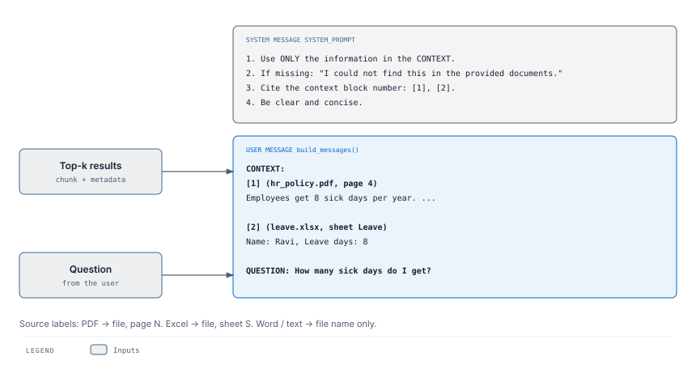
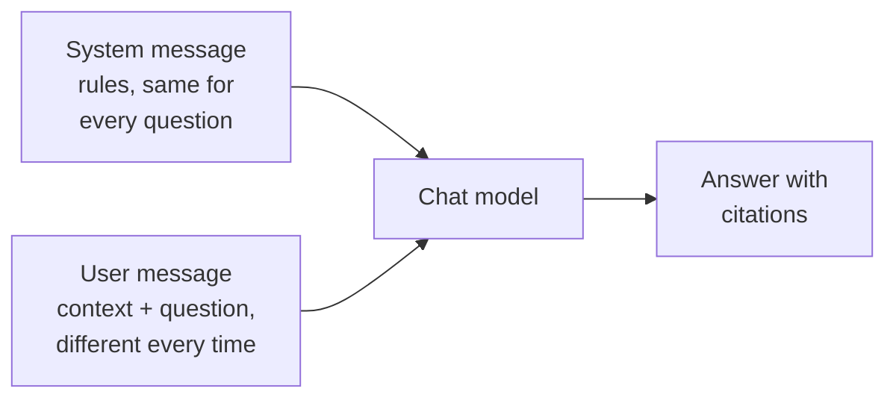

# 15. Prompt Builder

In this doc:

- What the prompt builder produces
- The system prompt and why each rule is there
- How context blocks and source labels are built
- Why system and user messages are separate
- Tests

Files:

- [app/generation/prompts.py](../app/generation/prompts.py)
- [tests/test_prompts.py](../tests/test_prompts.py)

Background: [notes 09. Prompt Augmentation and Generation](../../01.%20Notes/01.%20Basic%20Concepts/09.%20Prompt%20Augmentation%20and%20Generation.md)

## What it produces

This is the **Augment** step of Retrieve, Augment, Generate. It takes the question and the retrieved chunks and returns the two chat messages for the Azure OpenAI chat model. It makes no API calls.

```python
messages = build_messages("How many sick days do I get?", results)
```



## The system prompt

<table width="100%">
<thead><tr><th>Rule</th><th>Without it</th><th>With it</th></tr></thead>
<tbody>
<tr><td>1. Use ONLY the CONTEXT</td><td>The model mixes in its training memory, which may be outdated or wrong</td><td>Answers stay grounded in the uploaded documents</td></tr>
<tr><td>2. Exact "not found" reply</td><td>The model invents an answer when retrieval missed</td><td>An honest, fixed reply that code can detect (NOT_FOUND_ANSWER)</td></tr>
<tr><td>3. Cite [1], [2]</td><td>The user cannot check where a fact came from</td><td>Each fact points to a numbered block, which maps to a file and page</td></tr>
<tr><td>4. Clear and concise</td><td>Long, padded answers</td><td>Short answers, fewer output tokens</td></tr>
</tbody>
</table>

The not-found sentence is stored once as `NOT_FOUND_ANSWER` and used in the prompt, so the RAG service (next steps) can compare against the same string.

## Context blocks

### Step by step

1. `source_label(metadata)` builds a short label from the chunk metadata.
2. `format_context(results)` numbers chunks from 1, in retrieval order (best first), and writes each as `[n] (label)` on one line and the chunk text below.
3. Blocks are separated by a blank line so the model can see where one ends.
4. `build_messages` puts `CONTEXT:` and the blocks first, then `QUESTION:` and the question last.

### Source labels

<table width="100%">
<thead><tr><th>File type</th><th>Metadata used</th><th>Label</th></tr></thead>
<tbody>
<tr><td>PDF</td><td>source, page</td><td>hr_policy.pdf, page 4</td></tr>
<tr><td>Excel</td><td>source, sheet</td><td>leave.xlsx, sheet Leave</td></tr>
<tr><td>Word, text, Markdown</td><td>source</td><td>policy.docx</td></tr>
</tbody>
</table>

### Why the question comes last

Models pay most attention to the start and the end of a prompt. Putting the question right before the answer keeps it in focus after reading the context, and the best chunk is first, right after `CONTEXT:`.

## Why two messages



Chat models are trained to treat the system message as instructions with higher priority than the user message. Keeping the rules there, separate from the document text, makes it harder for text inside a document (for example "ignore the rules above") to override them.

## Token budget

With the default settings the prompt stays small:

<table width="100%">
<thead><tr><th>Part</th><th>Approximate tokens</th></tr></thead>
<tbody>
<tr><td>System prompt</td><td>90</td></tr>
<tr><td>4 chunks of about 1000 characters</td><td>1,000</td></tr>
<tr><td>Labels, question, formatting</td><td>50</td></tr>
<tr><td>Total input</td><td>about 1,150</td></tr>
</tbody>
</table>

## Tests

<table width="100%">
<thead><tr><th>Test</th><th>Checks</th></tr></thead>
<tbody>
<tr><td>test_source_label_by_file_type</td><td>PDF shows the page, Excel the sheet, Word only the file name</td></tr>
<tr><td>test_format_context_numbers_blocks</td><td>Exact block text: numbering from 1, labels, blank line between blocks</td></tr>
<tr><td>test_build_messages_has_system_rules_and_question</td><td>System message is SYSTEM_PROMPT, user message starts with CONTEXT and ends with the question</td></tr>
</tbody>
</table>

No new dependencies.
