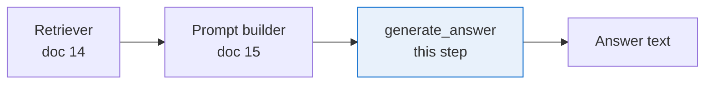
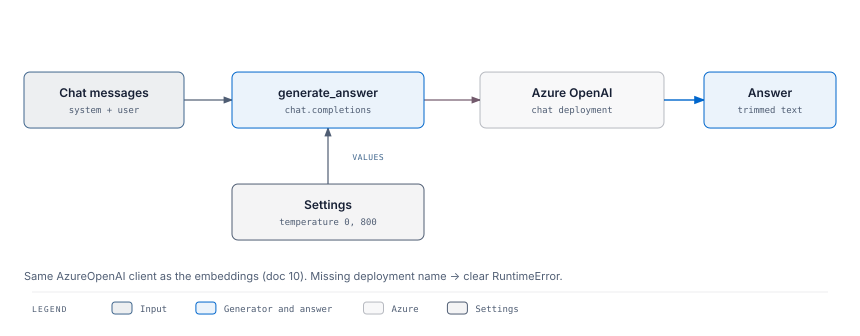
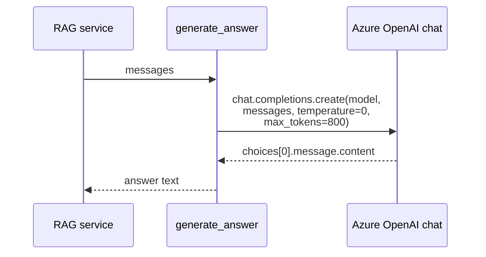

# 16. Answer Generator

In this doc:

- What the generator does
- How generate_answer works, step by step
- Why temperature 0 and an 800-token limit
- Real answers from the RAG paper, including a weakness of Naive RAG
- Tests

Files:

- [app/generation/generator.py](../app/generation/generator.py)
- [app/core/config.py](../app/core/config.py) (new LLM_TEMPERATURE and LLM_MAX_TOKENS settings)
- [tests/test_generator.py](../tests/test_generator.py)

## What it does

This is the **Generate** step. It sends the messages from the prompt builder (doc 15) to the Azure OpenAI chat deployment and returns the answer text.

## How it works

### Step by step

1. Read settings and get the shared `AzureOpenAI` client (the same one the embedder uses, doc 10). Tests pass a fake client.
2. If `AZURE_OPENAI_DEPLOYMENT_NAME` is empty, raise a clear `RuntimeError`.
3. Call `client.chat.completions.create` with the deployment name as `model`, the messages, the temperature and `max_tokens`.
4. The response has a list of `choices`. We ask for one, so the answer is `choices[0].message.content`. It is stripped of extra spaces; `or ""` handles a missing content value safely.

## Settings

<table width="100%">
<thead><tr><th>Setting</th><th>Default</th><th>Why</th></tr></thead>
<tbody>
<tr><td>LLM_TEMPERATURE</td><td>0.0</td><td>Always pick the most likely next token: stable, repeatable answers that stay close to the context. Good for factual Q and A and for comparing architectures fairly.</td></tr>
<tr><td>LLM_MAX_TOKENS</td><td>800</td><td>About 600 words: enough for a detailed answer, and a hard cap on output cost per question</td></tr>
</tbody>
</table>

Temperature reshapes the probability of each token (notes 09):

$$p_i = \frac{e^{z_i / T}}{\sum_j e^{z_j / T}}$$

As $T$ approaches 0, all probability goes to the highest-scoring token, so the same prompt gives the same answer.

## Real answers on the RAG paper

The full query path was run by hand: `retrieve` then `build_messages` then `generate_answer`.

<table width="100%">
<thead><tr><th>Question</th><th>Answer</th><th>Verdict</th></tr></thead>
<tbody>
<tr><td>What are the two RAG models and how do they differ?</td><td>The two RAG models are RAG-Sequence and RAG-Token. They differ in their generation diversity, with RAG-Sequence's generations being more diverse than RAG-Token's ... [2]</td><td>Names are correct and grounded, but the main difference (one document for the whole answer vs a different document per token) is missing</td></tr>
<tr><td>What is the capital of France?</td><td>I could not find this in the provided documents.</td><td>Correct: the model followed the grounding rule instead of answering from memory</td></tr>
</tbody>
</table>

The first answer is a clear example of a Naive RAG limitation: the chunk that explains the core difference (Section 2.1, page 3) was not in the top 4, so the model answered faithfully from the chunks it had. The answer is grounded but incomplete. The generator did its job; retrieval is the weak link. Later architectures in this repository target exactly this.

## Tests

The test uses a `FakeCompletions` object with the same `create(...)` method as the real client. It records the request and returns a fixed reply.

<table width="100%">
<thead><tr><th>Test</th><th>Checks</th></tr></thead>
<tbody>
<tr><td>test_generate_answer_sends_settings_and_trims</td><td>Request uses the deployment name, temperature and max_tokens from settings, messages are passed unchanged, reply is trimmed</td></tr>
</tbody>
</table>

No new dependencies (openai was added in doc 10).
