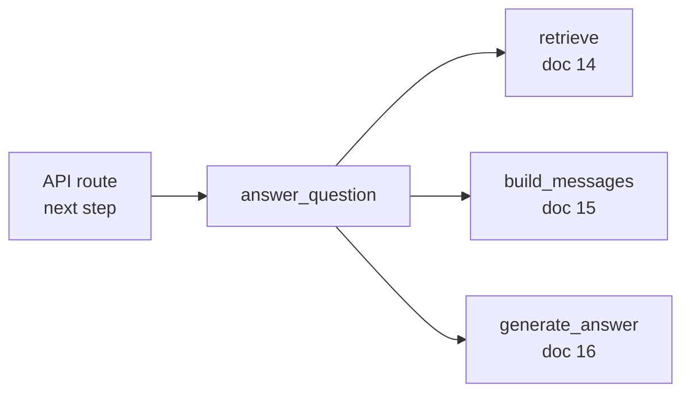
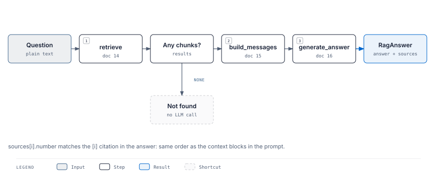
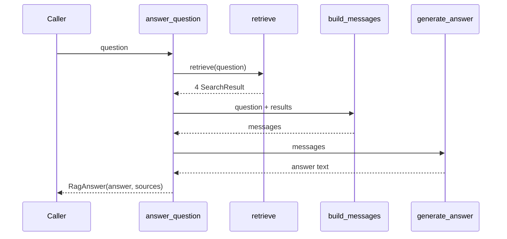

# 17. RAG Service

In this doc:

- What the RAG service does
- The query pipeline, step by step
- The result objects: RagAnswer and Source
- Why the not-found shortcut exists
- A real end-to-end answer
- Tests

Files:

- [app/services/rag_service.py](../app/services/rag_service.py)
- [tests/test_rag_service.py](../tests/test_rag_service.py)

## What it does

The RAG service is the **online query pipeline** of Naive RAG in one function. It connects the three query steps built in docs 14 to 16, the same way the ingestion service (doc 12) connects the indexing steps.

```python
result = answer_question("What dataset is used as the knowledge source?")
print(result.answer)
print(result.sources)
```



## The pipeline



### Step by step

1. `retrieve(question, top_k)` returns the top-k `SearchResult` objects, best first.
2. If the list is empty (nothing indexed yet), return `NOT_FOUND_ANSWER` with no sources. The chat model is not called.
3. `build_messages(question, results)` creates the system and user messages with numbered context blocks.
4. `generate_answer(messages)` calls the Azure OpenAI chat deployment.
5. Each result becomes a `Source` with the **same number** as its context block in the prompt, so `[2]` in the answer always means `sources[1]` (number 2).



## Result objects

<table width="100%">
<thead><tr><th>Object</th><th>Field</th><th>Example</th><th>Purpose</th></tr></thead>
<tbody>
<tr><td>RagAnswer</td><td>answer</td><td>"The knowledge source is Wikipedia ... [1][2]"</td><td>Text shown to the user</td></tr>
<tr><td>RagAnswer</td><td>sources</td><td>list of Source</td><td>Citations</td></tr>
<tr><td>Source</td><td>number</td><td>2</td><td>Matches [2] in the answer</td></tr>
<tr><td>Source</td><td>label</td><td>2005.11401_RAG-Lewis.pdf, page 4</td><td>Where to look in the original file</td></tr>
<tr><td>Source</td><td>score</td><td>0.4528</td><td>Cosine similarity, rounded to 4 decimals; useful for debugging and evaluation</td></tr>
<tr><td>Source</td><td>text</td><td>The chunk text</td><td>Lets the user read the evidence directly</td></tr>
</tbody>
</table>

## The not-found shortcut

<table width="100%">
<thead><tr><th>Situation</th><th>Without the shortcut</th><th>With the shortcut</th></tr></thead>
<tbody>
<tr><td>Question before any upload</td><td>Chat call with an empty CONTEXT: costs tokens and the model may answer from memory</td><td>Fixed not-found answer, zero API calls</td></tr>
</tbody>
</table>

The retriever (doc 14) already skips the embedding call when the store is empty, so an empty index costs nothing at all.

## Real end-to-end answer

Question: "What dataset is used as the knowledge source and how is it split?"

<table width="100%">
<thead><tr><th>Source</th><th>Label</th><th>Score</th></tr></thead>
<tbody>
<tr><td>1</td><td>2005.11401_RAG-Lewis.pdf, page 18</td><td>0.4768</td></tr>
<tr><td>2</td><td>2005.11401_RAG-Lewis.pdf, page 4</td><td>0.4528</td></tr>
<tr><td>3</td><td>2005.11401_RAG-Lewis.pdf, page 11</td><td>0.4358</td></tr>
<tr><td>4</td><td>2005.11401_RAG-Lewis.pdf, page 5</td><td>0.4315</td></tr>
</tbody>
</table>

Answer (shortened): "The dataset used as the knowledge source is Wikipedia ... The document encoder computes embeddings for each document, and a MIPS index is built using FAISS ... [1][2]"

What it shows:

- "Wikipedia" and "FAISS MIPS index" are correct and cited.
- The model read "split" as dataset train/test splits (TriviaQA) instead of the 100-word chunk split on page 4. The word "split" is ambiguous, and the chunk with the exact detail ranked 2nd with a low score (0.45). Query rewriting (folder 02) targets this kind of ambiguity.

## Tests

Retrieval and generation are replaced with fakes, so the tests check only how the service connects them.

<table width="100%">
<thead><tr><th>Test</th><th>Checks</th></tr></thead>
<tbody>
<tr><td>test_answer_question_returns_answer_and_sources</td><td>Answer is returned, sources are numbered 1 and 2 with the right labels and rounded scores, the chat model received the question</td></tr>
<tr><td>test_answer_question_with_empty_index_skips_llm</td><td>No chunks gives NOT_FOUND_ANSWER, no sources and no chat call</td></tr>
</tbody>
</table>

No new dependencies.
