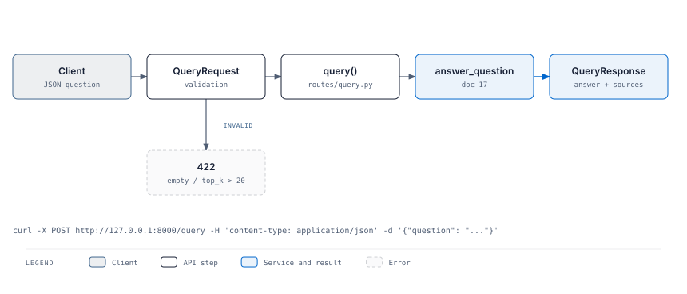
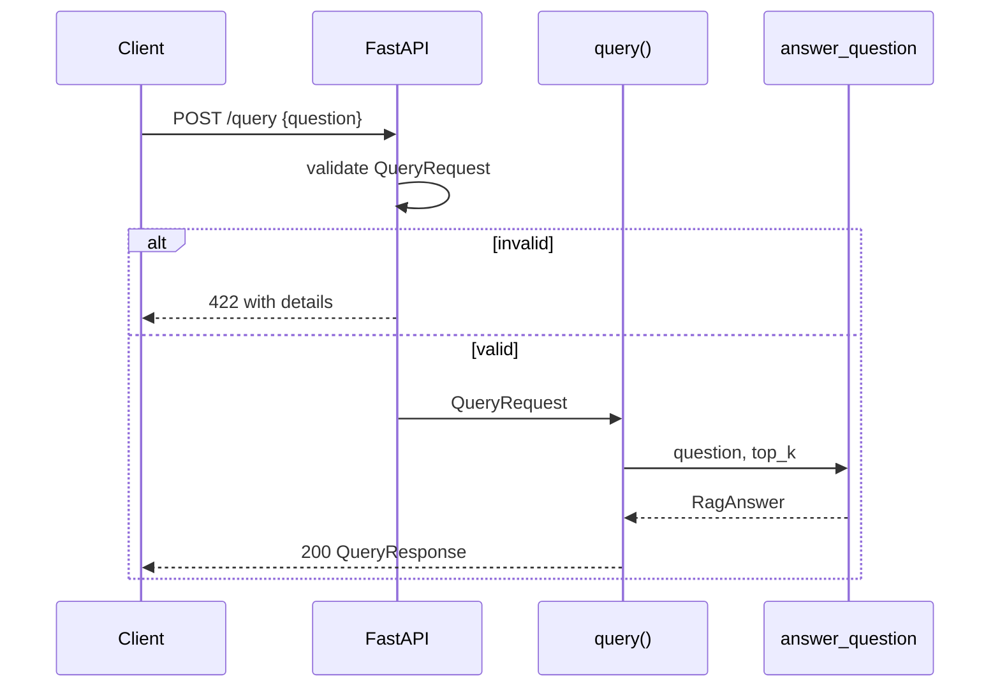

# 18. Query API

In this doc:

- The POST /query endpoint: request and response
- How a request is processed
- Input validation with the schema
- Try it, with a real answer
- Tests

Files:

- [app/api/routes/query.py](../app/api/routes/query.py)
- [app/schemas/query.py](../app/schemas/query.py)
- [app/api/router.py](../app/api/router.py) (registers the query router)
- [tests/test_query_api.py](../tests/test_query_api.py)

## The endpoint

<table width="100%">
<thead><tr><th>Item</th><th>Value</th></tr></thead>
<tbody>
<tr><td>Method and path</td><td>POST /query</td></tr>
<tr><td>Request body</td><td>JSON: question (required), top_k (optional)</td></tr>
<tr><td>Success</td><td>200 with answer and sources</td></tr>
<tr><td>Errors</td><td>422 invalid input, 500 unexpected failure (for example Azure unreachable)</td></tr>
</tbody>
</table>

Request:

```json
{
  "question": "Which retriever and generator does RAG combine?",
  "top_k": 4
}
```

Response:

```json
{
  "answer": "RAG combines a dense retriever with a sequence-to-sequence generator ... [2], [3].",
  "sources": [
    {"number": 1, "label": "2005.11401_RAG-Lewis.pdf, page 7", "score": 0.5441, "text": "..."},
    {"number": 2, "label": "2005.11401_RAG-Lewis.pdf, page 2", "score": 0.5254, "text": "..."}
  ]
}
```

## How a request is processed



1. FastAPI parses the JSON body into `QueryRequest`. If validation fails, it returns 422 with details and the route is never called.
2. `query()` calls `answer_question(question, top_k)` (doc 17).
3. The `RagAnswer` dataclass is converted into the `QueryResponse` schema, source by source.

The route has no logic of its own: validation lives in the schema, the pipeline lives in the service. Like `POST /documents`, it is a normal `def`, so the blocking Azure calls run in a worker thread (doc 13).



## Input validation

<table width="100%">
<thead><tr><th>Field</th><th>Rule</th><th>Why</th><th>Bad example</th></tr></thead>
<tbody>
<tr><td>question</td><td>1 to 2000 characters</td><td>An empty question has nothing to search; a huge one wastes tokens and is likely misuse</td><td>""</td></tr>
<tr><td>top_k</td><td>Optional, 1 to 20</td><td>Lets evaluation scripts try different k; the cap keeps prompts and cost bounded</td><td>50</td></tr>
</tbody>
</table>

These rules are declared once with `Field(min_length=..., ge=..., le=...)`. FastAPI enforces them and shows them in the `/docs` page.

## Try it

```bash
curl -X POST http://127.0.0.1:8000/query \
  -H "content-type: application/json" \
  -d '{"question": "Which retriever and generator does RAG combine?"}'
```

Real live result (RAG paper indexed):

<table width="100%">
<thead><tr><th>Source</th><th>Label</th><th>Score</th></tr></thead>
<tbody>
<tr><td>1</td><td>2005.11401_RAG-Lewis.pdf, page 7</td><td>0.5441</td></tr>
<tr><td>2</td><td>2005.11401_RAG-Lewis.pdf, page 2</td><td>0.5254</td></tr>
<tr><td>3</td><td>2005.11401_RAG-Lewis.pdf, page 7</td><td>0.5252</td></tr>
<tr><td>4</td><td>2005.11401_RAG-Lewis.pdf, page 9</td><td>0.5251</td></tr>
</tbody>
</table>

Answer: "RAG combines a dense retriever with a sequence-to-sequence generator. Specifically, it uses a dense retriever to retrieve relevant text documents based on the input sequence, and then a generator (such as BART) ... [2], [3]."

An empty question returned 422, as expected.

## Tests

<table width="100%">
<thead><tr><th>Test</th><th>Checks</th></tr></thead>
<tbody>
<tr><td>test_query_returns_answer_and_sources</td><td>With a fake RAG service: 200, exact response body, question and top_k passed through</td></tr>
<tr><td>test_query_rejects_empty_question</td><td>Empty question gives 422</td></tr>
<tr><td>test_query_rejects_top_k_out_of_range</td><td>top_k 50 gives 422</td></tr>
</tbody>
</table>

No new dependencies.
