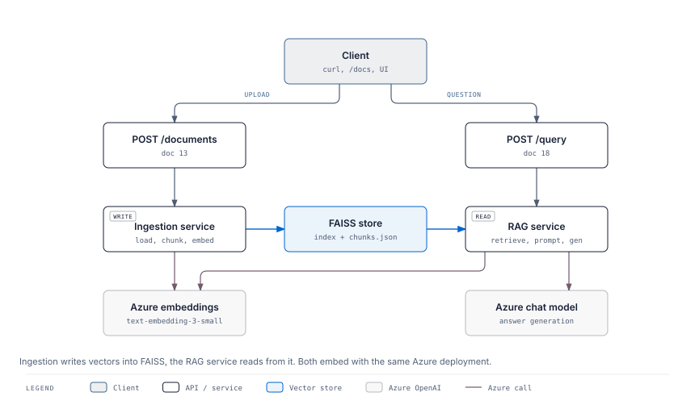
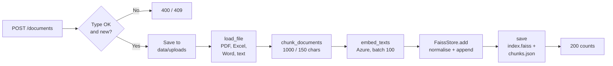
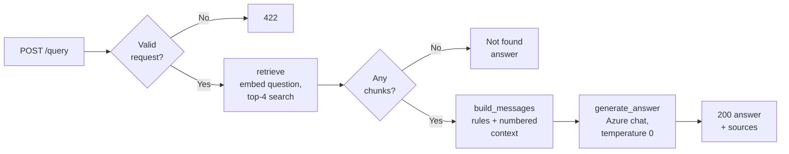

# 19. Naive RAG Architecture Overview

In this doc:

- The complete system in one diagram
- Both pipelines, end to end, with every module
- One upload and one question traced through the code
- Every design decision in one table
- Known limits of this baseline and where they are addressed
- Map of all docs

This doc ties docs 01 to 18 together. Read it first for the big picture, then the numbered docs for details.

## The complete system

<table width="100%">
<thead><tr><th>Part</th><th>Endpoint</th><th>Service</th><th>Modules used</th><th>Writes or reads FAISS</th></tr></thead>
<tbody>
<tr><td>Offline indexing</td><td>POST /documents</td><td>ingestion_service.ingest_file</td><td>file_loader, loaders, chunker, embedder, faiss_store</td><td>Writes</td></tr>
<tr><td>Online query</td><td>POST /query</td><td>rag_service.answer_question</td><td>retriever, embedder, faiss_store, prompts, generator</td><td>Reads</td></tr>
<tr><td>Status</td><td>GET /health</td><td>none</td><td>config</td><td>No</td></tr>
</tbody>
</table>

## Pipeline 1: indexing

## Pipeline 2: query

## One upload, traced through the code

Upload: `curl -F "file=@hr_policy.pdf" .../documents`

<table width="100%">
<thead><tr><th>#</th><th>File</th><th>Function</th><th>Data after this step</th></tr></thead>
<tbody>
<tr><td>1</td><td>api/routes/documents.py</td><td>upload_document</td><td>Name checked, saved as data/uploads/hr_policy.pdf</td></tr>
<tr><td>2</td><td>services/ingestion_service.py</td><td>ingest_file</td><td>Duplicate check passed</td></tr>
<tr><td>3</td><td>ingestion/file_loader.py</td><td>load_file</td><td>.pdf routed to load_pdf</td></tr>
<tr><td>4</td><td>ingestion/loaders/pdf_loader.py</td><td>load_pdf</td><td>One Document per page, metadata source and page</td></tr>
<tr><td>5</td><td>ingestion/chunker.py</td><td>chunk_documents</td><td>Chunks of at most 1000 characters, chunk_index added</td></tr>
<tr><td>6</td><td>embeddings/embedder.py</td><td>embed_texts</td><td>float32 matrix (chunks, 1536)</td></tr>
<tr><td>7</td><td>vectorstore/faiss_store.py</td><td>add, save</td><td>Rows appended in memory and written to data/index</td></tr>
<tr><td>8</td><td>api/routes/documents.py</td><td>upload_document</td><td>JSON: source, documents, chunks, total_chunks</td></tr>
</tbody>
</table>

## One question, traced through the code

Question: `{"question": "How many sick days do I get?"}`

<table width="100%">
<thead><tr><th>#</th><th>File</th><th>Function</th><th>Data after this step</th></tr></thead>
<tbody>
<tr><td>1</td><td>schemas/query.py</td><td>QueryRequest</td><td>Validated question, top_k None</td></tr>
<tr><td>2</td><td>services/rag_service.py</td><td>answer_question</td><td>Pipeline started</td></tr>
<tr><td>3</td><td>retrieval/retriever.py</td><td>retrieve</td><td>top_k = 4 from settings</td></tr>
<tr><td>4</td><td>embeddings/embedder.py</td><td>embed_query</td><td>Question vector (1, 1536)</td></tr>
<tr><td>5</td><td>vectorstore/faiss_store.py</td><td>search</td><td>4 SearchResult, best first, cosine scores</td></tr>
<tr><td>6</td><td>generation/prompts.py</td><td>build_messages</td><td>System rules + numbered context + question</td></tr>
<tr><td>7</td><td>generation/generator.py</td><td>generate_answer</td><td>Answer text with [n] citations</td></tr>
<tr><td>8</td><td>api/routes/query.py</td><td>query</td><td>JSON: answer and sources</td></tr>
</tbody>
</table>

## Design decisions

<table width="100%">
<thead><tr><th>Decision</th><th>Choice</th><th>Main reason</th><th>Doc</th></tr></thead>
<tbody>
<tr><td>Structure</td><td>API, service and component layers</td><td>Each RAG step replaceable and testable alone</td><td>01</td></tr>
<tr><td>Configuration</td><td>pydantic-settings, root .env</td><td>Typed values, secrets out of git</td><td>02</td></tr>
<tr><td>Framework</td><td>FastAPI, sync routes</td><td>Validation, auto docs, blocking work in threads</td><td>03, 13</td></tr>
<tr><td>File parsing</td><td>pypdf, openpyxl, python-docx, plain read</td><td>Light, simple, enough for a baseline</td><td>04 to 07</td></tr>
<tr><td>Table rows</td><td>"header: value" lines</td><td>Rows stay meaningful after chunking</td><td>05, 06</td></tr>
<tr><td>Loader choice</td><td>Extension to function dictionary</td><td>One entry point, one line per new type</td><td>08</td></tr>
<tr><td>Chunking</td><td>Own recursive splitter, 1000 / 150 characters</td><td>Natural boundaries, fully visible logic</td><td>09</td></tr>
<tr><td>Embeddings</td><td>Azure text-embedding-3-small, batches of 100</td><td>Same resource as chat, cheap, 1536 dimensions</td><td>10</td></tr>
<tr><td>Vector store</td><td>FAISS IndexFlatIP, normalised vectors</td><td>Exact cosine search, no server</td><td>11</td></tr>
<tr><td>Duplicates</td><td>Reject same file name (409)</td><td>No repeated chunks in top-k</td><td>12, 13</td></tr>
<tr><td>Concurrency</td><td>Lock around store add and save</td><td>Index rows and chunk list stay aligned</td><td>13</td></tr>
<tr><td>Retrieval</td><td>top_k = 4, no threshold</td><td>Good recall, low noise and cost</td><td>14</td></tr>
<tr><td>Prompt</td><td>System rules + numbered, labelled context</td><td>Grounding, honest not-found, citations</td><td>15</td></tr>
<tr><td>Generation</td><td>Azure chat, temperature 0, 800 tokens</td><td>Stable, repeatable, bounded cost</td><td>16</td></tr>
</tbody>
</table>

## Known limits of this baseline

Every limit below was seen in real runs on the RAG paper (docs 11, 14, 16, 17) and is the target of a later folder.

<table width="100%">
<thead><tr><th>Limit</th><th>Seen in</th><th>Addressed in</th></tr></thead>
<tbody>
<tr><td>Answer chunk not in the top 4 when wording differs</td><td>"How many documents are in the Wikipedia index?"</td><td>03 Hybrid Search, 02 Advanced RAG (re-ranking)</td></tr>
<tr><td>Ambiguous question words ("split")</td><td>Knowledge source question in doc 17</td><td>02 Advanced RAG (query rewriting), 04 HyDE</td></tr>
<tr><td>Grounded but incomplete answers</td><td>Two RAG models question in doc 16</td><td>05 RAG Fusion, 08 Self RAG</td></tr>
<tr><td>Scores close together, no threshold</td><td>Scores 0.43 to 0.66 in doc 14</td><td>02 Advanced RAG (re-ranking)</td></tr>
<tr><td>Scanned PDFs and images ignored</td><td>Loader limits, docs 04 and 06</td><td>18 Multimodal RAG</td></tr>
<tr><td>No re-index or delete of one file</td><td>Doc 12</td><td>Later production step</td></tr>
</tbody>
</table>

## Map of all docs

<table width="100%">
<thead><tr><th>Doc</th><th>Topic</th><th>Layer</th></tr></thead>
<tbody>
<tr><td><a href="01.%20Project%20Folder%20Structure.md">01</a></td><td>Project folder structure</td><td>Foundation</td></tr>
<tr><td><a href="02.%20Configuration%20and%20Settings.md">02</a></td><td>Configuration and settings</td><td>Foundation</td></tr>
<tr><td><a href="03.%20FastAPI%20Application%20Setup.md">03</a></td><td>FastAPI app and health endpoint</td><td>API</td></tr>
<tr><td><a href="04.%20PDF%20Loader.md">04</a></td><td>PDF loader and Document model</td><td>Indexing</td></tr>
<tr><td><a href="05.%20Excel%20Loader.md">05</a></td><td>Excel loader</td><td>Indexing</td></tr>
<tr><td><a href="06.%20Word%20Loader.md">06</a></td><td>Word loader</td><td>Indexing</td></tr>
<tr><td><a href="07.%20Text%20and%20Markdown%20Loader.md">07</a></td><td>Text and Markdown loader</td><td>Indexing</td></tr>
<tr><td><a href="08.%20File%20Loader%20Selection.md">08</a></td><td>File loader selection</td><td>Indexing</td></tr>
<tr><td><a href="09.%20Chunker.md">09</a></td><td>Chunker</td><td>Indexing</td></tr>
<tr><td><a href="10.%20Embeddings.md">10</a></td><td>Embeddings</td><td>Indexing and query</td></tr>
<tr><td><a href="11.%20FAISS%20Vector%20Store.md">11</a></td><td>FAISS vector store</td><td>Indexing and query</td></tr>
<tr><td><a href="12.%20Ingestion%20Service.md">12</a></td><td>Ingestion service</td><td>Indexing</td></tr>
<tr><td><a href="13.%20Document%20Upload%20API.md">13</a></td><td>Document upload API</td><td>API</td></tr>
<tr><td><a href="14.%20Retriever.md">14</a></td><td>Retriever</td><td>Query</td></tr>
<tr><td><a href="15.%20Prompt%20Builder.md">15</a></td><td>Prompt builder</td><td>Query</td></tr>
<tr><td><a href="16.%20Answer%20Generator.md">16</a></td><td>Answer generator</td><td>Query</td></tr>
<tr><td><a href="17.%20RAG%20Service.md">17</a></td><td>RAG service</td><td>Query</td></tr>
<tr><td><a href="18.%20Query%20API.md">18</a></td><td>Query API</td><td>API</td></tr>
<tr><td>19</td><td>Architecture overview (this doc)</td><td>All</td></tr>
</tbody>
</table>
