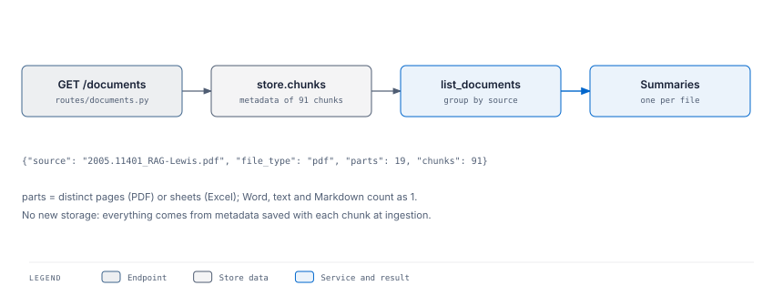
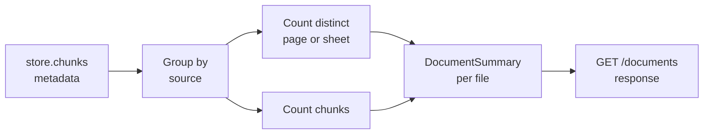

# 20. Document List API

In this doc:

- Why the UI needs GET /documents
- How the list is built from chunk metadata, step by step
- Request and response
- Tests

Files:

- [app/services/document_service.py](../app/services/document_service.py)
- [app/api/routes/documents.py](../app/api/routes/documents.py) (new GET route)
- [app/schemas/documents.py](../app/schemas/documents.py) (new DocumentInfo and DocumentListResponse)
- [tests/test_document_service.py](../tests/test_document_service.py), [tests/test_documents_api.py](../tests/test_documents_api.py)

## Why

The React UI (folder `04. UI`) shows the indexed files in its documents rail. Until now the API could add files but not list them, and after a server restart the UI would have no way to know what is already indexed.

## How it works



### Step by step

1. `list_documents()` reads `store.chunks`: the text and metadata of every chunk, already in memory (doc 11).
2. Chunks are grouped by `metadata["source"]` (the file name). A Python dict keeps insertion order, so files come back in upload order.
3. For each file:
   - `file_type` comes from the first chunk.
   - `parts` is the number of distinct `page` values (PDF) or `sheet` values (Excel). Word, text and Markdown chunks have neither, so the set holds one value (`None`) and `parts` is 1.
   - `chunks` is the number of chunks for that file.
4. The route converts the summaries to `DocumentInfo` and adds `total_chunks`.



### Why no separate document table

All the needed facts were already saved with each chunk at ingestion (docs 04 to 09). Reading them back keeps one source of truth: the list can never disagree with what is actually searchable.

## Request and response

```bash
curl http://127.0.0.1:8000/documents
```

```json
{
  "documents": [
    {"source": "2005.11401_RAG-Lewis.pdf", "file_type": "pdf", "parts": 19, "chunks": 91}
  ],
  "total_chunks": 91
}
```

<table width="100%">
<thead><tr><th>Field</th><th>Meaning</th></tr></thead>
<tbody>
<tr><td>source</td><td>File name</td></tr>
<tr><td>file_type</td><td>pdf, excel, word, text or markdown</td></tr>
<tr><td>parts</td><td>Pages (PDF), sheets (Excel), or 1 for whole-file types</td></tr>
<tr><td>chunks</td><td>Chunks stored for this file</td></tr>
<tr><td>total_chunks</td><td>Chunks in the whole index</td></tr>
</tbody>
</table>

## Tests

<table width="100%">
<thead><tr><th>Test</th><th>Checks</th></tr></thead>
<tbody>
<tr><td>test_list_documents_groups_chunks_by_file</td><td>3 PDF chunks on 2 pages and 1 Excel chunk give 2 summaries with parts 2 and 1</td></tr>
<tr><td>test_list_documents_after_uploads</td><td>Empty list first; after two uploads both files are listed in order with type and counts</td></tr>
</tbody>
</table>

No new dependencies.
