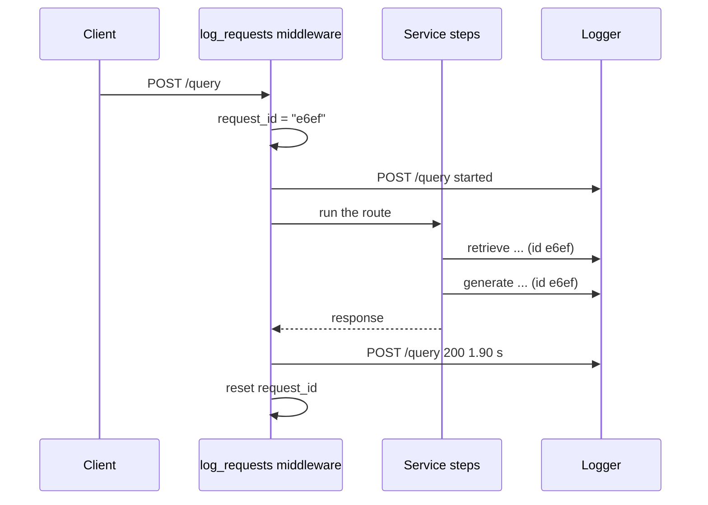

# 21. Structured Logging

In this doc:

- Why the API needs readable logs
- The log line format and what each column means
- How a request id ties all lines of one request together
- The log_step helper: one aligned line per pipeline step
- The startup summary
- Real logs from a query, an upload and a duplicate upload

Files:

- [app/core/logging.py](../app/core/logging.py)
- [app/api/middleware.py](../app/api/middleware.py)
- [app/main.py](../app/main.py) (setup, middleware, startup summary)
- [app/services/ingestion_service.py](../app/services/ingestion_service.py) and [app/services/rag_service.py](../app/services/rag_service.py) (step logs)
- [app/core/config.py](../app/core/config.py) (new LOG_LEVEL setting)

## Why

Until now the terminal only showed uvicorn's access lines (`"POST /query HTTP/1.1" 200`). That says nothing about what happened inside: how many chunks were retrieved, how good the best match was, which step was slow. For a project about understanding RAG, the logs should show the pipeline working.

## The log line


<table width="100%">
<thead><tr><th>Column</th><th>Example</th><th>Meaning</th></tr></thead>
<tbody>
<tr><td>Time</td><td>[16:43:41]</td><td>Shown when it changes, so repeated times do not clutter the view</td></tr>
<tr><td>Level</td><td>INFO</td><td>Colored by Rich: INFO blue, WARNING yellow, ERROR red</td></tr>
<tr><td>Request id</td><td>e6ef</td><td>4 random hex characters per request; "-" outside a request (startup)</td></tr>
<tr><td>Route line</td><td>POST /query  200  1.90 s</td><td>Start and end of a request, status colored green, yellow or red</td></tr>
<tr><td>Step line</td><td>retrieve  results=4  top_score=0.504  1.00 s</td><td>Indented: one pipeline step, its metadata (cyan values) and its duration</td></tr>
</tbody>
</table>

## Request ids



The id lives in a `ContextVar`. FastAPI copies the context into the worker thread that runs our sync routes, so every log call made while handling the request sees the same id, even when several requests run at the same time. A `logging.Filter` adds it to each record.

`/health` is logged at DEBUG level: the UI checks it every 30 seconds, and those lines would bury the useful ones. Set `LOG_LEVEL=DEBUG` in `.env` to see them.

## log_step

```python
with log_step(log, "chunk", size=1000, overlap=150) as step:
    chunks = chunk_documents(documents, 1000, 150)
    step["chunks"] = len(chunks)
```

1. Metadata known before the step is passed as keyword arguments.
2. The block adds results to the yielded dict (`step["chunks"] = ...`).
3. When the block finishes, one line is logged: the step name padded to 12 characters, every key=value pair, and the duration (ms under one second, seconds above).
4. If the block raises, a red "failed" line is logged with the error and the time spent, and the error is re-raised unchanged.

### Steps that are logged

<table width="100%">
<thead><tr><th>Pipeline</th><th>Step</th><th>Metadata</th></tr></thead>
<tbody>
<tr><td>Ingestion</td><td>load</td><td>file, documents (pages, sheets), characters</td></tr>
<tr><td>Ingestion</td><td>chunk</td><td>size, overlap, chunks</td></tr>
<tr><td>Ingestion</td><td>embed</td><td>model, vectors</td></tr>
<tr><td>Ingestion</td><td>store</td><td>total_chunks in the index</td></tr>
<tr><td>Ingestion</td><td>save</td><td>folder</td></tr>
<tr><td>Query</td><td>retrieve</td><td>top_k, results, top_score</td></tr>
<tr><td>Query</td><td>prompt</td><td>context_chars</td></tr>
<tr><td>Query</td><td>generate</td><td>answer_chars (token usage is added in doc 22)</td></tr>
</tbody>
</table>

## Startup summary

When the server starts, the lifespan handler loads the index and logs the settings that matter:

```text
[16:43:27] INFO  -  Naive RAG API v0.1.0 starting
           INFO  -    chat model    gpt-4o-mini
           INFO  -    embeddings    text-embedding-3-small  dims=1536
           INFO  -    chunking      size=1000  overlap=150  top_k=4
           INFO  -    index         files=2  chunks=92
```

Loading the index at startup also means the first request does not pay for reading it from disk.

## Real logs

A query, an upload, and the same upload again (409):

```text
[16:43:40] INFO  e6ef  POST /query  started
[16:43:41] INFO  e6ef    retrieve      top_k=default  results=4  top_score=0.504  1.00 s
           INFO  e6ef    prompt        context_chars=3374  0 ms
[16:43:42] INFO  e6ef    generate      answer_chars=87  888 ms
           INFO  e6ef  POST /query  200  1.90 s
           INFO  ace8  POST /documents  started
           INFO  ace8    load          file=it_policy.txt  documents=1  characters=70  0 ms
           INFO  ace8    chunk         size=1000  overlap=150  chunks=1  0 ms
[16:43:43] INFO  ace8    embed         model=text-embedding-3-small  vectors=1  489 ms
           INFO  ace8    store         total_chunks=93  0 ms
           INFO  ace8    save          folder=index  3 ms
           INFO  ace8  POST /documents  200  500 ms
           INFO  07f9  POST /documents  started
           INFO  07f9  POST /documents  409  2 ms
```

Reading it: retrieval took 1 second (the embedding call for the question), generation 888 ms, everything else is near zero. The duplicate upload stopped after 2 ms, before any API cost.

## Settings

<table width="100%">
<thead><tr><th>Variable</th><th>Default</th><th>Meaning</th></tr></thead>
<tbody>
<tr><td>LOG_LEVEL</td><td>INFO</td><td>DEBUG also shows health checks; WARNING shows only problems</td></tr>
</tbody>
</table>

## Dependencies added

<table width="100%">
<thead><tr><th>Package</th><th>Version</th><th>Why</th></tr></thead>
<tbody>
<tr><td>rich</td><td>13.9.4</td><td>Colored, aligned terminal logs and readable tracebacks</td></tr>
</tbody>
</table>
