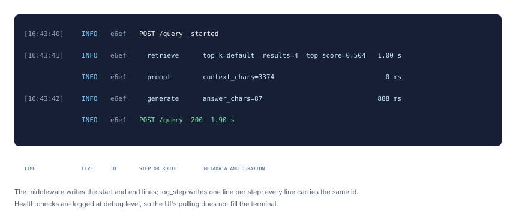
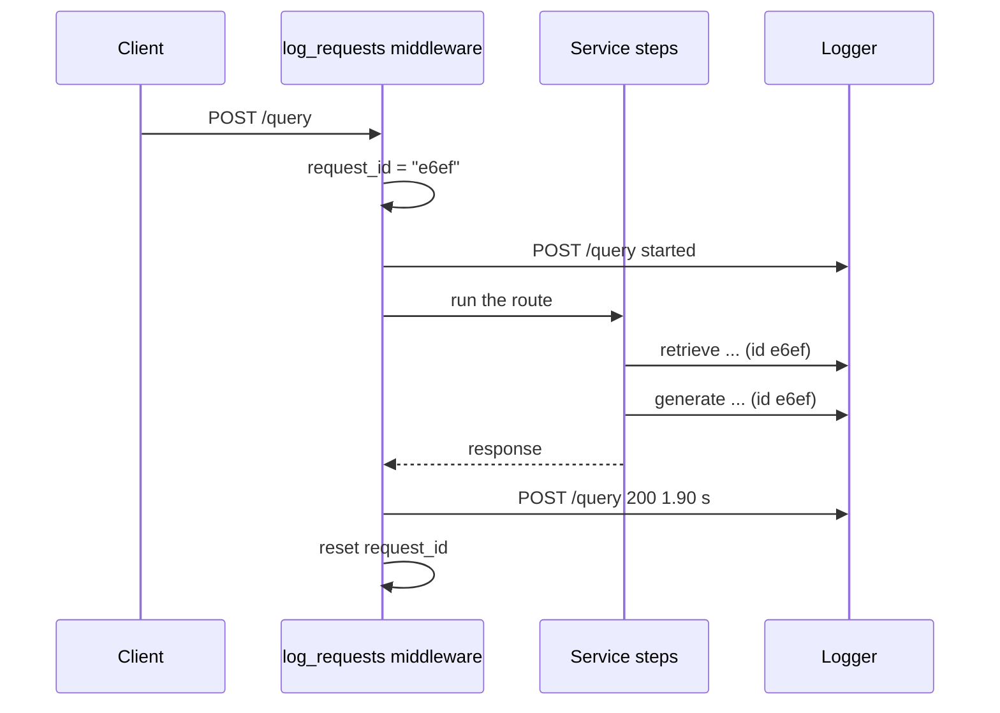

# 21. Structured Logging

In this doc:

- Why the API needs readable logs
- The log line format and what each column means
- How a request id ties all lines of one request together
- The log_step helper: one aligned line per pipeline step
- The startup summary
- Real logs from a query, an upload and a duplicate upload
- Detailed logs: request metadata, retrieved chunks, answers, judge scores (added later)
- How to run the API and watch the logs

Files:

- [app/core/logging.py](../app/core/logging.py)
- [app/api/middleware.py](../app/api/middleware.py)
- [app/main.py](../app/main.py) (setup, middleware, startup summary)
- [app/services/ingestion_service.py](../app/services/ingestion_service.py) and [app/services/rag_service.py](../app/services/rag_service.py) (step logs)
- [app/core/config.py](../app/core/config.py) (new LOG_LEVEL setting)

## Why

Until now the terminal only showed uvicorn's access lines (`"POST /query HTTP/1.1" 200`). That says nothing about what happened inside: how many chunks were retrieved, how good the best match was, which step was slow. For a project about understanding RAG, the logs should show the pipeline working.

## The log line



<table width="100%">
<thead><tr><th>Column</th><th>Example</th><th>Meaning</th></tr></thead>
<tbody>
<tr><td>Time</td><td>[16:43:41]</td><td>Shown when it changes, so repeated times do not clutter the view</td></tr>
<tr><td>Level</td><td>INFO</td><td>Colored by Rich: INFO blue, WARNING yellow, ERROR red</td></tr>
<tr><td>Request id</td><td>e6ef</td><td>4 random hex characters per request; "-" outside a request (startup)</td></tr>
<tr><td>Route line</td><td>POST /query  200  1.90 s</td><td>Start and end of a request, status colored green, yellow or red</td></tr>
<tr><td>Step line</td><td>retrieve  results=4  top_score=0.504  1.00 s</td><td>Indented: one pipeline step, its metadata (cyan values) and its duration</td></tr>
</tbody>
</table>

## Request ids



The id lives in a `ContextVar`. FastAPI copies the context into the worker thread that runs our sync routes, so every log call made while handling the request sees the same id, even when several requests run at the same time. A `logging.Filter` adds it to each record.

`/health` is logged at DEBUG level: the UI checks it every 30 seconds, and those lines would bury the useful ones. Set `LOG_LEVEL=DEBUG` in `.env` to see them.

## log_step

```python
with log_step(log, "chunk", size=1000, overlap=150) as step:
    chunks = chunk_documents(documents, 1000, 150)
    step["chunks"] = len(chunks)
```

1. Metadata known before the step is passed as keyword arguments.
2. The block adds results to the yielded dict (`step["chunks"] = ...`).
3. When the block finishes, one line is logged: the step name padded to 12 characters, every key=value pair, and the duration (ms under one second, seconds above).
4. If the block raises, a red "failed" line is logged with the error and the time spent, and the error is re-raised unchanged.

### Steps that are logged

<table width="100%">
<thead><tr><th>Pipeline</th><th>Step</th><th>Metadata</th></tr></thead>
<tbody>
<tr><td>Ingestion</td><td>load</td><td>file, documents (pages, sheets), characters</td></tr>
<tr><td>Ingestion</td><td>chunk</td><td>size, overlap, chunks</td></tr>
<tr><td>Ingestion</td><td>embed</td><td>model, vectors</td></tr>
<tr><td>Ingestion</td><td>store</td><td>total_chunks in the index</td></tr>
<tr><td>Ingestion</td><td>save</td><td>folder</td></tr>
<tr><td>Query</td><td>retrieve</td><td>top_k, results, top_score</td></tr>
<tr><td>Query</td><td>prompt</td><td>context_chars</td></tr>
<tr><td>Query</td><td>generate</td><td>answer_chars (token usage is added in doc 22)</td></tr>
</tbody>
</table>

## Startup summary

When the server starts, the lifespan handler loads the index and logs the settings that matter:

```text
[16:43:27] INFO  -  Naive RAG API v0.1.0 starting
           INFO  -    chat model    gpt-4o-mini
           INFO  -    embeddings    text-embedding-3-small  dims=1536
           INFO  -    chunking      size=1000  overlap=150  top_k=4
           INFO  -    index         files=2  chunks=92
```

Loading the index at startup also means the first request does not pay for reading it from disk.

## Real logs

A query, an upload, and the same upload again (409):

```text
[16:43:40] INFO  e6ef  POST /query  started
[16:43:41] INFO  e6ef    retrieve      top_k=default  results=4  top_score=0.504  1.00 s
           INFO  e6ef    prompt        context_chars=3374  0 ms
[16:43:42] INFO  e6ef    generate      answer_chars=87  888 ms
           INFO  e6ef  POST /query  200  1.90 s
           INFO  ace8  POST /documents  started
           INFO  ace8    load          file=it_policy.txt  documents=1  characters=70  0 ms
           INFO  ace8    chunk         size=1000  overlap=150  chunks=1  0 ms
[16:43:43] INFO  ace8    embed         model=text-embedding-3-small  vectors=1  489 ms
           INFO  ace8    store         total_chunks=93  0 ms
           INFO  ace8    save          folder=index  3 ms
           INFO  ace8  POST /documents  200  500 ms
           INFO  07f9  POST /documents  started
           INFO  07f9  POST /documents  409  2 ms
```

Reading it: retrieval took 1 second (the embedding call for the question), generation 888 ms, everything else is near zero. The duplicate upload stopped after 2 ms, before any API cost.

## Detailed logs

The first version logged one line per step. That shows how long each step took, but not what it did: which chunks were retrieved, what the model answered, how the judge scored it. The logs now add **detail lines** under each step and request metadata on the request lines.

### A query, step by step

```text
           INFO  899b  POST /query  started  client=127.0.0.1  body=49 B
           INFO  899b    question      "What is the hotel limit per night?"  kind=query
           INFO  899b    retrieve      top_k=4  results=4  top_score=0.524  tokens=8  313 ms
           INFO  899b        #1         0.524  travel_policy_demo.md  -  "# Travel Policy Employees can claim economy class flights for..."
           INFO  899b        #2         0.148  2310.11511_Self-RAG.pdf  p.30  "Market, Harajuku, and Shinjuku Gyoen. Perceived utility 3 Exp..."
           INFO  899b        #3         0.144  hr_policy.md  -  "# HR Policy 2026 ## 4.2 Leave New joiners get 12 days of paid..."
           INFO  899b        #4         0.143  2310.11511_Self-RAG.pdf  p.28  "and humidity creates a corresponding cycle of temperature and..."
           INFO  899b    prompt        context_chars=1677  messages=2  0 ms
[18:53:51] INFO  899b    generate      model=gpt-4o-mini  tokens_in=504  tokens_out=12  cost=$0.000083  818 ms
           INFO  899b        answer     "The hotel limit is 120 USD per night [1]."
           INFO  899b        cited      [1]  of 4 retrieved
           INFO  899b    usage         tokens=524  cost=$0.000083  inr=Rs 0.0070
           INFO  899b  POST /query  200  1.15 s  response=2.1 KB
```

Reading it from top to bottom tells the whole story of the request: the question, the 4 chunks FAISS returned with their cosine scores, files and pages, the answer and which chunk it cited, and what it cost. It also shows the Naive RAG weakness from doc 26 in plain sight: chunk 1 scores 0.524 and answers the question, while chunks 2 to 4 score about 0.14 and are unrelated, but are still sent to the model because top k is fixed at 4. A score threshold would have dropped them.

### An upload

```text
[18:53:48] INFO  33a5  POST /documents  started  client=127.0.0.1  body=349 B
           INFO  33a5    file          travel_policy_demo.md  type=md  size=0.1 KB
           INFO  33a5    load          file=travel_policy_demo.md  documents=1  characters=123  0 ms
           INFO  33a5        parts      1  chars per part min=123  max=123  avg=123
           INFO  33a5    chunk         size=1000  overlap=150  chunks=1  0 ms
           INFO  33a5        chunks     1  chars min=123  max=123  avg=123
[18:53:50] INFO  33a5    embed         model=text-embedding-3-small  vectors=1  tokens=27  1.06 s
           INFO  33a5    store         total_chunks=411  1 ms
           INFO  33a5    save          folder=index  9 ms
           INFO  33a5    usage         tokens=27  cost=$0.000001  inr=Rs 0.0000
           INFO  33a5  POST /documents  200  1.08 s  response=248 B
```

`parts` shows the shortest page: a PDF page with min=0 characters is a scanned page without text. `chunks` shows the chunk sizes, to check the splitter behaves as configured.

### Grading an answer

```text
           INFO  1bb8  POST /evals/answer  started  client=127.0.0.1  body=4.3 KB
[18:53:20] INFO  1bb8    judge         chunks=4  reference=False  overall=0.75  tokens_in=1351  tokens_out=73  1.66 s
           INFO  1bb8        question   "How does Self-RAG decide when to retrieve?"
           INFO  1bb8        faithful   1.00  All claims in the answer are directly supported by chunk 4.
           INFO  1bb8        relevance  1.00  The answer directly and completely addresses how Self-RAG decides when to retrieve.
           INFO  1bb8        precision  0.25  1 of 4 retrieved chunks are relevant to the question.
           INFO  1bb8        relevant   [4]
           INFO  1bb8  POST /evals/answer  200  1.67 s  response=495 B
```

During an evaluation run, each test case is separated by an empty line and ends with `eval 3/11  rag-corpus  overall=0.65` and two detail lines: the scores (hit and every metric) and the cost of answering and grading.

### What is logged where

<table width="100%">
<thead><tr><th>Line</th><th>Content</th><th>File</th></tr></thead>
<tbody>
<tr><td>Request start (POST, PUT, DELETE)</td><td>Empty line before it; method, path with query string, client address, body size</td><td>app/api/middleware.py</td></tr>
<tr><td>Request end</td><td>Colored status, total time, response size</td><td>app/api/middleware.py</td></tr>
<tr><td>question, #1 to #k, answer, cited, usage</td><td>Question, each retrieved chunk (rank, score, file, page, text preview), answer preview, cited numbers, total tokens and cost in USD and INR</td><td>app/services/rag_service.py</td></tr>
<tr><td>file, parts, chunks, usage</td><td>File name, type and size; characters per part; chunk sizes; embedding tokens and cost</td><td>app/services/ingestion_service.py</td></tr>
<tr><td>faithful, relevance, precision, correct, relevant</td><td>Each judge metric with score and reason; relevant chunk numbers</td><td>app/api/routes/evals.py</td></tr>
<tr><td>eval i/n, scores, cost</td><td>One block per test case in a run</td><td>app/evals/runner.py</td></tr>
</tbody>
</table>

### Less noise from polling

The UI polls documents, analytics and evaluation runs. Reads (GET) are now logged as **one line** when they finish (`GET /analytics  200  4 ms  response=3.1 KB`) instead of a start and an end line, and only requests that do work get the empty line, the start line and the detail lines. Health checks stay at DEBUG.

### Helpers

<table width="100%">
<thead><tr><th>Helper</th><th>What it does</th></tr></thead>
<tbody>
<tr><td>preview(text, limit)</td><td>Puts text on one line, cuts it at limit characters with "...", and escapes square brackets so citations like [1] are printed, not read as Rich markup</td></tr>
<tr><td>log_detail(logger, label, message)</td><td>One indented line under a step with an aligned label column</td></tr>
<tr><td>log_spacer()</td><td>An empty line straight on the console, without time or level</td></tr>
<tr><td>is_debug(logger)</td><td>True at DEBUG level; used to switch to long previews</td></tr>
</tbody>
</table>

### DEBUG level

With `LOG_LEVEL=DEBUG` the logs also show:

- chunk previews of 300 characters instead of 64,
- the **full prompt** sent to the chat model (system rules are fixed; the user message with all context blocks is printed),
- health checks.

Use DEBUG to inspect exactly what the model saw when an answer looks wrong; use INFO for everyday work.

## Running the API and watching the logs

The logs are printed in the terminal that runs the API. Start the API and the UI in two terminals:

```bash
# Terminal 1: API with logs
cd "01. Naive RAG/03. API"
.venv/bin/uvicorn app.main:app --reload --port 8000

# Same, with full prompts and long previews
LOG_LEVEL=DEBUG .venv/bin/uvicorn app.main:app --reload --port 8000

# Terminal 2: UI
cd "01. Naive RAG/04. UI"
npm run dev
```

Then use the app at http://localhost:5173; every action in the UI appears in terminal 1. To keep a copy of the logs in a file as well, add `2>&1 | tee api.log` to the uvicorn command.

## Settings

<table width="100%">
<thead><tr><th>Variable</th><th>Default</th><th>Meaning</th></tr></thead>
<tbody>
<tr><td>LOG_LEVEL</td><td>INFO</td><td>DEBUG also shows health checks, the full prompt and long chunk previews; WARNING shows only problems</td></tr>
</tbody>
</table>

## Dependencies added

<table width="100%">
<thead><tr><th>Package</th><th>Version</th><th>Why</th></tr></thead>
<tbody>
<tr><td>rich</td><td>13.9.4</td><td>Colored, aligned terminal logs and readable tracebacks</td></tr>
</tbody>
</table>
