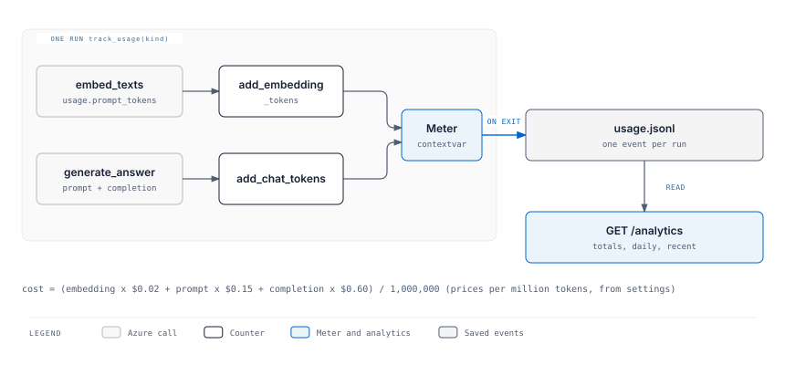
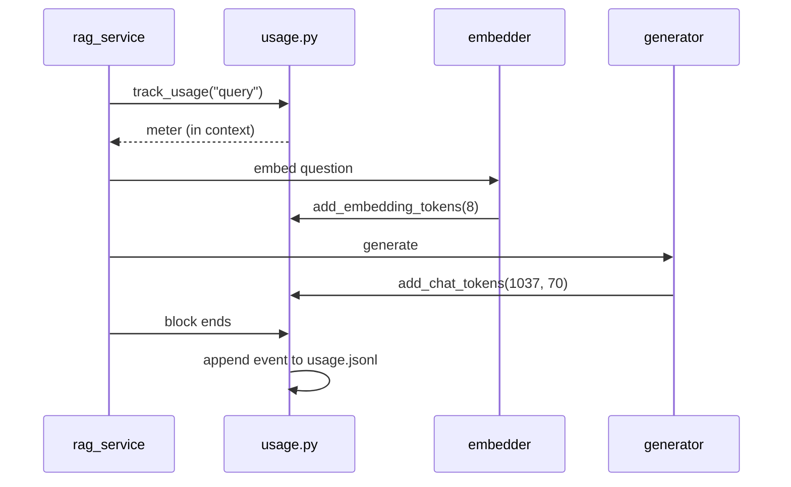

# 22. Usage and Cost Tracking

In this doc:

- Why track tokens and cost
- The usage meter and how tokens reach it without changing function signatures
- The cost formula and prices
- The usage file and the event format
- GET /analytics and the new usage fields in the query and upload responses
- Real numbers

Files:

- [app/services/usage.py](../app/services/usage.py)
- [app/embeddings/embedder.py](../app/embeddings/embedder.py) and [app/generation/generator.py](../app/generation/generator.py) (count tokens)
- [app/services/rag_service.py](../app/services/rag_service.py) and [app/services/ingestion_service.py](../app/services/ingestion_service.py) (open a meter per run)
- [app/schemas/analytics.py](../app/schemas/analytics.py), [app/api/routes/analytics.py](../app/api/routes/analytics.py)
- [app/schemas/query.py](../app/schemas/query.py), [app/schemas/documents.py](../app/schemas/documents.py) (usage fields)
- [tests/test_usage.py](../tests/test_usage.py), [tests/conftest.py](../tests/conftest.py)

## Why

Every query costs an embedding call and a chat call; every upload embeds all its chunks. To compare architectures later (re-ranking, query rewriting and HyDE all add LLM calls), we need the cost and token use of each run, not only its answer quality. The UI's analytics page reads these numbers.

## How tokens are measured



Azure OpenAI returns token counts with every response (`response.usage`). The question is how to get them from deep inside the embedder and generator up to the service, without changing every function signature.

The answer is a **usage meter in a ContextVar**, the same technique as the request id in doc 21:

1. The service opens a run: `with track_usage("query", question=...) as meter:`. This puts a fresh `UsageMeter` in the context.
2. The embedder calls `add_embedding_tokens(response.usage.prompt_tokens)` after each batch; the generator calls `add_chat_tokens(prompt, completion)`.
3. Those helpers add to the meter of the current run. Outside a run (unit tests, scripts) they do nothing.
4. When the block ends normally, one event is appended to the usage file. If the block raises (for example an empty PDF), nothing is saved: failed runs cost nothing worth reporting.



The step logs now show tokens too:

```text
retrieve      top_k=4  results=4  top_score=0.659  tokens=8  277 ms
generate      model=gpt-4o-mini  tokens_in=987  tokens_out=51  cost=$0.000179  1.31 s
embed         model=text-embedding-3-small  vectors=91  tokens=21172  1.62 s
```

## Cost formula

$$\text{cost} = \frac{T_{embed} \cdot P_{embed} + T_{in} \cdot P_{in} + T_{out} \cdot P_{out}}{1{,}000{,}000}$$

<table width="100%">
<thead><tr><th>Symbol</th><th>Setting</th><th>Default (USD per 1M tokens)</th><th>Model</th></tr></thead>
<tbody>
<tr><td>P_embed</td><td>PRICE_EMBEDDING_PER_MILLION</td><td>0.02</td><td>text-embedding-3-small</td></tr>
<tr><td>P_in</td><td>PRICE_CHAT_INPUT_PER_MILLION</td><td>0.15</td><td>gpt-4o-mini input</td></tr>
<tr><td>P_out</td><td>PRICE_CHAT_OUTPUT_PER_MILLION</td><td>0.60</td><td>gpt-4o-mini output</td></tr>
</tbody>
</table>

The defaults are public list prices for the deployed models; Azure prices can differ by region and agreement, so they are settings that can be overridden in `.env`.

## The usage file

Each run is one JSON line in `data/usage/usage.jsonl` (git-ignored, like the index):

```json
{"time": "2026-11-20T11:17:31+00:00", "kind": "query", "embedding_tokens": 10, "prompt_tokens": 1037,
 "completion_tokens": 70, "total_tokens": 1117, "cost_usd": 0.000198, "latency_ms": 1503,
 "question": "Which retriever and generator does RAG combine?", "sources": 4}
```

<table width="100%">
<thead><tr><th>Field</th><th>Query</th><th>Ingest</th></tr></thead>
<tbody>
<tr><td>kind</td><td>query</td><td>ingest</td></tr>
<tr><td>Tokens</td><td>embedding (question), prompt, completion</td><td>embedding (all chunks)</td></tr>
<tr><td>cost_usd, latency_ms</td><td>Yes</td><td>Yes</td></tr>
<tr><td>Context</td><td>question (first 300 characters), sources</td><td>file, chunks</td></tr>
</tbody>
</table>

JSON Lines is append-only and readable: no database is needed for a local learning project, and a lock makes concurrent appends safe.

## API changes

### GET /analytics

<table width="100%">
<thead><tr><th>Part</th><th>Content</th></tr></thead>
<tbody>
<tr><td>totals</td><td>queries, ingestions, embedding/prompt/completion/total tokens, cost_usd, avg_query_latency_ms</td></tr>
<tr><td>daily</td><td>One point per UTC day: cost_usd, tokens, queries, ingestions</td></tr>
<tr><td>recent</td><td>Last 50 runs, newest first, as recorded</td></tr>
</tbody>
</table>

### Usage in existing responses

<table width="100%">
<thead><tr><th>Endpoint</th><th>New fields</th></tr></thead>
<tbody>
<tr><td>POST /query</td><td>usage: {embedding_tokens, prompt_tokens, completion_tokens, cost_usd, latency_ms}; each source also has source (file name) and page, so the UI can open the cited PDF page</td></tr>
<tr><td>POST /documents</td><td>embedding_tokens, cost_usd</td></tr>
</tbody>
</table>

## Real numbers

<table width="100%">
<thead><tr><th>Run</th><th>Tokens</th><th>Cost</th><th>Time</th></tr></thead>
<tbody>
<tr><td>Query: How many sick days do I get?</td><td>8 + 754 + 24</td><td>$0.000128</td><td>1.75 s</td></tr>
<tr><td>Query: Which retriever and generator does RAG combine?</td><td>10 + 1037 + 70</td><td>$0.000198</td><td>1.50 s</td></tr>
<tr><td>Ingest: the 19-page RAG paper (91 chunks)</td><td>21,172 embedding</td><td>$0.000423</td><td>about 1.7 s</td></tr>
</tbody>
</table>

A query costs about two hundredths of a cent; the chat prompt (about 1,000 tokens of context) is most of it. Embedding a whole 19-page paper costs about as much as two or three queries.

## Tests

<table width="100%">
<thead><tr><th>Test</th><th>Checks</th></tr></thead>
<tbody>
<tr><td>test_track_usage_saves_one_event_with_cost</td><td>Tokens, total, cost formula and context fields of the saved event</td></tr>
<tr><td>test_tokens_outside_a_run_are_ignored_and_failed_runs_not_saved</td><td>No meter, no count; a failing run saves nothing</td></tr>
<tr><td>test_summarize_totals_and_daily</td><td>Totals, one daily point, newest-first recent list</td></tr>
</tbody>
</table>

`tests/conftest.py` points the usage file to a temporary folder for every test, so running the tests never changes the real analytics. 47 tests pass.

No new dependencies.
