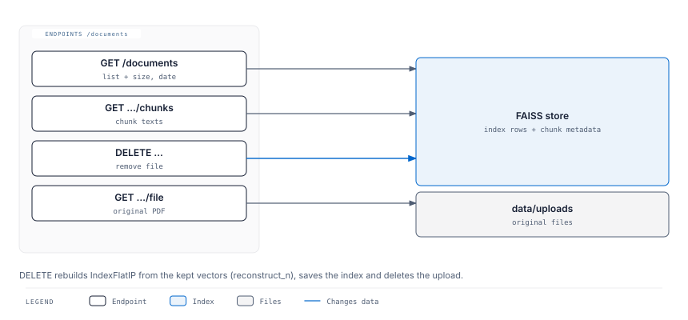
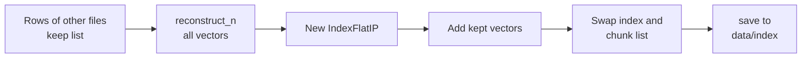

# 23. Document Viewer and Management API

In this doc:

- The new endpoints the redesigned UI needs
- Serving the original PDF for the in-app viewer
- Listing a file's chunks
- Deleting a file from a FAISS flat index
- Upload metadata and step timings
- Tests and a live run

Files:

- [app/services/document_service.py](../app/services/document_service.py)
- [app/api/routes/documents.py](../app/api/routes/documents.py)
- [app/schemas/documents.py](../app/schemas/documents.py)
- [app/vectorstore/faiss_store.py](../app/vectorstore/faiss_store.py) (new remove_source)
- [app/services/ingestion_service.py](../app/services/ingestion_service.py) and [app/core/logging.py](../app/core/logging.py) (step timings)
- [tests/test_documents_api.py](../tests/test_documents_api.py), [tests/test_faiss_store.py](../tests/test_faiss_store.py)

## Endpoints

<table width="100%">
<thead><tr><th>Method and path</th><th>Returns</th><th>Used by the UI for</th><th>Errors</th></tr></thead>
<tbody>
<tr><td>GET /documents</td><td>Files with type, parts, chunks, size_bytes, uploaded_at</td><td>Documents table</td><td>-</td></tr>
<tr><td>GET /documents/{source}/file</td><td>The original file, Content-Disposition inline</td><td>PDF viewer, opening a citation at its page</td><td>404</td></tr>
<tr><td>GET /documents/{source}/chunks</td><td>Every chunk with chunk_index, page or sheet, text</td><td>Chunk list in the document drawer</td><td>404</td></tr>
<tr><td>DELETE /documents/{source}</td><td>source, removed_chunks</td><td>Delete action in the documents table</td><td>404</td></tr>
<tr><td>POST /documents (changed)</td><td>Adds steps: [{name, ms}] for load, chunk, embed, store, save</td><td>Pipeline timeline after an upload</td><td>400, 409, 422</td></tr>
</tbody>
</table>

`{source}` is the file name, URL-encoded by the client (`2005.11401_RAG-Lewis.pdf`, `my%20file.pdf`).

## Serving the PDF

`uploaded_file(source)` keeps only `Path(source).name`, so a request like `../../.env` cannot leave `data/uploads`, and raises `DocumentNotFoundError` when the file is missing (the route turns it into 404).

`FileResponse(..., content_disposition_type="inline")` streams the file and tells the browser to display it rather than download it. The UI's PDF viewer (pdf.js) loads it from `/api/documents/{source}/file` through the Vite proxy, so no CORS setup is needed.

## Listing chunks

`list_chunks(source)` filters `store.chunks` by file name and returns them in index order, with `chunk_index` and the page (PDF) or sheet (Excel). The document drawer shows them next to the PDF, so a learner can see exactly how a page was cut.

## Deleting from a flat index

FAISS `IndexFlatIP` has no "delete row" that keeps our chunk list aligned. `remove_source(source)` rebuilds instead:

1. Find the rows whose chunk belongs to another file.
2. `index.reconstruct_n(0, count)` returns every stored vector (already normalised).
3. Build a new index and add only the kept vectors, then replace the chunk list with the kept chunks, in the same order.
4. `delete_document` does this under the same `STORE_LOCK` as ingestion, saves the index and deletes the upload.

Rebuilding is linear in the index size, which is fine for a local index of a few thousand chunks.

## Upload metadata and step timings

<table width="100%">
<thead><tr><th>Field</th><th>Source</th></tr></thead>
<tbody>
<tr><td>size_bytes</td><td>File size of data/uploads/{source}</td></tr>
<tr><td>uploaded_at</td><td>Modification time of that file, ISO 8601 UTC</td></tr>
<tr><td>steps</td><td>log_step (doc 21) now leaves duration_ms in its dict after logging; ingest_file collects one entry per step</td></tr>
</tbody>
</table>

Example upload response steps: `[{"name": "load", "ms": 41}, {"name": "chunk", "ms": 3}, {"name": "embed", "ms": 1620}, {"name": "store", "ms": 1}, {"name": "save", "ms": 4}]`. The embedding call is almost all of the time.

## Live run

<table width="100%">
<thead><tr><th>Request</th><th>Result</th></tr></thead>
<tbody>
<tr><td>DELETE /documents/rag-copy-test.pdf</td><td>removed_chunks 91 (a duplicate created while testing usage tracking)</td></tr>
<tr><td>GET /documents</td><td>2 files with size and upload time</td></tr>
<tr><td>GET /documents/2005.11401_RAG-Lewis.pdf/file</td><td>200, application/pdf, 885,323 bytes</td></tr>
<tr><td>GET /documents/hr_policy.md/chunks</td><td>1 chunk with its text</td></tr>
</tbody>
</table>

## Tests

<table width="100%">
<thead><tr><th>Test</th><th>Checks</th></tr></thead>
<tbody>
<tr><td>test_upload_indexes_file</td><td>Now also checks the five step names in order</td></tr>
<tr><td>test_list_documents_after_uploads</td><td>Size and upload time are filled</td></tr>
<tr><td>test_file_chunks_and_delete</td><td>File bytes come back, chunks listed, delete removes chunks and upload</td></tr>
<tr><td>test_unknown_document_gives_404</td><td>Chunks and delete of a missing file give 404</td></tr>
<tr><td>test_remove_source_keeps_other_files</td><td>Rebuilt index keeps other files searchable</td></tr>
</tbody>
</table>

50 tests pass. No new dependencies.
