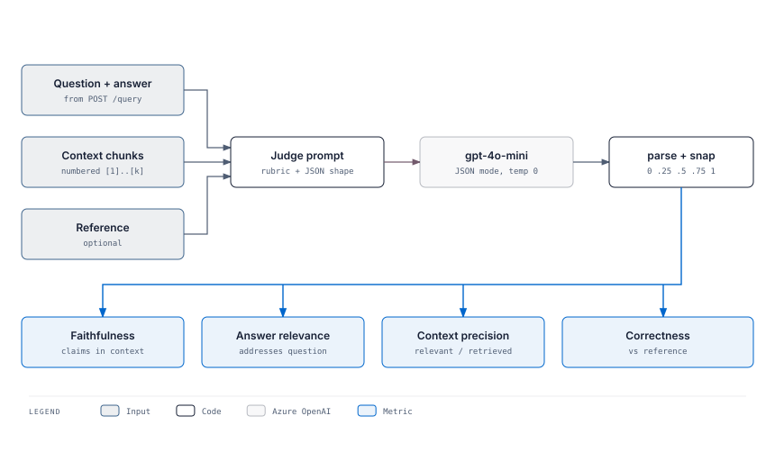
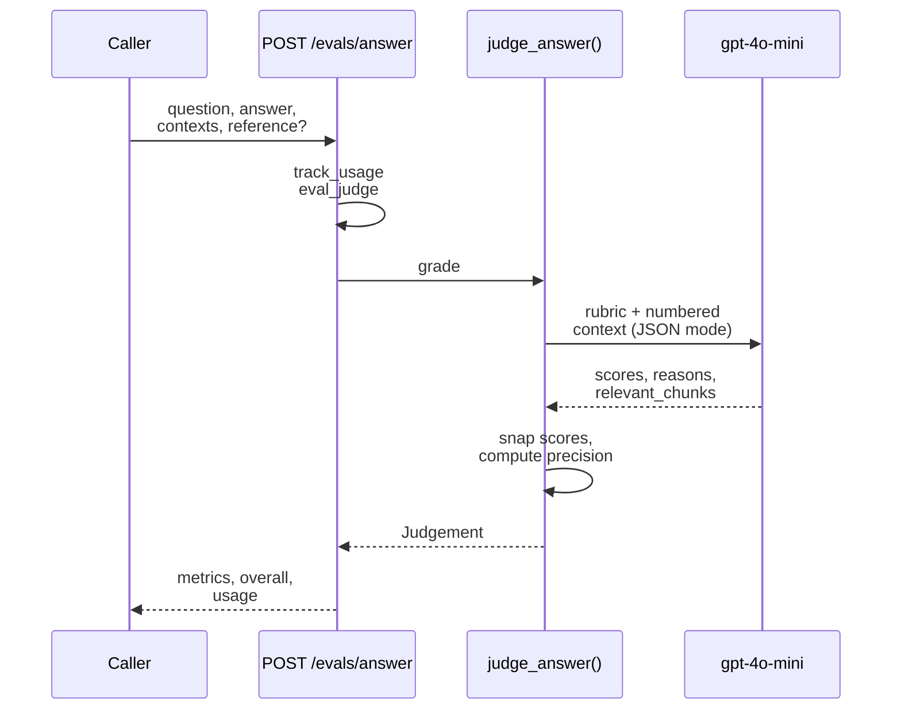

# 24. Answer Evaluation with an LLM Judge

In this doc:

- Why a RAG system needs evaluation, and why an LLM judge
- The four metrics and what each one catches
- How one answer is graded, step by step
- POST /evals/answer
- How evaluation cost is tracked
- A real result and what it says about Naive RAG
- Tests

Files:

- [app/evals/judge.py](../app/evals/judge.py): prompt, request, parsing and scores
- [app/api/routes/evals.py](../app/api/routes/evals.py), [app/schemas/evals.py](../app/schemas/evals.py)
- [app/services/usage.py](../app/services/usage.py): evaluation runs counted separately
- [tests/test_judge.py](../tests/test_judge.py)

## Why evaluate, and why an LLM judge

A RAG answer can fail in two places: retrieval can bring the wrong chunks, and generation can say things the chunks do not support. Looking at answers by hand does not scale and is not repeatable, so every architecture in this repository needs the same measuring stick to show whether it improves on Naive RAG.

<table width="100%">
<thead><tr><th>Approach</th><th>Strength</th><th>Weakness</th><th>Decision</th></tr></thead>
<tbody>
<tr><td>Human grading</td><td>Most reliable</td><td>Slow, costly, not repeatable for every change</td><td>Used to sanity-check the judge</td></tr>
<tr><td>String overlap (exact match, BLEU, ROUGE)</td><td>Free and fast</td><td>Punishes correct answers phrased differently; cannot check grounding</td><td>Not used</td></tr>
<tr><td>Evaluation library (RAGAS and similar)</td><td>Ready-made metrics</td><td>Extra dependency, several LLM calls per answer, less control over prompts</td><td>Not used; the same ideas are implemented directly</td></tr>
<tr><td>One LLM judge call with a rubric</td><td>Checks meaning and grounding; one request per answer; prompt is visible and versioned</td><td>The judge can be wrong; needs a strict rubric and temperature 0</td><td>Chosen</td></tr>
</tbody>
</table>

The metrics follow the RAG evaluation ideas popularised by RAGAS (faithfulness, answer relevance, context precision, answer correctness), implemented in about 150 lines so every step is visible.

## The four metrics

<table width="100%">
<thead><tr><th>Metric</th><th>Question it answers</th><th>Catches</th><th>How it is computed</th></tr></thead>
<tbody>
<tr><td>Faithfulness</td><td>Are the answer's claims supported by the retrieved chunks?</td><td>Hallucination: the generator adds facts that are not in the context</td><td>Judge score, against the context only</td></tr>
<tr><td>Answer relevance</td><td>Does the answer address the question directly and completely?</td><td>Vague or off-topic answers</td><td>Judge score; an honest "not found" when the context lacks the answer scores 1</td></tr>
<tr><td>Context precision</td><td>How many of the retrieved chunks are useful for the question?</td><td>Retrieval noise: top-k filled with unrelated chunks</td><td>Computed: relevant chunks / retrieved chunks, from the chunk numbers the judge marks as relevant</td></tr>
<tr><td>Correctness</td><td>Does the answer agree with a known reference answer?</td><td>Answers that are grounded but incomplete or wrong because retrieval missed the key chunk</td><td>Judge score; only when a reference is given (test sets, doc 25)</td></tr>
</tbody>
</table>

The overall score is the mean of the metrics that apply. Faithfulness and relevance grade the generator; context precision grades the retriever; correctness grades the whole pipeline.

## How one answer is graded





1. `build_judge_messages` writes a system message with the rubric and a user message with the question, the context chunks numbered `[1]..[k]` exactly as the answer cites them, the answer and the optional reference.
2. One chat request with `temperature=0` (repeatable) and `response_format={"type": "json_object"}` (the reply is always valid JSON).
3. `parse_judgement` reads the reply. Each score is snapped to one of five levels: 0, 0.25, 0.5, 0.75, 1. Five levels are easier for a model to apply consistently than a free 0 to 1 number, and easier for people to read.
4. Context precision is computed in code from `relevant_chunks`, keeping only numbers between 1 and k. Asking the model for a list and doing the division in code is exact and explainable ("1 of 4 retrieved chunks are relevant").
5. A missing or unreadable metric scores 0 with the reason "The judge did not return this metric", so a judge failure never looks like a good score.

### The rubric

The full prompt is `JUDGE_PROMPT` in `judge.py`. Its key rules:

- Faithfulness is judged against the context only, never against the reference, so grounding and correctness stay separate.
- An answer that says the information was not found makes no claims, so it is faithful (1).
- If the context lacks the answer and the answer says so, relevance is 1: refusing correctly is the right behaviour.
- Correctness accepts extra correct detail but lowers the score for missing or wrong key facts.

## POST /evals/answer

Request:

```json
{
  "question": "Which retriever and generator does RAG combine?",
  "answer": "RAG combines a retriever R ... and a generator G ... [3].",
  "contexts": ["chunk 1 text", "chunk 2 text", "chunk 3 text", "chunk 4 text"],
  "reference": "A DPR retriever over a Wikipedia index and a BART-large generator."
}
```

<table width="100%">
<thead><tr><th>Response field</th><th>Content</th></tr></thead>
<tbody>
<tr><td>faithfulness, answer_relevance, context_precision</td><td>{score, reason}</td></tr>
<tr><td>correctness</td><td>{score, reason}, or null without a reference</td></tr>
<tr><td>relevant_chunks</td><td>Chunk numbers the judge found relevant</td></tr>
<tr><td>overall</td><td>Mean of the scores that apply</td></tr>
<tr><td>usage</td><td>prompt_tokens, completion_tokens, cost_usd, cost_inr, latency_ms of the judge call</td></tr>
</tbody>
</table>

Validation: question up to 2000 characters, answer up to 8000, at most 20 contexts, reference up to 4000. The chat UI calls this endpoint from the Evaluate button under an answer (UI doc 10).

## Evaluation cost in analytics

The judge call runs inside `track_usage("eval_judge", question=...)`, so its tokens are recorded like any other run. `summarize()` now counts three families of runs:

<table width="100%">
<thead><tr><th>Family</th><th>Kinds</th><th>Counted in</th></tr></thead>
<tbody>
<tr><td>Questions</td><td>query</td><td>totals.queries, daily.queries</td></tr>
<tr><td>Ingestions</td><td>ingest</td><td>totals.ingestions, daily.ingestions</td></tr>
<tr><td>Evaluations</td><td>every kind starting with "eval"</td><td>totals.evals, daily.evals (new fields)</td></tr>
</tbody>
</table>

Before this change every non-question run was counted as an ingestion. Keeping evaluations separate means grading answers never inflates the question count or the average answer time, while the money spent on grading still appears in the total cost.

The log line for a judge call:

```text
0fc5  POST /evals/answer  started
0fc5    judge         chunks=4  reference=True  overall=0.562  tokens_in=1272  tokens_out=155  1.85 s
0fc5  POST /evals/answer  200  1.86 s
```

## A real result

The question "Which retriever and generator does RAG combine?" asked against the indexed papers, graded with the reference "a DPR retriever over a Wikipedia index and a BART-large generator":

<table width="100%">
<thead><tr><th>Metric</th><th>Score</th><th>Judge's reason (shortened)</th></tr></thead>
<tbody>
<tr><td>Faithfulness</td><td>0.75</td><td>Matches chunk 3, but does not name the models</td></tr>
<tr><td>Answer relevance</td><td>0.75</td><td>Addresses the question in general terms</td></tr>
<tr><td>Context precision</td><td>0.25</td><td>1 of 4 retrieved chunks is relevant</td></tr>
<tr><td>Correctness</td><td>0.25</td><td>Misses DPR and BART-large from the reference</td></tr>
<tr><td>Overall</td><td>0.5</td><td>Cost about 1,400 tokens, Rs 0.024, 1.9 s</td></tr>
</tbody>
</table>

This is the Naive RAG weakness in numbers: the answer is grounded, but retrieval brought three unrelated chunks and missed the passage that names DPR and BART, so the final answer is vague. Later architectures (query rewriting, re-ranking, hybrid search) should raise context precision and correctness on exactly this kind of question.

## Tests

<table width="100%">
<thead><tr><th>Test</th><th>Checks</th></tr></thead>
<tbody>
<tr><td>test_snap_rounds_to_levels</td><td>0.9 to 1, 0.6 to 0.5, 1.7 clamped to 1, "bad" to 0</td></tr>
<tr><td>test_parse_judgement_computes_precision</td><td>Chunks [1, 3, 7] with 4 retrieved give [1, 3] and precision 0.5; overall is the mean</td></tr>
<tr><td>test_parse_judgement_handles_bad_reply_and_no_reference</td><td>Non-JSON reply gives zeros; no chunks gives no precision; no reference gives no correctness</td></tr>
<tr><td>test_judge_messages_number_the_context</td><td>Chunks numbered [1], [2]; reference included</td></tr>
<tr><td>test_judge_answer_uses_json_mode</td><td>JSON mode, temperature 0, configured deployment (fake client)</td></tr>
<tr><td>test_evals_answer_endpoint</td><td>Metrics, overall and usage in the response (judge stubbed)</td></tr>
<tr><td>test_summarize_counts_evaluation_runs_separately</td><td>An eval_judge run counts as an evaluation, not a question or ingestion</td></tr>
</tbody>
</table>

58 tests pass.
