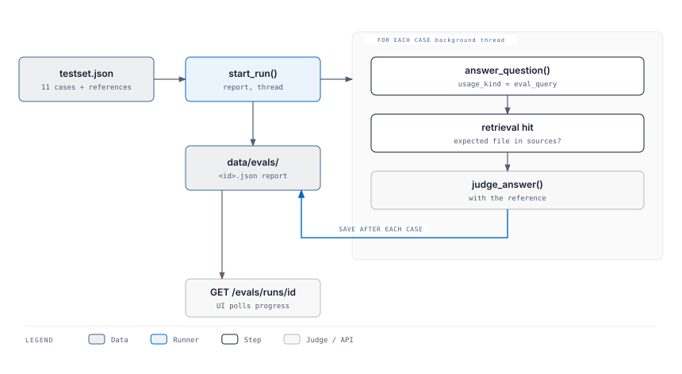
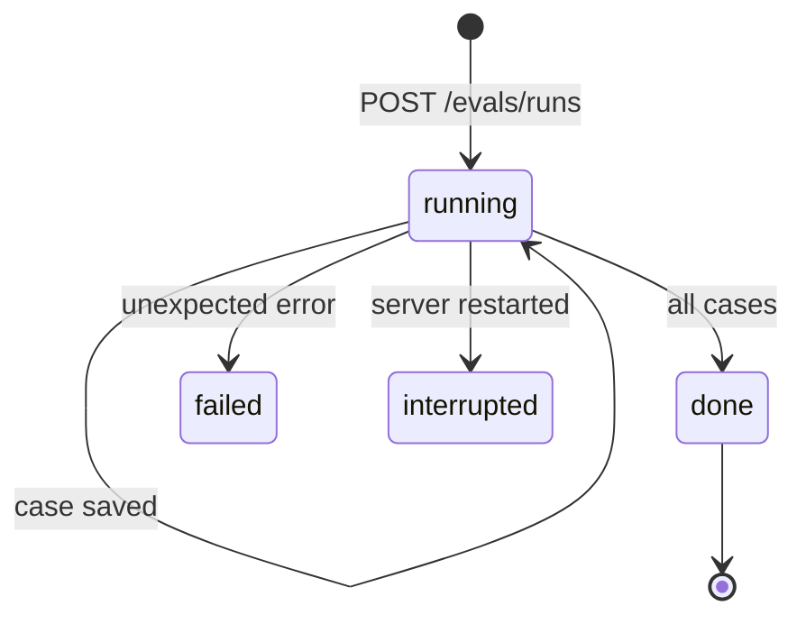

# 25. Evaluation Runs and Reports

In this doc:

- Why a fixed test set, and what is in it
- How a run works, step by step
- The report format and the summary metrics
- The run endpoints
- The first real run of Naive RAG, case by case
- How to add test cases
- Tests

Files:

- [app/evals/testset.json](../app/evals/testset.json): the built-in test cases
- [app/evals/runner.py](../app/evals/runner.py): runs, reports, summary
- [app/api/routes/evals.py](../app/api/routes/evals.py), [app/schemas/evals.py](../app/schemas/evals.py)
- [app/services/rag_service.py](../app/services/rag_service.py): new `usage_kind` argument
- [tests/test_eval_runner.py](../tests/test_eval_runner.py)

Doc 24 explains how one answer is graded. This doc runs that grading over a whole test set, so the pipeline gets one comparable score. Doc 26 explains how to read and explain the report, why context precision is low and how to raise it.

## Why a fixed test set

Grading single answers from the chat tells you about one question. To know whether a change (a new chunk size, a re-ranker, a different architecture) makes the system better or worse, the same questions must be asked again under the same rules. A fixed test set with reference answers turns "it feels better" into "correctness went from 0.84 to 0.91 and context precision from 0.41 to 0.62".

The test set lives in the code (`app/evals/testset.json`), not in `data/`, so it is versioned with the pipeline it measures. Reports are local results and go to `data/evals/` (git-ignored).

### The cases

<table width="100%">
<thead><tr><th>Id</th><th>Question</th><th>Expected file</th><th>Tests</th></tr></thead>
<tbody>
<tr><td>rag-variants</td><td>What are the two RAG model variants proposed by Lewis et al.?</td><td>RAG-Lewis</td><td>A named fact stated in the abstract and method</td></tr>
<tr><td>rag-components</td><td>Which retriever and generator does the original RAG model combine?</td><td>RAG-Lewis</td><td>Specific model names (DPR, BART)</td></tr>
<tr><td>rag-corpus</td><td>What document collection does RAG retrieve from?</td><td>RAG-Lewis</td><td>A detail from the experimental setup</td></tr>
<tr><td>selfrag-reflection</td><td>What are reflection tokens in Self-RAG?</td><td>Self-RAG</td><td>A core concept</td></tr>
<tr><td>selfrag-when</td><td>How does Self-RAG decide when to retrieve?</td><td>Self-RAG</td><td>A mechanism</td></tr>
<tr><td>crag-evaluator</td><td>What does the retrieval evaluator in Corrective RAG do?</td><td>Corrective-RAG</td><td>A component and its three actions</td></tr>
<tr><td>crag-incorrect</td><td>What does CRAG do when the retrieved documents are judged incorrect?</td><td>Corrective-RAG</td><td>One branch of the method</td></tr>
<tr><td>adaptive-routing</td><td>How does Adaptive-RAG decide which retrieval strategy to use for a query?</td><td>Adaptive-RAG</td><td>A classifier and three strategies</td></tr>
<tr><td>hr-sick-days</td><td>How many sick days do employees get per year?</td><td>hr_policy.md</td><td>A number in a short file</td></tr>
<tr><td>hr-new-joiner-leave</td><td>How much paid leave do new joiners get in their first year?</td><td>hr_policy.md</td><td>A number with a condition</td></tr>
<tr><td>out-of-scope</td><td>Who won the FIFA World Cup in 2018?</td><td>none</td><td>The system must say it could not find the answer</td></tr>
</tbody>
</table>

The questions match the files indexed in this project: the four papers in `02. Papers` and `hr_policy.md`. Index them first (from the Documents page) or the retrieval hit rate will drop for the missing files.

## How a run works



1. `POST /evals/runs` calls `start_run()`. Under a lock it checks that no run is active (otherwise 409), picks the cases (all, or the ids given), saves an empty report with the pipeline settings (models, chunk size, overlap, top_k) and starts a daemon thread. The request returns 202 at once with the run id.
2. The thread calls `evaluate_case()` for each case:
   - `answer_question(question, top_k, usage_kind="eval_query")` runs the normal pipeline. The new `usage_kind` argument records it as an evaluation question, so test questions never count as user questions in analytics.
   - Retrieval hit: was `expected_source` among the files of the retrieved chunks? `None` when the case has no expected file (out-of-scope).
   - `judge_answer()` grades the answer against its retrieved chunks and the reference, inside `track_usage("eval_judge")`.
3. After every case the result is appended, the summary is recomputed and the report is saved. The UI polls `GET /evals/runs/{id}` and shows "5 of 11" while it runs.
4. A case that raises an error (for example an Azure timeout) is stored with its error and the run continues. When all cases are done the status becomes `done`; an unexpected error ends it as `failed`. The thread always frees the run slot.



A report still marked `running` whose thread no longer exists (the server was restarted mid-run) is shown as `interrupted`.

### Why a thread and not a task queue

A run takes about 20 to 40 seconds for 11 cases. A background thread inside the API process is enough for a local, single-user learning project, needs no extra service, and the per-case save makes progress visible. A production system would use a job queue (Celery, RQ, Azure Functions) so runs survive restarts and can run in parallel.

## The report

```json
{
  "id": "7241472bb4ad",
  "created_at": "2026-11-20T12:20:03+00:00",
  "status": "done",
  "top_k": 4, "chat_model": "gpt-4o-mini", "embedding_model": "text-embedding-3-small",
  "chunk_size": 1000, "chunk_overlap": 150,
  "total": 11, "completed": 11,
  "summary": {"faithfulness": 0.932, "answer_relevance": 0.977, "context_precision": 0.409,
              "correctness": 0.841, "overall": 0.79, "retrieval_hit_rate": 0.9, "passed": 9,
              "failed_cases": 0, "avg_latency_ms": 1734, "cost_usd": 0.005116, "cost_inr": 0.4297},
  "results": [{"id": "rag-variants", "question": "...", "reference": "...", "expected_source": "...",
               "answer": "...", "sources": [{"number": 1, "label": "...", "source": "...", "page": 2, "score": 0.61}],
               "metrics": {"faithfulness": {"score": 1.0, "reason": "..."}, "...": "..."},
               "relevant_chunks": [2], "overall": 0.75, "retrieval_hit": true,
               "latency_ms": 1650, "answer_cost_usd": 0.0002, "judge_cost_usd": 0.0003, "error": null}]
}
```

Saving the settings with every report makes runs comparable: when chunk size or top_k changes later, the report says which settings produced which scores.

### Summary metrics

<table width="100%">
<thead><tr><th>Field</th><th>Meaning</th></tr></thead>
<tbody>
<tr><td>faithfulness, answer_relevance, context_precision, correctness</td><td>Mean over finished cases where the metric applies</td></tr>
<tr><td>overall</td><td>Mean of the per-case overall scores</td></tr>
<tr><td>retrieval_hit_rate</td><td>Share of cases with an expected file where that file was retrieved</td></tr>
<tr><td>passed</td><td>Cases with overall at least 0.75 (PASS_SCORE)</td></tr>
<tr><td>failed_cases</td><td>Cases that ended with an error; left out of every average</td></tr>
<tr><td>avg_latency_ms</td><td>Mean answer time of the pipeline (judge time not included)</td></tr>
<tr><td>cost_usd, cost_inr</td><td>Answering plus grading, for the whole run</td></tr>
</tbody>
</table>

## Endpoints

<table width="100%">
<thead><tr><th>Endpoint</th><th>Returns</th></tr></thead>
<tbody>
<tr><td>GET /evals/testset</td><td>{cases: [...]} from testset.json</td></tr>
<tr><td>POST /evals/runs</td><td>202 with the new run (no results yet). Body: {top_k?, case_ids?}. 409 if a run is active</td></tr>
<tr><td>GET /evals/runs</td><td>{runs: [...]} newest first, each with its summary but without results</td></tr>
<tr><td>GET /evals/runs/{id}</td><td>The full report; 404 for unknown ids (ids must be alphanumeric, so no path tricks)</td></tr>
</tbody>
</table>

Log lines of a run:

```text
eval run 7241472bb4ad started  cases=11  top_k=4
  eval  1/11  rag-variants  overall=0.75
  ...
  eval  11/11  out-of-scope  overall=0.75
eval run 7241472bb4ad done  overall=0.79
```

## The first real run

<table width="100%">
<thead><tr><th>Case</th><th>Hit</th><th>Faithful</th><th>Relevant</th><th>Precision</th><th>Correct</th><th>Overall</th></tr></thead>
<tbody>
<tr><td>rag-variants</td><td>yes</td><td>1.0</td><td>1.0</td><td>0.25</td><td>0.75</td><td>0.75</td></tr>
<tr><td>rag-components</td><td>yes</td><td>0.75</td><td>1.0</td><td>0.25</td><td>0.5</td><td>0.625</td></tr>
<tr><td>rag-corpus</td><td>no</td><td>0.5</td><td>0.75</td><td>0.25</td><td>0.0</td><td>0.375</td></tr>
<tr><td>selfrag-reflection</td><td>yes</td><td>1.0</td><td>1.0</td><td>1.0</td><td>1.0</td><td>1.0</td></tr>
<tr><td>selfrag-when</td><td>yes</td><td>1.0</td><td>1.0</td><td>0.25</td><td>1.0</td><td>0.812</td></tr>
<tr><td>crag-evaluator</td><td>yes</td><td>1.0</td><td>1.0</td><td>1.0</td><td>1.0</td><td>1.0</td></tr>
<tr><td>crag-incorrect</td><td>yes</td><td>1.0</td><td>1.0</td><td>0.5</td><td>1.0</td><td>0.875</td></tr>
<tr><td>adaptive-routing</td><td>yes</td><td>1.0</td><td>1.0</td><td>0.5</td><td>1.0</td><td>0.875</td></tr>
<tr><td>hr-sick-days</td><td>yes</td><td>1.0</td><td>1.0</td><td>0.25</td><td>1.0</td><td>0.812</td></tr>
<tr><td>hr-new-joiner-leave</td><td>yes</td><td>1.0</td><td>1.0</td><td>0.25</td><td>1.0</td><td>0.812</td></tr>
<tr><td>out-of-scope</td><td>-</td><td>1.0</td><td>1.0</td><td>0.0</td><td>1.0</td><td>0.75</td></tr>
<tr><td><b>Summary</b></td><td><b>90%</b></td><td><b>0.93</b></td><td><b>0.98</b></td><td><b>0.41</b></td><td><b>0.84</b></td><td><b>0.79</b></td></tr>
</tbody>
</table>

11 cases, 9 passed, 1.7 s average answer time, $0.0051 (Rs 0.43) for the whole run.

What the numbers say about Naive RAG:

- **Generation is reliable.** Faithfulness 0.93 and relevance 0.98: when the right chunk is in the context, gpt-4o-mini uses it and does not invent facts. The out-of-scope question is refused correctly.
- **Retrieval is the weak part.** Context precision is 0.41: on average fewer than half of the 4 retrieved chunks are useful. The HR questions show why: the HR file is a single chunk, so the other 3 slots are always filled with unrelated paper chunks (precision 0.25 even though the answer is perfect).
- **Missed retrieval breaks correctness.** `rag-corpus` retrieved no chunk from the RAG paper at all (hit = no), so the answer could not be correct. `rag-components` found the paper but not the passage naming DPR and BART.

These are exactly the problems the next architectures address: Advanced RAG (query rewriting, re-ranking) for precision, hybrid search for exact names like "DPR", and adaptive top-k for small documents. Running the same test set on each will show the gain.

## Adding test cases

Add an object to `app/evals/testset.json`:

```json
{"id": "my-case", "question": "...", "reference": "The answer a human expert would give.", "expected_source": "file.pdf"}
```

- `id` must be unique; the UI and reports use it.
- `reference` should contain the key facts; wording does not matter, the judge compares meaning.
- `expected_source` is the indexed file name, or `null` for questions the documents cannot answer.

## Tests

<table width="100%">
<thead><tr><th>Test</th><th>Checks</th></tr></thead>
<tbody>
<tr><td>test_testset_cases_are_complete</td><td>At least 10 cases, unique ids, every case has a question and a reference</td></tr>
<tr><td>test_evaluate_case_checks_retrieval_and_grades</td><td>Retrieval hit true, false and None; metrics, overall and costs in the result</td></tr>
<tr><td>test_summary_averages_and_skips_failed_cases</td><td>Failed cases counted but not averaged; hit rate, passed and cost</td></tr>
<tr><td>test_run_saves_report_and_endpoints_return_it</td><td>A two-case run through the API finishes, is saved, listed without results, and 404 for unknown ids</td></tr>
<tr><td>test_only_one_run_at_a_time</td><td>A second run while one is active gives 409</td></tr>
</tbody>
</table>

In the tests the pipeline and judge are stubs and the thread runs inline, so a full run finishes in milliseconds without Azure. The shared fixture also points `evals_dir` to a temporary folder. 63 tests pass.
