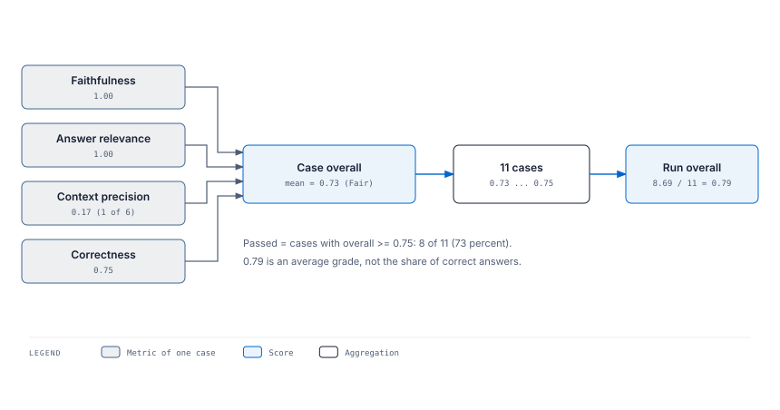
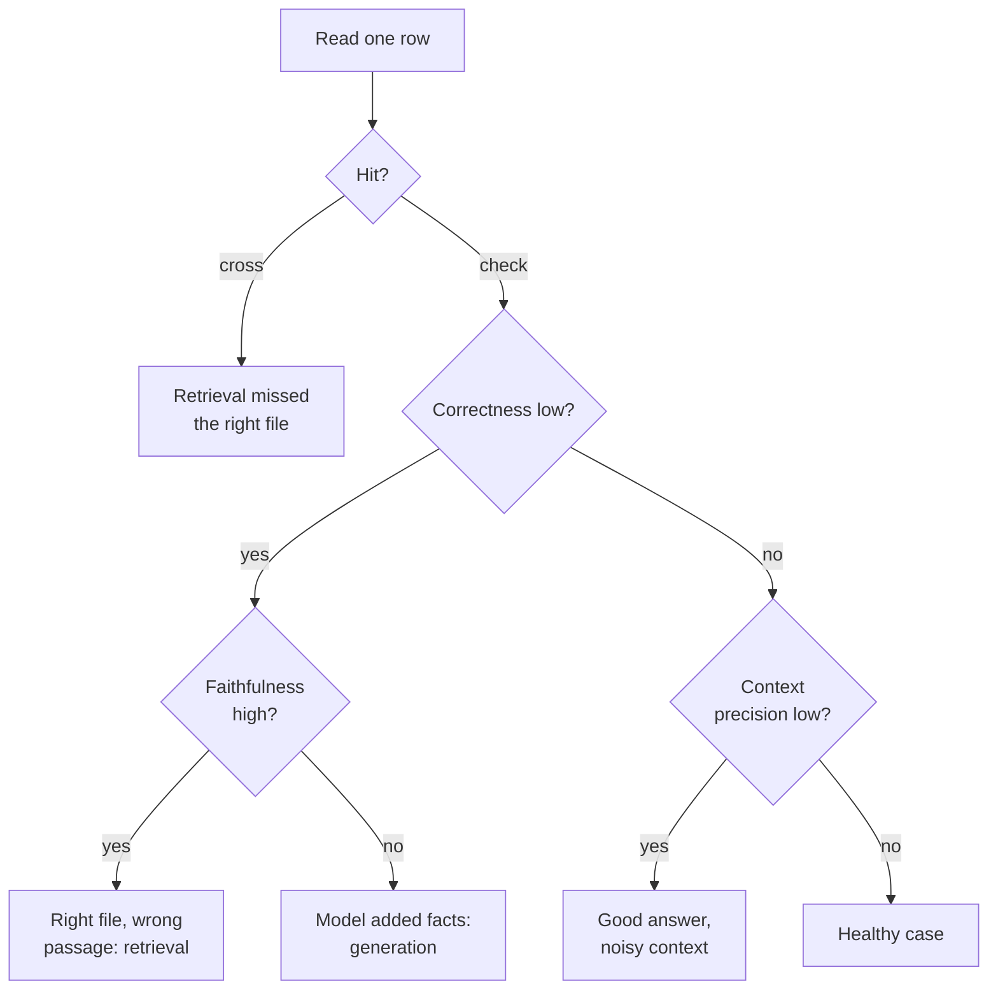
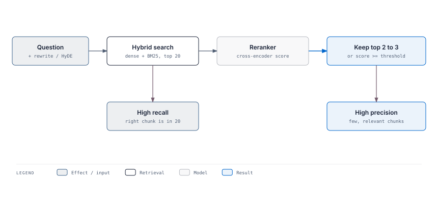

# 26. Reading the Evaluation Report

In this doc:

- How to explain the report to someone in two minutes
- What "0.79" means and how it is calculated, step by step
- How to read the test case table, row by row
- Why context precision is low in Naive RAG
- The top-k experiment: what happens when we retrieve fewer or more chunks
- Ways to increase context precision, ordered by effort
- Limits of the metric itself

Docs 24 and 25 explain how answers are graded and how runs work. This doc is about reading the numbers and acting on them. All numbers below come from real runs on this project's index (4 RAG papers, `hr_policy.md` and one CV, 410 chunks).

## The two-minute explanation

Explain RAG as an **open-book exam**:

- The **librarian** (the retriever) reads the question and brings a few pages from the library (the top-k chunks from FAISS).
- The **student** (gpt-4o-mini) writes an answer using only those pages.
- The **examiner** (the LLM judge) grades every answer with the official **answer key** (the reference answer).

<table width="100%">
<thead><tr><th>Metric</th><th>Exam question it answers</th><th>Who it grades</th></tr></thead>
<tbody>
<tr><td>Hit</td><td>Did the librarian bring at least one page from the right book?</td><td>Retriever</td></tr>
<tr><td>Faithfulness</td><td>Did the student write only what is on the pages, without inventing anything?</td><td>Generator</td></tr>
<tr><td>Answer relevance</td><td>Did the student answer the question that was asked?</td><td>Generator</td></tr>
<tr><td>Context precision</td><td>Of all the pages the librarian brought, how many were actually useful?</td><td>Retriever</td></tr>
<tr><td>Correctness</td><td>Does the answer match the answer key?</td><td>Whole pipeline</td></tr>
<tr><td>Overall</td><td>The average grade of one answer (or of the whole exam)</td><td>Everything</td></tr>
</tbody>
</table>

The one-sentence summary of the current report:

> The student is honest and on topic (faithfulness 0.98, relevance 1.00), the right book is almost always found (hit rate 100 percent at top 6), but most of the pages the librarian brings are not useful (context precision 0.32), and on 3 questions the useful page was missing, so the answers were incomplete.

## What 0.79 means

**0.79 is an average grade, not "79 percent of answers are correct".** It is built in two steps.

**Step 1, one case.** The case overall is the mean of the metrics that apply to it. For `rag-variants` in the run with top 6:

$$\text{overall}_{case} = \frac{1.00 + 1.00 + 0.17 + 0.75}{4} = 0.73$$

**Step 2, the run.** The run overall is the mean of the 11 case overalls:

<table width="100%">
<thead><tr><th>Case</th><th>Overall</th><th>Case</th><th>Overall</th></tr></thead>
<tbody>
<tr><td>rag-variants</td><td>0.73</td><td>crag-incorrect</td><td>0.83</td></tr>
<tr><td>rag-components</td><td>0.60</td><td>adaptive-routing</td><td>0.88</td></tr>
<tr><td>rag-corpus</td><td>0.65</td><td>hr-sick-days</td><td>0.79</td></tr>
<tr><td>selfrag-reflection</td><td>0.92</td><td>hr-new-joiner-leave</td><td>0.79</td></tr>
<tr><td>selfrag-when</td><td>0.79</td><td>out-of-scope</td><td>0.75</td></tr>
<tr><td>crag-evaluator</td><td>0.96</td><td><b>Sum</b></td><td><b>8.69</b></td></tr>
</tbody>
</table>

$$\text{overall}_{run} = \frac{8.69}{11} = 0.79$$

Other numbers on the summary card:

- **Passed: 8 of 11 (73 percent).** A case passes when its overall is 0.75 or higher. The three Fair cases (0.73, 0.60, 0.65) are the three RAG-paper questions.
- **Metric averages** are computed per metric over the cases. Context precision 0.32 is the mean of the Context column; correctness 0.86 the mean of the Correctness column.
- **Colors:** green is 0.75 and above (Good), amber 0.5 to 0.75 (Fair), red below 0.5 (Poor).

How to say it: "On our 11 test questions the pipeline averages 0.79 out of 1. Eight questions pass. Every answer is grounded in its sources, but retrieval brings mostly unrelated chunks, and three questions about the original RAG paper lose points because the key passage was not retrieved."

## Reading the table

Worked examples from the screenshot run (top 6):

<table width="100%">
<thead><tr><th>Case</th><th>Pattern</th><th>What happened</th></tr></thead>
<tbody>
<tr><td>crag-evaluator (0.96)</td><td>Healthy</td><td>5 of 6 chunks come from the CRAG paper and describe the evaluator; the answer matches the reference</td></tr>
<tr><td>hr-sick-days (0.79)</td><td>Good answer, noisy context</td><td>Perfect answer from chunk 1 (`hr_policy.md`), but the other 5 chunks are paper chunks, so precision is 1/6 = 0.17</td></tr>
<tr><td>rag-components (0.60)</td><td>Right file, wrong passage</td><td>4 of 6 chunks are from the RAG paper but only 1 is useful, and it does not name DPR and BART, so correctness is 0.50</td></tr>
<tr><td>rag-corpus (0.65)</td><td>Right file, wrong passage</td><td>The first 4 chunks come from the Corrective RAG paper, which mentions RAG's corpus only in passing; the Wikipedia detail is missing, correctness 0.25</td></tr>
<tr><td>out-of-scope (0.75)</td><td>Correct refusal</td><td>The system said it could not find the answer (faithfulness, relevance, correctness 1.00); precision is 0 because no chunk can be relevant to a question the documents cannot answer</td></tr>
</tbody>
</table>

Open a row on the Evals page to see the evidence for each conclusion: the answer next to the reference, the retrieved chunks with the relevant ones tagged, and the judge's reasons.

## Why context precision is low

Context precision = relevant retrieved chunks / retrieved chunks. Five things push it down in Naive RAG.

### 1. A fixed top k sets a ceiling

Naive RAG always returns exactly k chunks, whether one or ten are relevant. When only one chunk in the index holds the answer, the best possible precision is 1/k:

<table width="100%">
<thead><tr><th>Relevant chunks that exist</th><th>Best precision at top 2</th><th>at top 4</th><th>at top 6</th></tr></thead>
<tbody>
<tr><td>1 (for example `hr_policy.md`, a single chunk)</td><td>0.50</td><td>0.25</td><td>0.17</td></tr>
<tr><td>2</td><td>1.00</td><td>0.50</td><td>0.33</td></tr>
<tr><td>4 or more</td><td>1.00</td><td>1.00</td><td>0.67</td></tr>
</tbody>
</table>

That is why both HR cases show exactly 0.17 at top 6 although their answers are perfect. The metric is doing its job: 5 of the 6 chunks really were noise and cost tokens. But part of the low average is this ceiling, not bad ranking.

### 2. The documents share a vocabulary

Four of the files are papers about retrieval-augmented generation. "Retrieve", "documents", "generator" and "RAG" appear in all of them, so their embeddings sit close together. A question about the original RAG paper's corpus is semantically close to Corrective RAG's discussion of "static and limited corpora", and FAISS ranks those chunks first (all 4 top chunks of `rag-corpus` came from the CRAG paper).

### 3. Dense search alone misses exact names

Embeddings capture meaning, not exact tokens. "DPR" and "BART-large" are rare names that a keyword search would match exactly, but in embedding space the chunk that names them is not much closer than any chunk about retrievers and generators.

### 4. Chunks mix topics

Chunks are 1000 characters cut by length, not by section. One chunk can hold the end of one idea and the start of another, so its vector is a blend, and a chunk can be "about" the topic without containing the answer.

### 5. No second look at the candidates

Naive RAG trusts the first ranking. There is no reranker to re-read the candidates against the question and no score threshold to drop weak matches: chunk 6 with a cosine score of 0.55 is used just like chunk 1 with 0.65.

## The top-k experiment

The same 11 questions at three values of top k (changed from the Evals page header, no code change):

<table width="100%">
<thead><tr><th>Top k</th><th>Context precision</th><th>Hit rate</th><th>Correctness</th><th>Faithfulness</th><th>Overall</th><th>Passed</th><th>Cost</th></tr></thead>
<tbody>
<tr><td>2</td><td><b>0.50</b></td><td>80%</td><td>0.73</td><td>0.93</td><td>0.77</td><td>8</td><td>Rs 0.30</td></tr>
<tr><td>4 (default)</td><td>0.41</td><td>90%</td><td><b>0.86</b></td><td>0.96</td><td><b>0.81</b></td><td>9</td><td>Rs 0.43</td></tr>
<tr><td>6</td><td>0.32</td><td><b>100%</b></td><td><b>0.86</b></td><td>0.98</td><td>0.79</td><td>8</td><td>Rs 0.57</td></tr>
</tbody>
</table>

This is the classic **precision versus recall trade-off**:

- **Fewer chunks (top 2)** raise precision to 0.50, but the right passage falls out of the context more often: hit rate drops to 80 percent and correctness to 0.73. `rag-variants` got correctness 0 at top 2, because the chunk that names RAG-Sequence and RAG-Token was ranked third.
- **More chunks (top 6)** find the right file every time, but every extra chunk is usually noise, so precision falls to 0.32 and each question costs more tokens.
- **Top 4** is the best balance for Naive RAG here, which is why it is the default.

The lesson: **changing k alone cannot fix precision**, because the ranking itself is the problem. The relevant chunk is often in the top 6 but not in the top 2. The fix is to rank better, then keep fewer.

## Ways to increase context precision

The common pattern is **retrieve wide, then narrow**: get many candidates for recall, then keep only the chunks that truly answer the question.

<table width="100%">
<thead><tr><th>Technique</th><th>What it does</th><th>Fixes cause</th><th>Effort</th><th>Covered by</th></tr></thead>
<tbody>
<tr><td>Score threshold</td><td>Drop chunks whose cosine score is below a value (for example 0.5) or far below the top score (for example top minus 0.1); fewer, stronger chunks</td><td>1, 5</td><td>Small: a filter in the retriever</td><td>Settings change</td></tr>
<tr><td>Dynamic k</td><td>Keep chunks until the score drops sharply, so a one-chunk answer gets one chunk and a broad question gets more</td><td>1</td><td>Small</td><td>Settings change</td></tr>
<tr><td>Reranking</td><td>Retrieve 20, score each (question, chunk) pair with a cross-encoder (for example bge-reranker, Cohere Rerank, Azure AI Search semantic ranker), keep the best 2 to 3</td><td>2, 5</td><td>Medium: one extra model call</td><td>02. Advanced RAG</td></tr>
<tr><td>Hybrid search</td><td>Combine BM25 keyword search with dense search (for example reciprocal rank fusion), so exact names like DPR and BART are matched</td><td>3</td><td>Medium: a keyword index next to FAISS</td><td>Hybrid RAG</td></tr>
<tr><td>Contextual chunk headers</td><td>Prepend the document title and section to each chunk before embedding ("RAG-Lewis, 4 Experiments: ..."), so chunks from different papers stop looking alike</td><td>2, 4</td><td>Small: re-index</td><td>Advanced chunking</td></tr>
<tr><td>Better chunking</td><td>Split by section or meaning (semantic chunking), smaller chunks, or parent-child (search small chunks, send their parent section)</td><td>4</td><td>Medium: re-index</td><td>Advanced chunking</td></tr>
<tr><td>Metadata filtering and routing</td><td>Detect that a question is about one document ("Self-RAG", "HR policy") and search only that file</td><td>2</td><td>Medium</td><td>Modular / Adaptive RAG</td></tr>
<tr><td>Query rewriting, multi-query, HyDE</td><td>Rewrite the question, ask several variants, or embed a hypothetical answer, so the query vector lands closer to the answer chunks</td><td>2, 3</td><td>Medium: extra model call</td><td>02. Advanced RAG</td></tr>
<tr><td>Corrective retrieval</td><td>Grade retrieved chunks before generating and drop or replace irrelevant ones</td><td>5</td><td>Higher</td><td>Corrective RAG</td></tr>
<tr><td>Stronger embeddings</td><td>text-embedding-3-large (3072 dimensions) separates close topics better</td><td>2</td><td>Small: config and re-index, higher cost</td><td>Settings change</td></tr>
</tbody>
</table>

A sensible order: a score threshold first (cheap, immediate), then reranking (the biggest gain for most systems), then hybrid search for exact names, then chunking improvements. After each change, run the evaluation again and compare with the baseline run: context precision and correctness should rise together while hit rate stays at 90 to 100 percent. If precision rises but correctness falls, the change is throwing away useful chunks (the top 2 problem).

## Limits of the metric

Read context precision with these caveats:

<table width="100%">
<thead><tr><th>Limit</th><th>Effect in this report</th><th>Possible improvement</th></tr></thead>
<tbody>
<tr><td>Not rank-aware: a relevant chunk at position 1 counts the same as at position 6</td><td>The HR cases (relevant chunk ranked first) score as low as cases where it is ranked last</td><td>Rank-weighted average precision (as RAGAS does), which would give the HR cases 1.0</td></tr>
<tr><td>Out-of-scope questions always score 0 (nothing can be relevant)</td><td>Pulls the average down although the refusal was correct</td><td>Treat precision as "not applicable" when the case has no expected file</td></tr>
<tr><td>Capped at 1/k when only one chunk can be relevant</td><td>Short documents always look bad at large k</td><td>Report precision next to hit rate and correctness, never alone</td></tr>
<tr><td>The judge decides what is "relevant"</td><td>Small run-to-run differences (0.79 vs 0.81 overall with the same settings)</td><td>Treat differences under about 0.03 as noise; compare runs, not single cases</td></tr>
</tbody>
</table>

None of these change the main finding: in Naive RAG, generation is reliable and retrieval is the bottleneck. That is the problem the next architectures in this repository set out to solve, and this report is the baseline they will be measured against.
