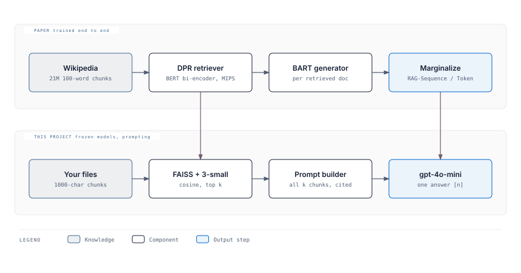

# 27. Research Paper to Code Mapping

In this doc:

- What "Naive RAG" means compared with the original RAG paper
- Every part of Lewis et al. 2020, section by section, and where it lives in the code
- What was adapted, what was not implemented, and why
- What this project adds that the paper does not have
- Interview questions about the paper and the implementation

The paper: Lewis et al., *Retrieval-Augmented Generation for Knowledge-Intensive NLP Tasks*, NeurIPS 2020 ([local PDF](../../02.%20Papers/2005.11401_RAG-Lewis.pdf), [section-by-section notes](../../01.%20Notes/02.%20Research%20Paper%20Explained/)).

## Naive RAG versus the paper's RAG

The paper introduced the **idea** (combine a parametric memory, the generator's weights, with a non-parametric memory, a searchable document index) and one **trained model** that implements it. Later work, starting with the RAG survey by Gao et al. 2023, named the simplest practical form of the idea **Naive RAG**: index documents, retrieve top-k chunks by vector similarity, put them in the prompt of a frozen LLM, generate. This project implements Naive RAG, so it keeps the paper's architecture and roles but replaces the trained parts with off-the-shelf models and prompting.

<table width="100%">
<thead><tr><th>Aspect</th><th>Paper (2020)</th><th>This project (Naive RAG)</th></tr></thead>
<tbody>
<tr><td>Knowledge</td><td>Wikipedia, December 2018, 21M passages of 100 words</td><td>Your uploaded files (PDF, Word, Excel, Markdown, text), 1000-character chunks with 150 overlap</td></tr>
<tr><td>Retriever</td><td>DPR: two BERT encoders, query encoder fine-tuned</td><td>Azure text-embedding-3-small for both chunks and questions, frozen</td></tr>
<tr><td>Index</td><td>FAISS HNSW, approximate MIPS</td><td>FAISS IndexFlatIP, exact search on normalised vectors (cosine)</td></tr>
<tr><td>Generator</td><td>BART-large (400M parameters), fine-tuned</td><td>gpt-4o-mini through Azure OpenAI, frozen, instructed by a prompt</td></tr>
<tr><td>How documents reach the generator</td><td>Each document is paired with the question separately; outputs are marginalised over documents</td><td>All k chunks are concatenated into one prompt; one answer is generated</td></tr>
<tr><td>Training</td><td>End-to-end: retriever and generator learn together from (question, answer) pairs</td><td>None; quality comes from the pre-trained models and the prompt</td></tr>
<tr><td>Provenance</td><td>A motivation of the paper, not shown to users</td><td>Every claim cites [n]; the UI opens the cited PDF page with the passage highlighted</td></tr>
<tr><td>Evaluation</td><td>Exact Match, BLEU, ROUGE, accuracy on public benchmarks</td><td>LLM judge (faithfulness, relevance, context precision, correctness) on an 11-question test set</td></tr>
</tbody>
</table>

Why not train the paper's model? It needs GPUs, a large labelled question-answer set and days of training, and it ties the system to one fixed generator. A frozen API model with retrieval gives most of the benefit with no training, updates instantly when documents change, and is how almost every production RAG system starts. Understanding the paper still matters: every later architecture in this repository improves one of the paper's components.

## Section by section

Status: **Implemented** (same idea, same role), **Adapted** (same role, different technique), **Not implemented** (with the reason).

### Section 1 and 2 overview: two kinds of memory

<table width="100%">
<thead><tr><th>Paper concept</th><th>Status</th><th>Where in the code</th><th>Notes</th></tr></thead>
<tbody>
<tr><td>Parametric memory (knowledge in the generator's weights)</td><td>Implemented</td><td><a href="../app/generation/generator.py">app/generation/generator.py</a></td><td>gpt-4o-mini's own knowledge; the prompt tells it to use only the context, so the parametric memory provides language skill, not facts</td></tr>
<tr><td>Non-parametric memory (an index the model can read)</td><td>Implemented</td><td><a href="../app/vectorstore/faiss_store.py">app/vectorstore/faiss_store.py</a>, <a href="../app/services/vector_store.py">app/services/vector_store.py</a></td><td>FAISS index plus the chunk texts and metadata, saved in data/index</td></tr>
<tr><td>Retrieved document as a latent variable z</td><td>Adapted</td><td><a href="../app/retrieval/retriever.py">app/retrieval/retriever.py</a></td><td>The top-k chunks are treated as fixed context, not as a variable to sum over</td></tr>
</tbody>
</table>

### Section 2.1: RAG-Sequence and RAG-Token

<table width="100%">
<thead><tr><th>Paper concept</th><th>Status</th><th>Why</th></tr></thead>
<tbody>
<tr><td>RAG-Sequence: p(y|x) = sum over z of p(z|x) p(y|x,z), same document for the whole answer</td><td>Not implemented</td><td>Needs one generation per retrieved document and the probability of each full answer. Chat APIs return text, not sequence probabilities, and it would cost k times more calls</td></tr>
<tr><td>RAG-Token: marginalise over documents at every token</td><td>Not implemented</td><td>Needs per-token probabilities from k parallel generations; not possible with a chat API</td></tr>
<tr><td>What replaces them</td><td>Adapted</td><td>Context concatenation in <a href="../app/generation/prompts.py">app/generation/prompts.py</a>: the LLM reads all k chunks at once and combines them in one answer, which is what large LLMs do well</td></tr>
</tbody>
</table>

The concatenation approach is close in spirit to Fusion-in-Decoder (Izacard and Grave 2021), which the RAG survey identifies as the practical successor: the generator attends to all passages together instead of marginalising over them.

### Section 2.2: Retriever (DPR)

<table width="100%">
<thead><tr><th>Paper concept</th><th>Status</th><th>Where in the code</th><th>Notes</th></tr></thead>
<tbody>
<tr><td>Document encoder d(z), run once over the corpus</td><td>Adapted</td><td><a href="../app/embeddings/embedder.py">app/embeddings/embedder.py</a> embed_texts, called by <a href="../app/services/ingestion_service.py">app/services/ingestion_service.py</a></td><td>text-embedding-3-small, batches of 100 chunks, 1536 dimensions</td></tr>
<tr><td>Query encoder q(x)</td><td>Adapted</td><td>embed_query in <a href="../app/embeddings/embedder.py">app/embeddings/embedder.py</a></td><td>Same model as the document encoder (DPR uses two separate BERTs)</td></tr>
<tr><td>Score p(z|x) proportional to exp(d(z) . q(x)), inner product</td><td>Implemented</td><td><a href="../app/vectorstore/faiss_store.py">app/vectorstore/faiss_store.py</a> search</td><td>IndexFlatIP on L2-normalised vectors, so the inner product equals cosine similarity; the score is logged and shown on every source card</td></tr>
<tr><td>MIPS: top-k by maximum inner product</td><td>Implemented</td><td><a href="../app/retrieval/retriever.py">app/retrieval/retriever.py</a></td><td>Exact search (flat index) instead of approximate HNSW: our index has 410 chunks, the paper's 21 million</td></tr>
<tr><td>Bi-encoder: documents encoded independently, offline</td><td>Implemented</td><td>Ingestion pipeline (API doc 12)</td><td>Vectors are computed once per upload and saved; a question costs one embedding call (about 10 tokens)</td></tr>
<tr><td>k = 5 or 10 retrieved documents</td><td>Adapted</td><td>TOP_K in <a href="../app/core/config.py">app/core/config.py</a> (default 4), per request top_k</td><td>Our chunks are about 1.5 times longer than the paper's 100-word passages, so 4 chunks give a similar amount of context</td></tr>
<tr><td>Fine-tuning the query encoder</td><td>Not implemented</td><td>-</td><td>API embedding models cannot be fine-tuned here; retrieval quality is improved later with rewriting, hybrid search and reranking instead</td></tr>
</tbody>
</table>

### Section 2.3: Generator (BART)

<table width="100%">
<thead><tr><th>Paper concept</th><th>Status</th><th>Where in the code</th><th>Notes</th></tr></thead>
<tbody>
<tr><td>Seq2seq generator conditioned on input x and document z</td><td>Adapted</td><td><a href="../app/generation/generator.py">app/generation/generator.py</a></td><td>Chat completion with gpt-4o-mini; temperature 0 and max 800 tokens from settings</td></tr>
<tr><td>Input = question concatenated with the document</td><td>Adapted</td><td><a href="../app/generation/prompts.py">app/generation/prompts.py</a> build_messages</td><td>User message = numbered context blocks with source labels, then the question; system message = rules (use only the context, cite [n], say when the answer is missing)</td></tr>
</tbody>
</table>

### Section 2.4: Training

<table width="100%">
<thead><tr><th>Paper concept</th><th>Status</th><th>Why</th></tr></thead>
<tbody>
<tr><td>Joint training of query encoder and generator by minimising negative log-likelihood of the answer</td><td>Not implemented</td><td>Naive RAG uses frozen models by definition; needs GPUs and labelled data</td></tr>
<tr><td>No supervision on which document to retrieve</td><td>Not applicable</td><td>We do not train, but the idea reappears in our evaluation: the judge decides which chunks were relevant without labels</td></tr>
<tr><td>Frozen document encoder and index (no re-indexing during training)</td><td>Implemented in spirit</td><td>Chunk vectors are computed once and never recomputed unless a file is re-uploaded</td></tr>
</tbody>
</table>

### Section 2.5: Decoding

<table width="100%">
<thead><tr><th>Paper concept</th><th>Status</th><th>Notes</th></tr></thead>
<tbody>
<tr><td>Beam search per document; "Thorough" and "Fast" decoding for RAG-Sequence</td><td>Not implemented</td><td>The chat API decodes; temperature 0 gives near-deterministic answers (LLM_TEMPERATURE in config.py)</td></tr>
</tbody>
</table>

### Section 3: Experiments

<table width="100%">
<thead><tr><th>Paper concept</th><th>Status</th><th>Where in the code</th><th>Notes</th></tr></thead>
<tbody>
<tr><td>Wikipedia split into disjoint 100-word chunks</td><td>Adapted</td><td><a href="../app/ingestion/chunker.py">app/ingestion/chunker.py</a></td><td>Recursive character splitter (paragraph, line, sentence, word), 1000 characters, 150 overlap, so sentences are not cut and context carries across chunks</td></tr>
<tr><td>Document titles kept with passages</td><td>Adapted</td><td><a href="../app/ingestion/loaders/">app/ingestion/loaders/</a>, source_label in prompts.py</td><td>Each chunk keeps source file, page or sheet; the label "file.pdf, page 3" is put above the chunk in the prompt</td></tr>
<tr><td>Index built once with FAISS</td><td>Implemented</td><td>faiss_store.py save and load</td><td>Loaded at startup (API doc 21 startup summary)</td></tr>
<tr><td>Tasks: open-domain QA, abstractive QA, Jeopardy, FEVER</td><td>Adapted</td><td><a href="../app/evals/testset.json">app/evals/testset.json</a></td><td>One task, question answering over your documents, with 11 test cases</td></tr>
<tr><td>Metrics: Exact Match, BLEU, ROUGE-L, accuracy</td><td>Adapted</td><td><a href="../app/evals/judge.py">app/evals/judge.py</a></td><td>LLM judge metrics, because free-form answers to document questions are judged by meaning, not exact strings (API doc 24)</td></tr>
</tbody>
</table>

### Section 4: Results and additional results

<table width="100%">
<thead><tr><th>Paper finding</th><th>Status</th><th>Where</th><th>What we observed</th></tr></thead>
<tbody>
<tr><td>RAG answers are more factual and specific than a closed-book model</td><td>Reproduced in spirit</td><td>Faithfulness 0.93 to 0.98 (API doc 25)</td><td>Answers stay grounded in the retrieved chunks; out-of-scope questions are refused</td></tr>
<tr><td>Index hot-swapping: replace the index to update world knowledge without retraining</td><td>Implemented</td><td>POST and DELETE /documents (<a href="../app/api/routes/documents.py">app/api/routes/documents.py</a>), remove_source in faiss_store.py</td><td>Uploading or deleting a file changes what the system knows in about a second; no model change</td></tr>
<tr><td>Retrieving more documents helps up to a point (Figure 3)</td><td>Reproduced</td><td>top-k experiment, API doc 26</td><td>Top 2, 4, 6: hit rate 80, 90, 100 percent; precision 0.50, 0.41, 0.32; best overall at 4</td></tr>
<tr><td>Learned retrieval beats BM25 for most tasks (Table 6)</td><td>Not yet</td><td>Planned in 03. Hybrid Search RAG</td><td>Our failure on exact names (DPR, BART) suggests combining both</td></tr>
<tr><td>Generation diversity (Table 5)</td><td>Not applicable</td><td>-</td><td>Not a goal for factual QA; temperature 0</td></tr>
</tbody>
</table>

### Sections 6 and 7: Discussion and broader impact

<table width="100%">
<thead><tr><th>Paper point</th><th>How the project addresses it</th><th>Where</th></tr></thead>
<tbody>
<tr><td>Provenance: knowing where an answer came from</td><td>Citations [n] required by the prompt; citation chips; PDF opens at the cited page with highlights</td><td>prompts.py, UI docs 06 and 07</td></tr>
<tr><td>Hallucination risk</td><td>"Use only the context" rule, fixed not-found answer, faithfulness metric</td><td>prompts.py, judge.py</td></tr>
<tr><td>Future work: better retrieval, joint pre-training</td><td>The next 21 architectures in this repository, measured with the same evaluation</td><td>Doc 28</td></tr>
</tbody>
</table>

## What this project adds beyond the paper

<table width="100%">
<thead><tr><th>Addition</th><th>Why it matters</th><th>Docs</th></tr></thead>
<tbody>
<tr><td>Loaders for PDF, Excel, Word, Markdown, text</td><td>Real documents are not clean Wikipedia text</td><td>04 to 08</td></tr>
<tr><td>Not-found answer and citation rules</td><td>Safe behaviour when the documents lack the answer</td><td>15</td></tr>
<tr><td>Structured logs with retrieved chunks and scores</td><td>See exactly what the retriever returned and why an answer looks wrong</td><td>21</td></tr>
<tr><td>Token and cost tracking in USD and INR</td><td>Production systems are judged on cost per question</td><td>22</td></tr>
<tr><td>Document management (view, chunks, delete)</td><td>Index hot-swapping as a user feature</td><td>23</td></tr>
<tr><td>LLM-judge evaluation and test set runs</td><td>A repeatable score to compare every later architecture</td><td>24 to 26</td></tr>
<tr><td>React UI with PDF citations and analytics</td><td>Makes provenance usable</td><td>UI docs 01 to 11</td></tr>
</tbody>
</table>

## Interview questions

<table width="100%">
<thead><tr><th>Question</th><th>Short answer</th></tr></thead>
<tbody>
<tr><td>What problem did the RAG paper solve?</td><td>LLMs store knowledge in weights: hard to update, no provenance, hallucinations. RAG adds a searchable non-parametric memory that the generator reads, so knowledge can be updated and traced</td></tr>
<tr><td>Difference between RAG-Sequence and RAG-Token?</td><td>RAG-Sequence uses one document for the whole answer and sums over documents per answer; RAG-Token can switch documents at every token and sums per token</td></tr>
<tr><td>Why is the retriever a bi-encoder?</td><td>Documents are encoded once offline; a query needs one encoding plus a fast inner-product search. A cross-encoder would have to run on every (query, document) pair at query time</td></tr>
<tr><td>Is your system the paper's RAG?</td><td>No. It is Naive RAG: same architecture, but frozen embedding and chat models, concatenated context instead of marginalisation, and no training</td></tr>
<tr><td>Why cosine with IndexFlatIP?</td><td>On L2-normalised vectors the inner product equals cosine similarity; flat (exact) search is fast enough for thousands of chunks, HNSW or IVF would be used for millions</td></tr>
<tr><td>What is index hot-swapping and do you support it?</td><td>Changing the knowledge by changing the index, without retraining. Yes: upload or delete a file and answers change immediately</td></tr>
<tr><td>Why chunks of 1000 characters with overlap instead of 100 words?</td><td>Overlap keeps sentences that cross a boundary retrievable; slightly longer chunks keep more context for a strong LLM. The trade-off is less precise retrieval, which our context precision metric shows</td></tr>
<tr><td>How do you know retrieval works?</td><td>Retrieval hit rate (expected file retrieved) and context precision (share of useful chunks), measured on a fixed test set</td></tr>
</tbody>
</table>
