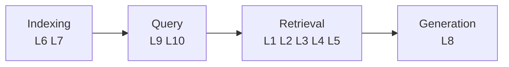
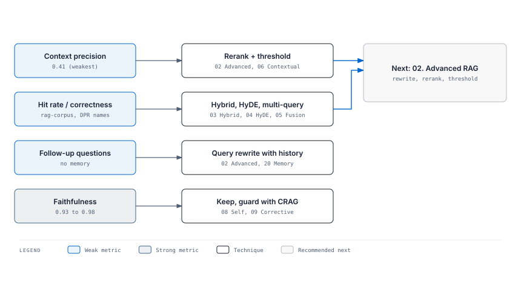

# 28. Naive RAG Limitations, Lessons and Next Steps

In this doc:

- Is the Naive RAG implementation complete? What is in scope and what is not
- The evaluation results in one place (the baseline scoreboard)
- Every limitation we measured, with the evidence from evals and logs, its root cause and its fix
- What Naive RAG does well
- Why move to the next architecture, which one, and what score it should reach
- How to compare architectures fairly
- Interview preparation: the 30-second explanation, a project story with numbers, and common questions

This doc closes the Naive RAG implementation. It builds on docs 24 to 26 (evaluation) and 27 (paper to code).

## Is Naive RAG complete?

Yes. The full Naive RAG pattern is implemented end to end, from file upload to a cited answer, with evaluation, cost tracking, logs and a UI.

<table width="100%">
<thead><tr><th>Stage</th><th>Implemented</th><th>API docs</th><th>UI</th></tr></thead>
<tbody>
<tr><td>Load</td><td>PDF (per page), Excel (per sheet), Word, Markdown, text</td><td>04 to 08</td><td>Upload queue</td></tr>
<tr><td>Chunk</td><td>Recursive splitter, 1000 characters, 150 overlap, metadata kept</td><td>09</td><td>Chunk list, pipeline card</td></tr>
<tr><td>Embed</td><td>Azure text-embedding-3-small, batched</td><td>10</td><td>Ingestion step timings</td></tr>
<tr><td>Index</td><td>FAISS IndexFlatIP, cosine, saved to disk, add and delete</td><td>11, 23</td><td>Documents page</td></tr>
<tr><td>Retrieve</td><td>Top-k similarity search</td><td>14</td><td>Source cards with scores</td></tr>
<tr><td>Augment</td><td>Grounded prompt with numbered, labelled chunks and rules</td><td>15</td><td>-</td></tr>
<tr><td>Generate</td><td>gpt-4o-mini, temperature 0, citations, not-found answer</td><td>16, 17</td><td>Chat, citation chips, PDF panel</td></tr>
<tr><td>Serve</td><td>FastAPI: query, documents, analytics, evals, health</td><td>13, 18, 20, 23</td><td>All pages</td></tr>
<tr><td>Observe</td><td>Structured logs, tokens, cost in USD and INR</td><td>21, 22</td><td>Analytics, sidebar</td></tr>
<tr><td>Evaluate</td><td>LLM judge, test set runs, reports</td><td>24 to 26</td><td>Evaluate button, Evals page</td></tr>
</tbody>
</table>

Deliberately **not** part of Naive RAG (each belongs to a later architecture or to deployment):

<table width="100%">
<thead><tr><th>Not included</th><th>Why</th><th>Where it comes</th></tr></thead>
<tbody>
<tr><td>Query rewriting, reranking, score thresholds</td><td>These are the definition of Advanced RAG</td><td>02. Advanced RAG</td></tr>
<tr><td>Keyword (BM25) search</td><td>Naive RAG is dense-only</td><td>03. Hybrid Search RAG</td></tr>
<tr><td>Conversation memory (follow-up questions)</td><td>Naive RAG answers each question independently</td><td>02. Advanced RAG (conversational rewriting), 20. Memory RAG</td></tr>
<tr><td>Multi-step or iterative retrieval</td><td>Naive RAG retrieves once</td><td>10. Adaptive RAG, 11. Active Iterative RAG</td></tr>
<tr><td>Answer streaming, authentication, rate limits, Docker, OCR for scanned PDFs</td><td>Production hardening, not retrieval quality</td><td>Can be added to any architecture later</td></tr>
<tr><td>The paper's trained model (RAG-Sequence, RAG-Token, joint training)</td><td>Needs GPUs and training data; Naive RAG uses frozen models</td><td>Explained in doc 27</td></tr>
</tbody>
</table>

## The evaluation in one paragraph

Every answer is graded by an LLM judge (gpt-4o-mini, JSON mode, temperature 0) on four metrics: **faithfulness** (are the claims supported by the retrieved chunks?), **answer relevance** (does it answer the question?), **context precision** (what share of the retrieved chunks is useful?) and **correctness** (does it match a reference answer?). The **retrieval hit rate** checks whether the expected file was retrieved at all. A run asks 11 fixed test questions (8 about four RAG papers, 2 about an HR policy, 1 that the documents cannot answer) and averages the scores. Details: docs 24 (judge), 25 (runs), 26 (reading the report).

## Baseline scoreboard

All runs on the same index (410 chunks, 6 files) and the same test set:

<table width="100%">
<thead><tr><th>Run</th><th>Top k</th><th>Overall</th><th>Faithful</th><th>Relevant</th><th>Precision</th><th>Correct</th><th>Hit rate</th><th>Passed</th><th>Cost</th></tr></thead>
<tbody>
<tr><td>1</td><td>4</td><td>0.79</td><td>0.93</td><td>0.98</td><td>0.41</td><td>0.84</td><td>90%</td><td>9/11</td><td>Rs 0.43</td></tr>
<tr><td>2</td><td>4</td><td>0.81</td><td>0.95</td><td>1.00</td><td>0.41</td><td>0.86</td><td>90%</td><td>9/11</td><td>Rs 0.43</td></tr>
<tr><td>3</td><td>6</td><td>0.79</td><td>0.98</td><td>1.00</td><td>0.32</td><td>0.86</td><td>100%</td><td>8/11</td><td>Rs 0.57</td></tr>
<tr><td>4</td><td>2</td><td>0.77</td><td>0.93</td><td>0.93</td><td>0.50</td><td>0.73</td><td>80%</td><td>8/11</td><td>Rs 0.30</td></tr>
<tr><td>5</td><td>4</td><td>0.79</td><td>0.95</td><td>0.95</td><td>0.41</td><td>0.84</td><td>90%</td><td>9/11</td><td>Rs 0.43</td></tr>
</tbody>
</table>

**Naive RAG baseline (top 4, mean of runs 1, 2, 5): overall 0.80, faithfulness 0.95, relevance 0.98, context precision 0.41, correctness 0.85, hit rate 90 percent, about Rs 0.02 and 1.7 s per question.** Every later architecture is compared against this line.

In words: the **generator is reliable**, the **retriever is the bottleneck**.

## Limitations we measured

Each limitation below comes from our own runs or logs, not from theory.

### L1. Most retrieved chunks are noise (context precision 0.41)

- **Evidence:** on average fewer than half of the 4 chunks are useful. In the logs (API doc 21), the question "What is the hotel limit per night?" retrieved the right chunk with score 0.524 and three unrelated chunks with scores of about 0.14, and all four were sent to the model.
- **Root cause:** Naive RAG always returns exactly k chunks. There is no minimum score and no second look at the candidates.
- **Cost of it:** about 59 percent of the context chunks in every prompt are useless, which is most of the roughly 1,000 prompt tokens each question pays for, and noise can distract the model.
- **Fix:** score threshold or dynamic k (cheap), reranking with a cross-encoder (best gain). **Architecture:** 02. Advanced RAG.

### L2. The precision-recall trade-off cannot be solved by k alone

- **Evidence:** top 2 gives precision 0.50 but hit rate 80 percent and correctness 0.73; top 6 gives hit rate 100 percent but precision 0.32 (scoreboard runs 3 and 4).
- **Root cause:** the ranking is not good enough: the useful chunk is often in the top 6 but not in the top 2.
- **Fix:** retrieve wide (20 candidates) for recall, then rerank and keep 2 to 3 for precision. **Architecture:** 02. Advanced RAG.

### L3. Similar documents confuse dense search

- **Evidence:** `rag-corpus` ("What document collection does RAG retrieve from?") retrieved four chunks from the Corrective RAG paper and none from the RAG paper at top 4 (hit = no, correctness 0 to 0.25). Four of the six files discuss retrieval-augmented generation with the same words.
- **Root cause:** embeddings capture topic, so chunks from papers on the same topic sit close together; a chunk that mentions "RAG's corpus" in passing ranks above the one that defines it.
- **Fix:** contextual chunk headers (prepend the document title and section before embedding), metadata filtering (route the question to the right document), reranking. **Architecture:** 06. Contextual Chunking RAG, 02. Advanced RAG, 22. Modular RAG (routing).

### L4. Exact names and terms are missed

- **Evidence:** `rag-components` found the RAG paper but not the passage naming DPR and BART-large, so correctness was 0.25 to 0.50 although faithfulness was high.
- **Root cause:** rare names and acronyms carry little weight in an embedding; a keyword search would match "DPR" exactly.
- **Fix:** hybrid search (BM25 plus dense, fused with reciprocal rank fusion), query expansion. **Architecture:** 03. Hybrid Search RAG, 05. RAG Fusion.

### L5. Similarity score is not usefulness

- **Evidence:** for "How does Self-RAG decide when to retrieve?", the top chunk (score 0.601) was a results table ("SelfRAG-LLaMA2-7b PopQA CRAG 54.9 59.8 ...") with no answer; the chunk the model actually cited was ranked 4th (0.582). The scores of all four chunks were within 0.02 of each other.
- **Root cause:** a bi-encoder compares two independent vectors; it cannot read the question and the chunk together.
- **Fix:** a cross-encoder reranker reads (question, chunk) pairs and orders them by real relevance. **Architecture:** 02. Advanced RAG.

### L6. Fixed-size chunks ignore document structure

- **Evidence:** the HR policy is one chunk, so with top 4 the best possible precision is 0.25 even when the answer is perfect (`hr-sick-days`: correctness 1.0, precision 0.25). Paper chunks mix the end of one section with the start of the next.
- **Root cause:** splitting by character count, not by meaning or section.
- **Fix:** structure-aware or semantic chunking, parent-child chunks, contextual headers; dynamic k. **Architecture:** 06. Contextual Chunking RAG, 07. RAPTOR RAG (hierarchical summaries).

### L7. PDF extraction noise reaches the index

- **Evidence:** chunks such as "SELF -RAG : L EARNING TO RETRIEVE" (small caps split by the PDF parser), tables flattened into rows of numbers, and LaTeX-like fragments that appeared verbatim in one answer.
- **Root cause:** plain text extraction (pypdf) loses layout, tables and formulas.
- **Fix:** layout-aware parsing (tables as Markdown, formulas kept), cleaning rules, OCR for scanned pages. **Architecture:** 18. Multimodal RAG for figures and tables; better loaders can be added to any architecture.

### L8. No verification after retrieval

- **Evidence:** when retrieval missed (`rag-corpus`), the model still answered with what it had (faithfulness 0.5 to 0.75, correctness 0 to 0.25) instead of saying the context was insufficient or searching again.
- **Root cause:** Naive RAG trusts whatever it retrieved and generates once.
- **Fix:** grade retrieved chunks before generating and correct or re-retrieve (Corrective RAG), or let the model decide when to retrieve and critique itself (Self-RAG). **Architecture:** 09. Corrective RAG, 08. Self RAG.

### L9. Each question stands alone

- **Evidence:** in the chat history, a follow-up question that referred to the previous answer with a pronoun ("is he ...") was answered without knowing who "he" was, because only the follow-up text was embedded and searched.
- **Root cause:** Naive RAG has no conversation state; retrieval uses only the latest message.
- **Fix:** rewrite the follow-up into a standalone question using the chat history before retrieval; long-term memory. **Architecture:** 02. Advanced RAG (conversational query rewriting), 20. Memory RAG.

### L10. One retrieval step cannot answer multi-hop questions

- **Evidence:** not yet measured: all 11 test cases are single-hop. Questions like "How does Self-RAG's retrieval decision differ from Adaptive-RAG's routing?" need chunks from two documents and reasoning over both.
- **Root cause:** one query vector, one search.
- **Fix:** query decomposition, iterative retrieval, graph-based retrieval. **Architecture:** 10. Adaptive RAG, 11. Active Iterative RAG, 13. Graph RAG. **Test set action:** add multi-hop and follow-up cases before evaluating those architectures.

### Summary by pipeline stage

<table width="100%">
<thead><tr><th>Stage</th><th>Limitations</th><th>Metric that shows it</th></tr></thead>
<tbody>
<tr><td>Indexing</td><td>L6 fixed chunks, L7 extraction noise</td><td>Context precision, correctness</td></tr>
<tr><td>Query</td><td>L9 no memory, L10 single hop</td><td>Correctness (needs new test cases)</td></tr>
<tr><td>Retrieval</td><td>L1 noise, L2 k trade-off, L3 similar docs, L4 exact names, L5 score is not usefulness</td><td>Context precision, hit rate, correctness</td></tr>
<tr><td>Generation</td><td>L8 no verification</td><td>Faithfulness on missed-retrieval cases</td></tr>
</tbody>
</table>

## What Naive RAG does well

- **Grounded answers:** faithfulness 0.93 to 0.98; the model rarely adds facts that are not in the chunks.
- **Honest refusals:** the out-of-scope question scored 1.0 on faithfulness, relevance and correctness every time.
- **Easy questions are solved:** single-fact questions whose answer sits in one distinctive chunk (CRAG evaluator, Self-RAG reflection tokens, HR policy) score 0.8 to 1.0.
- **Cheap and fast:** about Rs 0.02 and 1.7 s per question; ingestion of a 30-page paper costs about Rs 0.05.
- **Instant updates:** add or delete a file and the answers change, no training.

That is why Naive RAG is the right baseline: it works for simple questions over clean documents, and its failures are measurable and specific.

## Why move to the next architecture

The scores say exactly where to invest: generation is already near the ceiling (faithfulness 0.95, relevance 0.98), so a bigger chat model would add cost but little quality. Retrieval is at 0.41 precision and 90 percent hit rate, so **every point of improvement now comes from retrieval**.

### Recommended next: 02. Advanced RAG

Advanced RAG keeps the Naive RAG pipeline and adds three kinds of optimisation around retrieval:

<table width="100%">
<thead><tr><th>Stage</th><th>Technique</th><th>Fixes</th><th>Expected effect</th></tr></thead>
<tbody>
<tr><td>Pre-retrieval</td><td>Query rewriting (and standalone rewriting of follow-ups with chat history)</td><td>L3, L9</td><td>Better query vectors; follow-ups work</td></tr>
<tr><td>Retrieval</td><td>Retrieve 20 candidates instead of 4</td><td>L2</td><td>Hit rate towards 100 percent</td></tr>
<tr><td>Post-retrieval</td><td>Cross-encoder reranking, keep top 3; score threshold</td><td>L1, L2, L5</td><td>Context precision up sharply; fewer prompt tokens</td></tr>
</tbody>
</table>

**Target for Advanced RAG on the same test set:**

<table width="100%">
<thead><tr><th>Metric</th><th>Naive RAG baseline</th><th>Target</th></tr></thead>
<tbody>
<tr><td>Context precision</td><td>0.41</td><td>0.65 or higher</td></tr>
<tr><td>Correctness</td><td>0.85</td><td>0.90 or higher</td></tr>
<tr><td>Hit rate</td><td>90%</td><td>95 to 100%</td></tr>
<tr><td>Faithfulness</td><td>0.95</td><td>stay at 0.95 or higher</td></tr>
<tr><td>Overall</td><td>0.80</td><td>0.85 or higher</td></tr>
<tr><td>Cost per question</td><td>Rs 0.02</td><td>under Rs 0.04 (rewriting and reranking add calls, fewer chunks save prompt tokens)</td></tr>
<tr><td>Answer time</td><td>1.7 s</td><td>under 3 s</td></tr>
</tbody>
</table>

### The roadmap after that

<table width="100%">
<thead><tr><th>Next</th><th>Main idea</th><th>Targets</th></tr></thead>
<tbody>
<tr><td>03. Hybrid Search RAG</td><td>BM25 plus dense search, rank fusion</td><td>L4 exact names: correctness on name-heavy questions</td></tr>
<tr><td>04. HyDE RAG, 05. RAG Fusion</td><td>Embed a hypothetical answer; search several query variants and fuse</td><td>L3, hit rate</td></tr>
<tr><td>06. Contextual Chunking RAG</td><td>Chunk with document and section context</td><td>L3, L6: precision</td></tr>
<tr><td>08. Self RAG, 09. Corrective RAG</td><td>Grade retrieval and answers, re-retrieve or refuse</td><td>L8: faithfulness and correctness when retrieval fails</td></tr>
<tr><td>10. Adaptive RAG, 11. Active Iterative RAG</td><td>Choose no, single or multi-step retrieval per question</td><td>L10: multi-hop questions, cost on easy questions</td></tr>
<tr><td>13. Graph RAG and later</td><td>Entities and relations across documents</td><td>Global and cross-document questions</td></tr>
</tbody>
</table>

## Comparing architectures fairly

1. **Same test set, same judge, same index.** Only the pipeline changes.
2. **Change one thing at a time** (for example reranking alone, then rewriting), so each gain is attributable.
3. **Run at least twice;** the same settings moved overall between 0.79 and 0.81 here, so treat differences under about 0.03 as noise.
4. **Read precision, hit rate and correctness together.** Precision up with correctness down means useful chunks are being thrown away (the top-2 problem).
5. **Track cost and latency next to quality;** a gain that triples cost may not be worth it.
6. **Grow the test set** with multi-hop, follow-up and exact-name questions as the architectures that target them arrive, keeping the original 11 for continuity.

## Interview preparation

### Explain Naive RAG in 30 seconds

"An LLM only knows what was in its training data. RAG gives it an open book: we split documents into chunks, turn each chunk into an embedding vector and store them in a vector index. For a question, we embed it, find the most similar chunks by cosine similarity, put them into the prompt and ask the LLM to answer only from them, with citations. Naive RAG is the simplest version: one retrieval, fixed top-k, no reranking. It is cheap and grounded, and its main weakness is retrieval quality."

### Project story with numbers

- **Situation:** build a RAG system from scratch that answers questions over research papers and company documents with verifiable citations.
- **Task:** implement Naive RAG end to end and measure it, as the baseline for more advanced architectures.
- **Action:** FastAPI backend with loaders for five file types, recursive chunking, Azure text-embedding-3-small, FAISS, gpt-4o-mini with a citation prompt; React UI that opens the cited PDF page with the passage highlighted; structured logs, cost tracking in rupees; an LLM-judge evaluation with an 11-question test set.
- **Result:** faithfulness 0.95 and correct refusals, overall 0.80 at about Rs 0.02 per answer; the evaluation showed context precision of only 0.41 and pinpointed retrieval (similar documents, exact names, fixed top-k) as the bottleneck, which defines the next step: reranking and query rewriting.

### Common questions

<table width="100%">
<thead><tr><th>Question</th><th>Answer</th></tr></thead>
<tbody>
<tr><td>How do you evaluate a RAG system?</td><td>Separate retrieval and generation. Retrieval: hit rate, context precision (and recall if relevant chunks are labelled). Generation: faithfulness and answer relevance. End to end: correctness against reference answers. Use a fixed test set and an LLM judge with a strict rubric at temperature 0, and spot-check the judge by hand</td></tr>
<tr><td>Faithfulness versus correctness?</td><td>Faithfulness asks whether the answer is supported by the retrieved context; correctness asks whether it matches the truth. A faithful answer can be wrong if retrieval brought the wrong chunks (our rag-corpus case)</td></tr>
<tr><td>Why is context precision low in Naive RAG?</td><td>Fixed top-k always fills k slots; similar documents and rare names confuse dense search; the bi-encoder score does not reflect usefulness. Also a metric effect: with one relevant chunk, precision is capped at 1/k</td></tr>
<tr><td>How do you choose top k?</td><td>Measure it: we ran 2, 4 and 6. More chunks raise recall (hit rate 80 to 100 percent) and cost, fewer raise precision; 4 was best overall. Better: retrieve many and rerank to a few</td></tr>
<tr><td>Bi-encoder versus cross-encoder?</td><td>A bi-encoder embeds question and chunk separately: fast, used for search over the whole index. A cross-encoder reads them together: accurate but slow, so it reranks only the top 20 to 50 candidates</td></tr>
<tr><td>Why hybrid search?</td><td>Dense search matches meaning, BM25 matches exact words such as names, codes and acronyms; fusing both (reciprocal rank fusion) fixes cases like "DPR" and "BART"</td></tr>
<tr><td>How do you choose chunk size?</td><td>Large enough to hold a complete idea, small enough to be specific. We used 1000 characters with 150 overlap; the HR file shows the downside of one-size-fits-all. Evaluate a few sizes on the test set; consider structure-aware chunking</td></tr>
<tr><td>How do you stop hallucinations?</td><td>Instruct the model to use only the context and to say when the answer is missing, require citations, keep temperature low, measure faithfulness, and add retrieval grading (Corrective RAG) when retrieval is weak</td></tr>
<tr><td>Risks of LLM-as-a-judge?</td><td>Judge bias and run-to-run variation (we saw 0.79 versus 0.81), sensitivity to the prompt, and cost. Mitigate with a strict rubric, discrete score levels, JSON output, temperature 0, computing what can be computed (precision from chunk lists), and human spot checks</td></tr>
<tr><td>What does a question cost and how would you reduce it?</td><td>About 1,000 prompt tokens and 100 answer tokens, Rs 0.02 with gpt-4o-mini. Most prompt tokens are context, and 59 percent of the chunks are noise, so reranking to fewer chunks reduces cost while raising quality; caching repeated questions helps too</td></tr>
<tr><td>When is RAG the wrong tool?</td><td>When the knowledge fits in the prompt (use long context or caching), when the task is reasoning without external facts, or when answers need aggregation over the whole corpus (use structured queries or Graph RAG)</td></tr>
<tr><td>Why not fine-tune instead of RAG?</td><td>Fine-tuning teaches style and skills but is a poor way to add changing facts: it is costly to update, gives no citations and can still hallucinate. RAG updates instantly and cites sources; the two can be combined</td></tr>
<tr><td>How would you scale this to millions of chunks?</td><td>Approximate indexes (HNSW or IVF-PQ in FAISS, or a managed vector database), metadata filters, batching and caching embeddings, async ingestion with a queue, and a reranker to keep quality</td></tr>
</tbody>
</table>
