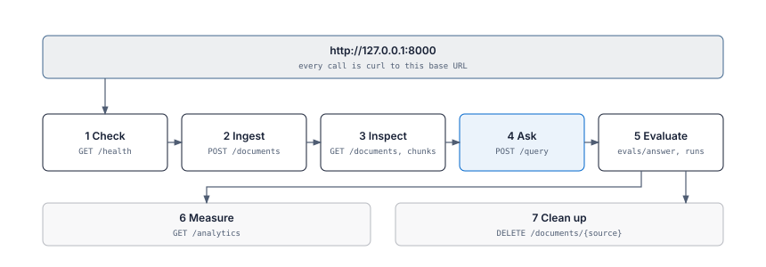
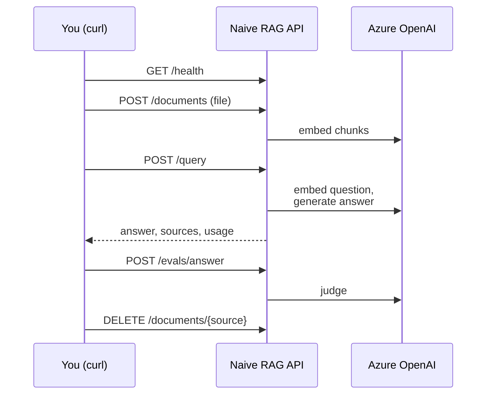

# 29. End to End curl Guide

In this doc:

- What you need before calling the API
- Every endpoint in the order a new user calls them, with the curl command, what it does and a real response
- Errors you can get and what they mean
- One script that runs the whole flow
- Tips for reading and saving responses

All responses below are real, from the running Naive RAG API (gpt-4o-mini, text-embedding-3-small, FAISS) with the six project documents indexed, plus a small demo file uploaded and removed again. Long fields are shortened with `jq`.



## Before You Start

<table width="100%">
<thead><tr><th>Need</th><th>How</th></tr></thead>
<tbody>
<tr><td>API running</td><td>From 01. Naive RAG/03. API: <code>.venv/bin/uvicorn app.main:app --reload</code> (port 8000)</td></tr>
<tr><td>Azure settings</td><td>Root .env with AZURE_OPENAI_ENDPOINT, AZURE_OPENAI_API_KEY, AZURE_OPENAI_DEPLOYMENT_NAME, AZURE_OPENAI_EMBEDDING_DEPLOYMENT (doc 02)</td></tr>
<tr><td>curl</td><td>Installed on macOS and Linux; on Windows use Git Bash or WSL</td></tr>
<tr><td>jq (optional)</td><td>Pretty-prints and filters JSON: <code>brew install jq</code> or <code>apt install jq</code>. Without jq, add nothing: curl prints raw JSON</td></tr>
</tbody>
</table>

Set the base URL once so every command is short:

```bash
BASE=http://127.0.0.1:8000
```

The interactive docs at http://127.0.0.1:8000/docs show the same endpoints and let you try them in the browser.



## 1. Check the API: GET /health

```bash
curl -s $BASE/health | jq .
```

```json
{
  "status": "ok",
  "app_name": "Naive RAG API",
  "version": "0.1.0",
  "config": { "azure_chat": true, "azure_embeddings": true },
  "pipeline": {
    "chat_model": "gpt-4o-mini",
    "embedding_model": "text-embedding-3-small",
    "embedding_dimensions": 1536,
    "chunk_size": 1000,
    "chunk_overlap": 150,
    "top_k": 4
  }
}
```

- `config` says whether the Azure chat and embedding settings are filled in (true/false only; secrets are never returned). If either is false, fix the .env before anything else.
- `pipeline` shows the models and chunking settings the API runs with.

## 2. Upload a File: POST /documents

The file is sent as multipart form data in a field named `file` (`-F "file=@path"`). PDF, Excel (.xlsx), Word (.docx), Markdown and text are supported.

```bash
curl -s -X POST $BASE/documents -F "file=@travel_policy.md" | jq .
```

```json
{
  "source": "travel_policy.md",
  "documents": 1,
  "chunks": 1,
  "total_chunks": 411,
  "embedding_tokens": 110,
  "cost_usd": 0.000002,
  "steps": [
    { "name": "load", "ms": 0 },
    { "name": "chunk", "ms": 0 },
    { "name": "embed", "ms": 1261 },
    { "name": "store", "ms": 1 },
    { "name": "save", "ms": 6 }
  ]
}
```

<table width="100%">
<thead><tr><th>Field</th><th>Meaning</th></tr></thead>
<tbody>
<tr><td>source</td><td>File name, used as its id in every other call</td></tr>
<tr><td>documents</td><td>Parts loaded (pages of a PDF, sheets of a workbook, 1 for Markdown)</td></tr>
<tr><td>chunks, total_chunks</td><td>Chunks from this file, and in the whole index after the upload</td></tr>
<tr><td>embedding_tokens, cost_usd</td><td>What embedding this file cost</td></tr>
<tr><td>steps</td><td>Time of each ingestion step; embedding is the slow one</td></tr>
</tbody>
</table>

Uploading the same file name again returns 409 (already indexed); delete it first to replace it.

## 3. Inspect the Index

### List the documents: GET /documents

```bash
curl -s $BASE/documents | jq '{count: (.documents | length), first: .documents[0]}'
```

```json
{
  "count": 7,
  "first": {
    "source": "2005.11401_RAG-Lewis.pdf",
    "file_type": "pdf",
    "parts": 19,
    "chunks": 91,
    "size_bytes": 885323,
    "uploaded_at": "2026-11-20T07:41:17+00:00"
  }
}
```

### Read the chunks of one file: GET /documents/{source}/chunks

```bash
curl -s $BASE/documents/travel_policy.md/chunks | jq '{source, count: (.chunks | length), first: .chunks[0]}'
```

```json
{
  "source": "travel_policy.md",
  "count": 1,
  "first": {
    "chunk_index": 0,
    "page": null,
    "sheet": null,
    "text": "# Travel Policy 2026\n\n## 1. Booking\n\nEmployees book flights through the company travel portal ..."
  }
}
```

This is exactly the text the retriever can find; checking it is the first step when an answer misses something.

### Download the original file: GET /documents/{source}/file

```bash
curl -s -o travel_policy_copy.md $BASE/documents/travel_policy.md/file
curl -s -o /dev/null -w "status=%{http_code} type=%{content_type} bytes=%{size_download}\n" $BASE/documents/travel_policy.md/file
```

```text
status=200 type=text/markdown; charset=utf-8 bytes=474
```

The UI uses this endpoint to show PDFs. File names with spaces must be URL-encoded (`my%20file.pdf`).

## 4. Ask a Question: POST /query

```bash
curl -s -X POST $BASE/query \
  -H "Content-Type: application/json" \
  -d '{"question": "What is the daily meal allowance abroad?"}' | jq .
```

```json
{
  "answer": "The daily meal allowance abroad is USD 60. Receipts are not needed for the daily allowance. [1]",
  "sources": [
    { "number": 1, "label": "travel_policy.md", "score": 0.4626, "text": "...", "source": "travel_policy.md", "page": null },
    { "number": 2, "label": "hr_policy.md", "score": 0.2356, "...": "..." },
    { "number": 3, "label": "2310.11511_Self-RAG.pdf, page 22", "score": 0.2148, "...": "..." },
    { "number": 4, "label": "2310.11511_Self-RAG.pdf, page 30", "score": 0.1894, "...": "..." }
  ],
  "usage": {
    "embedding_tokens": 8,
    "prompt_tokens": 632,
    "completion_tokens": 23,
    "cost_usd": 0.000109,
    "cost_inr": 0.0091,
    "latency_ms": 1574
  }
}
```

<table width="100%">
<thead><tr><th>Field</th><th>Meaning</th></tr></thead>
<tbody>
<tr><td>answer</td><td>Written only from the retrieved chunks; [1] cites source 1</td></tr>
<tr><td>sources</td><td>The top_k chunks sent to the model, with cosine similarity (score), file and page</td></tr>
<tr><td>usage</td><td>Tokens, cost in USD and rupees, total time</td></tr>
</tbody>
</table>

Notice sources 2 to 4: they are unrelated to travel but are always sent, because Naive RAG sends a fixed top 4. This is the low context precision that Advanced RAG fixes (doc 28).

### Choose the number of chunks: top_k

```bash
curl -s -X POST $BASE/query \
  -H "Content-Type: application/json" \
  -d '{"question": "When must expense claims be submitted?", "top_k": 2}' \
  | jq '{answer, sources: [.sources[] | .label], cost_inr: .usage.cost_inr}'
```

```json
{
  "answer": "Expense claims must be submitted within 30 days after the trip, with all hotel and taxi receipts [1].",
  "sources": ["travel_policy.md", "2310.11511_Self-RAG.pdf, page 23"],
  "cost_inr": 0.0068
}
```

top_k is 1 to 20; fewer chunks cost less (Rs 0.0068 instead of Rs 0.0091).

## 5. Evaluate

### Grade one answer: POST /evals/answer

Send the question, the answer, the chunk texts it was given, and optionally a reference answer. This example reuses the saved query response:

```bash
curl -s -X POST $BASE/query -H "Content-Type: application/json" \
  -d '{"question": "What is the daily meal allowance abroad?"}' > query.json

jq '{question: "What is the daily meal allowance abroad?", answer: .answer,
     contexts: [.sources[].text], reference: "USD 60 per day abroad."}' query.json > eval.json

curl -s -X POST $BASE/evals/answer -H "Content-Type: application/json" -d @eval.json \
  | jq '{overall, faithfulness: .faithfulness.score, answer_relevance: .answer_relevance.score,
         context_precision: .context_precision.score, correctness: .correctness.score,
         relevant_chunks, cost_inr: .usage.cost_inr}'
```

```json
{
  "overall": 0.812,
  "faithfulness": 1.0,
  "answer_relevance": 1.0,
  "context_precision": 0.25,
  "correctness": 1.0,
  "relevant_chunks": [1],
  "cost_inr": 0.0173
}
```

The full response also has a one-line reason per metric. Context precision 0.25 means 1 of the 4 chunks was useful (doc 26 explains each metric).

### The test set: GET /evals/testset

```bash
curl -s $BASE/evals/testset | jq '{count: (.cases | length), first: .cases[0]}'
```

```json
{
  "count": 11,
  "first": {
    "id": "rag-variants",
    "question": "What are the two RAG model variants proposed by Lewis et al.?",
    "reference": "RAG-Sequence, which uses the same retrieved document ...",
    "expected_source": "2005.11401_RAG-Lewis.pdf"
  }
}
```

### Run an evaluation: POST /evals/runs, then poll

A run works in the background, so the POST returns at once (status 202). Send `case_ids` to run only some cases, `top_k` to change the number of chunks, or `{}` for all 11 cases (about Rs 0.4).

```bash
RUN_ID=$(curl -s -X POST $BASE/evals/runs -H "Content-Type: application/json" \
  -d '{"case_ids": ["hr-sick-days"]}' | jq -r .id)

# Poll every 2 seconds until the run is no longer "running"
while [ "$(curl -s $BASE/evals/runs/$RUN_ID | jq -r .status)" = "running" ]; do sleep 2; done

curl -s $BASE/evals/runs/$RUN_ID | jq '{id, status, completed, summary: {overall: .summary.overall,
  retrieval_hit_rate: .summary.retrieval_hit_rate, cost_inr: .summary.cost_inr}}'
```

```json
{
  "id": "1bf3340b39af",
  "status": "done",
  "completed": 1,
  "summary": { "overall": 0.812, "retrieval_hit_rate": 1.0, "cost_inr": 0.0293 }
}
```

`GET /evals/runs/{id}` also returns `results`: every case with its answer, sources, scores and reasons. Only one run can be active; a second POST while one runs returns 409.

### List runs: GET /evals/runs

```bash
curl -s $BASE/evals/runs | jq '.runs[] | {id, status, top_k, overall: .summary.overall}'
```

Runs are listed newest first, without their results (doc 25).

## 6. Measure Cost: GET /analytics

```bash
curl -s $BASE/analytics | jq '{totals, days: (.daily | length), recent: (.recent | length), usd_to_inr}'
```

```json
{
  "totals": {
    "queries": 34,
    "ingestions": 8,
    "evals": 123,
    "embedding_tokens": 95511,
    "prompt_tokens": 176839,
    "completion_tokens": 15958,
    "total_tokens": 288308,
    "cost_usd": 0.038011,
    "avg_query_latency_ms": 2851
  },
  "days": 2,
  "recent": 50,
  "usd_to_inr": 84.0
}
```

Every query, ingestion, evaluation question and judge call is recorded (doc 22). `daily` has one point per day and `recent` the last 50 runs.

## 7. Clean Up: DELETE /documents/{source}

```bash
curl -s -X DELETE $BASE/documents/travel_policy.md | jq .
```

```json
{ "source": "travel_policy.md", "removed_chunks": 1 }
```

The file and its chunks are removed and the FAISS index is rebuilt from the remaining chunks (doc 23).

## Errors

<table width="100%">
<thead><tr><th>Status</th><th>When</th><th>Example body</th></tr></thead>
<tbody>
<tr><td>404</td><td>Unknown file name or run id</td><td>{"detail": "'travel_policy.md' is not indexed"}</td></tr>
<tr><td>409</td><td>Same file uploaded twice, or an evaluation run already active</td><td>{"detail": "..."}</td></tr>
<tr><td>400</td><td>Unsupported file type</td><td>{"detail": "Unsupported file type. Allowed: ..."}</td></tr>
<tr><td>422</td><td>Invalid input (empty question, top_k out of 1 to 20), or an uploaded file with no text</td><td>{"detail": [{"msg": "String should have at least 1 character", "loc": ["body", "question"]}]}</td></tr>
<tr><td>500</td><td>Azure settings missing or the model call failed</td><td>Check GET /health and the server log</td></tr>
</tbody>
</table>

A real validation error:

```bash
curl -s -w "\nstatus=%{http_code}\n" -X POST $BASE/query -H "Content-Type: application/json" -d '{"question": ""}'
```

```text
{"detail":[{"type":"string_too_short","loc":["body","question"],"msg":"String should have at least 1 character","input":"","ctx":{"min_length":1}}]}
status=422
```

## The Whole Flow in One Script

```bash
#!/bin/bash
BASE=http://127.0.0.1:8000
set -e

curl -s $BASE/health | jq '.config'
curl -s -X POST $BASE/documents -F "file=@travel_policy.md" | jq '{source, chunks, total_chunks}'
curl -s $BASE/documents/travel_policy.md/chunks | jq '.chunks | length'
curl -s -X POST $BASE/query -H "Content-Type: application/json" \
  -d '{"question": "What is the daily meal allowance abroad?"}' | tee query.json | jq '{answer, cost_inr: .usage.cost_inr}'
jq '{question: "What is the daily meal allowance abroad?", answer: .answer, contexts: [.sources[].text]}' query.json \
  | curl -s -X POST $BASE/evals/answer -H "Content-Type: application/json" -d @- | jq '{overall}'
curl -s $BASE/analytics | jq '.totals.cost_usd'
curl -s -X DELETE $BASE/documents/travel_policy.md | jq .
```

`-d @-` reads the request body from the pipe, so the evaluation request is built from the query response without a temporary file.

## Tips

<table width="100%">
<thead><tr><th>Tip</th><th>Command</th></tr></thead>
<tbody>
<tr><td>See status code and timing</td><td><code>curl -s -o /dev/null -w "%{http_code} %{time_total}s\n" ...</code></td></tr>
<tr><td>See request and response headers</td><td><code>curl -v ...</code></td></tr>
<tr><td>Only the answer text</td><td><code>... | jq -r .answer</code></td></tr>
<tr><td>Save a response</td><td><code>... | tee response.json</code></td></tr>
<tr><td>Question with quotes or new lines</td><td>Write the JSON in a file and send <code>-d @request.json</code></td></tr>
<tr><td>Windows PowerShell</td><td>Use <code>curl.exe</code> and escape inner quotes, or send <code>-d @request.json</code></td></tr>
</tbody>
</table>

## Key Points

- Seven phases cover every endpoint: health, upload, inspect, query, evaluate, analytics, delete.
- Every response shown here is real; the demo file was uploaded and deleted, leaving the index as it was.
- Errors are JSON with a `detail` field and a clear status code; 422 explains which input field is wrong.
