# Naive RAG UI

A React app for the Naive RAG API: chat with your documents and open every citation at the exact passage in the PDF, upload and inspect documents, track LLM cost and token usage in rupees, and evaluate answer quality with an LLM judge.

Start with [docs/09. UI Architecture Overview](docs/09.%20UI%20Architecture%20Overview.md) for the big picture.


## Showcase

All screenshots are taken from the running app with real answers from the indexed papers (gpt-4o-mini, text-embedding-3-small, FAISS).

### 1. Ask a question

<table width="100%">
<thead><tr><th>Start screen</th><th>While the answer is prepared</th></tr></thead>
<tbody>
<tr><td>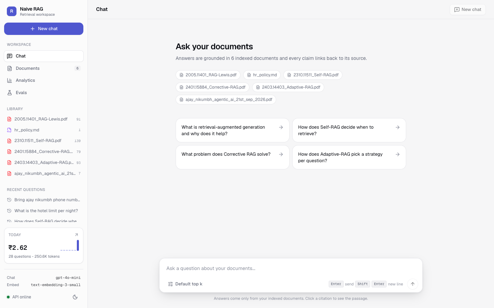</td><td>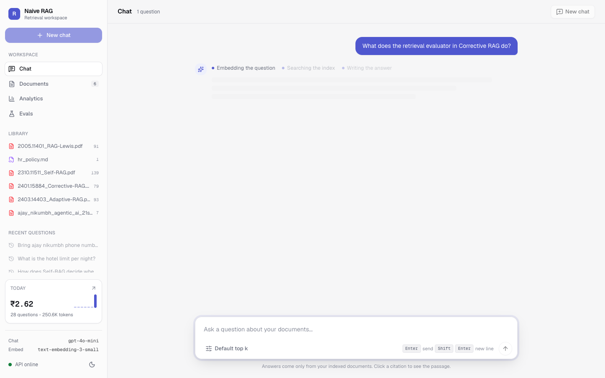</td></tr>
</tbody>
</table>

The start screen lists the indexed documents and starter questions. After Enter, the question appears at once and the pipeline steps (embed the question, search the index, write the answer) pulse until the answer arrives.

### 2. The answer with citations

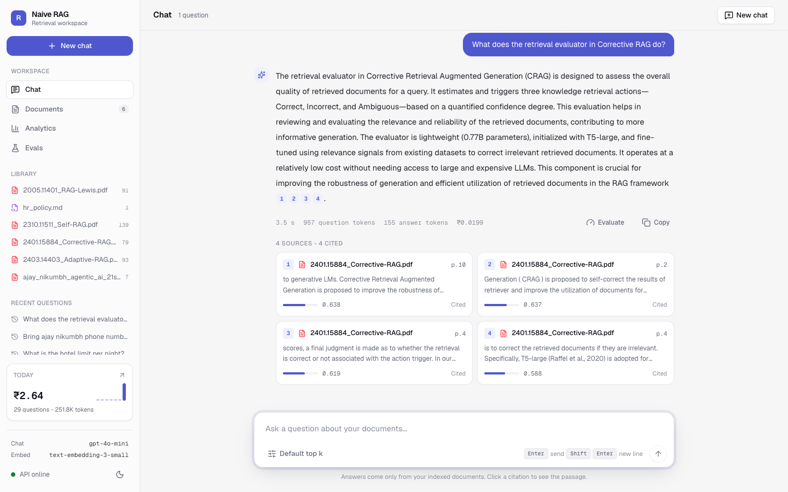

Each claim ends with a numbered citation chip. Under the answer: answer time, question tokens, answer tokens and the cost in rupees, then the four retrieved chunks as cards (cited first, uncited dimmed) with their similarity scores.

### 3. Open a citation

<table width="100%">
<thead><tr><th>Hover a chip: preview</th><th>Click a chip: the PDF opens at the cited passage</th></tr></thead>
<tbody>
<tr><td>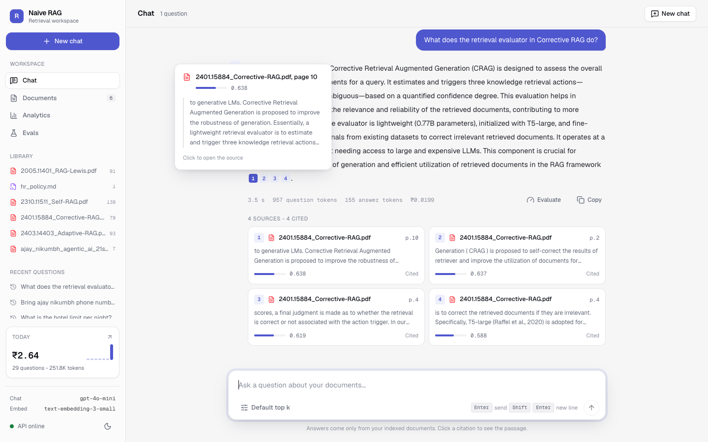</td><td></td></tr>
</tbody>
</table>

### 4. Evaluate the answer

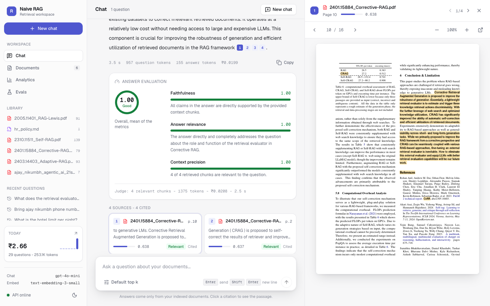

The Evaluate button sends the answer and its chunks to the LLM judge. The card shows the overall score, faithfulness, answer relevance and context precision with the judge's reasons and the cost of grading; source cards the judge found useful get a "Relevant" tag.

### 5. Dark mode

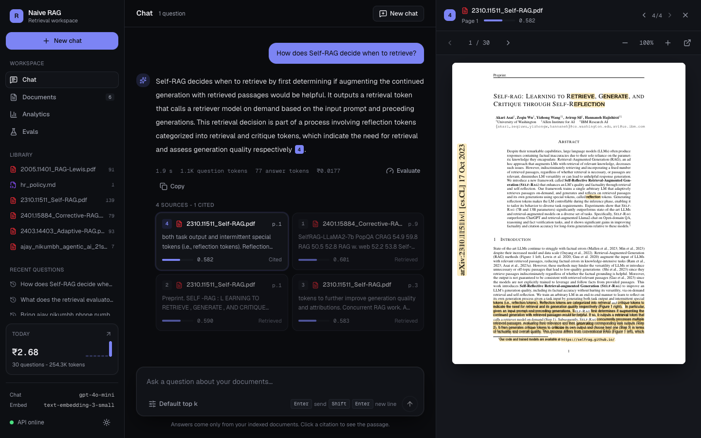

### 6. Documents and ingestion


<table width="100%">
<thead><tr><th>Upload: queue and pipeline breakdown</th><th>Open a file: PDF next to its chunks</th></tr></thead>
<tbody>
<tr><td></td><td>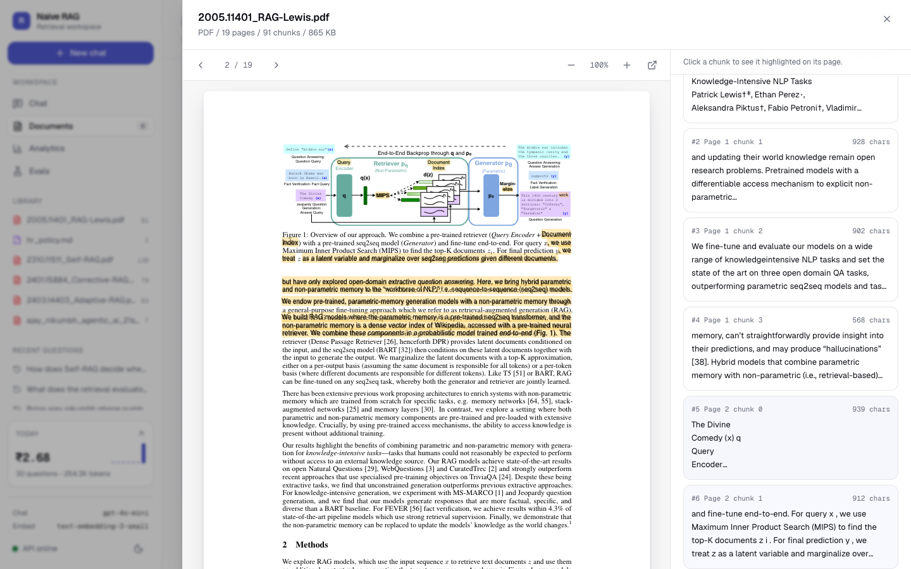</td></tr>
</tbody>
</table>

An upload shows every ingestion step (load, chunk, embed, store, save) with its time, plus chunks, tokens and cost. Opening a file shows the PDF and its chunks; clicking a chunk highlights it on its page.

### 7. Analytics

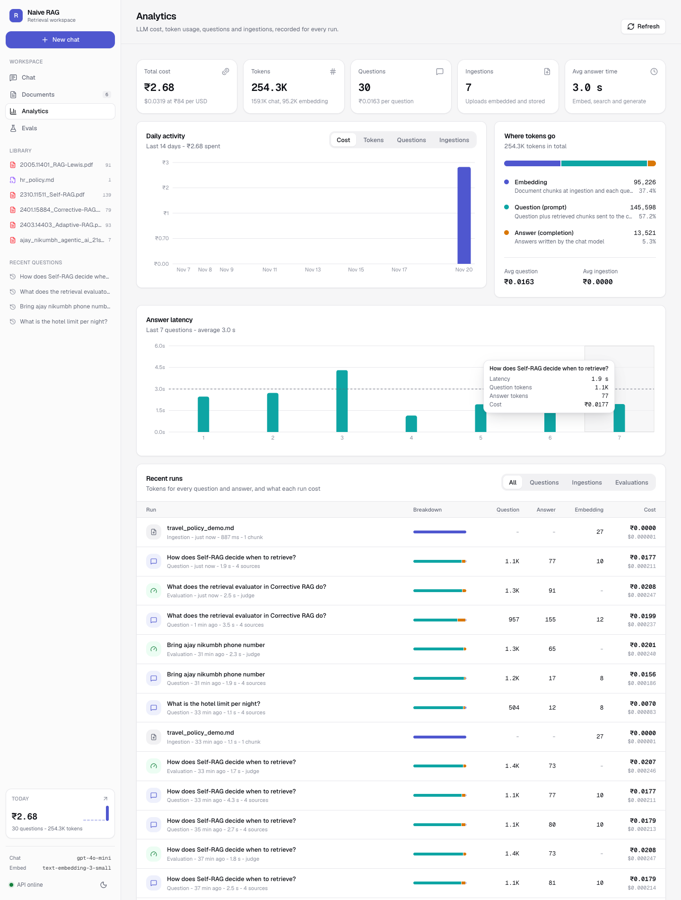

Total cost in rupees, tokens, questions, ingestions and answer time; daily activity; where the tokens go; latency per question; and every run with its question, answer and embedding tokens.

### 8. Evals: run the test set

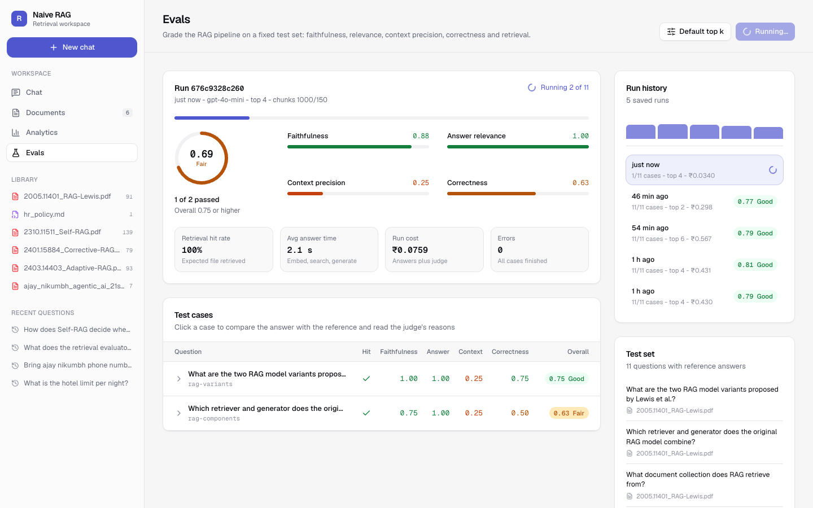

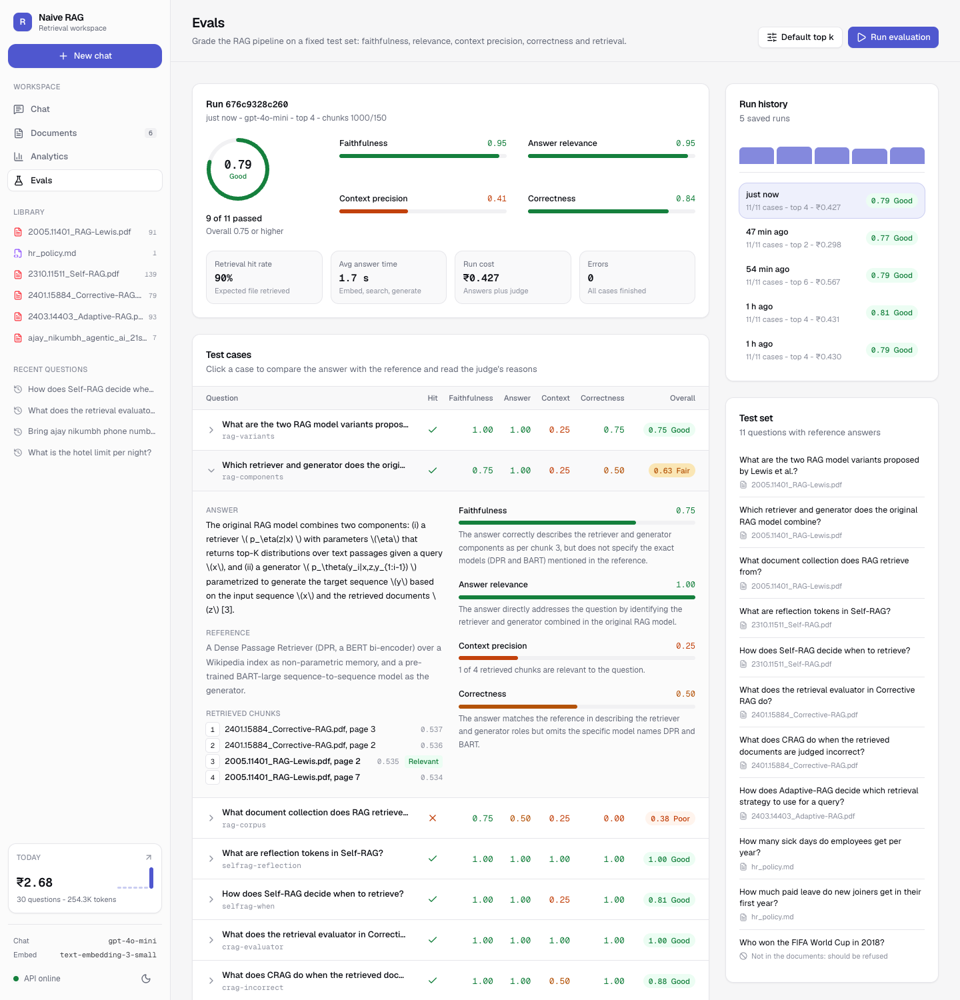

Run evaluation asks 11 test questions through the pipeline and grades each answer against a reference answer. Scores fill in case by case; the finished report shows the overall score, the four metric averages, the retrieval hit rate and cost, and each case opens to compare the answer with the reference and read the judge's reasons. How to read it: [API doc 26](../03.%20API/docs/26.%20Reading%20the%20Evaluation%20Report.md).

### 9. Sidebar and phone layout

<table width="100%">
<thead><tr><th>Sidebar</th><th>Phone</th></tr></thead>
<tbody>
<tr><td>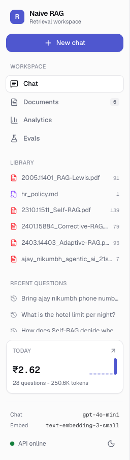</td><td>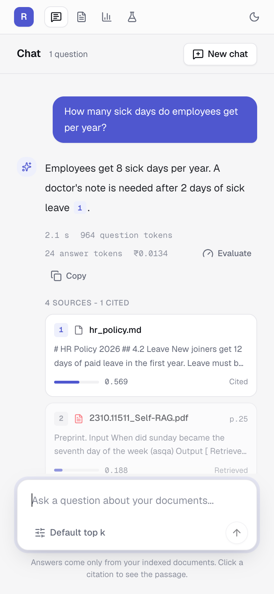</td></tr>
</tbody>
</table>

## Run

1. Start the API (from `01. Naive RAG/03. API`, see its README for setup):

```bash
.venv/bin/uvicorn app.main:app --reload
```

2. Start the UI (from this folder):

```bash
npm install
npm run dev
```

3. Open http://localhost:5173.

## Commands

<table width="100%">
<thead><tr><th>Command</th><th>What it does</th></tr></thead>
<tbody>
<tr><td>npm run dev</td><td>Dev server with hot reload; /api is proxied to FastAPI on port 8000</td></tr>
<tr><td>npm test</td><td>Unit tests (Vitest)</td></tr>
<tr><td>npm run lint</td><td>Lint (oxlint)</td></tr>
<tr><td>npm run build</td><td>Production build into dist/</td></tr>
</tbody>
</table>

## Features

<table width="100%">
<thead><tr><th>Feature</th><th>Where</th><th>Doc</th></tr></thead>
<tbody>
<tr><td>Markdown answers with citation chips, hover previews and per-answer cost</td><td>Chat</td><td>07</td></tr>
<tr><td>Click a citation to open the PDF at the cited page with the passage highlighted</td><td>Chat source panel</td><td>06, 07</td></tr>
<tr><td>Drag and drop upload queue with progress and ingestion step timings</td><td>Documents</td><td>05</td></tr>
<tr><td>Document table with search, delete, and a drawer with PDF and chunks</td><td>Documents</td><td>05, 06</td></tr>
<tr><td>Cost in rupees, question and answer tokens, latency and recent runs</td><td>Analytics</td><td>08</td></tr>
<tr><td>Evaluate any answer: faithfulness, relevance, context precision</td><td>Chat</td><td>10</td></tr>
<tr><td>Run the test set and compare runs: correctness, retrieval hit rate, cost</td><td>Evals</td><td>11</td></tr>
<tr><td>Light and dark themes, phone to wide-screen layouts</td><td>Everywhere</td><td>03, 09</td></tr>
</tbody>
</table>

## Docs

<table width="100%">
<thead><tr><th>Step</th><th>Doc</th></tr></thead>
<tbody>
<tr><td>01</td><td><a href="docs/01.%20UI%20Project%20Setup%20and%20Folder%20Structure.md">UI Project Setup and Folder Structure</a></td></tr>
<tr><td>02</td><td><a href="docs/02.%20API%20Client.md">API Client</a></td></tr>
<tr><td>03</td><td><a href="docs/03.%20Design%20System.md">Design System</a></td></tr>
<tr><td>04</td><td><a href="docs/04.%20App%20Shell%2C%20Routing%20and%20Data%20Layer.md">App Shell, Routing and Data Layer</a></td></tr>
<tr><td>05</td><td><a href="docs/05.%20Documents%20and%20Ingestion.md">Documents and Ingestion</a></td></tr>
<tr><td>06</td><td><a href="docs/06.%20PDF%20Viewer%20and%20Document%20Drawer.md">PDF Viewer and Document Drawer</a></td></tr>
<tr><td>07</td><td><a href="docs/07.%20Chat%20with%20Citations.md">Chat with Citations</a></td></tr>
<tr><td>08</td><td><a href="docs/08.%20Analytics%20Dashboard.md">Analytics Dashboard</a></td></tr>
<tr><td>09</td><td><a href="docs/09.%20UI%20Architecture%20Overview.md">UI Architecture Overview</a></td></tr>
<tr><td>10</td><td><a href="docs/10.%20Answer%20Evaluation%20in%20Chat.md">Answer Evaluation in Chat</a></td></tr>
<tr><td>11</td><td><a href="docs/11.%20Evals%20Page.md">Evals Page</a></td></tr>
</tbody>
</table>
