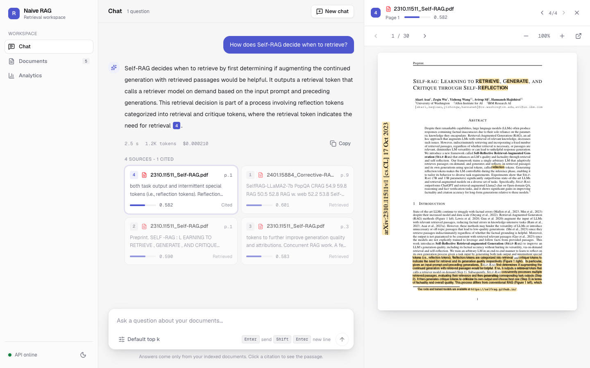

# Naive RAG UI

A React app for the Naive RAG API: chat with your documents and open every citation at the exact passage in the PDF, upload and inspect documents, and track LLM cost and token usage.

Start with [docs/09. UI Architecture Overview](docs/09.%20UI%20Architecture%20Overview.md) for the big picture.



## Run

1. Start the API (from `01. Naive RAG/03. API`, see its README for setup):

```bash
.venv/bin/uvicorn app.main:app --reload
```

2. Start the UI (from this folder):

```bash
npm install
npm run dev
```

3. Open http://localhost:5173.

## Commands

<table width="100%">
<thead><tr><th>Command</th><th>What it does</th></tr></thead>
<tbody>
<tr><td>npm run dev</td><td>Dev server with hot reload; /api is proxied to FastAPI on port 8000</td></tr>
<tr><td>npm test</td><td>Unit tests (Vitest)</td></tr>
<tr><td>npm run lint</td><td>Lint (oxlint)</td></tr>
<tr><td>npm run build</td><td>Production build into dist/</td></tr>
</tbody>
</table>

## Features

<table width="100%">
<thead><tr><th>Feature</th><th>Where</th><th>Doc</th></tr></thead>
<tbody>
<tr><td>Markdown answers with citation chips, hover previews and per-answer cost</td><td>Chat</td><td>07</td></tr>
<tr><td>Click a citation to open the PDF at the cited page with the passage highlighted</td><td>Chat source panel</td><td>06, 07</td></tr>
<tr><td>Drag and drop upload queue with progress and ingestion step timings</td><td>Documents</td><td>05</td></tr>
<tr><td>Document table with search, delete, and a drawer with PDF and chunks</td><td>Documents</td><td>05, 06</td></tr>
<tr><td>Cost, tokens, latency and recent runs</td><td>Analytics</td><td>08</td></tr>
<tr><td>Light and dark themes, phone to wide-screen layouts</td><td>Everywhere</td><td>03, 09</td></tr>
</tbody>
</table>

## Docs

<table width="100%">
<thead><tr><th>Step</th><th>Doc</th></tr></thead>
<tbody>
<tr><td>01</td><td><a href="docs/01.%20UI%20Project%20Setup%20and%20Folder%20Structure.md">UI Project Setup and Folder Structure</a></td></tr>
<tr><td>02</td><td><a href="docs/02.%20API%20Client.md">API Client</a></td></tr>
<tr><td>03</td><td><a href="docs/03.%20Design%20System.md">Design System</a></td></tr>
<tr><td>04</td><td><a href="docs/04.%20App%20Shell%2C%20Routing%20and%20Data%20Layer.md">App Shell, Routing and Data Layer</a></td></tr>
<tr><td>05</td><td><a href="docs/05.%20Documents%20and%20Ingestion.md">Documents and Ingestion</a></td></tr>
<tr><td>06</td><td><a href="docs/06.%20PDF%20Viewer%20and%20Document%20Drawer.md">PDF Viewer and Document Drawer</a></td></tr>
<tr><td>07</td><td><a href="docs/07.%20Chat%20with%20Citations.md">Chat with Citations</a></td></tr>
<tr><td>08</td><td><a href="docs/08.%20Analytics%20Dashboard.md">Analytics Dashboard</a></td></tr>
<tr><td>09</td><td><a href="docs/09.%20UI%20Architecture%20Overview.md">UI Architecture Overview</a></td></tr>
</tbody>
</table>
